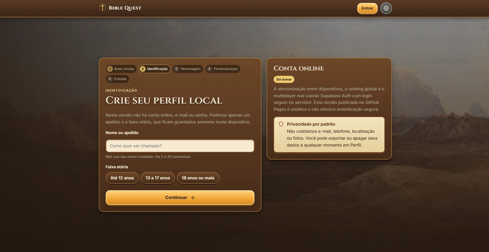
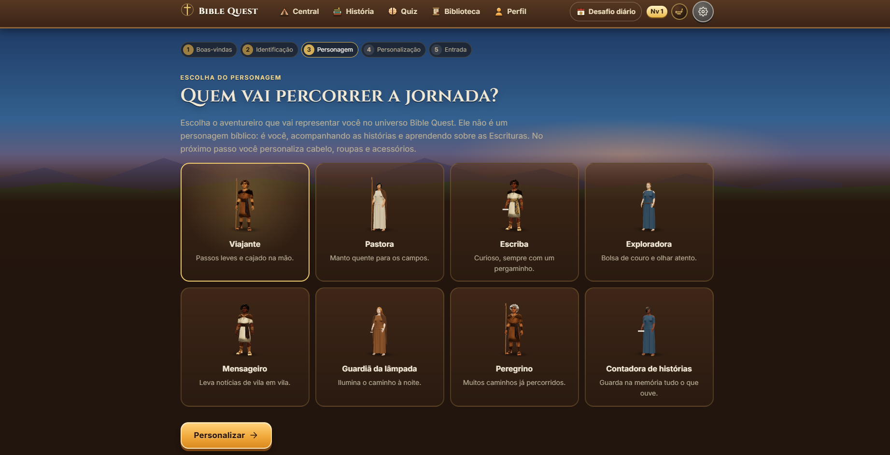
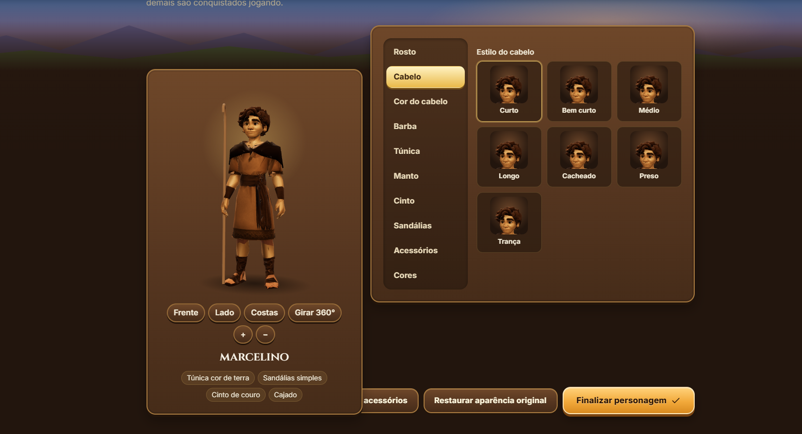
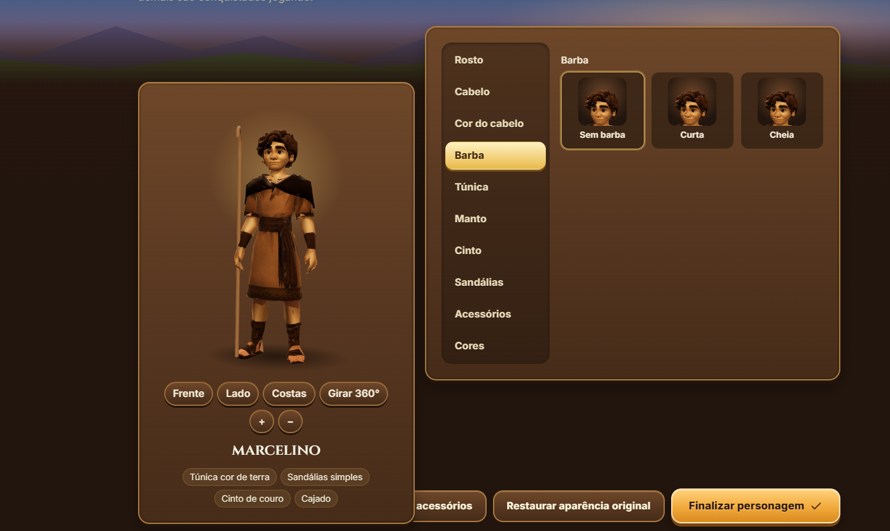
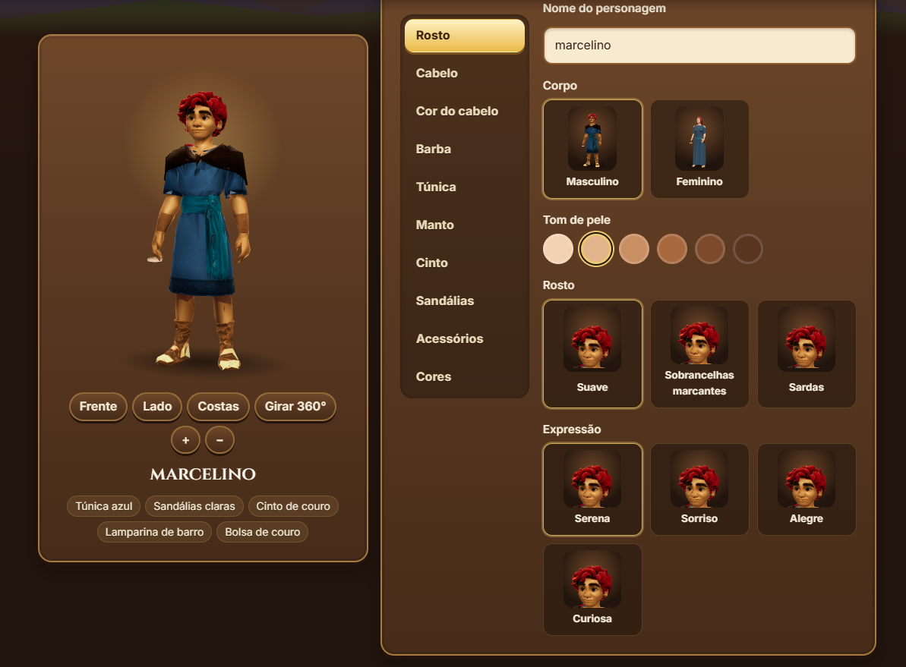
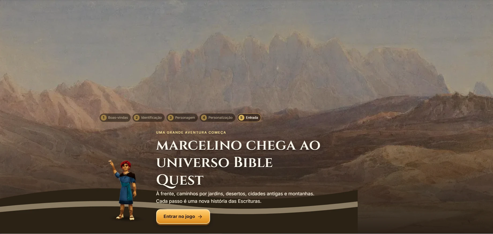
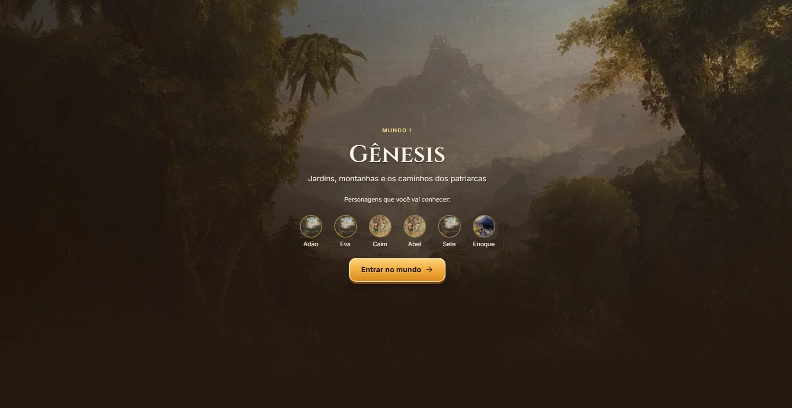
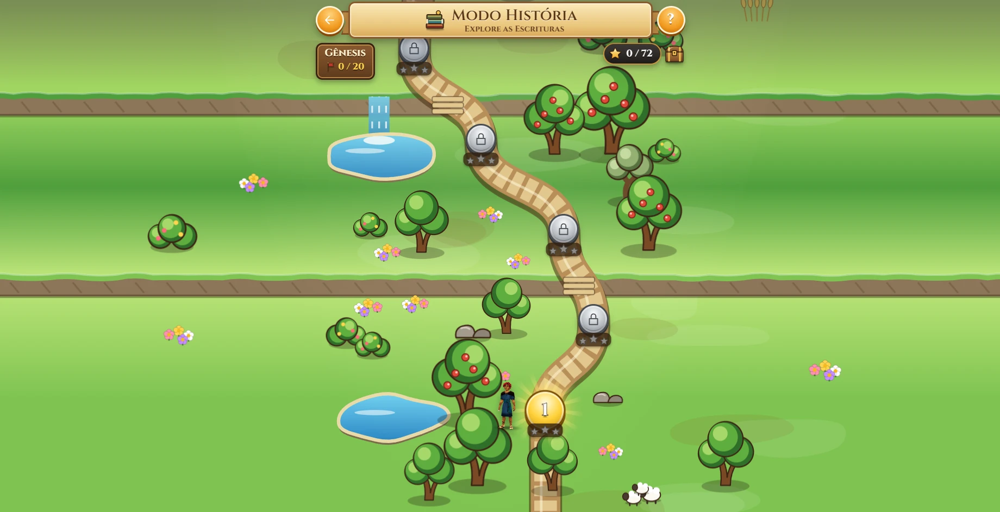

# Bible Quest — Apontamentos visuais do dono do projeto

**Data:** 25/11/2026 · **Versão avaliada:** site publicado (0.17.7, https://theuzxl13-oss.github.io/Bible-Quest/)

Este documento registra as imagens enviadas pelo dono do projeto, em lotes. Abaixo de cada uma está o comentário **exatamente como foi escrito**. Novas imagens são acrescentadas ao fim, em sequência. Nenhuma mudança no jogo foi feita: é só registro.

---

## Imagem 01 — Boas-vindas

> **Comentário do dono do projeto:** está tela de fundo

---

## Imagem 02 — Identificação (perfil local)

> **Comentário do dono do projeto:** tela de fundo

---

## Imagem 03 — Escolha do personagem

> **Comentário do dono do projeto:** deixar somente 2 personagem, masculino e feminino e arrumar o personagem feminino

---

## Imagem 04 — Personalização: cabelo

> **Comentário do dono do projeto:** arrumar a questão dos cabelos, ter os modelos que estão prescritos

---

## Imagem 05 — Personalização: barba

> **Comentário do dono do projeto:** mesma coisa do cabelo com as barbas

---

## Imagem 06 — Personalização: rosto e expressão

> **Comentário do dono do projeto:** mesma coisa do cabelo e barba com as fisionomias  de rosto e expressão

---

## Imagem 07 — Entrada (personagem caminha e acena)

> **Comentário do dono do projeto:** está tela que o personagem caminha e acena pode retirar

---

## Imagem 08 — Abertura do mundo (Gênesis)

> **Comentário do dono do projeto:** está tela que mostra o mundo e nome do livro, pode retirar também, está bem feia

---

## Imagem 09 — Mapa de níveis (Modo História)

> **Comentário do dono do projeto:** a parte do mapa com os niveis está muito "quadrada, queria algo mais bonito

---

## Imagem 10 — Referência de estilo para o mapa de níveis

**Nota:** a imagem de referência é uma captura de tela de um jogo comercial de terceiros. Ela foi recebida, mas **não foi publicada** aqui, por direitos autorais. Descrição: mapa vertical com um caminho largo e sinuoso, de bordas arredondadas; os níveis são "pedras" redondas e com volume, com estrelas logo abaixo; há cenário ilustrado dos dois lados e personagens decorativos ao longo do caminho; o avatar do jogador fica sobre o nível atual; há um menu inferior com ícones grandes.

> **Comentário do dono do projeto:** como por exemplo o da imagem 10 de um jogo chamado candy crush, vizulamente bonito e atrativo, não falo das cores, mas do design
>
> e este mapa de niveis falo tanto no modo hisotria quando no modo quiz

---

## Observações técnicas (para a análise seguinte)

São só leituras das imagens. Elas não alteram os comentários acima.

| Imagem | O que se vê na tela | Ponto a confirmar com o dono do projeto |
|---|---|---|
| 01 e 02 | Fundo com a pintura *Jerusalém vista do Monte das Oliveiras* (David Roberts, c. 1841), escurecida | O que deve mudar no fundo: trocar a imagem, clarear ou ajustar. |
| 03 | Oito opções: Viajante, Pastora, Escriba, Exploradora, Mensageiro, Guardiã da lâmpada, Peregrino e Contadora de histórias. Os modelos femininos ainda são os provisórios. | Reduzir para 2 personagens, um masculino e um feminino. A reformulação da personagem feminina já está aprovada para a 1.0 (diretrizes da versão 1.0) e ainda não começou. |
| 04 | As sete miniaturas de cabelo (Curto, Bem curto, Médio, Longo, Cacheado, Preso e Trança) mostram **o mesmo cabelo**. | Cada opção deve mostrar e aplicar o modelo que o nome indica. |
| 05 | As três miniaturas de barba (Sem barba, Curta e Cheia) mostram **o mesmo rosto sem barba**. | Igual ao cabelo: cada opção deve mostrar e aplicar a barba correspondente. |
| 06 | As miniaturas de rosto (Suave, Sobrancelhas marcantes, Sardas) e de expressão (Serena, Sorriso, Alegre, Curiosa) mostram **o mesmo rosto**. Na mesma tela, o corpo já oferece Masculino e Feminino. | Cada opção deve mostrar e aplicar o rosto ou a expressão correspondente. |
| 07 | Passo 5 da entrada ("Entrada"), com o personagem que caminha e acena sobre a pintura. | Retirar a tela. Para onde o jogador vai depois da personalização: direto para a Central? |
| 08 | Abertura do mundo "Mundo 1 — Gênesis", com os personagens bíblicos em medalhões e o botão "Entrar no mundo". | Retirar a tela e ir direto ao mapa de níveis. |
| 09 e 10 | O mapa atual tem um caminho fino, faixas retas de terreno e níveis em botões cinza com cadeado. A referência tem um caminho largo e curvo, níveis com volume, cenário rico e decorações. | Redesenhar o mapa de níveis do **Modo História e do Modo Quiz**, com o design inspirado na referência (formas, profundidade, cenário), **sem copiar** o jogo citado e mantendo a identidade visual do Bible Quest. |

**Situação:** registrado, aguardando a análise e a autorização para implementar.
