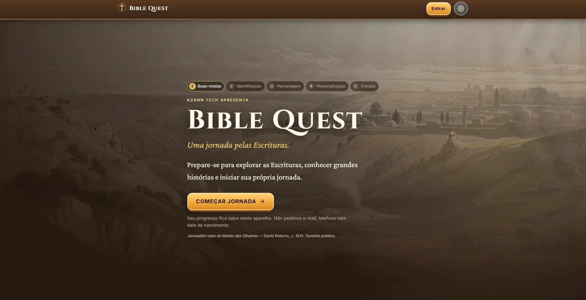

# Bible Quest — Apontamentos visuais do dono do projeto

**Data:** 25/11/2026 · **Versão avaliada:** site publicado (0.17.7, https://theuzxl13-oss.github.io/Bible-Quest/)

Este documento registra cinco imagens enviadas pelo dono do projeto. Abaixo de cada uma está o comentário **exatamente como foi escrito**. Nenhuma mudança no jogo foi feita: é só registro.

---

## Imagem 01 — Boas-vindas

> **Comentário do dono do projeto:** está tela de fundo

---

## Imagem 02 — Identificação (perfil local)

> **Comentário do dono do projeto:** tela de fundo

---

## Imagem 03 — Escolha do personagem

> **Comentário do dono do projeto:** deixar somente 2 personagem, masculino e feminino e arrumar o personagem feminino

---

## Imagem 04 — Personalização: cabelo

> **Comentário do dono do projeto:** arrumar a questão dos cabelos, ter os modelos que estão prescritos

---

## Imagem 05 — Personalização: barba

> **Comentário do dono do projeto:** mesma coisa do cabelo com as barbas

---

## Observações técnicas (para a análise seguinte)

São só leituras das imagens. Elas não alteram os comentários acima.

| Imagem | O que se vê na tela | Ponto a confirmar com o dono do projeto |
|---|---|---|
| 01 e 02 | Fundo com a pintura *Jerusalém vista do Monte das Oliveiras* (David Roberts, c. 1841), escurecida | O que deve mudar no fundo: trocar a imagem, clarear ou ajustar. |
| 03 | Oito opções: Viajante, Pastora, Escriba, Exploradora, Mensageiro, Guardiã da lâmpada, Peregrino e Contadora de histórias. Os modelos femininos ainda são os provisórios. | Reduzir para 2 personagens, um masculino e um feminino. A reformulação da personagem feminina já está aprovada para a 1.0 (diretrizes da versão 1.0) e ainda não começou. |
| 04 | As sete miniaturas de cabelo (Curto, Bem curto, Médio, Longo, Cacheado, Preso e Trança) mostram **o mesmo cabelo**. | Cada opção deve mostrar e aplicar o modelo que o nome indica. |
| 05 | As três miniaturas de barba (Sem barba, Curta e Cheia) mostram **o mesmo rosto sem barba**. | Igual ao cabelo: cada opção deve mostrar e aplicar a barba correspondente. |

**Situação:** registrado, aguardando a análise e a autorização para implementar.
