# Bible Quest — Diagnóstico Visual das Telas

**Kzann Tech** · Etapa 2 · versão oficial 0.17.3 · 16/11/2026 · análise, sem mudança no jogo · aguardando avaliação.

Versão em texto de `ETAPA_2_DIAGNOSTICO_VISUAL_TELAS.pdf` (mesmo conteúdo). As imagens estão em [`evidencias/etapa-2-diagnostico-visual/`](evidencias/etapa-2-diagnostico-visual/) e aparecem abaixo de cada item.

### Sobre este relatório

- **Etapa de análise.** Nenhum arquivo de código, estilo, componente ou funcionalidade foi alterado. A Central aprovada não foi tocada. Não há versão nova do jogo.
- **Base:** versão oficial 0.17.3 (commit `f92aa32`, igual ao publicado). Todas as capturas são reais, feitas nesta análise; nenhuma tela foi simulada ou desenhada.
- **Objetivo:** preparar a continuidade da Etapa 2 (identidade visual nas demais telas). A Etapa 3 não foi iniciada.
- **Evidências:** as 84 capturas (42 telas e estados no celular e no computador), mais os recortes de detalhe, estão em `docs/relatorios/evidencias/etapa-2-diagnostico-visual/`.

# 1. Resumo

**38** — telas e funcionalidades analisadas, em 6 áreas

**3** — estilos visuais diferentes convivendo no jogo

**5** — defeitos objetivos de leitura (contraste), de correção simples

**0** — erros de JavaScript e de rolagem lateral em 84 capturas

**Conclusão principal:** o jogo tem hoje **três estilos visuais**, criados em épocas diferentes, e só a Central segue a identidade aprovada:

- **A Central (0.17):** 3D em baixo polígono, luz de entardecer, névoa, madeira, pergaminho e ouro envelhecido, com cores vindas de `tokens.css`.
- **As telas "de aventura" (v0.14 a v0.16):** mapas, perguntas, cena da fase, resultado, Biblioteca, Perfil e Conquistas. Desenho plano e colorido, com pergaminho e madeira. Já parecem jogo, mas com outra luz e outra paleta.
- **As telas antigas (v0.2 a v0.10):** introdução, livros, fichas, treino, Desafio diário, Estatísticas, Ranking, Configurações e Sobre. Fundo marrom escuro, pinturas escurecidas no topo, barra superior e rodapé de site.

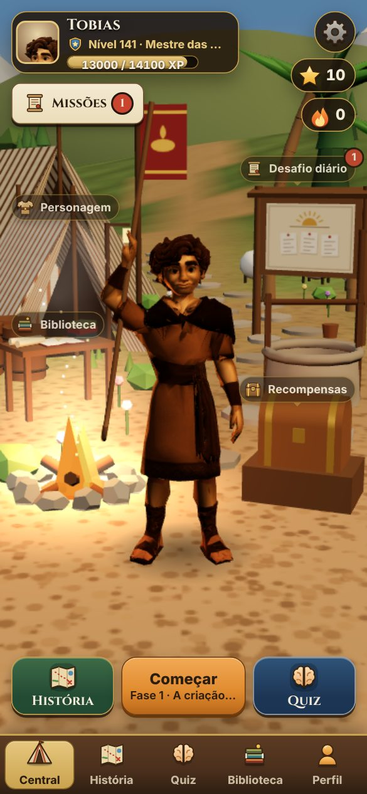  
*1. Central (referência aprovada)*

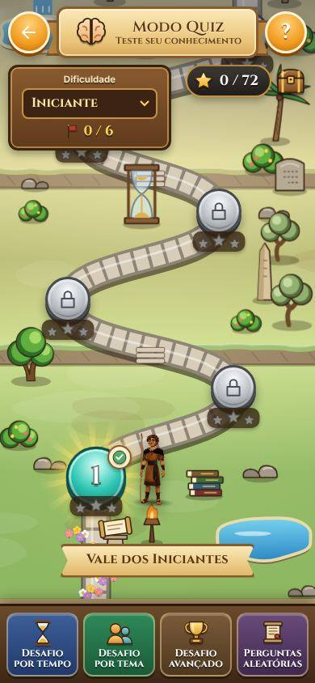  
*2. Telas "de aventura" (mapas, perguntas, Biblioteca)*

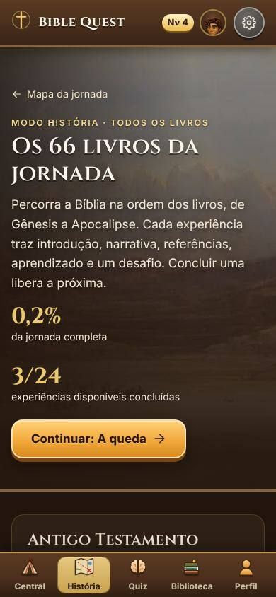  
*3. Telas antigas (livros, fichas, treino, Desafio diário)*

**Classificação dos 38 itens:** 3 aprovados, 25 precisam de refinamento, 8 precisam de reformulação e 2 não verificáveis.

### Correções pontuais recomendadas antes de qualquer reformulação (defeitos de leitura)

1.  Título dos avisos ilegível (marfim sobre pergaminho): Ranking, Multiplayer, Desafio diário e Entrar (X4).
2.  Subtítulo e nomes dos personagens ilegíveis na introdução do mundo, com contraste de 1,39:1 (H2).
3.  Tabela de recordes do Perfil sobre o cenário, com contraste de até 1,01:1 (P1).
4.  Link "Linha do tempo" quase invisível na barra de abas da Biblioteca (B1).
5.  Nomes diferentes na barra do computador ("Início", "Diário") em vez dos aprovados ("Central", "Desafio diário") (X5). Depende da sua decisão.

**Recomendação:** não reformular tela por tela de forma isolada. Primeiro, migrar a **base visual comum** (botões, painéis, janelas, avisos, cabeçalhos e cores) para os tokens da Central. Depois, dar a cada área uma **personalidade própria dentro do mesmo mundo**: trilha (História), templo do saber (Quiz), sala de estudos (Biblioteca), tenda do personagem (Perfil) e sala dos troféus (Conquistas). A sequência está na seção 12.

# 2. Como a análise foi feita

- **Versão analisada:** 0.17.3 oficial (`f92aa32`), servida localmente com o servidor de desenvolvimento. Não houve mudança no código.
- **Navegador:** Chromium (Playwright) com vídeo por software. **Telas:** celular 390 × 844 e computador 1280 × 800.
- **Perfil de teste:** o personagem de testes (Tobias), nível 4, com 3 fases de Gênesis concluídas, 1 conquista e 4 personagens e 2 lugares desbloqueados na Biblioteca. Para as introduções, foi usado um perfil vazio e um perfil sem personagem.
- **Estados capturados:**
  - pergunta, acerto, erro e resultado;
  - janelas da fase, do desafio e de item novo;
  - introdução do mundo;
  - ficha bloqueada e desbloqueada;
  - carregamento da Central.
- **Resultado da varredura:** nenhum erro de JavaScript, nenhuma rolagem lateral e nenhuma rota quebrada.
- **Contraste:** medido no navegador pela fórmula do WCAG, nos textos sobre fundo sólido. Os casos citados como defeito foram confirmados visualmente; os falsos positivos (fundos translúcidos sobre fundo escuro, que ficam legíveis) foram descartados.
- **Código:** leitura das páginas, dos componentes e de `global.css`, com contagem de cores e uso de tokens.

# 3. A referência: o que define a Central

| Elemento           | Como está na Central 0.17.3                                                                                                                                                           | Como levar às outras telas                                         |
|--------------------|---------------------------------------------------------------------------------------------------------------------------------------------------------------------------------------|--------------------------------------------------------------------|
| Cores              | Paleta "Crônicas da Jornada" em `src/styles/tokens.css` (terra, ouro envelhecido, floresta, musgo, pergaminho, marfim) e tokens de modo (História em floresta, Quiz em azul profundo) | Toda cor nova vem dos tokens; cada área recebe o seu token de modo |
| Luz e profundidade | Entardecer quente, névoa, cordilheira, três planos (perto, meio, fundo)                                                                                                               | Fundos em camadas, com luz quente, mesmo quando ilustrados em 2D   |
| Materiais          | Madeira, pergaminho, lona, pedra, com texturas leves                                                                                                                                  | Painéis, janelas e placas com os mesmos materiais                  |
| Interface          | HUD em vidro escuro com moldura dourada, placas de madeira, painel de pergaminho, rótulos discretos, ação principal laranja                                                           | Componentes de `styles/componentes/` reaproveitados                |
| Personagem         | Protagonista, de 40 a 45% da altura da cena                                                                                                                                           | Presente e em destaque nas telas do jogador                        |
| Navegação          | Central, História, Quiz, Biblioteca e Perfil, com os mesmos nomes                                                                                                                     | Os mesmos nomes no celular e no computador                         |
| Acessibilidade     | Áreas de toque de 44 px, foco visível, alto contraste, reduzir animações, alternativa 2D                                                                                              | Critério obrigatório em cada tela                                  |

# 4. Achados que atravessam o jogo

## 4.1 Três estilos e uma base de estilos acumulada

- `src/styles/global.css` tem 1.722 linhas, em camadas de versões (v0.2, v0.3, v0.4, v0.9, v0.10, v0.14, v0.15 e v0.16), muitas sobrescrevendo as anteriores.
- São **528 cores HEX** (222 diferentes) e 14 `!important`. Nenhuma referência aos tokens novos: `tokens.css` só é usado pela Central.
- As variáveis antigas (`--gold`, `--parchment`, `--navy-*`) continuam valendo e têm nomes que não correspondem às cores (`--navy-900` é marrom).
- **Consequência:** o mesmo componente (por exemplo, o aviso) muda de aparência conforme a página, e uma correção numa camada não alcança as outras. É o caso do título dos avisos (X4).

## 4.2 Fundos de tela

- **Pinturas escurecidas no topo:** 14 páginas usam pinturas em domínio público como cabeçalho (introduções, livros, fichas, treino, Desafio diário, Multiplayer e Sobre).
- **Cenário de desenho (`PaginaAventura`):** 3 páginas (Biblioteca, Perfil e Conquistas).
- **Céu e chão desenhados em CSS:** as perguntas e a cena da fase.
- As pinturas são conteúdo valioso, com crédito, e devem ficar como "janela" para a história, não como fundo de interface.

## 4.3 Navegação e estrutura de site

No computador, a barra superior antiga usa nomes diferentes dos aprovados ("Início", "Modo História", "Modo Quiz", "Diário"). As páginas antigas terminam num rodapé de site com 10 links e "Versão 0.17", fixa no código (X5).

## 4.4 Legibilidade

Há cinco defeitos objetivos (seção 1). Fora deles, a tipografia (Cinzel nos títulos, Inter no texto e Crimson Pro nas citações) é consistente e deve ser mantida.

## 4.5 O que já está bom e deve servir de modelo

- As janelas de pergaminho (`.av-janela`).
- O personagem do jogador presente em todas as telas.
- As perguntas com alternativas grandes e numeradas.
- A honestidade dos textos: narrativa dramatizada identificada, datas debatidas e recursos online que ainda não existem.

# 5. Tabela-resumo dos itens

| Item | Área                     | Tela ou funcionalidade                                                        | Classificação           | Prioridade                                           | Complexidade |
|------|--------------------------|-------------------------------------------------------------------------------|-------------------------|------------------------------------------------------|--------------|
| H1   | História                 | Mapa do Modo História                                                         | Precisa de refinamento  | Alta                                                 | Média        |
| H2   | História                 | Introdução do mundo (janela "Mundo 1 · Gênesis")                              | Precisa de refinamento  | Alta (defeito de leitura)                            | Baixa        |
| H3   | História                 | Janela da fase (no mapa)                                                      | Aprovado                | Baixa                                                | Baixa        |
| H4   | História                 | Seleção de livros ("Os 66 livros da jornada")                                 | Precisa de reformulação | Média                                                | Média        |
| H5   | História                 | Página do livro (capítulos e fases)                                           | Precisa de reformulação | Média                                                | Média        |
| H6   | História                 | Apresentação da fase (página antiga da fase)                                  | Precisa de reformulação | Baixa (decisão pendente)                             | Baixa        |
| H7   | História                 | Introdução narrativa (cena da fase)                                           | Precisa de refinamento  | Média                                                | Média        |
| H8   | História                 | Exploração e progressão (estrelas, baús, desbloqueios)                        | Precisa de refinamento  | Baixa                                                | Média        |
| Q1   | Quiz                     | Tela inicial do Quiz (mapa de desafios)                                       | Precisa de refinamento  | Alta                                                 | Média        |
| Q2   | Quiz                     | Seleção de desafios (janela do desafio)                                       | Aprovado                | Baixa                                                | Baixa        |
| Q3   | Quiz                     | Página do desafio (antes de começar)                                          | Precisa de reformulação | Baixa                                                | Baixa        |
| Q4   | Quiz                     | Treino livre (escolha de modalidade)                                          | Precisa de reformulação | Média                                                | Média        |
| Q5   | Quiz                     | Perguntas e alternativas (Modo História e Modo Quiz)                          | Precisa de refinamento  | Alta (componente compartilhado por todos os modos)   | Média        |
| Q6   | Quiz                     | Feedback de respostas                                                         | Precisa de refinamento  | Média                                                | Baixa        |
| Q7   | Quiz                     | Resultados e pontuação                                                        | Precisa de refinamento  | Média                                                | Média        |
| Q8   | Quiz                     | Desafio diário (página)                                                       | Precisa de reformulação | Média                                                | Baixa        |
| Q9   | Quiz                     | Multiplayer (demonstração)                                                    | Precisa de refinamento  | Baixa                                                | Média        |
| Q10  | Quiz                     | Multiplayer e ranking online                                                  | Não verificável         | —                                                    | —            |
| B1   | Biblioteca               | Biblioteca: organização (personagens, livros, lugares, acontecimentos, temas) | Precisa de refinamento  | Média                                                | Média        |
| B2   | Biblioteca               | Fichas: personagens, livros e lugares (leitura)                               | Precisa de reformulação | Média                                                | Média        |
| B3   | Biblioteca               | Acontecimentos e linha do tempo                                               | Precisa de refinamento  | Baixa                                                | Média        |
| B4   | Biblioteca               | Regiões e informações históricas                                              | Precisa de refinamento  | Baixa                                                | Alta         |
| P1   | Perfil                   | Apresentação do jogador e progresso                                           | Precisa de refinamento  | Alta (defeito de leitura)                            | Média        |
| P2   | Perfil                   | Estatísticas                                                                  | Precisa de refinamento  | Baixa                                                | Baixa        |
| P3   | Perfil                   | Configurações                                                                 | Precisa de refinamento  | Baixa                                                | Baixa        |
| P4   | Perfil                   | Personalização (guarda-roupa)                                                 | Precisa de refinamento  | Média                                                | Alta         |
| P5   | Perfil                   | Ranking (recordes locais)                                                     | Precisa de refinamento  | Baixa                                                | Baixa        |
| C1   | Personagens e conquistas | Conquistas desbloqueadas                                                      | Precisa de refinamento  | Média                                                | Média        |
| C2   | Personagens e conquistas | Coleção e recompensas (janela de item novo)                                   | Precisa de refinamento  | Média                                                | Baixa        |
| C3   | Personagens e conquistas | Apresentação dos personagens bíblicos                                         | Precisa de refinamento  | Baixa                                                | Baixa        |
| C4   | Personagens e conquistas | Integração com o jogador (personagem em todas as telas)                       | Aprovado                | Baixa                                                | Baixa        |
| X1   | Telas complementares     | Introduções (boas-vindas, perfil, escolha do personagem, chegada)             | Precisa de reformulação | Alta (primeira impressão)                            | Média        |
| X2   | Telas complementares     | Telas de carregamento                                                         | Precisa de refinamento  | Baixa (mexe na Central aprovada; só com autorização) | Baixa        |
| X3   | Telas complementares     | Modais (janelas)                                                              | Precisa de refinamento  | Média                                                | Baixa        |
| X4   | Telas complementares     | Notificações e avisos                                                         | Precisa de refinamento  | Alta (defeito)                                       | Baixa        |
| X5   | Telas complementares     | Navegação entre as experiências                                               | Precisa de refinamento  | Alta (consistência e nomes aprovados)                | Baixa        |
| X6   | Telas complementares     | Sobre, página não encontrada e revisão                                        | Precisa de refinamento  | Baixa                                                | Baixa        |
| X7   | Telas complementares     | Dispositivos reais, Safari e leitores de tela                                 | Não verificável         | —                                                    | —            |

Prioridade: Alta = defeito, primeira impressão ou componente usado por várias telas. Complexidade: Baixa = estilos e pequenos ajustes de componente; Média = novo fundo ilustrado ou reorganização da tela; Alta = mudanças em 3D ou em conteúdo.

# 6. História

### H1 — Mapa do Modo História \[Precisa de refinamento\]

**Rota e arquivos:** `/historia` · StoryMap.tsx, components/map/JourneyMap.tsx, components/map/aventura/\*, global.css (seção v0.14, linhas 1417–1551)

**Como funciona:** Trilha sinuosa vertical por mundo (Gênesis, Êxodo), com medalhões numerados, estrelas, baús, cadeados, o personagem do jogador andando até a fase atual, placa do mundo, total de estrelas e botão de ajuda. Toque no medalhão abre a janela da fase.

**Evidências no código:** Cenário vetorial próprio (CenaMapa, Elementos.tsx com 495 linhas); fundo fixo `.av-mapa { background: #6f9a45; color: #3b2414 }` (global.css:1418). Não usa `tokens.css`. Página longa: 3.566 px no celular e 5.665 px no computador.

**Avaliação visual:** É a tela mais "jogo" depois da Central: legível, colorida, com progresso claro. Mas o estilo é desenho plano (verde saturado, árvores de clip-art, céu chapado), enquanto a Central é 3D em baixo polígono, com luz de entardecer, névoa e profundidade. Lado a lado, parecem jogos diferentes.

**Problemas:**

- Paleta e luz diferentes da Central (verde \#6f9a45 chapado, sem gradação de distância nem luz quente).
- Sem profundidade: árvores e pedras do mesmo tamanho em todo o caminho.
- No computador, a trilha ocupa uma coluna estreita no centro; as laterais ficam vazias de informação.

**Preservar:**

- Estrutura de trilha, medalhões, estrelas, baús e cadeados.
- O personagem andando até a fase atual.
- Placa do mundo, total de estrelas e ajuda.
- Regras de desbloqueio (progression.ts).

**Pode melhorar:**

- Aproximar a luz e a paleta dos tokens da Central (terra, musgo, ouro envelhecido, céu de fim de tarde).
- Camadas de profundidade: colinas e cordilheira ao fundo, névoa, sombras de contato.
- Aproveitar as laterais no computador (marcos do mundo, placa da próxima fase).

**Direção visual:** "Trilha da jornada": o mesmo mundo da Central visto do alto, como um mapa ilustrado de aventura. Cada mundo bíblico com cor própria de terreno (Éden verde, deserto do Êxodo areia), sempre com a mesma luz quente e as mesmas molduras de madeira e ouro.

**Prioridade:** Alta · **Complexidade:** Média

**Critérios de aceitação:**

- Paleta derivada de tokens.css, sem HEX novos fora dos tokens.
- Pelo menos três planos de profundidade visíveis (fundo, meio e trilha).
- Medalhões, estrelas e cadeados legíveis com contraste de 4,5:1 no texto.
- Mesmas regras e mesmos testes de mapas (mapas.test.tsx) passando.

**Capturas:**

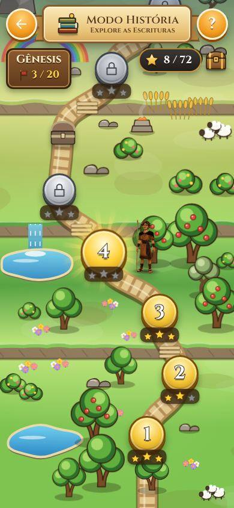  
*Celular*

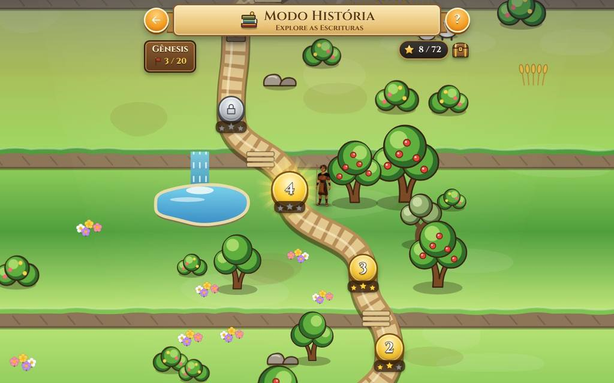  
*Computador*

### H2 — Introdução do mundo (janela "Mundo 1 · Gênesis") \[Precisa de refinamento\]

**Rota e arquivos:** `/historia (primeira visita a cada mundo)` · StoryMap.tsx:190–220; global.css:834–839 e :1418

**Como funciona:** Ao entrar num mundo pela primeira vez, uma janela escura sobre uma pintura apresenta o mundo, o subtítulo e os personagens que o jogador vai conhecer, com o botão "Entrar no mundo".

**Evidências no código:** O texto herda `color: #3b2414` de `.av-mapa` (global.css:1418), pensado para fundo claro, mas a janela usa fundo escuro `rgba(4, 7, 14, 0.78)`. Contraste medido: **1,39:1** no subtítulo e nos nomes dos personagens (mínimo exigido: 4,5:1).

**Avaliação visual:** A ideia é boa (apresentar o mundo como capítulo), mas o subtítulo e os nomes dos personagens ficam praticamente invisíveis. É um defeito, não uma questão de gosto.

**Problemas:**

- Subtítulo e nomes dos personagens ilegíveis (1,39:1).
- Estilo escuro e realista, diferente da Central e do próprio mapa.

**Preservar:**

- O momento de apresentação do mundo, os personagens e o botão "Entrar no mundo".
- O registro de "mundo visto" (markWorldSeen).

**Pode melhorar:**

- Corrigir a cor do texto (correção pontual, independente da reformulação).
- Apresentar o mundo como uma placa de madeira e pergaminho, como a janela da fase.

**Direção visual:** "Abertura de capítulo": placa de pergaminho sobre o mapa já iluminado, com os retratos dos personagens em molduras redondas e o título do mundo em faixa.

**Prioridade:** Alta (defeito de leitura) · **Complexidade:** Baixa

**Critérios de aceitação:**

- Texto com contraste de pelo menos 4,5:1.
- Mesmo conteúdo e mesma regra de exibição.

**Capturas:**

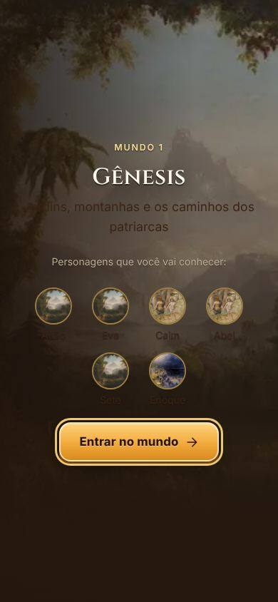  
*Celular*

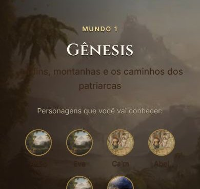  
*Detalhe: subtítulo e nomes ilegíveis*

### H3 — Janela da fase (no mapa) \[Aprovado\]

**Rota e arquivos:** `/historia → toque no medalhão` · components/map/aventura/JanelaFaseHistoria.tsx; global.css:1494–1515 (.av-janela)

**Como funciona:** Janela de pergaminho com número da fase, título, pintura, descrição, objetivo, referência bíblica, dificuldade, recompensa, estrelas e os botões "Começar fase" e "Voltar ao mapa".

**Evidências no código:** `.av-janela` usa pergaminho com moldura de madeira (#8a5a2a) e brilho interno, a mesma linguagem do painel de missões da Central.

**Avaliação visual:** Coerente com a Central: pergaminho, madeira, ouro, hierarquia clara e ações evidentes. Só precisará trocar os HEX pelos tokens quando a base for migrada.

**Problemas:**

- Cores fixas no CSS (sem tokens).

**Preservar:**

- Conteúdo, ordem das informações e ações.

**Pode melhorar:**

- Migrar as cores para tokens.css na Fase 1 da sequência.

**Direção visual:** Manter. Serve de modelo para as outras janelas do jogo.

**Prioridade:** Baixa · **Complexidade:** Baixa

**Critérios de aceitação:**

- Mesmo visual depois de migrar para tokens.

**Capturas:**

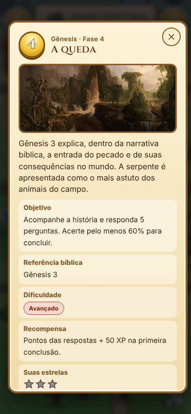  
*Celular*

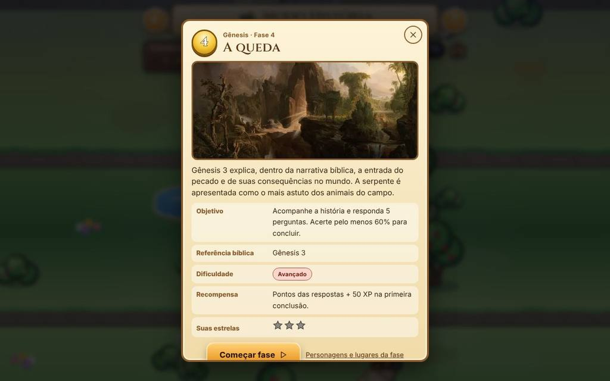  
*Computador*

### H4 — Seleção de livros ("Os 66 livros da jornada") \[Precisa de reformulação\]

**Rota e arquivos:** `/historia/livros` · story/BooksIndex.tsx (122 linhas); global.css seções "Jornada" e "Modo História: livro"

**Como funciona:** Página com o percurso completo da Bíblia, porcentagem da jornada, botão "Continuar" e a lista dos 66 livros por testamento e grupo, com estado (em andamento, em preparação).

**Evidências no código:** Visual antigo (v0.2–v0.10): cabeçalho com pintura escurecida, faixas e cartões marrons. Página de 6.527 px no celular. Usa a barra superior e o rodapé de site.

**Avaliação visual:** Funciona como índice, mas parece página de site, não de jogo. A maioria dos livros está "em preparação", o que deixa a tela cheia de itens sem ação.

**Problemas:**

- Linguagem visual antiga, sem relação com a Central.
- Rolagem muito longa no celular.
- Livros em preparação ocupam tanto espaço quanto os jogáveis.

**Preservar:**

- A ordem canônica dos 66 livros, os grupos e os estados.
- O "Continuar" e a porcentagem da jornada.

**Pode melhorar:**

- Destacar os livros jogáveis e agrupar os em preparação de forma compacta.
- Trocar a pintura escurecida por um cabeçalho ilustrado coerente com a trilha.

**Direção visual:** "Estante da jornada": prateleiras de madeira com os livros como lombadas ilustradas; os disponíveis acesos, os em preparação em sombra. A Bíblia como um caminho de capítulos.

**Prioridade:** Média · **Complexidade:** Média

**Critérios de aceitação:**

- Os mesmos 66 livros, na mesma ordem e com os mesmos estados.
- Livros jogáveis visíveis sem rolar no celular.
- Contraste de 4,5:1 em todos os textos.

**Capturas:**

  
*Celular*

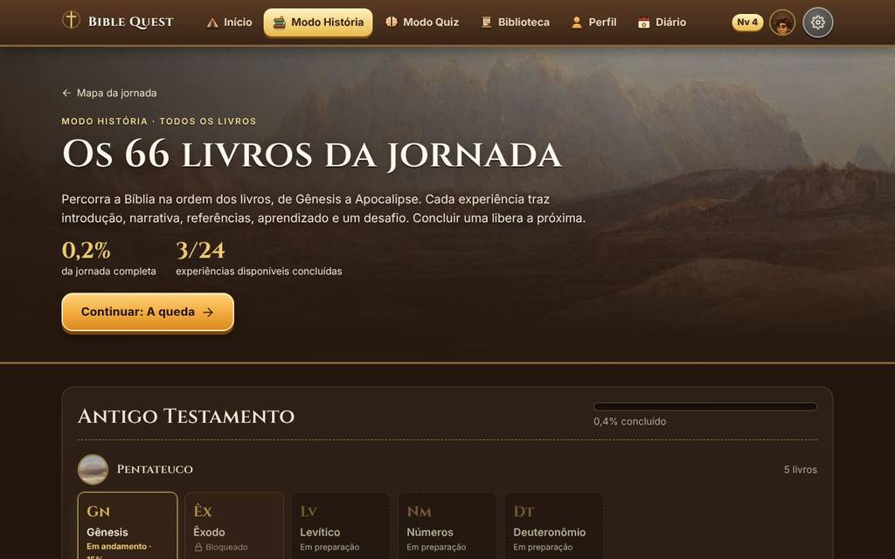  
*Computador*

### H5 — Página do livro (capítulos e fases) \[Precisa de reformulação\]

**Rota e arquivos:** `/historia/genesis, /historia/exodo` · story/BookPage.tsx (105 linhas)

**Como funciona:** Cabeçalho do livro (testamento, grupo, capítulos), progresso, e a lista vertical das fases com miniatura, título, perguntas, estrelas e "Revisitar/Começar".

**Evidências no código:** Mesmo visual antigo de H4. Página de 4.987 px no celular. A mesma lista de fases já existe, em forma de jogo, no mapa (H1).

**Avaliação visual:** Duplica o mapa com uma apresentação menos envolvente. Útil como visão de lista, mas visualmente fora da identidade.

**Problemas:**

- Duplicidade com o mapa sem um papel visual próprio.
- Visual antigo e rolagem longa.

**Preservar:**

- As informações de cada fase, a ordem e os estados.
- A rota (outras telas levam até ela).

**Pode melhorar:**

- Dar à página um papel claro: "diário do livro", com resumo, temas e progresso, levando ao mapa para jogar.

**Direção visual:** "Capa do livro": a página como a capa ilustrada do livro bíblico, com o progresso em estrelas e marcos; a lista de fases fica compacta e leva ao ponto correspondente no mapa.

**Prioridade:** Média · **Complexidade:** Média

**Critérios de aceitação:**

- Nenhuma informação ou rota removida.
- Visual com tokens e molduras da Central.
- Lista de fases navegável pelo teclado.

**Capturas:**

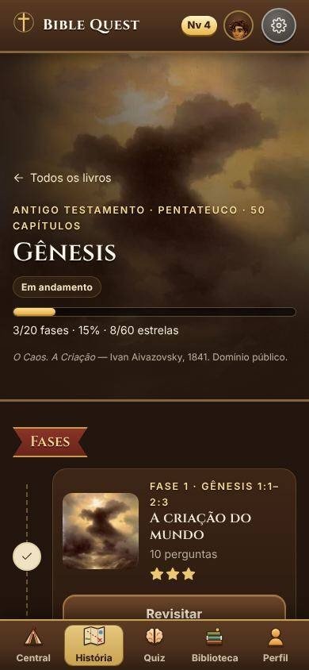  
*Celular*

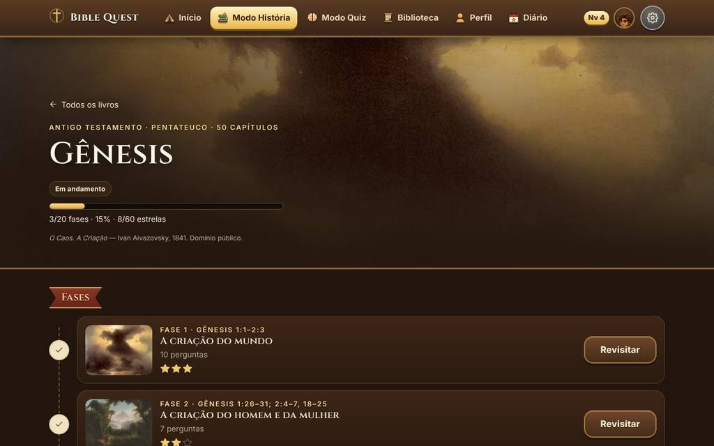  
*Computador*

### H6 — Apresentação da fase (página antiga da fase) \[Precisa de reformulação\]

**Rota e arquivos:** `/historia/genesis/gn-queda` · story/ExperiencePage.tsx (124 linhas)

**Como funciona:** Página com cabeçalho da fase, aviso de nova ficha na Biblioteca, introdução, personagens da fase, referências e o botão para começar.

**Evidências no código:** Visual antigo. As mesmas informações estão na janela da fase (H3), que é o caminho principal desde a v0.14. Na Etapa 2 ficou decidido adiar esta página.

**Avaliação visual:** Funcional, mas é uma terceira forma de apresentar a mesma fase, no visual antigo.

**Problemas:**

- Redundante com a janela da fase.
- Visual antigo.

**Preservar:**

- A rota e o conteúdo (introdução, personagens, referências, aviso de ficha nova).

**Pode melhorar:**

- Decidir o papel desta página antes de redesenhá-la (decisão já adiada na Etapa 2).

**Direção visual:** Manter como "ficha completa da fase", com o mesmo pergaminho da janela, em tela cheia. Implementar só depois da decisão de produto.

**Prioridade:** Baixa (decisão pendente) · **Complexidade:** Baixa

**Critérios de aceitação:**

- Decisão registrada antes da implementação.
- Nenhum conteúdo removido.

**Capturas:**

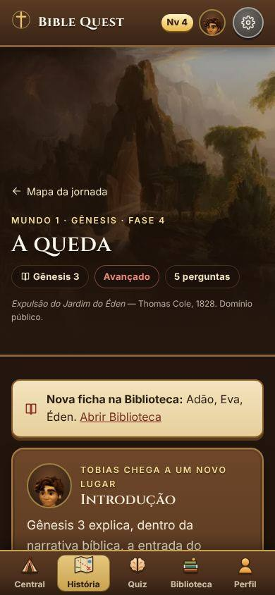  
*Celular*

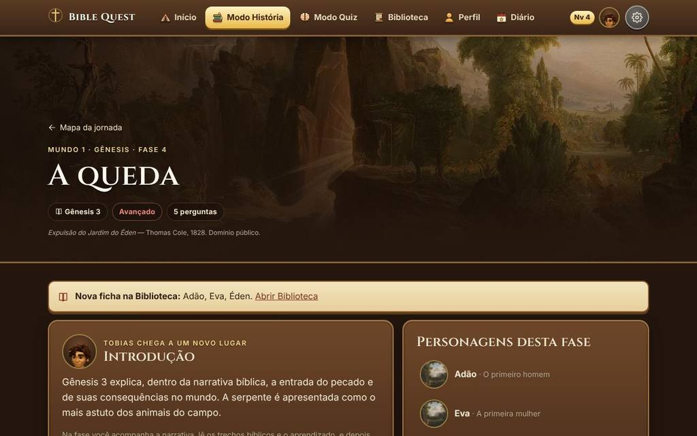  
*Computador*

### H7 — Introdução narrativa (cena da fase) \[Precisa de refinamento\]

**Rota e arquivos:** `/historia/genesis/gn-queda/historia` · story/PhaseScene.tsx (166 linhas); global.css:1626–1679 (v0.16)

**Como funciona:** Cena em etapas (introdução, narrativa, referências, aprendizado) com barra de progresso, botão "Pular", pintura emoldurada, personagem do jogador, retrato do personagem bíblico, cartão de pergaminho com "Ouvir" e os botões "Voltar/Continuar".

**Evidências no código:** Cartão `.av-cena .scene-card` em pergaminho e madeira (global.css:1647). Cena de céu azul com nuvens e chão verde desenhados em CSS. Rótulo "Narrativa dramatizada" e o aviso de que não atribui falas aos personagens estão presentes.

**Avaliação visual:** Boa leitura, hierarquia clara e linguagem de jogo. O cenário (céu azul chapado e colinas genéricas) não muda conforme a história e não conversa com a luz da Central.

**Problemas:**

- Cenário igual para todas as fases (Éden e deserto têm o mesmo céu e o mesmo chão).
- Paleta fria e chapada, diferente da Central.

**Preservar:**

- As etapas, o "Pular", o "Ouvir", a pintura com crédito.
- O rótulo "Narrativa dramatizada" e o aviso sobre falas (regra do projeto).

**Pode melhorar:**

- Cenário de fundo por ambiente da fase (jardim, deserto, cidade), com a luz quente da Central.
- Transição suave entre etapas.

**Direção visual:** "Teatro de pergaminho": o cartão de leitura em primeiro plano, a pintura como janela para a história e um fundo ilustrado que muda com o lugar da fase, sempre com névoa e luz de entardecer.

**Prioridade:** Média · **Complexidade:** Média

**Critérios de aceitação:**

- Texto bíblico, rótulos e avisos idênticos.
- Fundo coerente com o lugar da fase.
- Leitura com contraste de 4,5:1 e "Ouvir" funcionando.

**Capturas:**

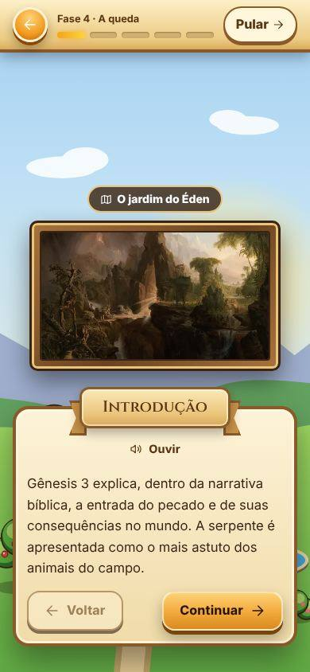  
*Celular, introdução*

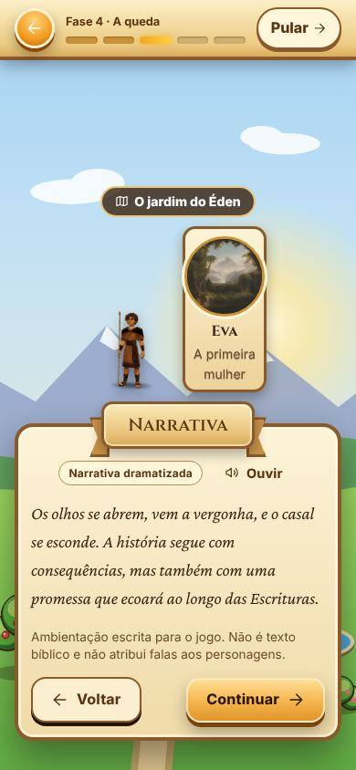  
*Celular, narrativa*

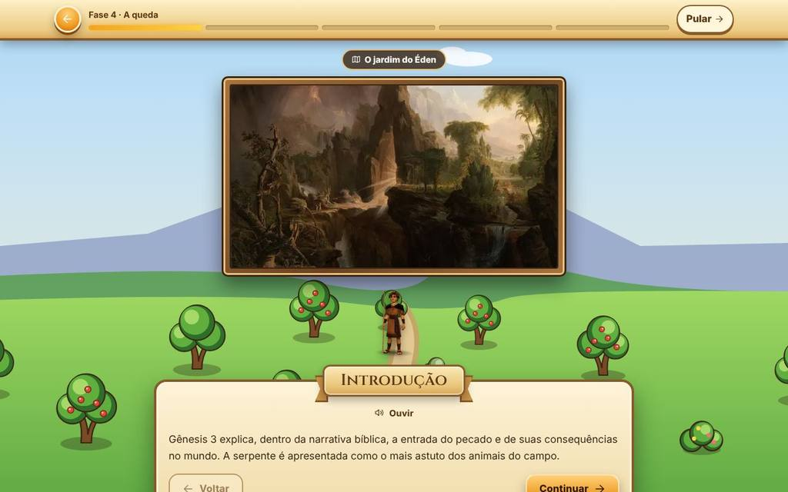  
*Computador*

### H8 — Exploração e progressão (estrelas, baús, desbloqueios) \[Precisa de refinamento\]

**Rota e arquivos:** `/historia, /resultado` · JourneyMap.tsx, Interface.tsx, services/game/progression.ts

**Como funciona:** Estrelas por fase, baús entre fases, cadeados nas próximas, placa com fases concluídas e estrelas, e o personagem avançando.

**Evidências no código:** Elementos presentes e claros nas capturas. O baú aberto e o desbloqueio usam animações próprias (just-unlocked).

**Avaliação visual:** O sistema de progresso é legível. Falta a sensação de recompensa no mesmo nível da Central (brilho, luz, celebração do personagem).

**Problemas:**

- Celebração discreta ao concluir e desbloquear.

**Preservar:**

- Todas as regras de progressão, estrelas e baús.

**Pode melhorar:**

- Momento de desbloqueio com luz e partículas (respeitando "Reduzir animações").

**Direção visual:** Mesmos sinais da Central: brilho dourado, o personagem comemora, a placa do mundo se atualiza com destaque.

**Prioridade:** Baixa · **Complexidade:** Média

**Critérios de aceitação:**

- Nenhuma regra alterada.
- Animações desligadas quando "Reduzir animações" estiver ativo.

**Capturas:**

  
*Trilha com estrelas e cadeados*

# 7. Quiz

### Q1 — Tela inicial do Quiz (mapa de desafios) \[Precisa de refinamento\]

**Rota e arquivos:** `/quiz` · quiz/QuizMap.tsx (142 linhas), data/quiz/regions.ts, aventura/\*

**Como funciona:** Mapa por região (Vale dos Iniciantes, Planície do Saber...), seletor de dificuldade, contador de desafios e estrelas, trilha com medalhões e quatro atalhos de modalidade embaixo (Desafio por tempo, por tema, avançado, perguntas aleatórias).

**Evidências no código:** Mesma base do mapa da História (H1). Os atalhos de baixo usam quatro cores fortes (azul, verde, marrom e roxo) sem relação com os tokens de modo. `tokens.css` já define o modo Quiz em azul profundo (`[data-modo='quiz']`), ainda não usado aqui.

**Avaliação visual:** Divertido e legível, mas tem a mesma distância de estilo da Central que o mapa da História. Os dois mapas são quase iguais, então o Quiz não tem personalidade própria.

**Problemas:**

- Mapa quase idêntico ao da História: falta personalidade do modo.
- Quatro cores de atalho que não seguem a paleta.

**Preservar:**

- Regiões, dificuldade, contadores, trilha, atalhos e regras (quizMap.ts).

**Pode melhorar:**

- Identidade do modo Quiz: azul profundo, pedra e ouro (o token de modo já existe).
- Atalhos nas cores do modo, diferenciados por ícone.

**Direção visual:** "Templo do saber": o mesmo mundo da Central, numa região de templos, bibliotecas e pergaminhos, com luz de fim de tarde e acentos em azul profundo, como a placa "Quiz" da Central.

**Prioridade:** Alta · **Complexidade:** Média

**Critérios de aceitação:**

- Cores do modo vindas de `[data-modo='quiz']`.
- Mapa reconhecível como diferente do mapa da História em uma olhada.
- Mesmas regras e testes.

**Capturas:**

  
*Celular*

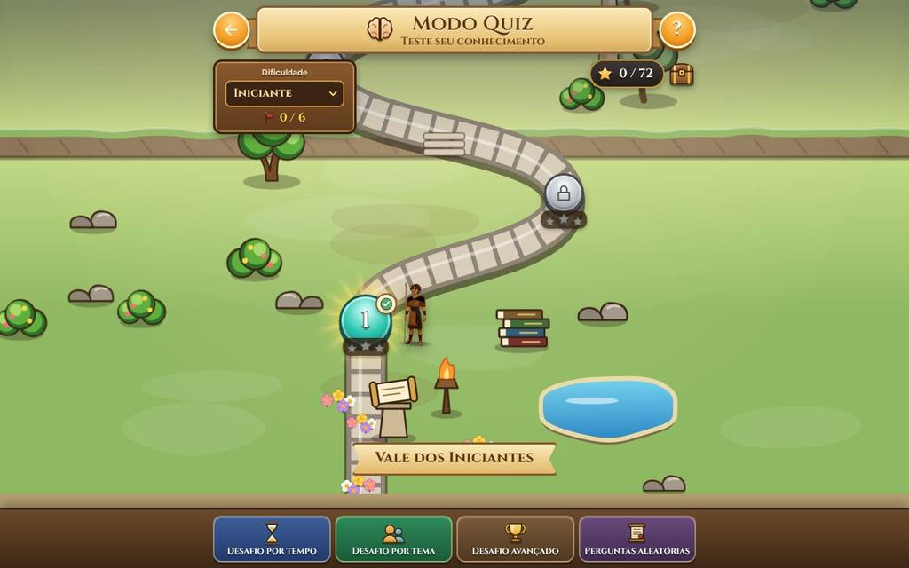  
*Computador*

### Q2 — Seleção de desafios (janela do desafio) \[Aprovado\]

**Rota e arquivos:** `/quiz → toque no medalhão` · aventura/JanelaFaseQuiz.tsx

**Como funciona:** Janela de pergaminho com região, número, tipo, dificuldade, quantidade de perguntas, objetivo, recompensa e estrelas.

**Evidências no código:** Mesma `.av-janela` de H3.

**Avaliação visual:** Coerente e clara.

**Problemas:**

- Cores fixas no CSS (sem tokens).

**Preservar:**

- Conteúdo e ações.

**Pode melhorar:**

- Acento azul do modo Quiz na faixa do título.

**Direção visual:** Manter, com o acento do modo.

**Prioridade:** Baixa · **Complexidade:** Baixa

**Critérios de aceitação:**

- Mesmo conteúdo; acento do modo vindo dos tokens.

**Capturas:**

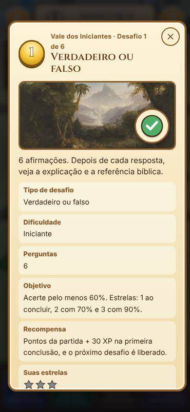  
*Celular*

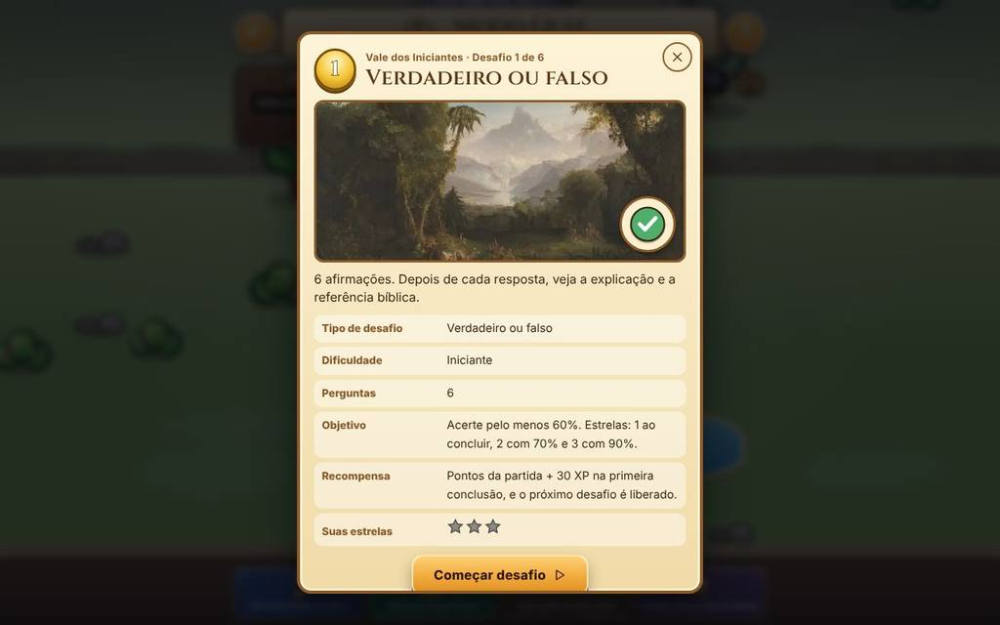  
*Computador*

### Q3 — Página do desafio (antes de começar) \[Precisa de reformulação\]

**Rota e arquivos:** `/quiz/desafio/vale-2` · quiz/QuizChallenge.tsx (94 linhas)

**Como funciona:** Quando o jogador chega pelo endereço direto ou pelo "Voltar", mostra a ficha do desafio com regras de conclusão e estrelas, ou o aviso de bloqueio, e o botão "Começar desafio".

**Evidências no código:** Visual antigo (pintura escurecida, cartão marrom e aviso de pergaminho), com a barra superior. Pela janela do mapa, a partida começa direto e esta página não aparece.

**Avaliação visual:** Tela pouco vista, mas é a única entrada para quem vem por endereço. O visual antigo quebra a continuidade com o mapa.

**Problemas:**

- Visual antigo.

**Preservar:**

- Regras, aviso de bloqueio e ações.

**Pode melhorar:**

- Reaproveitar a janela de pergaminho em tela cheia (mesmo componente de Q2).

**Direção visual:** Mesma ficha da janela do desafio, sobre o fundo do mapa do Quiz.

**Prioridade:** Baixa · **Complexidade:** Baixa

**Critérios de aceitação:**

- Mesmas informações e mesma regra de bloqueio.

**Capturas:**

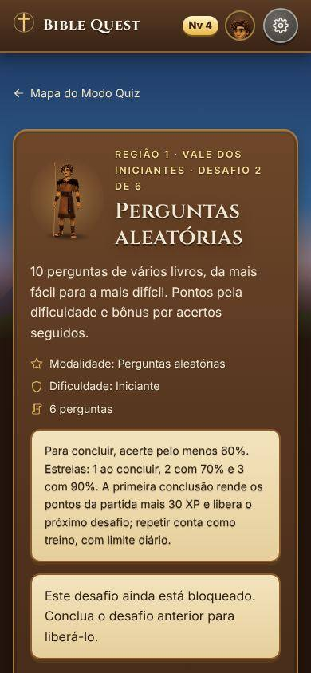  
*Celular*

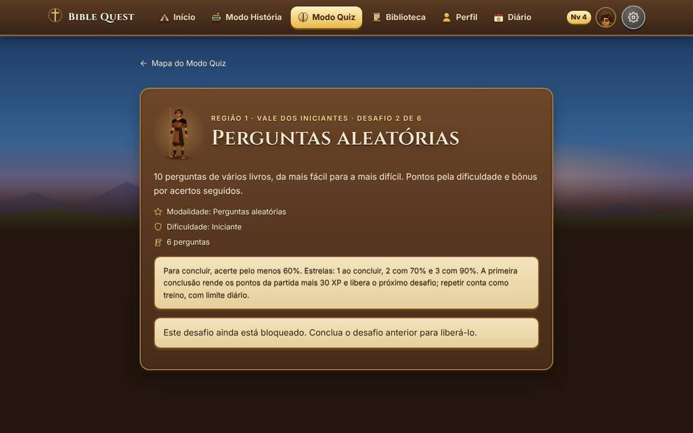  
*Computador*

### Q4 — Treino livre (escolha de modalidade) \[Precisa de reformulação\]

**Rota e arquivos:** `/quiz/treino e /quiz/treino/:modalidade` · free/FreeHub.tsx (94), free/FreePlay.tsx (136), services/game/freeModes.ts

**Como funciona:** Hub com estatísticas de treino, limite diário de XP, atalhos para o Desafio diário e o Multiplayer, e as 10 modalidades em cartões com pintura. Cada modalidade abre a configuração (dificuldade, quantidade) e "Começar".

**Evidências no código:** Visual antigo: cabeçalho de pintura, cartões com pinturas escurecidas e texto sobre imagem. Página de 4.893 px no celular.

**Avaliação visual:** Organizado, mas parece catálogo de site. As pinturas escuras deixam os cartões parecidos entre si e pesados.

**Problemas:**

- Visual antigo e rolagem longa.
- Cartões de modalidade pouco distintos (todas as pinturas escuras).

**Preservar:**

- As 10 modalidades, filtros, limite diário e atalhos.

**Pode melhorar:**

- Cartões de modalidade com ícone ilustrado e cor própria dentro da paleta do modo Quiz.
- Configuração da partida como "placa de desafio", como a ação principal da Central.

**Direção visual:** "Arena de treino": grade de placas de madeira com ícones ilustrados (os GameIcons já existem), uma por modalidade, e a configuração em um painel de pergaminho.

**Prioridade:** Média · **Complexidade:** Média

**Critérios de aceitação:**

- Todas as modalidades e opções preservadas.
- Modalidades distinguíveis sem ler o texto (ícone e cor).
- Rolagem do hub reduzida no celular.

**Capturas:**

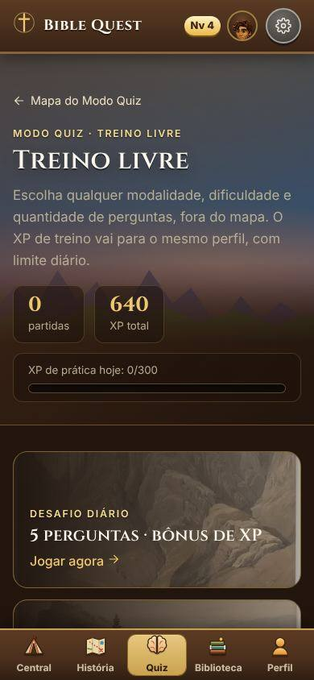  
*Hub, celular*

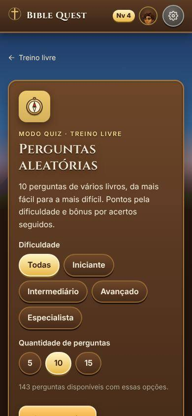  
*Modalidade, celular*

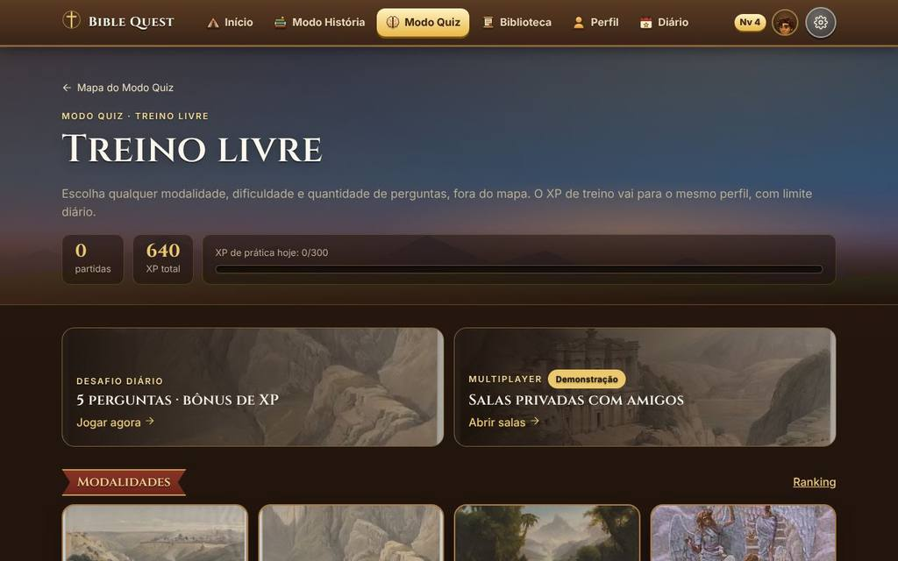  
*Computador*

### Q5 — Perguntas e alternativas (Modo História e Modo Quiz) \[Precisa de refinamento\]

**Rota e arquivos:** `/historia/.../desafio, /quiz/treino/..., /quiz/desafio/..., /diario` · components/quiz/QuizRunner.tsx (250), QuestionView.tsx (373); global.css:1216–1298 e :1552–1584

**Como funciona:** Barra com fase, contagem e pontos; o personagem com balão de fala; cartão emoldurado com tipo e dificuldade; alternativas numeradas (múltipla escolha, verdadeiro ou falso, complete o versículo, ordem dos acontecimentos, quem sou eu, relacione).

**Evidências no código:** Componente único para todos os modos (QuizRunner e QuestionView). Cartão marrom com moldura dourada sobre céu azul e chão verde desenhados em CSS.

**Avaliação visual:** É o coração do jogo e já parece jogo: botões grandes, numeração, personagem reagindo. O cartão marrom sobre céu azul chapado não tem a profundidade e a luz da Central, e o mesmo fundo aparece em todos os modos.

**Problemas:**

- Mesmo cenário em todos os modos e fases.
- Paleta do cartão e do fundo fora dos tokens.
- No computador, o personagem fica pequeno e longe do cartão.

**Preservar:**

- Tipos de pergunta, teclas numéricas, ordem, acessibilidade e regras de pontuação.
- O personagem com balão de fala.

**Pode melhorar:**

- Fundo por modo (História: lugar da fase; Quiz: templo; Diário: amanhecer).
- Cartão com os tokens de superfície e moldura da Central.
- Personagem maior e mais próximo no computador.

**Direção visual:** "Desafio no acampamento": o cartão de pergunta como uma placa de madeira e pergaminho em primeiro plano, com o personagem ao lado e o cenário do modo ao fundo, desfocado.

**Prioridade:** Alta (componente compartilhado por todos os modos) · **Complexidade:** Média

**Critérios de aceitação:**

- Todos os tipos de pergunta funcionando e com os mesmos testes.
- Alternativas com área de toque de 44 px e foco visível.
- Fundo diferente por modo, com contraste de 4,5:1 no texto do cartão.

**Capturas:**

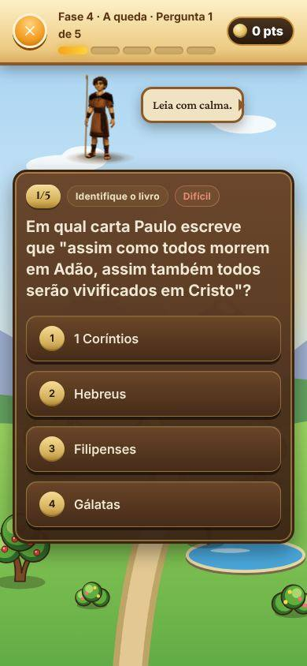  
*Múltipla escolha*

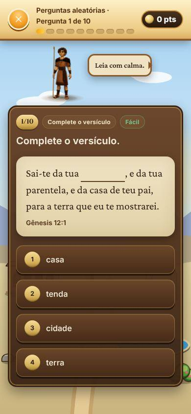  
*Complete o versículo*

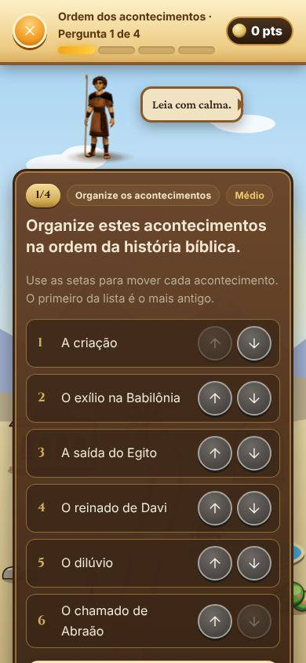  
*Ordem dos acontecimentos*

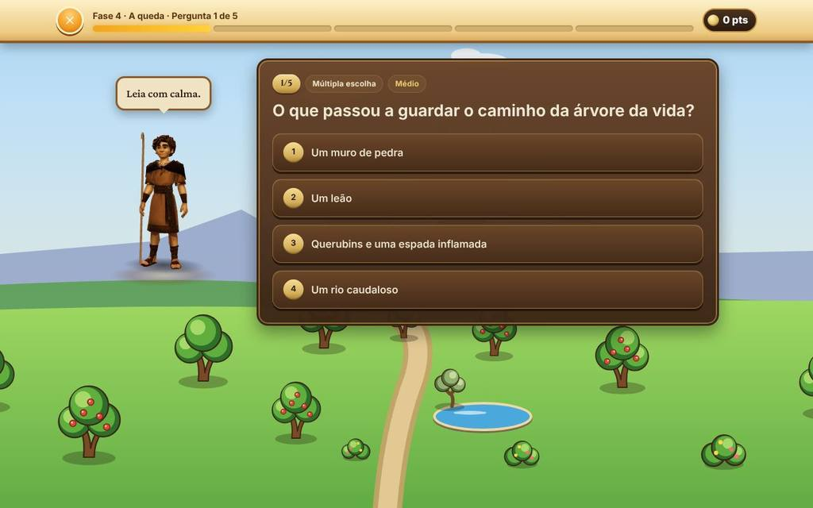  
*Computador*

### Q6 — Feedback de respostas \[Precisa de refinamento\]

**Rota e arquivos:** `mesmas de Q5` · QuestionView.tsx; global.css:1275–1298

**Como funciona:** Ao responder, a alternativa certa fica verde e a errada vermelha; aparece um cartão com "Correto! +15 pts" ou "Não foi desta vez", a resposta correta, a explicação, a referência bíblica e "Próxima pergunta". O personagem muda o balão.

**Evidências no código:** Cores de acerto e erro próprias (verde e vermelho saturados).

**Avaliação visual:** Claro e bem escrito. No celular, depois de um erro, o cartão de explicação empurra a pergunta para fora da tela (a página passa de 844 para 1.269 px), e o jogador perde o contexto.

**Problemas:**

- No celular, a pergunta sai da tela quando aparece a explicação do erro.
- Verde e vermelho fora da paleta (tokens já têm sucesso e erro).

**Preservar:**

- Texto, explicação, referência e ritmo da partida.

**Pode melhorar:**

- Explicação em painel que sobe de baixo, mantendo a pergunta visível.
- Cores de sucesso e erro dos tokens.

**Direção visual:** Mesmo padrão da folha de missões da Central no celular: painel que sobe de baixo, com a resposta destacada acima.

**Prioridade:** Média · **Complexidade:** Baixa

**Critérios de aceitação:**

- Pergunta e resposta escolhida visíveis junto da explicação no celular de 390 × 844.
- Mesmos textos e mesma lógica.

**Capturas:**

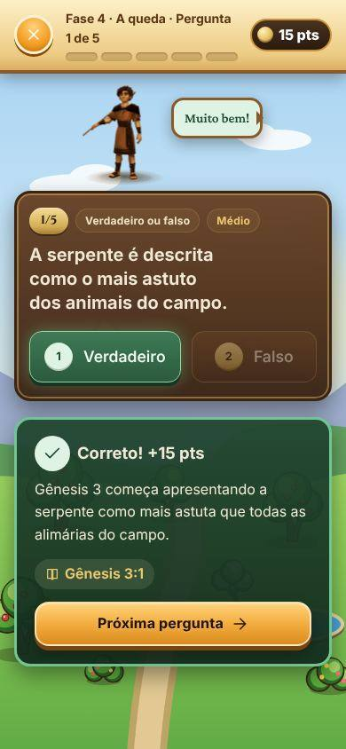  
*Acerto*

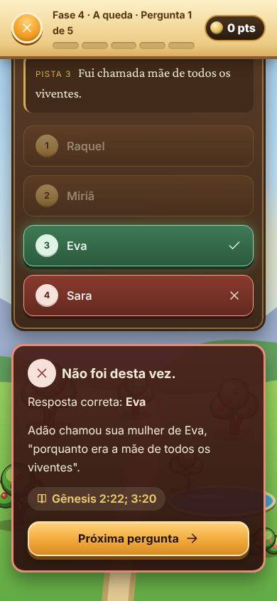  
*Erro*

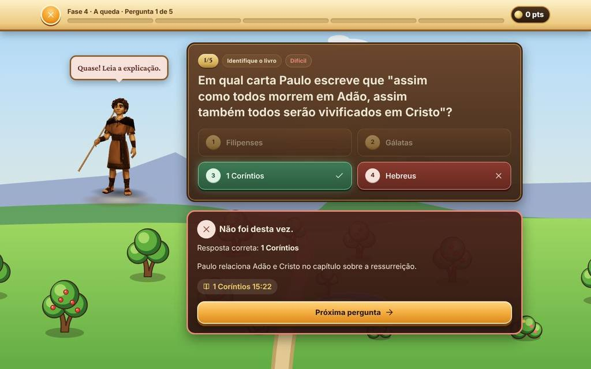  
*Computador*

### Q7 — Resultados e pontuação \[Precisa de refinamento\]

**Rota e arquivos:** `/resultado` · pages/Result.tsx (157); global.css:1585–1625

**Como funciona:** Pergaminho com "Fase concluída!" ou "Ainda não foi desta vez", estrelas, acertos, erros, aproveitamento e pontos, recompensas (XP e próxima fase), conquistas novas e revisão das respostas.

**Evidências no código:** `.av-resultado .result-head` em pergaminho e madeira, com o personagem comemorando.

**Avaliação visual:** Boa celebração e números claros. Antes do resultado, porém, a janela de item novo (C2) pode aparecer várias vezes seguidas ("1 de 7") e esconder o resultado.

**Problemas:**

- Janelas de item empilhadas escondem o resultado.
- Cenário de fundo igual ao das perguntas.

**Preservar:**

- Todos os números, recompensas, conquistas e revisão.

**Pode melhorar:**

- Mostrar o resultado primeiro e os itens novos num único painel de recompensas.
- Celebração com luz e partículas no padrão da Central.

**Direção visual:** "Fogueira da vitória": o personagem comemora junto ao placar; as recompensas aparecem como itens saindo de um baú, numa única tela.

**Prioridade:** Média · **Complexidade:** Média

**Critérios de aceitação:**

- Nenhuma recompensa ou regra alterada.
- Resultado visível antes de qualquer janela de item.
- "Guardar todos" e "Equipar" continuam disponíveis.

**Capturas:**

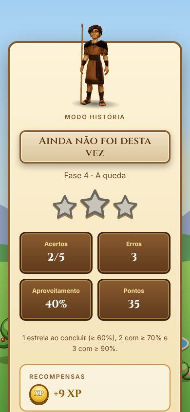  
*Resultado*

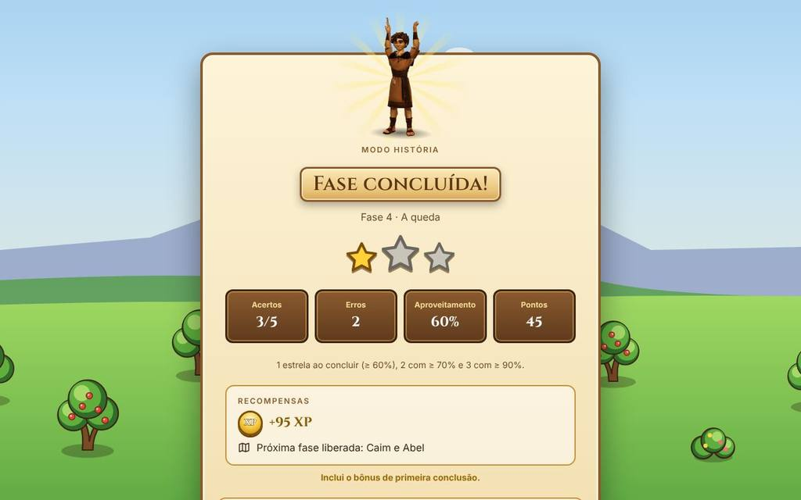  
*Computador*

### Q8 — Desafio diário (página) \[Precisa de reformulação\]

**Rota e arquivos:** `/diario` · pages/Daily.tsx (93)

**Como funciona:** Página com data, explicação, dias seguidos, desafios concluídos, "Começar" e o histórico; avisos de concluído hoje ou de data do aparelho.

**Evidências no código:** Visual antigo, com pintura escurecida. É aberta pelo rótulo "Desafio diário" da Central e pelo painel de missões. Os avisos com título têm o defeito de contraste de X4.

**Avaliação visual:** Agora é um destino direto da Central, mas o salto visual entre as duas é grande.

**Problemas:**

- Visual antigo logo depois da Central.
- Avisos com título ilegível (ver X4).

**Preservar:**

- Rota, 5 perguntas, 30 XP, uma conclusão por dia e os avisos.

**Pode melhorar:**

- Página com a luz de amanhecer e o quadro de missões da Central (o sol nascente e os bilhetes).

**Direção visual:** "Quadro do dia": o mesmo quadro da Central em close, com o sol nascente, a sequência de dias como marcas e o botão principal no estilo da ação "Começar" da Central.

**Prioridade:** Média · **Complexidade:** Baixa

**Critérios de aceitação:**

- Mesma regra e mesmos textos.
- Continuidade visual com o quadro da Central.

**Capturas:**

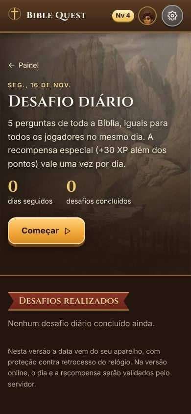  
*Celular*

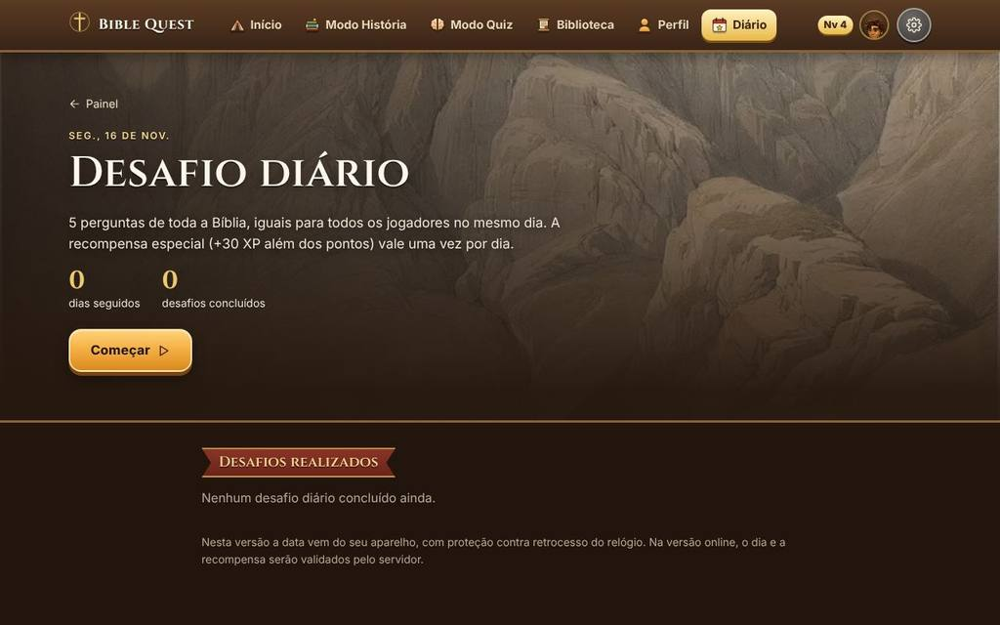  
*Computador*

### Q9 — Multiplayer (demonstração) \[Precisa de refinamento\]

**Rota e arquivos:** `/quiz/multiplayer` · free/Multiplayer.tsx (319)

**Como funciona:** Salas privadas em modo demonstração local (participantes fictícios simulados), entrada por código e regras da versão online, que depende de servidor.

**Evidências no código:** Visual antigo. O título do aviso "O que funciona agora e o que depende do servidor" é ilegível (X4).

**Avaliação visual:** Funciona como demonstração e é honesto sobre o que falta. O aviso principal tem o título ilegível.

**Problemas:**

- Título do aviso ilegível.
- Visual antigo.

**Preservar:**

- Os avisos de demonstração e de dependência do servidor.

**Pode melhorar:**

- Corrigir o aviso (X4).
- Redesenho junto com o treino livre (Q4).

**Direção visual:** Parte da "Arena de treino".

**Prioridade:** Baixa · **Complexidade:** Média

**Critérios de aceitação:**

- Avisos legíveis.
- Nenhuma promessa de recurso online que não exista.

**Capturas:**

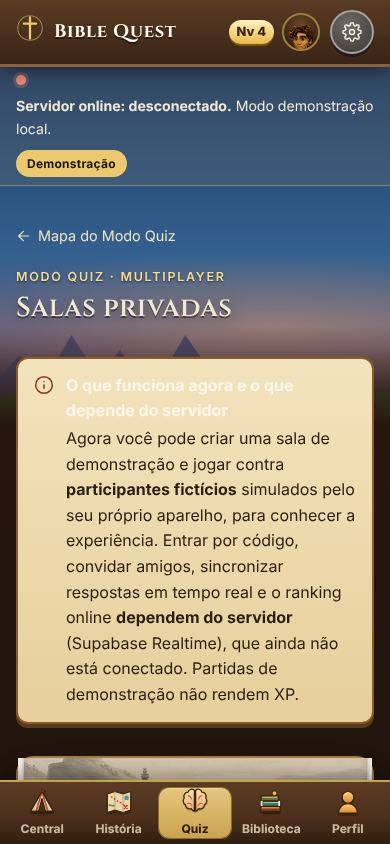  
*Celular*

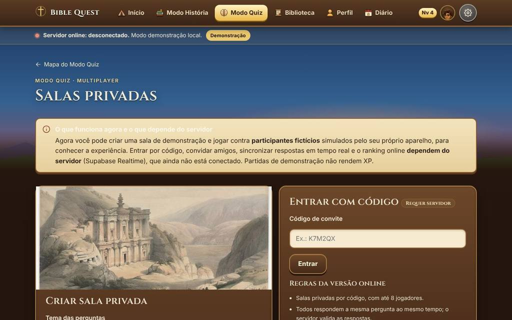  
*Computador*

### Q10 — Multiplayer e ranking online \[Não verificável\]

**Rota e arquivos:** `—` · —

**Como funciona:** Dependem de servidor (Supabase Realtime), que não está conectado nesta versão.

**Evidências no código:** Mensagens das próprias telas: "Servidor online: desconectado" e "Ranking online indisponível".

**Avaliação visual:** Não é possível avaliar uma experiência que ainda não existe.

**Problemas:**

—

**Preservar:**

- Os avisos honestos.

**Pode melhorar:**

—

**Direção visual:** Avaliar quando o servidor existir.

**Prioridade:** — · **Complexidade:** —

**Critérios de aceitação:**

- —

# 8. Biblioteca

### B1 — Biblioteca: organização (personagens, livros, lugares, acontecimentos, temas) \[Precisa de refinamento\]

**Rota e arquivos:** `/biblioteca` · library/Library.tsx (198); components/map/aventura/PaginaAventura.tsx; global.css:1680–1722

**Como funciona:** Cabeçalho de pergaminho, abas (Personagens 4/35, Livros, Lugares 2/19, Acontecimentos, Temas) e o atalho para a linha do tempo; grade de fichas, com as bloqueadas em "???".

**Evidências no código:** Usa `PaginaAventura` (cenário de desenho com deserto, céu e montanhas), como Perfil e Conquistas. O link "Linha do tempo" dentro das abas usa `color: #8a4706` (global.css:1697) sobre a barra marrom: quase invisível.

**Avaliação visual:** Bem organizada e com sensação de coleção ("4/35"). O cenário de desenho fica escondido atrás dos painéis no computador, e a barra de abas mistura abas e um link.

**Problemas:**

- Link "Linha do tempo" ilegível na barra de abas.
- Cenário de fundo pouco visível e sem relação com o tema (biblioteca).
- Fichas bloqueadas todas iguais ("???").

**Preservar:**

- Abas, contadores, regras de desbloqueio (library.ts) e a mensagem sobre como desbloquear.

**Pode melhorar:**

- Separar a linha do tempo das abas, como botão próprio.
- Fichas bloqueadas com silhueta e a dica de onde se desbloqueiam ("Aparece na fase 5" já existe).

**Direção visual:** "Sala de estudos": estantes e mesa de leitura à luz de lamparina (a mesa da Central é a porta de entrada), com as fichas como cartas de coleção.

**Prioridade:** Média · **Complexidade:** Média

**Critérios de aceitação:**

- Mesmas abas, contadores e regras.
- Link da linha do tempo com contraste de 4,5:1.
- Fichas bloqueadas indicam onde são liberadas.

**Capturas:**

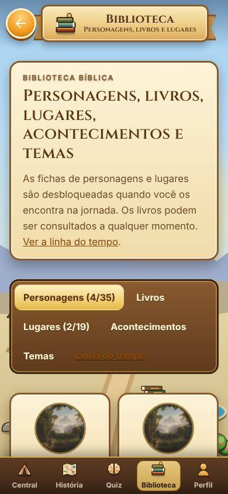  
*Celular*

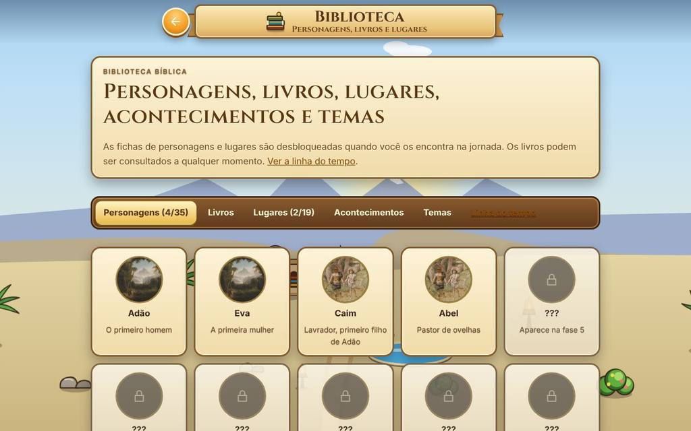  
*Computador*

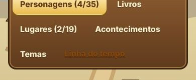  
*Detalhe: link ilegível*

### B2 — Fichas: personagens, livros e lugares (leitura) \[Precisa de reformulação\]

**Rota e arquivos:** `/biblioteca/personagem/:id, /biblioteca/livro/:id, /biblioteca/lugar/:id` · library/LibraryDetail.tsx (161)

**Como funciona:** Ficha com imagem em moldura, nome e descrição, principais acontecimentos, contexto histórico, acontecimentos relacionados e referências. A ficha bloqueada mostra cadeado e onde ela é liberada.

**Evidências no código:** Visual antigo (cabeçalho com montanhas em silhueta e fundo marrom), diferente da página da Biblioteca (B1), que usa o cenário de desenho. As imagens são pinturas em domínio público, com a observação de que não são retratos.

**Avaliação visual:** A tipografia de leitura é boa. Mas sair da Biblioteca para a ficha troca de estilo, e a ficha não tem sensação de "carta de coleção".

**Problemas:**

- Troca de estilo entre a Biblioteca e a ficha.
- Ficha bloqueada simples, com cara de página de erro.

**Preservar:**

- Todo o conteúdo, as referências, os créditos das imagens e o aviso "não é um retrato".

**Pode melhorar:**

- Ficha em pergaminho com moldura, mesma linguagem de B1.
- Ficha bloqueada como carta virada, com a dica de desbloqueio.

**Direção visual:** "Pergaminho de estudo": a ficha como um rolo aberto sobre a mesa, com a pintura em moldura e seções com títulos em faixa.

**Prioridade:** Média · **Complexidade:** Média

**Critérios de aceitação:**

- Conteúdo, créditos e referências idênticos.
- Mesmo estilo de B1.
- Leitura com contraste de 4,5:1 e "Ouvir" mantido onde existir.

**Capturas:**

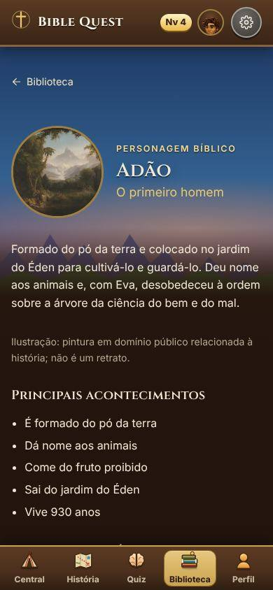  
*Personagem*

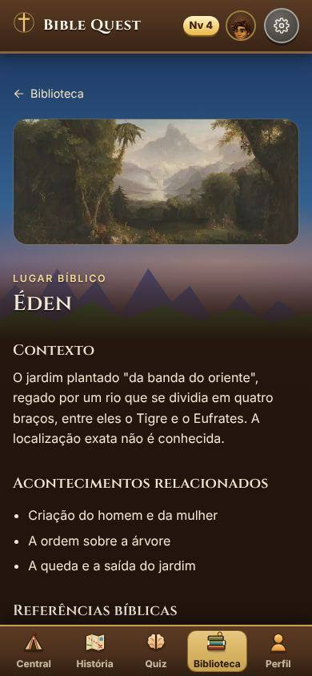  
*Lugar*

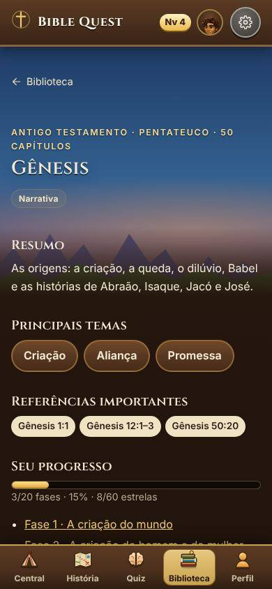  
*Livro*

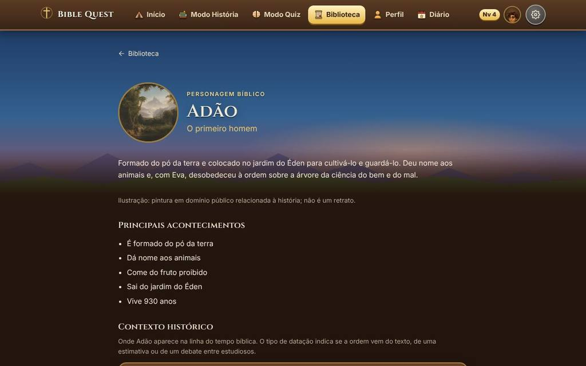  
*Computador*

### B3 — Acontecimentos e linha do tempo \[Precisa de refinamento\]

**Rota e arquivos:** `/linha-do-tempo e aba Acontecimentos` · library/Timeline.tsx (53), data/timeline.ts

**Como funciona:** Linha vertical por era, com selos "Sequência bíblica", "Data estimada" e "Data debatida", explicação de cada tipo, referências e links para livros, personagens e fases.

**Evidências no código:** Visual antigo; página de 7.210 px no celular. Selos coloridos translúcidos.

**Avaliação visual:** Conteúdo rico e cuidadoso com a honestidade histórica. A rolagem é muito longa, e não há como saltar entre eras.

**Problemas:**

- Rolagem muito longa sem navegação por era.
- Visual antigo.

**Preservar:**

- Os três tipos de datação e as explicações, sem alterar o conteúdo.

**Pode melhorar:**

- Navegação por eras (índice fixo ou abas).
- Linha do tempo como um caminho ilustrado, coerente com a trilha.

**Direção visual:** "Rolo da história": uma faixa de pergaminho com marcos por era, que pode ser percorrida de era em era.

**Prioridade:** Baixa · **Complexidade:** Média

**Critérios de aceitação:**

- Mesmo conteúdo e mesmos selos.
- Acesso a qualquer era em até dois toques.

**Capturas:**

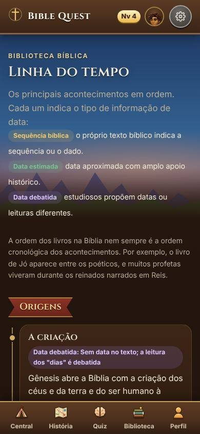  
*Celular*

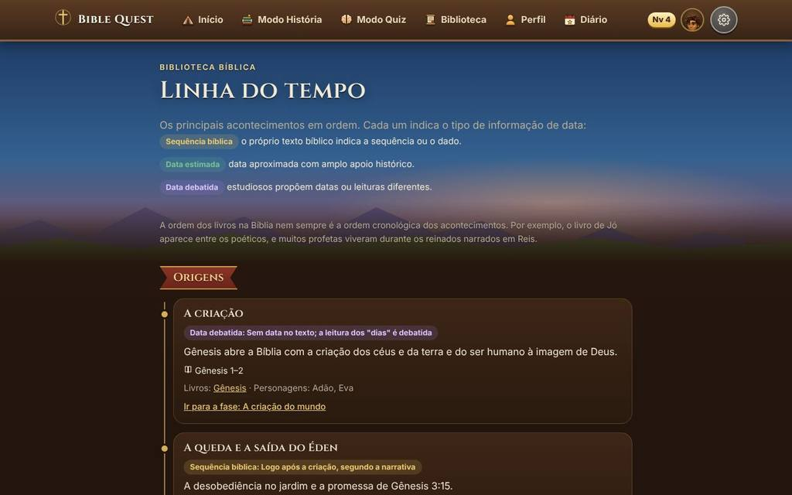  
*Computador*

### B4 — Regiões e informações históricas \[Precisa de refinamento\]

**Rota e arquivos:** `aba Lugares e fichas de lugar` · data/library/places.ts (19 lugares)

**Como funciona:** Os lugares bíblicos aparecem como fichas (Éden, Terra de Node...), com contexto e localização descrita em texto. Não existe um mapa geográfico das regiões.

**Evidências no código:** Ficha do Éden: "A localização exata não é conhecida". Não há componente de mapa geográfico no código.

**Avaliação visual:** As informações existem e são honestas. A descoberta das regiões fica só em lista, sem mapa.

**Problemas:**

- Sem visão espacial das regiões (não é defeito; é uma lacuna de experiência).

**Preservar:**

- Os textos e a honestidade sobre localizações incertas.

**Pode melhorar:**

- Proposta futura, que depende de aprovação e de conteúdo: um mapa ilustrado das regiões, sem afirmar localizações incertas.

**Direção visual:** Não criar agora. Registrar como possibilidade da Etapa 4 ou de conteúdo, porque um mapa exigiria dados novos.

**Prioridade:** Baixa · **Complexidade:** Alta

**Critérios de aceitação:**

- Só com decisão de produto e fontes para cada localização.

**Capturas:**

  
*Ficha de lugar*

# 9. Perfil

### P1 — Apresentação do jogador e progresso \[Precisa de refinamento\]

**Rota e arquivos:** `/perfil` · pages/Profile.tsx (214); PaginaAventura

**Como funciona:** Pergaminho com o personagem, faixa etária, nome, nível, título, XP e "Editar perfil"; atalhos (Conquistas, Estatísticas, Ranking, Revisão); aviso de perfil local; estatísticas resumidas; tabela de recordes por modalidade e histórico de partidas.

**Evidências no código:** A tabela de recordes tem fundo translúcido sobre o cenário de desenho: o texto marrom passa por cima de tendas, árvores e céu (contraste de 1,01:1 a 1,29:1 em algumas linhas).

**Avaliação visual:** A apresentação do jogador é fraca para uma tela que deveria celebrá-lo: o personagem aparece pequeno, num canto do pergaminho. A tabela de recordes está ilegível em partes.

**Problemas:**

- Tabela de recordes ilegível sobre o cenário.
- Personagem pequeno: o jogador não é o protagonista da tela.
- O cenário de fundo é o mesmo da Biblioteca e das Conquistas.

**Preservar:**

- Todos os dados, atalhos, aviso de perfil local e histórico.

**Pode melhorar:**

- Fundo sólido de pergaminho na tabela (correção pontual).
- O personagem grande, com o mesmo destaque da Central.

**Direção visual:** "Tenda do personagem": o interior da tenda da Central, com o personagem em destaque, o nível como medalhão, e estatísticas e recordes em placas.

**Prioridade:** Alta (defeito de leitura) · **Complexidade:** Média

**Critérios de aceitação:**

- Tabela com contraste de 4,5:1 em todas as linhas.
- Personagem com pelo menos 30% da altura visível no celular.
- Nenhum dado removido.

**Capturas:**

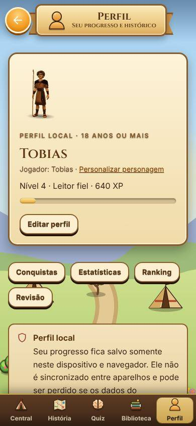  
*Celular*

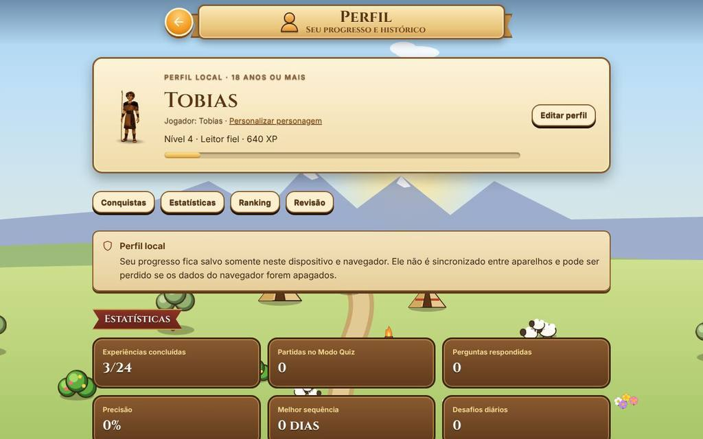  
*Computador*

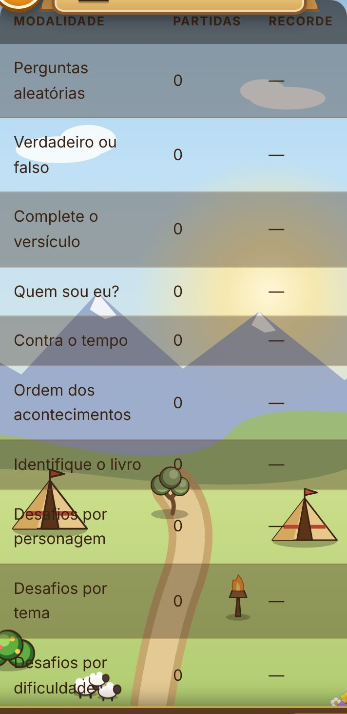  
*Detalhe: tabela sobre o cenário*

### P2 — Estatísticas \[Precisa de refinamento\]

**Rota e arquivos:** `/estatisticas` · pages/Statistics.tsx (133)

**Como funciona:** Cartões por grupo (geral, Modo História, Modo Quiz...) com nível, XP, perguntas, aproveitamento, sequências, conquistas e itens, e barras de progresso.

**Evidências no código:** Visual antigo, mas os cartões em madeira com moldura dourada já lembram as placas da Central.

**Avaliação visual:** Leitura clara. É a tela antiga mais próxima da identidade nova, mas é longa (3.708 px no celular) e só tem números.

**Problemas:**

- Só números, sem gráficos simples.
- Rolagem longa.

**Preservar:**

- Todos os indicadores e cálculos.

**Pode melhorar:**

- Agrupar em painéis recolhíveis; um gráfico simples de evolução (sem dados novos).

**Direção visual:** Placas da "Tenda do personagem" (P1), com os mesmos tokens.

**Prioridade:** Baixa · **Complexidade:** Baixa

**Critérios de aceitação:**

- Mesmos números.
- Cores dos tokens.

**Capturas:**

  
*Celular*

  
*Computador*

### P3 — Configurações \[Precisa de refinamento\]

**Rota e arquivos:** `/configuracoes` · pages/Settings.tsx (98)

**Como funciona:** Tamanho do texto, alto contraste, reduzir animações, leitura em voz alta, qualidade gráfica e dados do perfil.

**Evidências no código:** Visual antigo; controles grandes e acessíveis.

**Avaliação visual:** Funcional e acessível. O visual antigo é aceitável numa tela de utilidade.

**Problemas:**

- Visual antigo.

**Preservar:**

- Todas as opções e o efeito delas no jogo.

**Pode melhorar:**

- Migrar para os componentes de base (Fase 1). Não precisa de cenário.

**Direção visual:** Painel de pergaminho simples, sem cenário.

**Prioridade:** Baixa · **Complexidade:** Baixa

**Critérios de aceitação:**

- Todas as opções funcionando, inclusive alto contraste e reduzir animações.

**Capturas:**

  
*Celular*

  
*Computador*

### P4 — Personalização (guarda-roupa) \[Precisa de refinamento\]

**Rota e arquivos:** `/guarda-roupa (e /personagem/personalizar)` · onboarding/Wardrobe.tsx (365), character/\*

**Como funciona:** Prévia 3D do personagem com Frente, Lado, Costas, Girar 360° e zoom; categorias (rosto, cabelo, barba, túnica, manto, cinto, sandálias, acessórios, cores) e itens bloqueados e desbloqueados.

**Evidências no código:** Céu azul escuro com faixa marrom (visual antigo de cabeçalho). Página de 2.856 px no celular. É a porta de entrada da tenda da Central.

**Avaliação visual:** O personagem 3D é excelente e merece mais palco. No celular, prévia e categorias disputam a mesma coluna e a rolagem é longa.

**Problemas:**

- Visual antigo de cabeçalho.
- No celular, a prévia rola para fora quando se escolhe um item.

**Preservar:**

- Todas as categorias, itens, cores, regras de desbloqueio e o 3D.

**Pode melhorar:**

- Prévia fixa no topo do celular, enquanto as categorias rolam embaixo.
- Fundo de interior de tenda com a luz da Central.

**Direção visual:** "Dentro da tenda": o personagem num pedestal iluminado pela fogueira, com as roupas penduradas como itens.

**Prioridade:** Média · **Complexidade:** Alta

**Critérios de aceitação:**

- Prévia visível enquanto se escolhe um item no celular.
- Mesmos itens e regras.
- Desempenho do 3D igual ou melhor.

**Capturas:**

  
*Celular*

  
*Computador*

### P5 — Ranking (recordes locais) \[Precisa de refinamento\]

**Rota e arquivos:** `/ranking` · pages/Ranking.tsx (71)

**Como funciona:** Recordes do próprio jogador por categoria (XP geral, Modo História, Modo Quiz, Desafio diário) e um aviso de que o ranking online não existe nesta versão.

**Evidências no código:** O título do aviso "Ranking online indisponível" está em marfim (#fbf7ec) sobre pergaminho: `.notice-title { color: var(--ivory) }` (global.css:159) não foi atualizado quando o aviso passou a usar pergaminho (global.css:1386).

**Avaliação visual:** Honesto ("nenhum jogador ou posição é inventado"), mas o título do aviso é ilegível.

**Problemas:**

- Título do aviso ilegível.
- Visual antigo.

**Preservar:**

- Os recordes e o aviso de honestidade.

**Pode melhorar:**

- Corrigir o aviso (X4).
- Recordes como placas da "Tenda do personagem".

**Direção visual:** Parte da "Tenda do personagem".

**Prioridade:** Baixa · **Complexidade:** Baixa

**Critérios de aceitação:**

- Aviso legível; nenhum dado inventado.

**Capturas:**

  
*Celular*

  
*Detalhe: título do aviso*

# 10. Personagens e conquistas

### C1 — Conquistas desbloqueadas \[Precisa de refinamento\]

**Rota e arquivos:** `/conquistas` · pages/Achievements.tsx (68), data/achievements.ts (26 conquistas); PaginaAventura

**Como funciona:** Pergaminho com "1 de 26 conquistas" e a explicação; medalhas dos livros (bronze, prata, ouro pelas estrelas); conquistas por grupo, com estado.

**Evidências no código:** Cenário de deserto com o personagem no topo e um templo. Página de 5.309 px no celular.

**Avaliação visual:** Cenário simpático e o personagem presente. Mas a coleção não brilha: medalhas ainda não conquistadas e conquistadas têm quase o mesmo peso visual, e a rolagem é longa.

**Problemas:**

- Pouca diferença entre conquistado e não conquistado.
- Rolagem longa sem filtro.

**Preservar:**

- As 26 conquistas, as regras e as medalhas por estrelas.

**Pode melhorar:**

- Conquistadas em ouro e com brilho; não conquistadas em silhueta, com a dica.
- Filtro: todas, conquistadas, a conquistar.

**Direção visual:** "Sala dos troféus": prateleiras com medalhas e estandartes, na luz quente da Central.

**Prioridade:** Média · **Complexidade:** Média

**Critérios de aceitação:**

- Diferença clara entre estados sem depender só de cor (ícone ou texto).
- Mesmas conquistas e regras.

**Capturas:**

  
*Celular*

  
*Computador*

### C2 — Coleção e recompensas (janela de item novo) \[Precisa de refinamento\]

**Rota e arquivos:** `qualquer tela, depois de ganhar item` · components/character/ItemReward.tsx (66); global.css seção v0.4 "Recompensa de item"

**Como funciona:** Janela escura com "Novo item desbloqueado · 1 de N", o personagem vestindo o item, o motivo (nível, conquista) e as ações "Equipar", "Guardar para depois" e "Guardar todos".

**Evidências no código:** Fundo escuro antigo (`modal-backdrop`), diferente das janelas de pergaminho (`.av-janela`). Com vários itens ao mesmo tempo, aparecem em fila ("1 de 7").

**Avaliação visual:** Mostrar o personagem com o item novo é ótimo. A janela escura e a fila longa cansam e escondem a tela de trás (ver Q7).

**Problemas:**

- Estilo de janela diferente das janelas de pergaminho.
- Fila de janelas quando há muitos itens.

**Preservar:**

- Itens, motivos, ações e a regra de guardar no guarda-roupa.

**Pode melhorar:**

- Janela no padrão de pergaminho.
- Vários itens num só painel, com navegação entre eles.

**Direção visual:** "Baú aberto": os itens saem de um baú, em sequência, num único painel.

**Prioridade:** Média · **Complexidade:** Baixa

**Critérios de aceitação:**

- Mesmas ações e regras.
- No máximo uma janela por vez, sem esconder o resultado da partida.

**Capturas:**

  
*Janela de item sobre o resultado*

### C3 — Apresentação dos personagens bíblicos \[Precisa de refinamento\]

**Rota e arquivos:** `fichas da Biblioteca, cena da fase, introdução do mundo` · LibraryDetail.tsx, PhaseScene.tsx, StoryMap.tsx

**Como funciona:** Os personagens bíblicos aparecem em retratos redondos com pinturas em domínio público e, na cena, em cartão com nome e descrição. Nenhuma fala é atribuída a eles.

**Evidências no código:** Imagens de images.ts com crédito; aviso "não é um retrato" nas fichas.

**Avaliação visual:** Respeitoso e honesto. Visualmente pouco marcante: a mesma pintura de paisagem serve de retrato de vários personagens (Adão, Eva, Sete).

**Problemas:**

- Retratos repetidos (mesma pintura para personagens diferentes).

**Preservar:**

- Pinturas em domínio público com crédito, o aviso e a regra de não atribuir falas.

**Pode melhorar:**

- Moldura e cor por personagem (inicial ou símbolo) quando a pintura se repete, sem inventar rostos.

**Direção visual:** "Medalhões de personagem": moldura dourada, símbolo próprio de cada personagem (por exemplo, a árvore para Adão e Eva) e a pintura como fundo.

**Prioridade:** Baixa · **Complexidade:** Baixa

**Critérios de aceitação:**

- Sem imagens novas sem origem e licença registradas.
- Cada personagem distinguível no medalhão.

**Capturas:**

  
*Ficha*

  
*Na cena*

### C4 — Integração com o jogador (personagem em todas as telas) \[Aprovado\]

**Rota e arquivos:** `mapas, perguntas, resultado, perfil, conquistas, Central` · character/PlayerCharacter.tsx, Character.tsx, character3d/\*

**Como funciona:** O personagem do jogador, com as roupas escolhidas, aparece no mapa (andando), nas perguntas (reagindo), no resultado (comemorando), no perfil e nas conquistas.

**Evidências no código:** Componente único `PlayerCharacter`, com poses ("idle", "walk", "celebrate").

**Avaliação visual:** É o fio que une todo o jogo e já funciona. Só falta mais destaque em algumas telas (P1).

**Problemas:**

- Tamanho pequeno no Perfil e nas perguntas no computador.

**Preservar:**

- O componente único e as poses.

**Pode melhorar:**

- Tamanhos de destaque padronizados por tipo de tela.

**Direção visual:** Manter.

**Prioridade:** Baixa · **Complexidade:** Baixa

**Critérios de aceitação:**

- O personagem aparece com as roupas atuais em todas essas telas.

**Capturas:**

  
*Nas perguntas*

  
*No mapa*

# 11. Telas complementares

### X1 — Introduções (boas-vindas, perfil, escolha do personagem, chegada) \[Precisa de reformulação\]

**Rota e arquivos:** `/boas-vindas, /entrar, /personagem, /chegada` · onboarding/Welcome.tsx, Login.tsx, CharacterBase.tsx, Arrival.tsx, StepBar.tsx

**Como funciona:** Cinco passos numerados: boas-vindas, perfil local (apelido e faixa etária), escolha entre 8 personagens-base, personalização e chegada, com o botão "Entrar no jogo".

**Evidências no código:** Visual antigo: pinturas escurecidas (Jerusalém, montanhas), cartões marrons e a barra superior de site, com "Entrar". No celular, as prévias dos personagens aparecem desfocadas por alguns segundos enquanto o 3D carrega.

**Avaliação visual:** É a primeira impressão do jogo e hoje promete outro jogo: escuro e realista, enquanto a Central é clara, 3D e acolhedora. O conteúdo e o fluxo são bons.

**Problemas:**

- Primeira impressão desconectada da Central.
- Prévias desfocadas durante o carregamento, sem indicação.
- Barra superior de site no meio da introdução.

**Preservar:**

- Os cinco passos, o que é pedido (sem e-mail nem data de nascimento) e os 8 personagens-base.

**Pode melhorar:**

- Abrir com a paisagem da Central ao amanhecer, sem a barra superior.
- Estado de carregamento visível nas prévias (placa "preparando...").

**Direção visual:** "A chegada ao acampamento": cada passo como um trecho do caminho até o acampamento, com o sol nascendo, e a Central como o destino final, no mesmo mundo.

**Prioridade:** Alta (primeira impressão) · **Complexidade:** Média

**Critérios de aceitação:**

- Mesmos passos, campos e regras de privacidade.
- Sem barra superior durante a introdução.
- Prévias com estado de carregamento claro.

**Capturas:**

  
*Boas-vindas*

  
*Perfil*

  
*Escolha*

  
*Chegada*

  
*Computador*

### X2 — Telas de carregamento \[Precisa de refinamento\]

**Rota e arquivos:** `/painel (cena 3D), prévias de personagem` · CenaAcampamento.tsx ("Montando o acampamento…"), Character.tsx

**Como funciona:** A Central mostra "Montando o acampamento…" numa pílula sobre fundo azul escuro até a cena 3D ficar pronta (de 6 a 10 s no ambiente de medição, sem placa de vídeo). As prévias de personagem ficam desfocadas enquanto carregam.

**Evidências no código:** Captura 250 ms depois de abrir a Central.

**Avaliação visual:** O aviso existe, mas o fundo azul vazio contrasta com a cena que vem depois.

**Problemas:**

- Fundo vazio e frio durante o carregamento.

**Preservar:**

- O aviso com `role="status"` e a cena 2D como alternativa.

**Pode melhorar:**

- Mostrar a pintura 2D da Central como fundo enquanto o 3D carrega.

**Direção visual:** Carregamento "no próprio acampamento": o desenho 2D aparece primeiro e o 3D entra por cima, sem salto de cor.

**Prioridade:** Baixa (mexe na Central aprovada; só com autorização) · **Complexidade:** Baixa

**Critérios de aceitação:**

- Sem fundo vazio durante o carregamento.
- Nenhuma mudança na Central aprovada sem autorização expressa.

**Capturas:**

  
*Carregando a Central*

### X3 — Modais (janelas) \[Precisa de refinamento\]

**Rota e arquivos:** `janela da fase, do desafio, de ajuda, de baú, de item, introdução do mundo` · aventura/Interface.tsx, JanelaFase\*.tsx, ItemReward.tsx, StoryMap.tsx

**Como funciona:** Dois estilos convivem: janelas de pergaminho (`.av-janela`) e janelas escuras (`modal-backdrop` antigo).

**Evidências no código:** global.css:825–840 (modais antigos) e :1494–1515 (pergaminho).

**Avaliação visual:** O pergaminho é o padrão certo; as janelas escuras são as que destoam (C2 e H2).

**Problemas:**

- Dois estilos de janela.

**Preservar:**

- Foco preso na janela, Esc para fechar e a devolução do foco.

**Pode melhorar:**

- Um único componente de janela, com variantes.

**Direção visual:** Componente base "Janela" na Fase 1, a partir de `.av-janela`.

**Prioridade:** Média · **Complexidade:** Baixa

**Critérios de aceitação:**

- Todas as janelas com o mesmo componente, sem perder acessibilidade.

**Capturas:**

  
*Pergaminho*

  
*Escura*

### X4 — Notificações e avisos \[Precisa de refinamento\]

**Rota e arquivos:** `Ranking, Multiplayer, Desafio diário, Entrar e outras` · components/ui.tsx (Notice); global.css:157–162 e :1386–1389

**Como funciona:** Avisos de informação e alerta com ícone, título e texto.

**Evidências no código:** Quando o aviso passou a pergaminho claro (global.css:1386), o título continuou em marfim (global.css:159). Afeta os 7 avisos com título fora do painel administrativo (Ranking, 2 no Multiplayer, 2 no Desafio diário, Entrar e o componente base).

**Avaliação visual:** Defeito objetivo de leitura, de correção simples e independente da reformulação.

**Problemas:**

- Título do aviso ilegível (marfim sobre pergaminho).

**Preservar:**

- Textos e tons dos avisos.

**Pode melhorar:**

- Cor do título vinda do token de texto sobre leitura.

**Direção visual:** Correção pontual, que pode entrar antes de qualquer reformulação.

**Prioridade:** Alta (defeito) · **Complexidade:** Baixa

**Critérios de aceitação:**

- Título com contraste de 4,5:1 em todos os avisos.

**Capturas:**

  
*Ranking*

  
*Multiplayer*

### X5 — Navegação entre as experiências \[Precisa de refinamento\]

**Rota e arquivos:** `todas` · layout/Layout.tsx (NAV, SECONDARY, IMMERSIVE), layout/NavegacaoGlobal.tsx

**Como funciona:** No celular, a navegação global aprovada (Central, História, Quiz, Biblioteca, Perfil) aparece fora dos mapas e das partidas. No computador, fora da Central, aparece a barra superior antiga com "Início, Modo História, Modo Quiz, Biblioteca, Perfil, Diário". As páginas antigas têm rodapé com 10 links e "Versão 0.17".

**Evidências no código:** Layout.tsx: `NAV` com "Início" e um link "Diário" separado (Layout.tsx:63); a navegação global só aparece no computador na Central (decisão da 0.17.0). Rodapé com "Versão 0.17" fixo no código (Layout.tsx:107).

**Avaliação visual:** O celular está coerente. No computador, a mesma área tem nomes diferentes ("Início" em vez de "Central", "Diário" em vez de "Desafio diário"), contrariando a navegação e o nome aprovados.

**Problemas:**

- Nomes diferentes entre celular e computador.
- "Diário" no computador, quando o nome aprovado é "Desafio diário".
- Rodapé de site em telas de jogo, com versão desatualizada.

**Preservar:**

- As rotas, a regra de onde a navegação aparece (IMMERSIVE) e os links secundários (podem mudar de lugar, não sumir).

**Pode melhorar:**

- Unificar os nomes da barra do computador com a navegação aprovada (decisão sua).
- Rodapé só nas páginas de informação, com a versão vinda do pacote.

**Direção visual:** Uma só navegação, com os mesmos cinco destinos e os mesmos nomes em qualquer tela; os links secundários passam para o Perfil e para a página Sobre.

**Prioridade:** Alta (consistência e nomes aprovados) · **Complexidade:** Baixa

**Critérios de aceitação:**

- Os mesmos nomes no celular e no computador.
- Nenhuma rota sem acesso.
- Testes de navegação (central.test, flow.test) atualizados e passando.

**Capturas:**

  
*Barra do computador*

  
*Navegação no celular*

### X6 — Sobre, página não encontrada e revisão \[Precisa de refinamento\]

**Rota e arquivos:** `/sobre, /qualquer-endereco-inexistente, /revisao` · About.tsx (95), NotFound.tsx (12), Review.tsx (170)

**Como funciona:** Sobre: o que é o jogo e como jogar. Não encontrada: "Este caminho não está no mapa" e "Voltar ao início". Revisão inteligente: assuntos com menos de 70% de acertos, ou estado vazio com "Ir para a jornada".

**Evidências no código:** Visual antigo, com rodapé de site; o conteúdo curto deixa o rodapé ocupar metade da tela no celular.

**Avaliação visual:** Textos bons ("Este caminho não está no mapa" combina com o jogo). O visual é o antigo.

**Problemas:**

- Visual antigo; rodapé desproporcional no celular.

**Preservar:**

- Textos e funções (a regra de 70% da revisão).

**Pode melhorar:**

- Migrar para os componentes de base, com uma ilustração simples.

**Direção visual:** Páginas simples de pergaminho, com uma vinheta da paisagem da Central.

**Prioridade:** Baixa · **Complexidade:** Baixa

**Critérios de aceitação:**

- Mesmo conteúdo; sem rodapé ocupando a tela no celular.

**Capturas:**

  
*Não encontrada*

  
*Revisão*

  
*Sobre*

### X7 — Dispositivos reais, Safari e leitores de tela \[Não verificável\]

**Rota e arquivos:** `—` · —

**Como funciona:** A análise foi feita no Chromium com vídeo por software, no celular e no computador simulados.

**Evidências no código:** —

**Avaliação visual:** Não foi possível verificar em celulares e tablets reais, no Safari ou com leitores de tela.

**Problemas:**

—

**Preservar:**

—

**Pode melhorar:**

- Incluir na validação da implementação.

**Direção visual:** Testar em aparelho real a cada tela reformulada.

**Prioridade:** — · **Complexidade:** —

**Critérios de aceitação:**

- —

# 12. Sequência de implementação proposta

Cada fase só começa depois da aprovação da anterior, com capturas antes e depois, como na Central.

### Fase 0 — Correções pontuais (sem redesenho)

X4 (título dos avisos), H2 (introdução do mundo), P1 (tabela do Perfil), B1 (link da linha do tempo) e X5 (nomes da barra do computador, depois da sua decisão). **Depende de:** nada. **Risco:** baixo. **Complexidade:** baixa.

### Fase 1 — Base visual comum

Migrar para `tokens.css` os componentes compartilhados: botões, painéis, cabeçalho de página, abas, chips, avisos, barras de progresso e um componente único de janela (a partir de `.av-janela`, X3). Uma camada de compatibilidade liga as variáveis antigas (`--gold`, `--parchment`) aos tokens, sem quebrar as telas antigas. Inclui a guarda de cores (sem HEX novo fora dos tokens) já usada na Central. **Depende de:** Fase 0. **Todas as fases seguintes dependem desta.**

### Fase 2 — O ciclo principal do jogo

Perguntas, feedback e resultado (Q5, Q6, Q7 e C2), que são um só componente para todos os modos. Em seguida, os dois mapas (H1 e Q1), com a personalidade de cada modo, a introdução do mundo e as janelas (H2, H3, Q2). Por último, a cena narrativa (H7). **Depende de:** Fase 1. **Por que primeiro:** é onde o jogador passa a maior parte do tempo, e uma mudança alcança História, Quiz e Desafio diário de uma vez.

### Fase 3 — Primeira impressão

Introduções: boas-vindas, perfil, escolha do personagem e chegada (X1). **Depende de:** Fase 1 e da linguagem de fundo definida na Fase 2.

### Fase 4 — Coleção e jogador

Biblioteca e fichas (B1, B2, C3), Perfil, Estatísticas e Ranking (P1, P2, P5), Conquistas (C1) e guarda-roupa (P4, a mais complexa por envolver o 3D). **Depende de:** Fase 1. As telas são independentes entre si e podem ser feitas em qualquer ordem.

### Fase 5 — Telas de apoio

Livros e página do livro (H4, H5), Desafio diário (Q8), treino e Multiplayer (Q3, Q4, Q9), linha do tempo (B3), Configurações, Sobre, Revisão e página não encontrada (P3, X6) e a página antiga da fase (H6, depois da decisão). **Depende de:** Fase 1. O Desafio diário pode subir para a Fase 2, se quiserem continuidade imediata com a Central.

| Fase | Itens                                      | Depende de | Complexidade total |
|------|--------------------------------------------|------------|--------------------|
| 0    | X4, H2, P1 (tabela), B1 (link), X5         | —          | Baixa              |
| 1    | Base comum e X3                            | 0          | Média              |
| 2    | Q5, Q6, Q7, C2, H1, Q1, H2, H3, Q2, H7, H8 | 1          | Média a alta       |
| 3    | X1                                         | 1 e 2      | Média              |
| 4    | B1, B2, C3, P1, P2, P5, C1, P4             | 1          | Média (P4 alta)    |
| 5    | H4, H5, H6, Q3, Q4, Q8, Q9, B3, P3, X6     | 1          | Baixa a média      |

Fora da sequência: X2 (carregamento da Central) só com autorização, porque mexe na tela aprovada. B4 (mapa das regiões) depende de conteúdo novo e de decisão de produto. Q10 e X7 não são verificáveis agora.

# 13. Decisões que dependem de vocês

1.  **Nomes da barra do computador (X5):** trocar "Início" por "Central", "Diário" por "Desafio diário" e alinhar com os cinco destinos aprovados?
2.  **Correções da Fase 0:** podem entrar como uma versão pequena (por exemplo, 0.17.4), antes da reformulação?
3.  **Personalidade por área:** aprovam as direções propostas (trilha, templo do saber, sala de estudos, tenda do personagem, sala dos troféus) ou preferem outras?
4.  **Página antiga da fase (H6) e página do livro (H5):** manter, simplificar ou levar o conteúdo para a janela da fase e o mapa?
5.  **Estilo dos mapas (H1 e Q1):** continuar em ilustração 2D, só harmonizada com a Central, ou levar os mapas para 3D? A recomendação é 2D harmonizado, pelo desempenho e pela complexidade.
6.  **Carregamento da Central (X2):** autorizam mexer na Central aprovada só para esse ponto?

# 14. Limites desta análise

- Só Chromium com vídeo por software; sem celulares ou tablets reais, sem Safari e sem leitores de tela (X7).
- Multiplayer e ranking online dependem de servidor e não existem nesta versão (Q10).
- O painel administrativo (`/admin`) não faz parte da experiência do jogador e não foi analisado.
- O perfil de teste tem pouco progresso. Telas com muito conteúdo desbloqueado (por exemplo, a Biblioteca completa) podem revelar outros pontos.
- As medidas de contraste valem para fundos sólidos. Fundos com imagem foram avaliados só visualmente.

### Aguardando a avaliação

Nenhuma alteração será implementada antes da sua aprovação. Esta análise não mudou código, não criou versão nova e não iniciou a Etapa 3.

