# Bible Quest — Fase 0 da Etapa 2: Legibilidade e Navegação (versão 0.17.4)

**Kzann Tech** · Etapa 2 · versão 0.17.4 (em avaliação, não publicada) · 16/11/2026.

Versão em texto de `ETAPA_2_FASE_0_CORRECOES.pdf` (mesmo conteúdo). As imagens de antes e depois estão em [`evidencias/etapa-2-fase0-0.17.4/`](evidencias/etapa-2-fase0-0.17.4/) e aparecem ao longo do texto.

### Sobre este relatório

- **Fase 0 da Etapa 2**, autorizada depois do diagnóstico visual: só correções pontuais de legibilidade e navegação, sem reformular telas e sem iniciar a Fase 1.
- **Versão 0.17.4**, na branch de desenvolvimento `claude/loving-carson-8mrbjo`. **Não integrada ao `main` e não publicada:** o site continua na 0.17.3.
- **Resultados de execuções reais:** testes, build, medições de contraste e capturas no Chromium (celular 390 × 844 e computador 1280 × 800). "Antes" é a 0.17.3; "depois" é a 0.17.4.

# 1. Resumo

**5** — pontos corrigidos (X4, H2, P1, B1 e X5)

**7,2:1 ou mais** — contraste em todos os textos corrigidos (mínimo exigido: 4,5:1)

**155** — testes passando (4 novos); typecheck e build sem erros

**Idêntica** — Central 0.17.3, pixel a pixel, em 3D e 2D, no celular e no computador

- **Avisos:** o título, antes ilegível (1,2:1), agora fica com 8,2–8,3:1 nos 9 avisos conferidos.
- **Introdução do mundo:** o subtítulo, a chamada e os nomes dos personagens passaram de 1,07–4,22:1 para 8,1–14,4:1.
- **Perfil:** as tabelas ganharam um painel próprio de pergaminho; o cabeçalho passou de 2,25:1 para 7,2–7,5:1.
- **Biblioteca:** o link "Linha do tempo" na barra de abas passou de 1,33:1 para 7,27:1.
- **Computador:**
  - a barra superior usa os nomes oficiais (Central, História, Quiz, Biblioteca e Perfil);
  - o "Desafio diário" virou um destino secundário, com esse nome;
  - a versão exibida vem do pacote, e não mais do texto fixo "0.17" (rodapé) ou "Versão 0.3" (página Sobre).

A varredura de 84 capturas (42 telas e estados, no celular e no computador) não encontrou erros de JavaScript nem rolagem lateral. Nenhuma regra, dado, rota, link ou dependência mudou.

# 2. Decisões oficiais registradas

Registradas em `docs/planos/ETAPA_2_DECISOES_OFICIAIS.md`, no ROADMAP e no CHANGELOG. Só a navegação foi aplicada nesta versão; o restante orienta as próximas fases.

| Tema                  | Decisão                                                                                                                                                                  | Nesta versão         |
|-----------------------|--------------------------------------------------------------------------------------------------------------------------------------------------------------------------|----------------------|
| Navegação             | Central, História, Quiz, Biblioteca e Perfil; Desafio diário como destino secundário, com esse nome                                                                      | Aplicada (X5)        |
| Personalidade         | História: Trilha da Jornada · Quiz: Templo do Saber (azul profundo e dourado) · Biblioteca: Sala de Estudos · Perfil: Tenda do Personagem · Conquistas: Sala dos Troféus | Só registrada        |
| Página do livro       | Rota e conteúdo preservados; função futura de apresentar o livro (contexto, resumo, progresso e capítulos); o mapa continua sendo a exploração principal                 | Só registrada        |
| Página antiga da fase | Preservada integralmente; sem exclusão, fusão ou redirecionamento; destino decidido depois                                                                               | Sem mudança          |
| Mapas                 | Continuam em 2D, com evolução artística integrada à Central                                                                                                              | Só registrada        |
| Central               | A 0.17.3 não muda                                                                                                                                                        | Confirmada (seção 7) |

# 3. O que foi corrigido

## A (X4) — Título dos avisos

**Problema:** o título dos avisos sobre pergaminho ficava em marfim (cerca de 1,2:1).

**Causa no código:** `.notice-title {{ color: var(--ivory) }}` (global.css:159) era da época em que o aviso tinha fundo escuro. Depois, o aviso passou para pergaminho claro (global.css:1386), mas o título não acompanhou.

**Correção:** nova regra `.notice-title {{ color: #5a3511 }}` no bloco do pergaminho, a mesma cor já usada nos avisos das páginas de aventura. Todos os usos do componente `Notice` foram conferidos: Ranking, Multiplayer (2), Desafio diário (2), Entrar, Perfil local e painel administrativo (2).

**Preservado:** textos, ícones, tons e posição dos avisos.

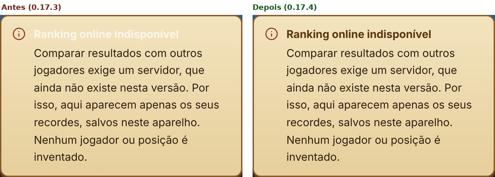  
*Ranking*

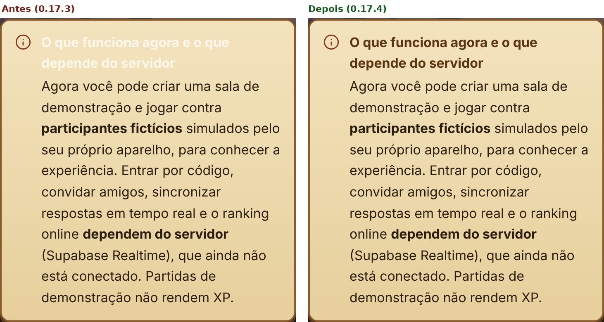  
*Multiplayer*

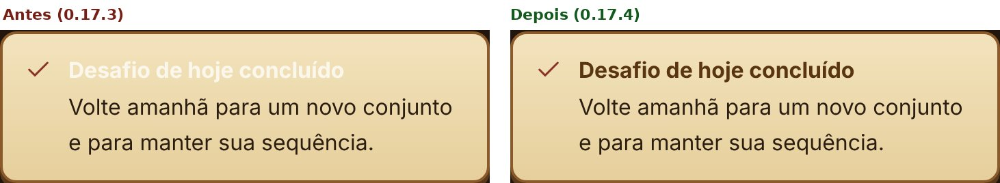  
*Desafio diário concluído hoje*

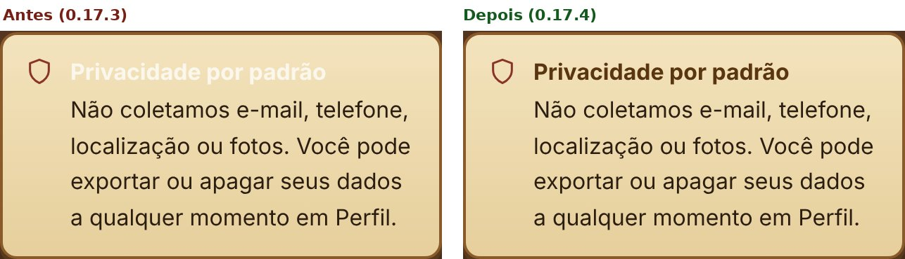  
*Entrar (criar perfil)*

## B (H2) — Introdução do mundo

**Problema:** o subtítulo, a chamada "Personagens que você vai conhecer" e os nomes dos personagens ficavam ilegíveis sobre o fundo escuro (de 1,07:1 a 4,22:1).

**Causa no código:** o texto herdava `color: #3b2414` de `.av-mapa` (global.css:1418), cor pensada para o mapa claro.

**Correção:** nova regra para `.world-intro-body`, com texto claro (`var(--text)`) e uma sombra leve, para ler bem sobre qualquer parte da pintura.

**Preservado:** conteúdo, pintura, retratos, botão "Entrar no mundo" e a regra `markWorldSeen` (nenhuma linha de StoryMap.tsx mudou).

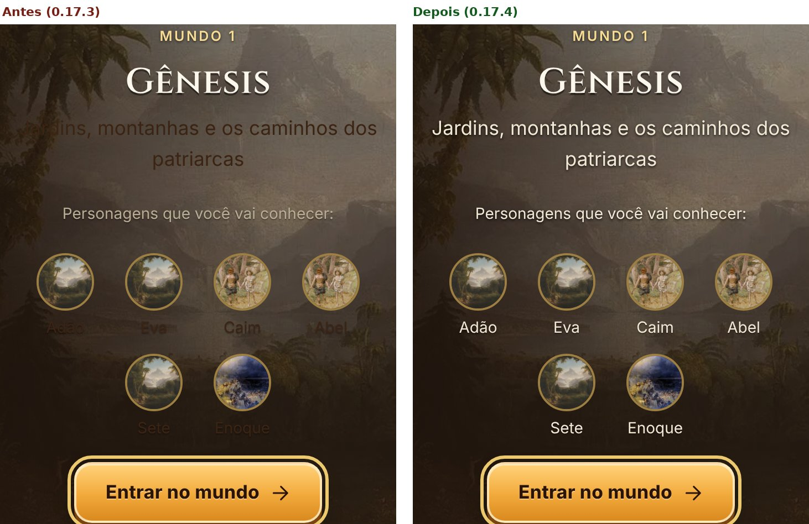  
*Introdução do mundo, celular*

## C (P1) — Tabela de recordes do Perfil

**Problema:** a tabela tinha linhas translúcidas sobre o cenário: o texto passava por cima de tendas, árvores e céu, e o cabeçalho ficava com 2,25:1.

**Causa no código:** a tabela não estava num painel; só as cores do texto tinham sido ajustadas para as páginas de aventura (global.css:1713).

**Correção:** nas páginas de aventura, `.table-wrap` virou um painel de pergaminho com moldura de madeira (o mesmo padrão dos outros painéis do Perfil), com cabeçalho em faixa e linhas alternadas suaves. Vale para as duas tabelas do Perfil: recordes e histórico.

**Preservado:** todos os dados, recordes, categorias e regras; o HTML da página não mudou.

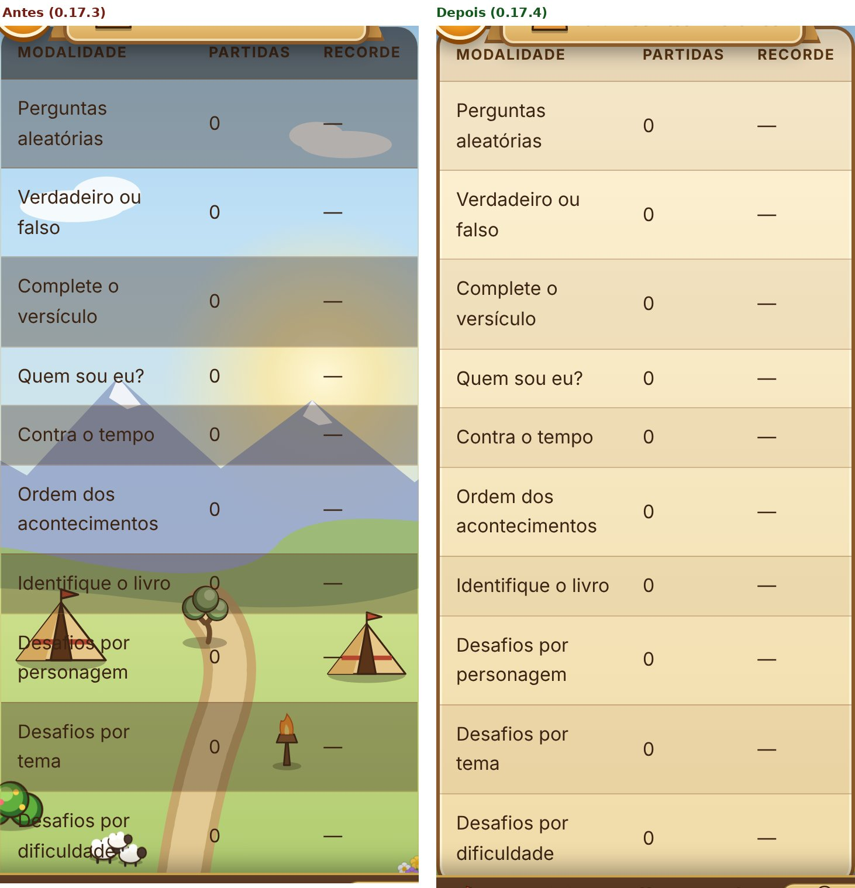  
*Tabela de recordes, celular*

## D (B1) — Link "Linha do tempo" na Biblioteca

**Problema:** o link na barra de abas ficava em laranja-escuro sobre madeira (1,33:1).

**Causa no código:** a regra geral de links das páginas de aventura (global.css:1697), com especificidade alta, vencia a regra feita para os links da barra de abas (global.css:1720), que nunca chegava a valer.

**Correção:** a regra geral passou a ignorar as abas (`:not(.tab)`), e o link recebeu a cor dourada clara já prevista para ele (7,27:1).

**Preservado:** as cinco abas, os contadores, os destinos e o link para `/linha-do-tempo`.

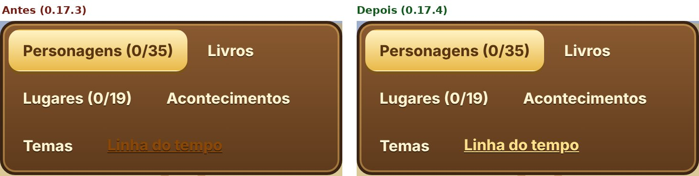  
*Barra de abas, celular*

## E (X5) — Navegação do computador e versão

**Problema:** a barra do computador usava "Início", "Modo História", "Modo Quiz" e "Diário". O rodapé mostrava "Versão 0.17" fixo, e a página Sobre dizia "Versão 0.3".

**Causa no código:** nomes fixos em `NAV` e um link "Diário" na fila principal (Layout.tsx); versões escritas à mão (Layout.tsx:107 e About.tsx:88).

**Correção:** nomes oficiais na barra; o "Desafio diário" saiu da fila principal e virou um destino secundário, com esse nome, junto das ações da barra (só no computador, como a barra; a Central, que esconde a barra, não recebe o link). A versão vem do `package.json`, pelo `define` do `vite.config.ts` e por `src/versao.ts`; rodapé e Sobre mostram 0.17.4.

**Preservado:** rotas; a regra de telas imersivas (`IMMERSIVE`); os 10 links secundários do rodapé; a navegação do celular; e o acesso ao Desafio diário pela Central, pelo painel de missões, pelo rodapé e pela barra.

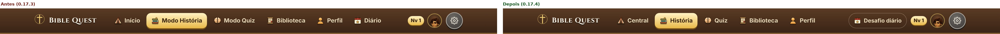  
*Barra do computador*

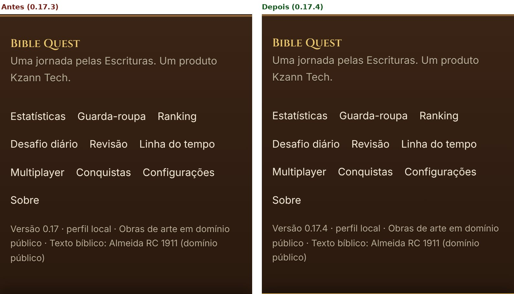  
*Rodapé, celular*

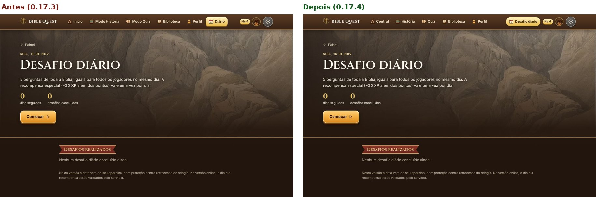  
*Desafio diário no computador: destino secundário ativo*

# 4. Contraste antes e depois

A medição foi feita no navegador, pelos pixels reais da tela: a cor do texto, comparada com a cor dominante do fundo no recorte do elemento, pela fórmula do WCAG. O mínimo para texto normal é 4,5:1.

| Onde                             | Texto                                    | 0.17.3  | 0.17.4  | 4,5:1              |
|----------------------------------|------------------------------------------|---------|---------|--------------------|
| Aviso do Ranking                 | Ranking online indisponível              | 1.22:1  | 8.33:1  | Atende             |
| Aviso do Multiplayer             | O que funciona agora e o que depende do  | 1.22:1  | 8.33:1  | Atende             |
| Multiplayer (até 12 anos)        | O que funciona agora e o que depende do  | 1.22:1  | 8.33:1  | Atende             |
| Multiplayer (até 12 anos)        | Proteção para menores                    | 1.23:1  | 8.24:1  | Atende             |
| Desafio diário: concluído hoje   | Desafio de hoje concluído                | 1.25:1  | 8.16:1  | Atende             |
| Desafio diário: data do aparelho | Data do aparelho anterior ao último desa | 1.23:1  | 8.24:1  | Atende             |
| Entrar (criar perfil)            | Privacidade por padrão                   | 1.23:1  | 8.24:1  | Atende             |
| Perfil: perfil local             | Perfil local                             | 8.3:1   | 8.3:1   | Atende             |
| Painel administrativo            | Sem autenticação real                    | 1.23:1  | 8.24:1  | Atende             |
| Introdução do mundo              | Jardins, montanhas e os caminhos dos pat | 2.15:1  | 8.17:1  | Atende             |
| Introdução do mundo              | Adão                                     | 1.07:1  | 12.74:1 | Atende             |
| Introdução do mundo              | Eva                                      | 1.17:1  | 10.53:1 | Atende             |
| Introdução do mundo              | Caim                                     | 1.43:1  | 8.63:1  | Atende             |
| Introdução do mundo              | Abel                                     | 1.23:1  | 10.16:1 | Atende             |
| Introdução do mundo              | Sete                                     | 1.2:1   | 14.35:1 | Atende             |
| Introdução do mundo              | Enoque                                   | 1.19:1  | 14.21:1 | Atende             |
| Introdução do mundo              | Personagens que você vai conhecer:       | 4.22:1  | 8.09:1  | Atende             |
| Perfil: tabela de recordes       | Modalidade                               | 2.25:1  | 7.4:1   | Atende             |
| Perfil: tabela de recordes       | Partidas                                 | 2.47:1  | 7.19:1  | Atende             |
| Perfil: tabela de recordes       | Recorde                                  | 2.25:1  | 7.46:1  | Atende             |
| Perfil: tabela de recordes       | Perguntas aleatórias                     | 5.05:1  | 11.62:1 | Atende             |
| Perfil: tabela de recordes       | 0                                        | 5.05:1  | 11.62:1 | Atende             |
| Perfil: tabela de recordes       | —                                        | 5.07:1  | 11.62:1 | Atende             |
| Perfil: tabela de recordes       | Verdadeiro ou falso                      | 10.51:1 | 12.56:1 | Atende             |
| Biblioteca: barra de abas        | Linha do tempo                           | 1.33:1  | 7.27:1  | Atende             |
| Biblioteca: barra de abas        | Livros                                   | 6.01:1  | 6.01:1  | Atende             |
| Biblioteca: barra de abas        | Lugares (0/19)                           | 7.15:1  | 7.15:1  | Atende             |
| Biblioteca: barra de abas        | Acontecimentos                           | 7.15:1  | 7.15:1  | Atende             |
| Biblioteca: barra de abas        | Temas                                    | 8.48:1  | 8.48:1  | Atende             |
| Barra do computador              | Início → Central                         | 9.22:1  | 9.22:1  | Sem mudança de cor |
| Barra do computador              | Modo História → História                 | 10.94:1 | 10.93:1 | Sem mudança de cor |
| Barra do computador              | Modo Quiz → Quiz                         | 9.22:1  | 9.22:1  | Sem mudança de cor |
| Barra do computador              | Biblioteca → Biblioteca                  | 9.22:1  | 9.22:1  | Sem mudança de cor |
| Barra do computador              | Perfil → Perfil                          | 9.13:1  | 9.13:1  | Sem mudança de cor |
| Barra do computador              | Diário                                   | 9.22:1  | —       |                    |
| Rodapé                           | Versão 0.17 → Versão 0.17.4              | 7.43:1  | —       |                    |

O histórico de partidas do Perfil não foi medido, porque o perfil de teste não tem partidas; ele usa a mesma regra da tabela de recordes. O aviso "Perfil local" já era legível (8,3:1) e continua igual. Na barra do computador e no rodapé mudaram só os nomes e a versão; as cores são as mesmas.

# 5. Arquivos alterados

| Arquivo                                                                                                        | Mudança                                                                                                                                                                        |
|----------------------------------------------------------------------------------------------------------------|--------------------------------------------------------------------------------------------------------------------------------------------------------------------------------|
| `src/styles/global.css`                                                                                        | Título dos avisos; texto da introdução do mundo; painel das tabelas do Perfil; exceção das abas na regra de links; estilo do link secundário da barra (+15 linhas, 1 alterada) |
| `src/components/layout/Layout.tsx`                                                                             | Nomes oficiais em `NAV`; Desafio diário como destino secundário (fora da Central); versão do pacote no rodapé                                                                  |
| `src/pages/About.tsx`                                                                                          | "Versão 0.3" trocada pela versão do pacote                                                                                                                                     |
| `src/versao.ts` (novo)                                                                                         | Exporta a versão do jogo, lida do pacote no build                                                                                                                              |
| `vite.config.ts`                                                                                               | Lê a versão do `package.json` e a disponibiliza ao jogo (`define`)                                                                                                             |
| `package.json`, `package-lock.json`                                                                            | Versão 0.17.3 → 0.17.4 (sem dependências novas nem atualizadas)                                                                                                                |
| `src/test/fase0.test.tsx` (novo)                                                                               | 4 testes: nomes da barra, Desafio diário secundário, Central sem o link, versão do pacote e acesso à linha do tempo                                                            |
| `docs/planos/ETAPA_2_DECISOES_OFICIAIS.md` (novo), `CHANGELOG.md`, `README.md`, `ROADMAP.md`, `docs/README.md` | Decisões, versão 0.17.4 e este relatório                                                                                                                                       |

Não mudaram: `tokens.css`, os estilos e componentes da Central (`styles/componentes/`, `styles/telas/`, `components/camp/`, `character3d/`, `Dashboard.tsx`, `NavegacaoGlobal.tsx`), os dados (`src/data/`), as regras (`src/services/`), `StoryMap.tsx`, `Profile.tsx` e `Library.tsx`.

# 6. Testes e verificações

| Verificação         | Resultado                                                                                                                      |
|---------------------|--------------------------------------------------------------------------------------------------------------------------------|
| `npm run typecheck` | Sem erros                                                                                                                      |
| `npm test`          | 155 de 155 testes passando, em 13 arquivos (antes: 151 em 12)                                                                  |
| `npm run build`     | Concluído sem erros                                                                                                            |
| Os cinco pontos     | Medidos e conferidos visualmente (seções 3 e 4)                                                                                |
| Varredura de telas  | 84 capturas (42 telas e estados, celular 390 × 844 e computador 1280 × 800): 0 erros de JavaScript, 0 casos de rolagem lateral |
| Central             | Idêntica pixel a pixel à 0.17.3 (seção 7)                                                                                      |

Um teste antigo do fluxo da Central falhou na primeira rodada: o novo link também aparecia, escondido, na barra que a Central oculta. A correção foi não montar o link na Central, e um teste novo garante isso. O teste antigo não foi alterado.

## Telas completas, antes e depois

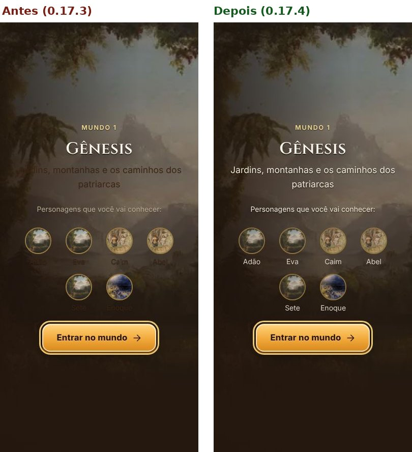  
*Introdução do mundo, celular*

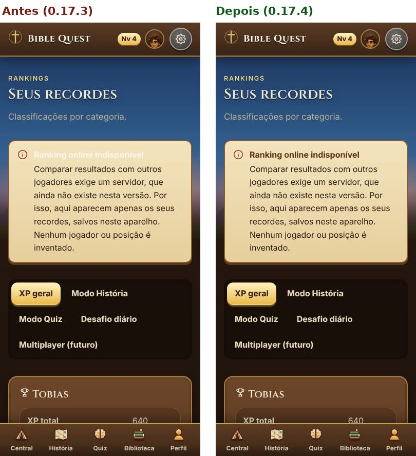  
*Ranking, celular*

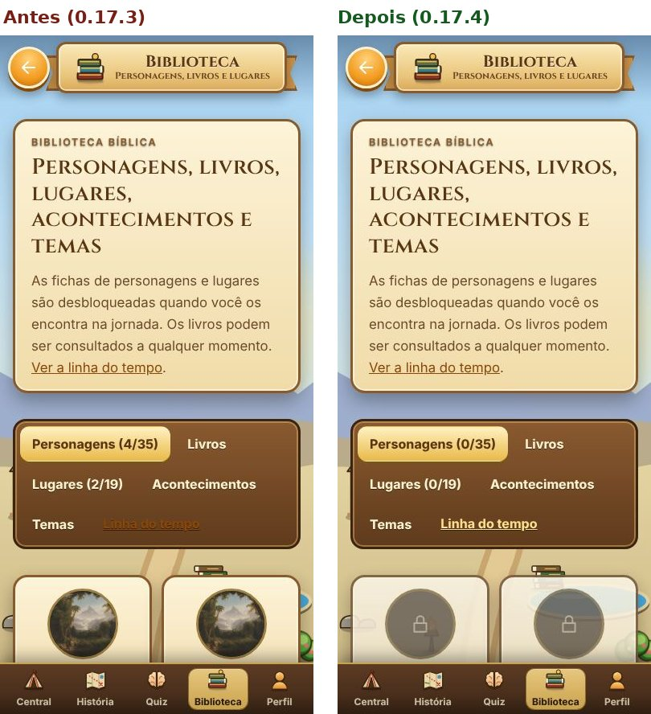  
*Biblioteca, celular*

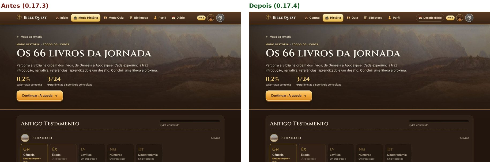  
*Livros, computador (barra superior)*

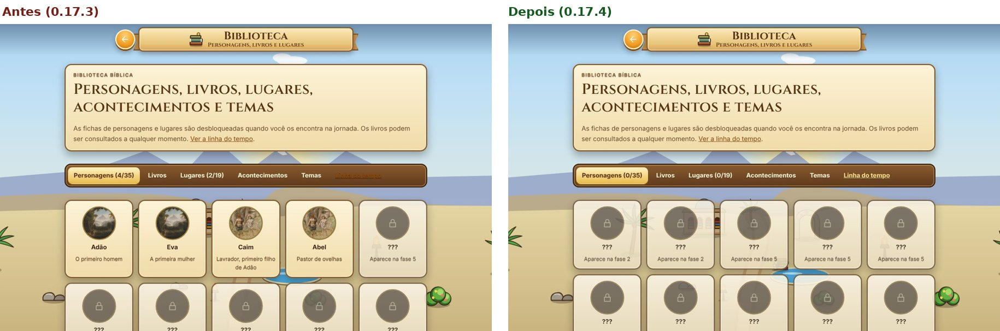  
*Biblioteca, computador*

# 7. A Central não foi modificada

- **Arquivos:** nenhum arquivo da Central mudou (lista na seção 5).
- **Imagem:** a Central foi capturada antes e depois, com animações reduzidas para eliminar a variação natural, em 3D e 2D, no celular e no computador. As quatro comparações deram **idênticas pixel a pixel**. Antes disso, duas capturas seguidas da 0.17.3 também saíram idênticas entre si, o que mostra que o método é confiável.
- **Estrutura:** a barra superior, escondida na Central, não recebe o novo link, e um teste confere isso.

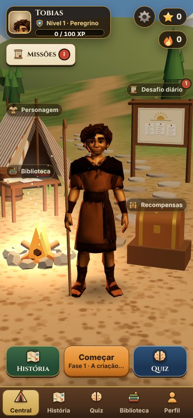  
*Central 0.17.4, celular, 3D (idêntica à 0.17.3)*

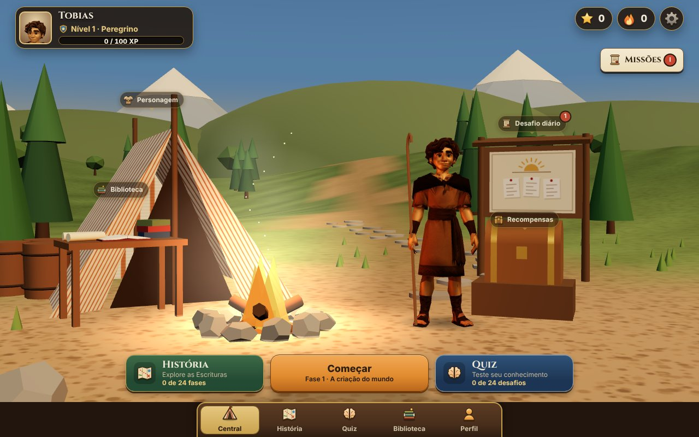  
*Central 0.17.4, computador, 3D (idêntica à 0.17.3)*

# 8. Problemas conhecidos

- **Medição de contraste:** é feita por amostragem de pixels. Sobre a pintura da introdução do mundo, o trecho mais desfavorável do subtítulo mede 5,9:1, ainda acima do mínimo.
- **Desafio diário no celular:** o link secundário aparece só no computador, junto da barra superior. No celular, o acesso continua pela Central (rótulo e painel de missões) e pelo rodapé. A navegação do celular não mudou.
- **Rodapé:** continua com o visual antigo e os 10 links secundários (mantidos, como pedido). A organização dele fica para as próximas fases.
- **Cores fixas:** as novas regras usam cores fixas em `global.css`, como o restante desse arquivo, porque não era para mexer em `tokens.css` nesta fase. A migração para os tokens é a Fase 1.
- **Pacote do jogo:** o arquivo principal mudou de nome (`index-DWTM3Srj.js`), o que é esperado com a mudança de código.
- **Limites da validação:** só Chromium, com vídeo por software; sem aparelhos reais, sem Safari e sem leitores de tela.

# 9. Publicação

- Commit somente na branch de desenvolvimento `claude/loving-carson-8mrbjo`.
- Sem integração ao `main` e sem publicação no GitHub Pages; o site continua na 0.17.3.
- Os links deste relatório apontam para a branch de desenvolvimento.

### Aguardando aprovação

A Fase 1 só começa depois da aprovação da 0.17.4.

