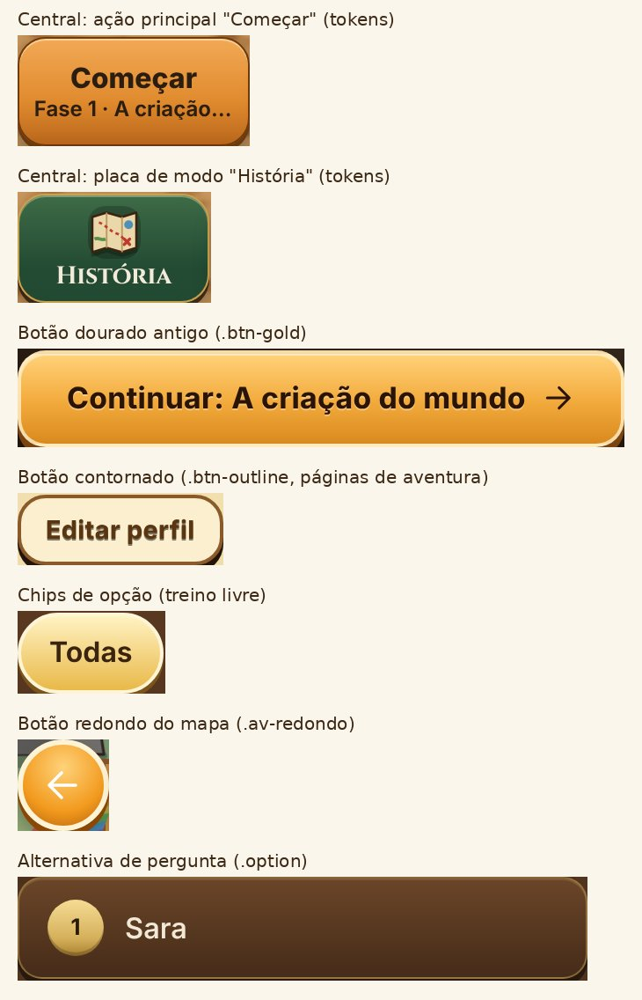
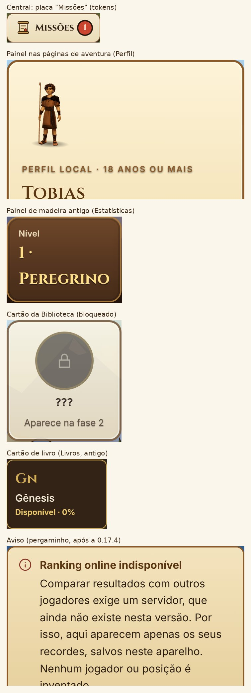
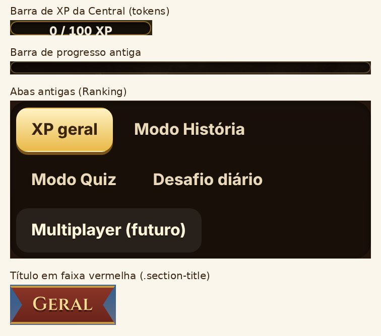

# Bible Quest — Fase 1 da Etapa 2: Auditoria Visual e Proposta da Base Comum

**Kzann Tech** · Etapa 2, Fase 1 · 16/11/2026.

- **Seções 1 a 14:** auditoria e proposta, feitas sobre a versão 0.17.4.
- **Seção 15:** implementação aprovada dos passos 1.1 a 1.3, na versão 0.17.5, ainda não publicada e aguardando aprovação para integrar.

Versão em PDF: `ETAPA_2_FASE_1_AUDITORIA_VISUAL.pdf` (mesmo conteúdo). As evidências desta auditoria estão em [`evidencias/etapa-2-fase1-auditoria/`](evidencias/etapa-2-fase1-auditoria/). As capturas das telas são as do diagnóstico, em [`evidencias/etapa-2-diagnostico-visual/`](evidencias/etapa-2-diagnostico-visual/).

### Sobre este relatório

- **O que é:** a primeira execução da Fase 1. É uma auditoria da estrutura visual atual e uma proposta técnica para a base comum (tokens e componentes). Nada foi implementado.
- **O que não mudou:** código, estilos, componentes, a Central, dados, regras, rotas e funcionalidades. Também não houve versão nova, publicação nem início da Etapa 3.
- **Base:** versão 0.17.4 (commit `7e8ab4e`, igual ao publicado).
- **Como os dados foram obtidos:**
  - leitura de todos os arquivos de estilo e de componentes;
  - contagem automática de cores, tamanhos, espaços, sombras e seletores;
  - medição no navegador (Chromium, celular 390 × 844 e computador 1280 × 800) de 23 telas;
  - cálculo de contraste pela fórmula do WCAG.

---

# 1. Resumo

| Medida | Valor |
| --- | --- |
| Arquivos de estilo | 7 (`global.css` com 1.736 linhas; `tokens.css`; 4 de componentes da Central; 1 de tela da Central) |
| Cores HEX diferentes nos estilos | 251, das quais 221 estão em `global.css` |
| Pares de cores quase iguais (diferença menor que 12 em 255) | 259 |
| Tamanhos de fonte diferentes em `global.css` | 57 |
| Sombras diferentes | 85 |
| Raios de borda diferentes | 19 |
| Valores de espaço diferentes (padding, margin, gap) | 33 |
| Pontos de quebra (`@media`) diferentes | 20 |
| Seletores definidos mais de uma vez em `global.css` | 173 |
| Usos dos tokens da Central em `global.css` | **0** |
| Variantes visuais de botão medidas nas telas | 18 |
| Classes de `global.css` sem ocorrência literal no código | 158 (22 podem ser montadas dinamicamente; as outras 136 são candidatas a remoção, a confirmar) |

**Conclusão:** já existe uma boa base, que é a da Central. O arquivo `tokens.css` tem paleta, cores semânticas, escalas de espaço, raio, fonte, sombra e tempo, alto contraste e redução de animações, e os componentes da Central usam só esses tokens (0 cores HEX fora deles). O resto do jogo usa outro sistema, com cerca de 40 variáveis antigas e centenas de cores fixas, acumulado em camadas desde a v0.2.

**Proposta:** não criar um terceiro sistema. A proposta é ampliar `tokens.css` como fonte única e organizá-lo em quatro camadas:

1. **Paleta:** os primitivos atuais, mais algumas cores novas para os ambientes.
2. **Significado:** os tokens semânticos atuais, mais bordas, links, feedback, foco sobre fundo claro e área de toque.
3. **Componentes:** botão, painel, janela, aviso, campo e progresso, com as mesmas peças em todo o jogo.
4. **Ambientes:** variáveis por ambiente (`[data-ambiente]`), que mudam cor de acento, superfície, luz e moldura, mas não a estrutura.

A migração seria incremental. Uma **ponte de compatibilidade** liga as variáveis antigas (`--gold`, `--parchment`, `--text`...) aos tokens novos, para as telas antigas continuarem iguais até serem migradas uma a uma, com capturas antes e depois.

**Pontos de acessibilidade encontrados:**

- **Foco sobre pergaminho:** o anel de foco atual (`--foco`, azul claro) tem só **1,87:1** sobre pergaminho; o mínimo para contorno é 3:1. Isso afeta o painel de missões da Central e as janelas de pergaminho. A proposta é um segundo token de foco para fundos claros.
- **Selo de aviso:** o número em marfim sobre o vermelho de aviso (`--aviso`) tem **4,05:1**, abaixo de 4,5:1 para texto pequeno. Esse selo aparece na Central.
- **Áreas de toque:** 15 tipos de elementos interativos ficam abaixo dos 44 px adotados pelo projeto, todos acima dos 24 px mínimos do WCAG. Exemplos: links do rodapé (38 px), "voltar" (35 px), chips (38 px), interruptor (30 px), seletor de dificuldade (38 px) e botões pequenos (40 px).
- **Foco pelo teclado:** nenhum elemento sem indicação de foco nos 12 primeiros passos de Tab de cada tela.
- **Dois altos contrastes:** existem dois sistemas diferentes de alto contraste (o antigo em preto e amarelo, o novo em terra e marfim).

**Os dois primeiros pontos tocam a Central.** Ficam registrados, mas só serão corrigidos com autorização expressa.

---

# 2. Diagnóstico da estrutura atual

## 2.1 Arquivos e ordem de carregamento

`src/main.tsx` importa, nesta ordem:

1. Fontes (Cinzel 600 e 700; Inter Variable; Crimson Pro 400, 400 itálico e 600).
2. `styles/global.css`, o sistema antigo, com tudo o que não é da Central.
3. `styles/tokens.css`, a paleta e os tokens da Central.
4. `styles/componentes/{navegacao,hud,placa,painel}.css` e `styles/telas/acampamento.css`, só da Central e da navegação inferior.

| Arquivo | Linhas | Regras | HEX | rgba | `!important` | Usos de `var()` | `@media` |
| --- | --- | --- | --- | --- | --- | --- | --- |
| `global.css` | 1.736 | 1.548 | 538 (221 diferentes) | 394 | 14 | 590 (todas de variáveis antigas) | 61 |
| `tokens.css` | 99 | 6 | 31 (a paleta) | 6 | 0 | 28 | 1 |
| `componentes/navegacao.css` | 36 | 14 | 0 | 3 | 0 | 27 | 1 |
| `componentes/hud.css` | 58 | 31 | 0 | 3 | 0 | 40 | 1 |
| `componentes/placa.css` | 75 | 36 | 0 | 7 | 0 | 47 | 1 |
| `componentes/painel.css` | 52 | 34 | 0 | 9 | 0 | 45 | 1 |
| `telas/acampamento.css` | 70 | 58 | 0 | 6 | 3 | 50 | 2 |

Um teste automático (`central.test.tsx`) garante que `componentes/` e `telas/` não tenham HEX, e esse padrão vale manter.

## 2.2 Camadas dentro de `global.css`

O arquivo cresceu por acréscimo. Cada versão adicionou um bloco que **sobrescreve** os anteriores:

- base e estrutura (v0.2);
- Modo História, Modo Livre e Admin (v0.2);
- personagem, mapa, modais, cena, biblioteca, linha do tempo e revisão (v0.3);
- Home em cena, mapa do Quiz e recompensa (v0.4);
- personagem 3D (v0.5); boas-vindas (v0.6); criador (v0.7 e v0.8);
- painel (v0.9); tela de perguntas (v0.9.3);
- visual de madeira (v0.10), que recolore botões, painéis, abas, avisos, campos e rodapé;
- ícones (v0.12); mapas de aventura (v0.14); perguntas e resultado de aventura (v0.15); cena da fase, Biblioteca, Conquistas e Perfil de aventura (v0.16);
- correções da 0.17.4.

**Consequências:**

- **O mesmo componente tem várias definições.** Por exemplo, `.panel` é definido 4 vezes e `.topnav-link` 3 vezes; ao todo, 173 seletores se repetem. Para saber a aparência final de um elemento, é preciso ler o arquivo inteiro.
- **Uma correção numa camada pode não chegar às outras.** Foi o caso do título dos avisos e do link da linha do tempo, corrigidos na 0.17.4.
- **Há duas definições de variáveis:** `:root` (linha 5) e um segundo `:root` (linha 1311), com `--wood`, `--plank` e `--sky-*`.

## 2.3 Estilos fora dos arquivos CSS

- **`style={{...}}` em componentes:** 23 ocorrências. A maioria é posição ou tamanho calculados (mapas, guarda-roupa, barra de progresso), o que é legítimo.
- **Cores escritas em código TS/TSX:** 774. São ilustrações e cenários, e não fazem parte da interface:
  - SVG dos mapas: `Elementos.tsx`, 205;
  - ícones ilustrados: `GameIcon.tsx`, 110;
  - cena 3D da Central: `acampamento.ts`, 104;
  - cenários dos mapas: `cenarios.ts`, 50;
  - cores do personagem e itens: `aparencia.ts` e `items.ts`;
  - cores dos mundos e das regiões: `worlds.ts` e `regions.ts`.

  **Proposta:** não tokenizar a arte. Só as cores de "clima" dos cenários (céu, chão, névoa) devem passar a ler os tokens do ambiente, numa fase posterior.

---

# 3. Inventário de cores e estilos

## 3.1 Cores

| Família | Cores diferentes |
| --- | --- |
| Marrons, laranjas e ouros | 114 |
| Pergaminhos e cremes | 41 |
| Azuis | 28 |
| Verdes | 22 |
| Vermelhos | 20 |
| Neutros (cinza, preto, branco) | 18 |
| Roxos e rosas | 6 |
| Amarelos claros | 2 |

**Mais usadas em `global.css`:**

| Cor | Usos | Papel |
| --- | --- | --- |
| `#8a5a2a` | 30 | moldura de madeira |
| `#5a3511` | 28 | texto escuro de títulos |
| `#3b2414` | 26 | texto sobre pergaminho |
| `#ffffff` | 21 | — |
| `#1b1407` | 15 | — |
| `#000000` | 10 | — |
| `#c9923a` | 10 | moldura dourada |
| `#22150d` | 9 | fundo |
| `#f6dc94` | 8 | — |
| `#fff6dc` | 7 | — |

Com 114 marrons e 41 pergaminhos, e 259 pares quase iguais (por exemplo, `#3b2414`, `#3a2410` e `#3a2416`), fica claro que **as mesmas intenções foram escritas com valores diferentes**. Uma paleta com 5 tons de terra, 2 de pergaminho e 3 de ouro (a da Central) cobre essas intenções.

## 3.2 Variáveis antigas e tokens da Central

| Variável antiga | Valor | Usos | Token da Central equivalente | Valor do token |
| --- | --- | --- | --- | --- |
| `--navy-950` / `-900` / `-850` / `-800` / `-700` (são marrons, apesar do nome) | `#160e08` / `#22150d` / `#2c1b11` / `#3a2416` / `#5a3822` | 1 / 9 / 3 / 2 / 1 | `--terra-900` / `-800` / `-700` | `#22160D` / `#2E1E12` / `#4A2F1C` |
| `--gold` | `#d4af5a` | 49 | `--ouro-500` | `#C9A24E` |
| `--gold-strong` | `#ecc96e` | 84 | `--ouro-300` | `#E6C77E` |
| `--gold-dim` | `#9d7f43` | 18 | `--ouro-700` | `#8C6A2A` |
| `--parchment` / `-dark` | `#efe3c4` / `#e2d2a8` | 19 / 8 | `--pergaminho` / `-escuro` | `#F4EAD2` / `#EBDDB9` |
| `--ivory` | `#fbf7ec` | 27 | `--marfim` | `#F3EBDA` |
| `--text` | `#f1e9d6` | 17 | `--texto-sobre-escuro` (marfim) | `#F3EBDA` |
| `--muted` | `#b8ad94` | 27 | `--texto-suave-sobre-escuro` | `#C9BBA0` |
| `--ink` | `#2b1d10` | 14 | `--tinta` | `#2B1D10` (igual) |
| `--earth` / `-light` | `#5c3d22` / `#7d5733` | 14 / 2 | `--terra-600` / `-500` | `#5C3B23` / `#7A5234` |
| `--ok` / `--err` | `#73c493` / `#ec8a78` | 19 / 15 | `--acerto` / `--erro` (versões escuras) | `#356B3B` / `#A63D2A` |
| `--border` / `-strong` | ouro com 22% / 50% | 43 / 29 | (não existe) | proposta: `--borda-suave` / `--borda-ouro` |
| `--radius` / `-sm` | 18px / 12px | 27 / 19 | `--raio-g` / `--raio-m` | 16px / 10px |
| `--shadow` | `0 18px 40px rgba(0,0,0,.35)` | 13 | `--elevacao-3` | `0 18px 44px rgba(0,0,0,.5)` |
| `--speed` | 180ms | 25 | `--dur-estado` | 200ms |
| `--wood-*`, `--plank`, `--sky-*` | madeira e céu (v0.10) | `--plank` 4, `--wood-edge` 2, `--wood-shadow` 5; `--wood`, `--wood-hi` e `--wood-lo` sem uso | `--superficie-madeira` | gradiente de terra |

**Tipografia:** já é consistente nas duas camadas:

- **Títulos:** Cinzel (`--font-display`).
- **Interface:** Inter Variable (`--font-body`).
- **Leitura e citações:** Crimson Pro (`--font-serif`).
- **Pesos usados:** 400, 500, 550, 600, 650, 700, 750 e 800. Sete pesos no Inter é mais do que o necessário.

## 3.3 Tamanhos, espaços, raios, sombras e pontos de quebra

- **Tamanhos de fonte:** 57 valores em `global.css`, dos quais 0.85rem (11 usos), 0.9rem (10), 0.78rem (9), 1.1rem (8) e 1.15rem (8) são os mais usados. A Central usa uma escala de 7 (12, 14, 16, 18, 22, 28 e 36 px).
- **Espaços:** 33 valores. Os mais usados são 10, 6, 12, 8, 4, 16 e 14 px. A escala da Central tem 7 (4, 8, 12, 16, 24, 32 e 48).
- **Raios:** 19 valores. Os mais usados são 50% (círculos), 999px (pílulas), 18, 12, 10, 8, 16 e 14 px. A Central usa 6, 10 e 16 px e pílula.
- **Sombras:** 85 diferentes. A Central usa 3 elevações e um brilho interno.
- **Pontos de quebra:** 20 diferentes (380, 420, 560, 600, 640, 700, 719, 720, 759, 760, 820, 860, 900, 960, 999, 1000 e 1100 px). Os mais usados são 760, 960 e 900.
- **Camadas (`z-index`):** 17 valores entre -2 e 100, sem escala definida.
- **Animações:** 47 `@keyframes` em `global.css`. A redução de movimento aparece de duas formas: `[data-motion='reduzido']` e `prefers-reduced-motion`.
- **Alto contraste:** dois sistemas.
  - `global.css` troca para preto (`#000`) e amarelo (`#ffd36b`).
  - `tokens.css` troca para terra e marfim.

  Hoje uma tela pode misturar os dois.

## 3.4 Componentes, como aparecem nas telas

A medição no navegador agrupou os elementos por aparência final (fundo, cor, borda, raio, fonte e sombra):

| Tipo | Variantes medidas | Observação |
| --- | --- | --- |
| Botões | 18 | `.btn-gold` (46 usos em 29 arquivos), `.btn-outline` (32), `.btn-ghost` (9), `.btn-danger` (5), `.btn-sm` (26), `.btn-lg` (17), `.icon-btn`, `.av-redondo`, `.option`, `.chip`, os botões da Central (`.camp-continuar`, `.camp-modo`, `.camp-label`) e outros |
| Painéis e cartões | 4 grupos principais | madeira antiga (`.panel`, 52 usos), pergaminho das páginas de aventura, pergaminho das janelas (`.av-janela`), placas da Central |
| Avisos | 2 | pergaminho (corrigido na 0.17.4) |
| Campos | 6 | pergaminho com borda, sem borda, seletor do mapa (dourado) e cores |
| Progresso | 4 | antigo, HUD da Central, páginas de aventura, mapas |
| Abas e chips | 10 | madeira, ouro em pílula, ouro em retângulo |
| Títulos h1 | 10 | 27, 38 e 18,7 px; marfim ou marrom |
| Títulos h2 | 12 | faixa vermelha, marrom e marfim |

**Notificações:** não há um sistema único.

- **Mensagens rápidas dos mapas** (`.map-toast`): dois mapas, com estado próprio em cada tela.
- **Aviso de bloqueio no mapa** (`.av-aviso-bloqueio`).
- **Mensagens de status:** `role="status"` e `aria-live` em 10 componentes.
- **Janela de item novo:** `ItemReward`.

---

# 4. Acessibilidade e responsividade

## 4.1 Contraste das cores atuais e dos tokens

Os valores foram calculados pela fórmula do WCAG. O mínimo é 4,5:1 para texto normal e 3:1 para texto grande e para contornos, bordas e foco.

| Combinação | Contraste | Situação |
| --- | --- | --- |
| Marfim sobre terra-900, -700 e -600 | 14,9 / 10,3 / 8,4 | Atende |
| Marfim suave sobre terra-900, -700 e -600 | 9,3 / 6,5 / 5,3 | Atende |
| Tinta sobre pergaminho e pergaminho escuro | 13,6 / 12,1 | Atende |
| Tinta suave sobre pergaminho e pergaminho escuro | 7,4 / 6,6 | Atende |
| Ouro-300 sobre terra-900 e -700 | 10,8 / 7,5 | Atende |
| Tinta sobre fogueira-500 (ação principal) | 6,1 | Atende |
| Marfim sobre acerto / erro | 5,3 / 5,3 | Atende |
| Marfim sobre azul-700 e -900 (modo Quiz) | 10,5 / 13,0 | Atende |
| **Marfim sobre aviso (selo numérico)** | **4,05** | **Não atende para texto pequeno** (selo da Central) |
| Foco (`#7FB2E5`) sobre terra-900 | 7,9 | Atende (3:1) |
| **Foco (`#7FB2E5`) sobre pergaminho** | **1,87** | **Não atende (3:1)**: foco quase invisível em painéis claros |
| Ouro-700 sobre pergaminho (moldura) | 4,2 | Atende (3:1) |
| Antigo: `--gold-dim` sobre fundo | 4,7 | No limite |
| Antigo: `--muted` sobre `--navy-700` (cartão claro) | 4,67 | No limite |

## 4.2 Foco pelo teclado

Percorri as 23 telas no computador com Tab, nos 12 primeiros elementos de cada uma. **Nenhum elemento ficou sem indicação de foco** (contorno ou sombra). O problema real é a cor do foco sobre fundos claros (seção 4.1).

## 4.3 Áreas de toque (meta do projeto: 44 px; mínimo do WCAG 2.2: 24 px)

| Elemento | Tamanho medido | Onde |
| --- | --- | --- |
| Links do rodapé | 38 px de altura | 15 telas |
| Marca "Bible Quest" e nível na barra superior | 36 e 38 px | 14 telas |
| Itens da barra do computador e "Desafio diário" secundário | 40 px | 14 telas (computador) |
| Link "voltar" (`.back-link`) | 35 px | 7 telas |
| Baú do topo do mapa (`.av-bau-topo`) | 40 × 40 px | mapas |
| Botões pequenos (`.btn-sm`) | 40 px | Perfil, Revisão |
| Chips de opção (quantidade, "−") | 38 px; o menor tem 39 px de largura | treino |
| Seletor de dificuldade do mapa | 38 px | mapa do Quiz |
| Interruptor (Configurações) | 52 × 30 px | Configurações |
| Seletores de cor | 34–42 px de largura | guarda-roupa |
| Rótulos da Central | 28–30 px visíveis, mas a área de toque é ampliada para 44 px por `::before` | Central (já resolvido) |

Todos passam no mínimo do WCAG (24 px), mas ficam abaixo da meta de 44 px. A proposta é um token `--toque-min: 44px` aplicado aos componentes base, com a área ampliada por pseudo-elemento quando o visual precisar ser menor, como já é feito na Central.

## 4.4 Responsividade

- Nenhuma rolagem horizontal nas 84 capturas do diagnóstico e nas 80 da 0.17.4.
- **Pontos de quebra:** há 20 diferentes. A proposta é padronizar em **3**:
  - **600 px:** celular;
  - **960 px:** computador, onde a barra superior aparece;
  - **1280 px:** telas largas.

  Os valores fora disso migram aos poucos, tela a tela.
- **Celular:** páginas antigas muito longas (de 4.800 a 7.200 px). Isso é questão de cada tela (Fases 2 a 5), não da base.
- **Tablet:** a Central já trata o tablet com posições próprias. As outras telas usam o layout de celular até 760 px ou 960 px, conforme a regra. A base deve definir um comportamento intermediário para os painéis (duas colunas a partir de 600 px).

---

# 5. Mapa de identidade visual

## 5.1 Linguagem comum, igual em todos os ambientes

Vem da Central 0.17.3:

- **Materiais:** madeira (placas, molduras e barras), pergaminho (leitura e janelas), ouro envelhecido (bordas e destaques) e vidro escuro (HUD).
- **Luz:** quente, de fim de tarde, com brilho interno nas superfícies e sombras curtas de "objeto apoiado" (`--elevacao-1`).
- **Tipografia:**
  - Cinzel nos títulos e placas;
  - Inter na interface;
  - Crimson Pro em citações e no texto bíblico.
- **Ação principal:** laranja de fogueira, sempre a mesma em todo o jogo. É o "Começar" e o "Continuar".
- **Feedback:** acerto, erro e aviso com as mesmas cores em todo lugar.
- **Acessibilidade:** área de toque de 44 px, foco visível em fundo claro e escuro, alto contraste e redução de animações.

## 5.2 O que muda em cada ambiente

| Ambiente | Ideia | Cor de acento | Superfície | Luz e fundo | Molduras e detalhes | Títulos |
| --- | --- | --- | --- | --- | --- | --- |
| Central | Acampamento de Aventura | ouro sobre madeira; ação laranja | madeira e pergaminho | entardecer, névoa, cena 3D | placas de madeira, rótulos discretos | Cinzel em placa |
| História | Trilha da Jornada | verde floresta (`--floresta-700/500`) | pergaminho de mapa, com bordas gastas | céu de manhã a tarde, campo verde suave e terreno do mundo | marcos de pedra, medalhões dourados | faixa de pergaminho |
| Quiz | Templo do Saber | azul profundo (`--azul-900/700`) e dourado | pedra clara (proposta `--pedra-100`) com moldura azul | interior de templo, colunas, luz dourada lateral | ouro polido, frisos geométricos | Cinzel com friso dourado |
| Biblioteca | Sala de Estudos | couro (proposta `--couro-700`) e âmbar de lamparina | papel claro (proposta `--papel`) | luz de lamparina, estantes de madeira | lombadas, marcadores de fita | Crimson Pro em destaque |
| Perfil | Tenda do Personagem | tecido avermelhado (proposta `--tecido-600`) | lona (proposta `--lona`) | interior da tenda, luz da fogueira | costuras, tapete, baú | Cinzel em placa de couro |
| Conquistas | Sala dos Troféus | veludo escuro (proposta `--veludo-800`), ouro, prata e bronze | madeira nobre | luz de vitrine sobre as prateleiras | medalhas e estandartes | Cinzel com ouro |

Os ambientes compartilham estrutura, materiais e componentes e diferem em cor de acento, superfície de leitura, luz e detalhes. O mesmo botão "Começar" é laranja em todos; o que muda é a moldura do painel em volta e o fundo.

---

# 6. Proposta de design tokens

## 6.1 Arquitetura em quatro camadas (tudo em `tokens.css`)

1. **Paleta (primitivos):** valores brutos, como `--terra-900` e `--ouro-300`. Só esta camada tem HEX.
2. **Significado (semânticos):** para que serve a cor ou a medida, como `--superficie-leitura`, `--texto-sobre-escuro` e `--borda-ouro`. As telas usam esta camada.
3. **Componentes:** valores específicos de peças compartilhadas, como `--botao-altura`, `--janela-raio` e `--aviso-fundo`. São opcionais e referenciam a camada 2.
4. **Ambientes:** `[data-ambiente='historia'|'quiz'|'biblioteca'|'perfil'|'conquistas']` redefinem só um conjunto pequeno de variáveis de ambiente (`--amb-*`). A Central continua com o padrão atual.

O atributo `data-modo` atual, que a Central usa nas placas de História e Quiz, continua funcionando como hoje.

## 6.2 Tokens globais

Itens marcados com **novo** não existem hoje. Os demais já existem em `tokens.css` e ficam como estão.

| Grupo | Tokens | Valores |
| --- | --- | --- |
| Terra e madeira | `--terra-900`, `-800`, `-700`, `-600`, `-500` | existentes |
| Leitura | `--pergaminho`, `--pergaminho-escuro`, `--areia`, `--tinta`, `--tinta-suave`, `--marfim`, `--marfim-suave` | existentes |
| Ouro | `--ouro-300`, `-500`, `-700` | existentes |
| Modos | `--floresta-*`, `--musgo-600`, `--azul-*`, `--pedra-300` | existentes |
| Ação | `--fogueira-*` | existentes |
| Estados | `--acerto`, `--erro`, `--bloqueado`, `--aviso`, `--foco` | existentes |
| **novo** Estados sobre fundo claro | `--acerto-texto` `#2E5E33` (6,4:1 no pergaminho); `--erro-texto` `#8E3020` (6,8:1); `--info` = `--azul-500` (6,7:1) | Para mensagens em pergaminho |
| **novo** Estados sobre fundo escuro | `--acerto-claro` `#8FD3A2` (10,1:1 em terra-900); `--erro-claro` `#F0A08F` (8,5:1) | Substituem `--ok` e `--err`, com contraste melhor |
| **novo** Foco sobre fundo claro | `--foco-sobre-claro` `#1F5FA8` (5,4:1 no pergaminho; 3,9:1 no ouro-300) | Corrige o 1,87:1 atual |
| **novo** Link | `--link-leitura` `#7A3B0A` (7,1:1 no pergaminho; 6,3:1 no pergaminho escuro); `--link-sobre-escuro` = `--ouro-300` (10,8:1) | Hoje há 3 cores de link |
| **novo** Selo de aviso | `--aviso-selo` `#A8321F` (marfim sobre ele: 5,6:1) | Corrige o 4,05:1 do selo (aplicar na Central só com autorização) |
| **novo** Bordas | `--borda-ouro` = `--ouro-500`; `--borda-suave` = ouro com 25%; `--borda-madeira` = `--terra-500`; `--borda-leitura` = `--ouro-700` (4,2:1) | Hoje: `--border`, `--border-strong` e 30 HEX |
| Superfícies | `--superficie-escura`, `--superficie-madeira`, `--superficie-leitura`, `--vidro-escuro` | existentes |
| **novo** Superfície elevada | `--superficie-leitura-elevada`: pergaminho com moldura (o padrão de `.av-janela`) | Janelas e painéis de destaque |
| Texto | `--texto-sobre-escuro`, `--texto-suave-sobre-escuro`, `--texto-sobre-leitura`, `--texto-suave-sobre-leitura`, `--texto-sobre-acao`, `--destaque` | existentes |
| Espaço | `--esp-1` a `--esp-7` (4, 8, 12, 16, 24, 32 e 48 px) | existentes; substituem 33 valores |
| Raio | `--raio-p` 6, `--raio-m` 10, `--raio-g` 16, `--raio-pilula`; **novo** `--raio-janela` 20 | Substituem 19 valores; 18 e 20 viram 20, 12 e 14 viram 10 ou 16, conforme o caso |
| Tipografia | `--fonte-12` a `--fonte-36`; **novo** `--fonte-titulo` (Cinzel), `--fonte-texto` (Inter), `--fonte-leitura` (Crimson Pro); **novo** `--peso-normal` 400, `--peso-forte` 700, `--peso-titulo` 600, `--peso-destaque` 800 | Substituem 57 tamanhos e 8 pesos |
| Sombra | `--elevacao-1`, `-2`, `-3`, `--brilho-interno`; **novo** `--sombra-texto-sobre-imagem` | Substituem 85 sombras |
| Tempo | `--dur-toque`, `--dur-estado`, `--dur-janela`, `--dur-recompensa`, `--curva-saida`, `--curva-mola` | existentes |
| **novo** Interação | `--toque-min` 44px; `--opacidade-desativado` 0.55; `--clarear-hover` (filtro de brilho 1.08); `--afundar-ativo` (deslocamento de 2 px) | Os mesmos estados em todos os botões |
| **novo** Camadas | `--z-cena` 0, `--z-conteudo` 1, `--z-hud` 4, `--z-navegacao` 30, `--z-mensagem` 60, `--z-janela` 80, `--z-topo` 100 | Substituem 17 valores soltos |
| Navegação | `--nav-altura` 64px | existente |

## 6.3 Tokens de ambiente (só o que muda)

| Token | Central (padrão) | História | Quiz | Biblioteca | Perfil | Conquistas |
| --- | --- | --- | --- | --- | --- | --- |
| `--amb-acento` | `--ouro-300` | `--floresta-500` | `--ouro-300` | **novo** `--lamparina-300` `#F0C76E` | **novo** `--tecido-600` `#7A3A26` | `--ouro-300` |
| `--amb-base` (placas e barras) | `--terra-600` | `--floresta-700` | `--azul-700` | **novo** `--couro-700` `#4B2A22` | `--terra-600` | **novo** `--veludo-800` `#3A1622` |
| `--amb-leitura` (superfície clara) | `--pergaminho` | **novo** `--campo-200` `#DCE6C3` ou pergaminho | **novo** `--pedra-100` `#E4E8EC` | **novo** `--papel` `#F7F0DE` | **novo** `--lona` `#EADCC0` | `--pergaminho` |
| `--amb-moldura` | `--ouro-500` | `--ouro-500` | `--ouro-300` | `--terra-500` | `--terra-500` | `--ouro-500` |
| `--amb-ceu` / `--amb-chao` | cena 3D | céu claro / campo | interior de pedra | estantes | lona | madeira nobre |
| Medalhas | — | — | — | — | — | **novo** `--bronze` `#C08A5B`, `--prata` `#C9CED4` (tinta sobre eles: 5,5:1 e 10,3:1) |

**Contraste das combinações propostas** (calculado):

| Ambiente | Combinação | Contraste |
| --- | --- | --- |
| História | marfim sobre floresta-500 | 5,2:1 |
| História | tinta sobre campo-200 | 12,6:1 |
| Quiz | ouro-300 sobre azul-700 | 7,6:1 |
| Quiz | marfim sobre azul-500 | 6,7:1 |
| Quiz | tinta sobre pedra-100 | 13,3:1 |
| Biblioteca | marfim sobre couro-700 | 10,7:1 |
| Biblioteca | lamparina-300 sobre couro-700 | 7,9:1 |
| Biblioteca | tinta sobre papel | 14,4:1 |
| Perfil | tinta sobre lona | 12,1:1 |
| Perfil | marfim sobre tecido-600 | 7,2:1 |
| Conquistas | marfim sobre veludo-800 | 13,4:1 |
| Conquistas | ouro-300 sobre veludo-800 | 9,7:1 |

Todas atendem 4,5:1.

## 6.4 Ponte de compatibilidade (cores atuais × propostas)

A proposta é redefinir as variáveis antigas, num único bloco, apontando para os tokens. Assim as telas antigas passam a usar a paleta nova sem trocar nenhuma linha delas. A ponte entra **só depois** das capturas de antes, e cada mudança perceptível vai para avaliação.

| Variável antiga | Atual | Proposta | Diferença visual | Justificativa |
| --- | --- | --- | --- | --- |
| `--gold` | `#d4af5a` | `--ouro-500` `#C9A24E` | levemente mais escuro | um só ouro de moldura, igual ao da Central |
| `--gold-strong` | `#ecc96e` | `--ouro-300` `#E6C77E` | quase igual | mesmo destaque da Central |
| `--gold-dim` | `#9d7f43` | `--ouro-700` `#8C6A2A` | mais escuro | sobre fundo escuro, usar `--ouro-500` (7,4:1) em vez de `--gold-dim` (4,7:1) quando for texto |
| `--parchment` | `#efe3c4` | `--pergaminho` `#F4EAD2` | um pouco mais claro | um só pergaminho; melhora o contraste da tinta |
| `--ivory` / `--text` | `#fbf7ec` / `#f1e9d6` | `--marfim` `#F3EBDA` | quase igual | une dois marfins |
| `--muted` | `#b8ad94` | `--marfim-suave` `#C9BBA0` | mais claro | sobe de 4,67:1 para 6,5:1 em terra-700 |
| `--navy-900` (marrom) | `#22150d` | `--terra-900` `#22160D` | igual | remove o nome enganoso "navy" |
| `--ok` / `--err` | `#73c493` / `#ec8a78` | `--acerto-claro` `#8FD3A2` / `--erro-claro` `#F0A08F` | um pouco mais claros | contraste maior sobre fundo escuro (10,1:1 e 8,5:1) |
| `--radius` / `--radius-sm` | 18 / 12 px | `--raio-g` 16 / `--raio-m` 10 px | cantos um pouco menos arredondados | um só conjunto de raios |
| `--shadow` | `0 18px 40px .35` | `--elevacao-3` | sombra um pouco mais forte | um só conjunto de elevações |
| Alto contraste antigo | preto e amarelo | terra e marfim (`tokens.css`) | outro tom | um só modo de alto contraste |

**Alternativa mais conservadora (recomendada para começar):** na primeira entrega, a ponte usa os **valores atuais**. Os nomes passam a apontar para tokens novos com o mesmo HEX antigo, e nada muda na tela. Os ajustes de tom vêm depois, ambiente por ambiente, com capturas.

---

# 7. Componentes que podem ser padronizados

**Princípio:** a mesma estrutura (HTML, estados, acessibilidade, medidas) em todo o jogo, com aparência ajustada pelo ambiente por meio de `--amb-*`. Não é transformar todas as telas num modelo único.

| Componente | Hoje | Proposta de base comum | O que varia por ambiente |
| --- | --- | --- | --- |
| **Botão** | 18 variantes; `.btn-gold`, `-outline`, `-ghost`, `-danger`, `-sm`, `-lg`; botões da Central | 4 papéis: **principal** (fogueira), **secundário** (madeira e ouro), **discreto** (texto com sublinhado), **perigo** (erro). 3 tamanhos, todos com altura mínima `--toque-min`. Estados iguais: passar o mouse, pressionar, desativado, foco (escuro ou claro) e carregando | Só o secundário recebe `--amb-base` e `--amb-moldura`. O principal é sempre o laranja |
| **Painel** | `.panel` com 4 definições; pergaminho das páginas de aventura; placas da Central | **Painel de leitura** (pergaminho com moldura) e **placa** (madeira com moldura de ouro), com cabeçalho opcional em faixa | `--amb-leitura`, `--amb-moldura` e o estilo da faixa do título |
| **Cartão** | `.lib-card`, `.ach-card`, `.medal-card`, `.history-item`, `.mode-card` e cartões de livro | Cartão com imagem ou ícone, título, detalhe e estado (normal, bloqueado, concluído, destaque). Bloqueado sem depender só de cor | Moldura e superfície do ambiente; Conquistas usa ouro, prata e bronze |
| **Janela (modal)** | `.av-janela` (pergaminho) e `modal-backdrop` antigo | Um componente: foco preso, Esc fecha, foco devolvido, título, ações embaixo. Variante **folha** que sobe de baixo no celular (como o painel de missões) | Moldura e acento |
| **Aviso** | `Notice` (info, demo, warn) | Mesmo componente, com tons info, sucesso, alerta e demonstração. Título e ícone com contraste garantido | Nenhuma (é informação do sistema) |
| **Mensagem rápida** | `.map-toast` em dois mapas, com estado local | Um componente único de mensagem rápida (`role="status"`) com tempo padrão e respeito à redução de animações | Nenhuma |
| **Campo de formulário** | 6 variantes | Campo, seletor, interruptor e opção (chip) com altura de 44 px, rótulo visível, erro com `role="alert"` e foco claro | Nenhuma |
| **Progresso** | 4 variantes | Barra com rótulo acessível, em 2 tamanhos (fina e HUD) e com o texto do valor quando couber | Cor de preenchimento: ouro (padrão), floresta (História), azul (Quiz) |
| **Abas e chips** | 10 variantes | Abas (`role="tab"`) e chips com o mesmo desenho de pílula, área de toque de 44 px e estado ativo em ouro | Base do ambiente |
| **Título de página e de seção** | h1 com 10 aparências; h2 com 12 | Cabeçalho de página (eyebrow, título e linha de apoio) e título de seção em faixa | Faixa: pergaminho (História), friso dourado (Quiz), fita (Biblioteca), placa de couro (Perfil), ouro (Conquistas) |
| **Link "voltar"** | `.back-link`, 35 px | Mesmo componente, com 44 px | Nenhuma |

**Não padronizar** (identidade de cada tela):

- a cena 3D e as placas da Central;
- o cenário SVG dos mapas;
- a cena da fase;
- os elementos de pergunta específicos de cada tipo (ordem, relacione, complete o versículo);
- o editor de personagem.

Esses usam os tokens, mas mantêm o próprio desenho.

---

# 8. Diferenças entre os ambientes (resumo)

| | Central | História | Quiz | Biblioteca | Perfil | Conquistas |
| --- | --- | --- | --- | --- | --- | --- |
| Temperatura | quente | clara e natural | fria (azul) com ouro | quente e baixa | quente | escura e brilhante |
| Material dominante | madeira | pergaminho de mapa | pedra | papel e couro | lona | veludo e madeira nobre |
| Acento | ouro | verde | azul e ouro | âmbar | vermelho tecido | ouro, prata e bronze |
| Sensação | chegar ao acampamento | caminhar | ser desafiado | estudar | se preparar | celebrar |

---

# 9. Riscos de implementação

| Risco | Impacto | Como reduzir |
| --- | --- | --- |
| Mudar a Central sem querer (as variáveis antigas e os tokens convivem no mesmo `:root`) | Alto | Não alterar o significado dos tokens que a Central usa; novos tokens com nomes novos; comparar a Central pixel a pixel em toda entrega (método já usado na 0.17.4) |
| Ordem de importação: `global.css` vem antes de `tokens.css` | Médio | A ponte das variáveis antigas fica em `tokens.css` (ou num arquivo novo importado depois), nunca dentro das camadas antigas |
| Especificidade alta das regras antigas, que vencem regras novas (aconteceu na 0.17.4 com o link) | Médio | Novos componentes em arquivos próprios, com classes próprias e baixa especificidade; migrar uma tela retirando dela as classes antigas, sem empilhar regras |
| Remover CSS ainda usado (136 classes candidatas; algumas montadas dinamicamente, como `medal-${tipo}`) | Médio | Remover só com prova: busca no código, varredura de 84 capturas antes e depois e teste |
| Mudança de tom perceptível em telas não avaliadas (ponte com valores novos) | Médio | Ponte com os valores atuais primeiro; trocar os tons por ambiente, com aprovação |
| Dois altos contrastes conflitantes | Médio | Unificar o alto contraste numa entrega própria, testada em todas as telas |
| Desempenho (gradientes e sombras em excesso no celular) | Baixo | Tokens de sombra limitados; medir o tempo de carregamento nas telas migradas |
| Testes que procuram textos ou classes antigas | Baixo | Atualizar os testes só quando a mudança for intencional e registrada |
| Escopo crescer (redesenhar telas durante a base) | Alto | A Fase 1 entrega só a base e a ponte; o visual de cada ambiente fica nas Fases 2 a 5 |

---

# 10. Ordem recomendada de migração

Cada passo é uma entrega pequena, com capturas antes e depois, testes e comparação da Central.

| Passo | O que entra | Muda a tela? | Depende de |
| --- | --- | --- | --- |
| 1.1 | Tokens novos em `tokens.css` (feedback, foco claro, link, bordas, interação, camadas, tipografia e raio da janela) e os tokens de ambiente (`[data-ambiente]`), **sem uso ainda** | Não | — |
| 1.2 | Ponte das variáveis antigas apontando para tokens com os **valores atuais** | Não (comparação pixel a pixel) | 1.1 |
| 1.3 | Componentes base em `styles/componentes/` (botão, painel, cartão, janela, aviso, mensagem rápida, campo, progresso, abas, cabeçalho, voltar), com teste de "sem HEX" | Não (ainda sem uso) | 1.1 |
| 1.4 | Correções de acessibilidade da base: área de toque de 44 px (rodapé, voltar, chips, botão pequeno, seletor, interruptor) e foco claro em fundos de pergaminho **fora da Central** | Sim, pouco (alturas) | 1.3 |
| 1.5 | Atributo `data-ambiente` nas páginas (só marcação, sem visual) | Não | 1.1 |
| 1.6 | Unificação do alto contraste | Sim, só no modo de alto contraste | 1.2 |
| 1.7 | Troca dos tons da ponte para a paleta da Central (ouro, pergaminho, marfim, raios) | Sim, leve, em todas as telas antigas | 1.2 e aprovação visual |
| 1.8 | Inventário das classes sem uso, comprovado; remoção só das comprovadas | Não | 1.3 a 1.7 |

Depois da Fase 1, as telas migram para os componentes base na ordem do diagnóstico:

- **Fase 2:** perguntas, resultado e mapas.
- **Fase 3:** introduções.
- **Fase 4:** Biblioteca, Perfil, Conquistas e guarda-roupa.
- **Fase 5:** telas de apoio.

**Pendências da Central (só com autorização):**

- foco claro no painel de missões;
- selo de aviso com 4,5:1;
- uso de `data-ambiente='central'`.

---

# 11. Critérios de aceitação da Fase 1

1. A Central fica **idêntica pixel a pixel** à 0.17.3 (3D e 2D, celular e computador), salvo mudanças autorizadas.
2. Nenhuma cor HEX fora de `tokens.css` nos arquivos novos (`componentes/` e `telas/`), com o teste atual estendido.
3. Todos os tokens de texto atendem 4,5:1 sobre as superfícies onde são usados; contornos e foco atendem 3:1, com tabela de contraste gerada automaticamente.
4. Componentes base com área de toque de 44 px, foco visível em fundo claro e escuro, navegação por teclado e nomes acessíveis.
5. Os passos que não mudam a tela (1.1, 1.2, 1.3 e 1.5) não mudam nenhum pixel nas 84 capturas de referência.
6. Typecheck, todos os testes (155 ou mais) e build passando; varredura sem erros de JavaScript e sem rolagem horizontal.
7. Nenhuma rota, dado, regra, funcionalidade ou link removido; nenhuma dependência nova.
8. A documentação (CHANGELOG, ROADMAP e este relatório) é atualizada a cada passo.

---

# 12. Estimativa de esforço

As estimativas são aproximadas e incluem testes, capturas e documentação. "Sessão" é um ciclo de trabalho como os das versões 0.17.x.

| Parte | Esforço | Risco |
| --- | --- | --- |
| 1.1 Tokens novos e de ambiente | 1 sessão curta | Baixo |
| 1.2 Ponte com valores atuais e comparação pixel a pixel | 1 sessão | Médio |
| 1.3 Componentes base (11 componentes) e testes | 2 a 3 sessões | Médio |
| 1.4 Áreas de toque e foco claro (fora da Central) | 1 sessão | Baixo |
| 1.5 `data-ambiente` nas páginas | 1 sessão curta | Baixo |
| 1.6 Alto contraste unificado | 1 sessão | Médio |
| 1.7 Tons da paleta nova nas telas antigas | 1 a 2 sessões, com avaliação visual | Médio |
| 1.8 Limpeza comprovada de CSS sem uso | 1 sessão | Médio |
| **Total da Fase 1** | **cerca de 9 a 11 sessões** | — |

**Sugestão de entregas (versões):**

- 0.17.5: passos 1.1 a 1.3, sem mudança visual;
- 0.17.6: passos 1.4 e 1.5;
- 0.17.7: passos 1.6 e 1.7;
- 0.17.8: passo 1.8.

Os números de versão são só sugestão; cada versão depende da sua aprovação.

---

# 13. Decisões que dependem de vocês

1. **Ponte de compatibilidade:** começar com os valores atuais (nenhuma mudança visível, recomendado) ou já com os tons da Central?
2. **Pendências da Central:** autorizam corrigir o foco sobre o pergaminho do painel de missões e o contraste do selo de aviso?
3. **Novas cores dos ambientes:** aprovam campo-200, pedra-100, couro-700, lamparina-300, papel, lona, tecido-600, veludo-800, bronze e prata, ou preferem ver amostras primeiro? Uma folha de amostras pode entrar no passo 1.1, sem afetar o jogo.
4. **Pontos de quebra:** aprovam padronizar em 600, 960 e 1280 px?
5. **Área de toque:** confirmam 44 px como mínimo para todos os elementos interativos (meta do projeto), e não os 24 px do WCAG?
6. **Divisão em versões:** aprovam a sugestão de 0.17.5 a 0.17.8, ou preferem outra divisão?

---

# 14. Limites desta auditoria

- **Medição no navegador:** só Chromium com vídeo por software, no celular e no computador simulados. O tablet foi avaliado só pelo código, sem aparelhos reais e sem leitores de tela.
- **Foco pelo teclado:** verificado nos 12 primeiros passos de Tab de cada tela, não na tela inteira.
- **Classes sem uso:** a contagem procura o nome literal no código. Classes montadas por concatenação podem aparecer como sem uso, por isso a remoção depende de prova.
- **Contraste:** calculado entre cores sólidas. Textos sobre imagens foram avaliados no diagnóstico e na 0.17.4, por amostragem de pixels.
- **Esforço:** as estimativas são aproximadas.
- **Painel administrativo:** não foi analisado em detalhe, porque não faz parte da experiência do jogador.

**Aguardando aprovação:** nenhuma mudança será implementada antes da sua avaliação. Esta auditoria não alterou o jogo, não criou versão e não foi publicada.

---

# 15. Implementação (0.17.5)

Aprovada com as decisões oficiais abaixo, e implementada na branch de desenvolvimento. **Não integrada ao `main` e não publicada.**

- A ponte começa com os valores visuais antigos (HEX, opacidades, gradientes, sombras e medidas iguais).
- Os novos tons dos ambientes não são aplicados: dependem da folha de amostras.
- A Central não muda.
- Os tokens novos ampliam o `tokens.css`; não foi criado um terceiro sistema.

## 15.1 Passo 1.1 — tokens (`src/styles/tokens.css`)

Os blocos da 0.17.3 ficaram **exatamente iguais**. Os tokens novos foram acrescentados depois deles, em quatro camadas:

| Camada | Tokens novos |
| --- | --- |
| 1. Paleta | Feedback (`--verde-700`, `--vermelho-700`, `--verde-200`, `--vermelho-200`, `--vermelho-600`); foco sobre claro (`--azul-foco-700`); link (`--marrom-link`); tons propostos dos ambientes, **não aplicados** (`--campo-200`, `--pedra-100`, `--couro-700`, `--lamparina-300`, `--papel`, `--lona`, `--tecido-600`, `--veludo-800`, `--bronze`, `--prata`); paleta legada com os 39 valores exatos das variáveis antigas (`--legado-*`) |
| 2. Significado | `--feedback-*` (acerto, erro, texto, sobre escuro, info, alerta, selo); `--foco-sobre-escuro`, `--foco-sobre-claro`, `--foco-espessura`, `--foco-afastamento`; `--link-leitura`, `--link-sobre-escuro`; `--borda-ouro`, `--borda-suave`, `--borda-madeira`, `--borda-leitura`, `--borda-espessura`; `--toque-min` (44px), `--opacidade-desativado`, `--brilho-hover`, `--subir-hover`, `--afundar-ativo`; `--z-cena` a `--z-topo`; `--fonte-titulo`, `--fonte-texto`, `--fonte-leitura`, `--peso-*`, `--altura-linha*`; `--raio-janela` (20px); `--sombra-texto-sobre-imagem` |
| 3. Componentes | `--botao-*`, `--painel-*`, `--cartao-raio`, `--janela-*`, `--aviso-raio`, `--campo-*`, `--progresso-*`, `--aba-altura` |
| 4. Ambientes | Padrão (`:root`, valores da Central): `--amb-acento`, `--amb-acento-texto`, `--amb-base`, `--amb-leitura`, `--amb-moldura`, `--amb-texto-sobre-base`, `--amb-progresso`. Os mesmos tokens em `[data-ambiente='historia'\|'quiz'\|'biblioteca'\|'perfil'\|'conquistas']`. **Nenhuma tela usa `data-ambiente` ainda**, e um teste garante isso. |

O token `--amb-acento-texto` não estava na proposta da seção 6. Ele nasceu da folha de amostras: a cor de acento de História e do Perfil não serve como texto. Detalhes em `evidencias/etapa-2-fase1-amostras/FOLHA_AMOSTRAS.md`.

## 15.2 Passo 1.2 — ponte de compatibilidade (`src/styles/ponte.css`)

- **O que faz:** as 39 variáveis antigas de `global.css` (`--navy-*`, `--gold*`, `--parchment*`, `--ivory`, `--earth*`, `--text`, `--muted`, `--ink`, `--ok*`, `--err*`, `--border*`, `--panel`, `--shadow`, `--radius*`, `--font-*`, `--tabbar-h`, `--speed`, `--wood*`, `--plank`, `--sky-*`) passam a valer `var(--legado-*)`, com **os mesmos valores**.
- **Onde fica:** num arquivo próprio, carregado **depois** de `global.css` e de `tokens.css`. Nenhuma regra nova foi colocada dentro das camadas antigas.
- **Alto contraste e animação reduzida:** os ajustes antigos (`html[data-contrast='alto']` e `html[data-motion='reduzido']`) têm especificidade maior que a ponte e continuam valendo.
- **Conferência:**
  - **Por teste:** cada variável antiga é igual ao seu valor legado, com o texto do valor normalizado.
  - **No navegador:** os 39 valores calculados são iguais nos modos normal, alto contraste e animação reduzida.

## 15.3 Passo 1.3 — componentes base

| Componente | Estilo (`src/styles/componentes/`) | Estrutura (`src/components/base/index.tsx`) | Acessibilidade |
| --- | --- | --- | --- |
| Botão | `base-botao.css` (`.bq-botao`, papéis principal, secundário, discreto e perigo; pequeno, padrão e grande) | `Botao`, `BotaoLink` | 44 px (o pequeno amplia a área com `::before`), foco claro ou escuro, `aria-busy` ao carregar |
| Painel | `base-painel.css` (`.bq-painel--leitura` e `--placa`) | `Painel` | região com nome pelo título |
| Cartão | `base-cartao.css` | `Cartao` | estado bloqueado ou concluído em texto e ícone, não só por cor; bloqueado não navega |
| Janela | `base-janela.css` (com variante folha no celular) | `Janela` | `role="dialog"`, foco preso, Esc fecha, o foco volta para quem abriu |
| Aviso | `base-aviso.css` (info, sucesso, alerta, demo) | `Aviso` | `role="note"`, título com contraste garantido |
| Mensagem rápida | `base-mensagem.css` | `MensagemRapida` | `role="status"`, some sozinha |
| Campo | `base-campo.css` | `Campo` | rótulo visível, ajuda e erro ligados por `aria-describedby`, `aria-invalid`, erro com `role="alert"` |
| Progresso | `base-progresso.css` | `Progresso` | `role="progressbar"` com valor, limite e nome |
| Abas | `base-abas.css` | `Abas` | setas, Home e End; só a aba ativa entra no Tab |
| Cabeçalho | `base-cabecalho.css` (e título de seção) | `Cabecalho`, `TituloSecao` | hierarquia de títulos |
| Voltar | `base-voltar.css` | `Voltar` | 44 px |

**Nenhuma tela usa esses componentes ainda.** As classes têm o prefixo `bq-`, para não colidir com as antigas (`.base-grid` já existia). Os arquivos novos não têm cor HEX, e um teste confere isso.

## 15.4 Testes e verificação

| Verificação | Resultado |
| --- | --- |
| Typecheck | Sem erros |
| Testes | **173 de 173**, em 15 arquivos (eram 155 em 13; 18 novos em `ponte.test.ts` e `base.test.tsx`) |
| Build | Concluído |
| Comparação pixel a pixel (88 capturas) | 43 idênticas; 38 só com a linha da versão no rodapé; 2 na página Sobre (versão no rodapé e no texto); 5 variações naturais; **0 mudanças inesperadas**. Com o código novo e a versão ainda 0.17.4: 84 idênticas e 4 variações naturais |
| Central (3D e 2D, celular e computador) | Idêntica pixel a pixel à 0.17.3 |
| Variáveis antigas no navegador | 39 de 39 iguais; alto contraste e animação reduzida preservados |
| Erros de JavaScript, falhas de carregamento e rolagem horizontal | 0 |

Registro completo: `evidencias/etapa-2-fase1-0.17.5/COMPARACAO.md`.

## 15.5 Problemas encontrados

1. **Acento como texto (resolvido):** a folha de amostras mostrou que a cor de acento de História e do Perfil ficava ilegível como texto. Criei o token `--amb-acento-texto`; sem efeito no jogo, porque os ambientes não estão aplicados.
2. **Colisão de nome (evitada):** o prefixo `base-` já existia no CSS antigo (`.base-grid`). Os componentes novos usam `bq-`.
3. **Variações naturais na comparação:** o personagem andando no mapa, as telas de carregamento e o retrato da barra carregando. Foram identificadas com duas referências (A e B) e repetições, e não vêm do código novo.
4. **Versão no rodapé:** a única mudança visível é "Versão 0.17.5", que vem do pacote, como decidido na 0.17.4.

## 15.6 Próximos passos (dependem de aprovação)

- Integrar a 0.17.5 ao `main` e publicar.
- Aprovar ou ajustar os tons da folha de amostras.
- Passos 1.4 a 1.8, incluindo as correções do foco e do selo na Central, já autorizadas para a próxima entrega.
