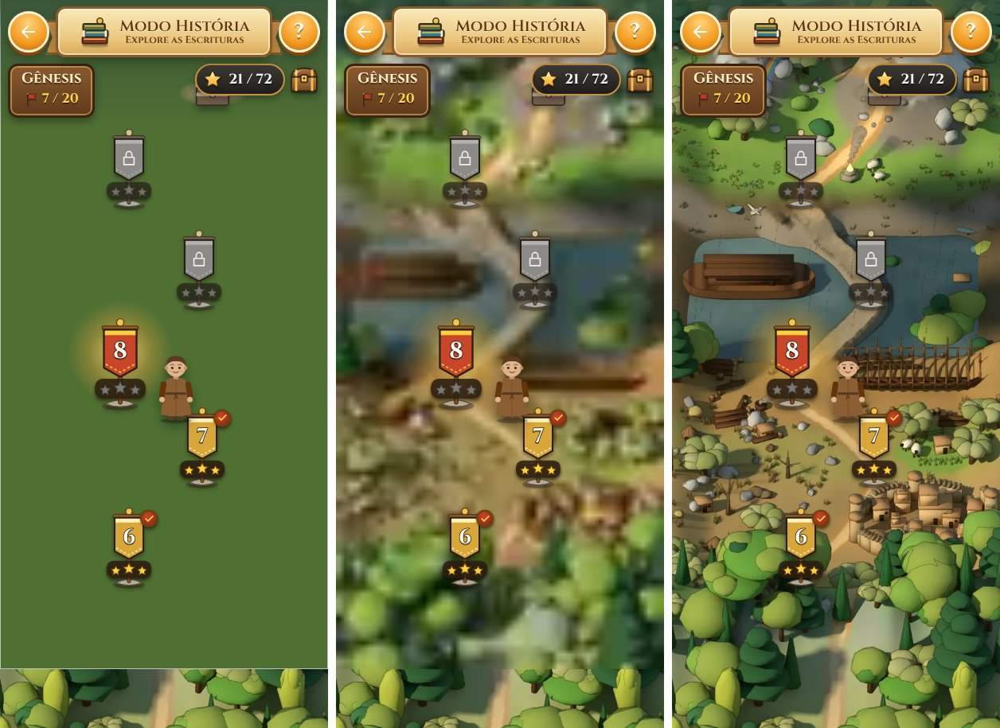
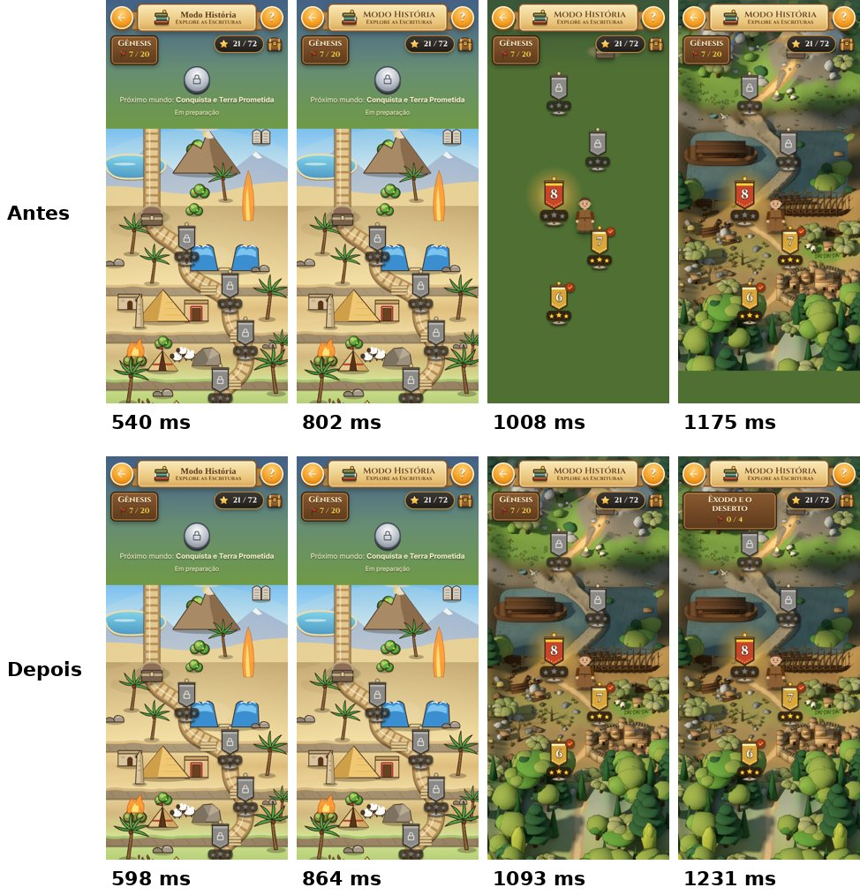

# Bible Quest — Carregamento sob demanda das pinturas do mapa

**Implementação da proposta da auditoria `MAPA_AUDITORIA_MEMORIA_DESEMPENHO.md` (commit `ebfa578`)** · branch `claude/bible-quest-android` · commits `32d44d6` e `c8770c5` · 27/11/2026

> **Limitação, antes de tudo.** Continua sem aparelho Android ligado à sessão e sem emulador (o servidor não tem `/dev/kvm`). **Todas as medições são do Chromium**, com o mesmo roteiro, a mesma tela de celular e as mesmas ferramentas da auditoria:
> - 412 × 915 px CSS, densidade 2,625;
> - versão de produção Android;
> - `memory-infra`;
> - GPU simulada e rasterização por software.
>
> Nenhum número foi estimado como se fosse medido. Onde um valor é projeção, o texto diz.

## 1. Resumo

| Pergunta | Resultado |
|---|---|
| Cada região tem os três estados (longe, perto, visível)? | **Sim.** A pintura carrega a até 1,5 tela e sai a mais de 3 telas. Entre essas distâncias, cada região mantém o estado anterior. |
| No máximo 3 pinturas ao mesmo tempo? | **Sim, em todos os quadros medidos.** Com 2 regiões, o máximo foi 2. Com 4 regiões (simuladas), o máximo foi 3, na rolagem normal, na rápida e em todas as paradas. |
| Miniatura e nada de espaço vazio? | **Sim.** Cada região tem uma miniatura de 1,7 KB embutida. A validação contou **0 quadros** sem pintura nem miniatura e 0 imagens quebradas. Com o arquivo da pintura bloqueado, aparece a miniatura. Antes aparecia uma imagem quebrada sobre o verde liso. |
| Abertura do mapa | A região da fase atual e as vizinhas ficam prontas antes do mapa aparecer, enquanto a tela anterior continua visível. Nos quadros reais da tela, a pintura aparece **12 % mais cedo** (1.035 contra 1.175 ms, CPU 4×). A versão antiga mostrava **1 quadro de região vazia** por abertura; agora são **0**. |
| Visitas repetidas ao mapa | **Sem cópias novas.** Em 24 idas e voltas, a memória de imagens ficou estável: em alta, 16,4 MB, contra um pico de 57,1 MB antes; no 2D, 5,9 MB, contra 29,4 MB antes. A volta ao mapa não decodifica de novo: 0 decodificações, contra 2–3 antes. |
| Troca de qualidade | Só a versão nova fica na página e no registro. **O cache do navegador ainda guarda a versão anterior** (14,2 MB, igual a antes). Isso só se resolve com pressão de memória (§ 8). |
| Pinturas, pontos, baús, emenda, progressão | **Preservados.** As pinturas têm hashes idênticos. Os 29 marcos ficaram nas mesmas posições (diferença de 0 px) e os 29 respondem ao toque. A emenda continua com 0 px de folga. Os dados salvos não mudaram. O Quiz está igual. |
| Os 13 critérios | **10 aprovados, 2 não atingidos, 1 sem como comprovar.** Os não atingidos são o 3 e o 4: memória com 4 regiões **depois de percorrer todas**. O critério 13 depende de aparelho real (§ 5). |
| Testes | `typecheck`, **284 testes** (266 + 18 novos) e `build` passando. |

**A investigação mudou uma premissa da auditoria.** A auditoria supunha que bastava deixar de desenhar as regiões distantes para limitar a memória decodificada. As medições desta etapa mostraram que o Chromium guarda a decodificação de **cada região já visitada** e não a solta sem pressão de memória. Isso vale com a pintura na página ou fora dela. Por isso, depois de percorrer as 4 regiões, a memória fica **igual** à da versão antiga, e não abaixo do teto proposto.

O que esta etapa garante:
- menos memória **na abertura**;
- **nenhuma cópia extra**, seja ao voltar ao mapa, seja ao voltar a uma região;
- no máximo 3 pinturas na página;
- nenhum quadro vazio.

## 2. O que foi implementado

**`src/components/map/trilha/pinturas.ts` (novo).** Fica fora do React, para sobreviver à saída e à volta ao mapa.
- **Regras puras:**
  - `distanciaEmTelas` mede a distância de cada região até a área visível;
  - `proximoEstado` define o estado da região (visível ≤ 0, perto ≤ 1,5 tela, longe > 3 telas; entre 1,5 e 3 mantém o estado anterior);
  - `escolherCarregadas` escolhe as 3 regiões mais próximas que não estão longe.
- **Registro.**
  - Cada pintura é **baixada uma vez** por um `Image` fora da página. A `` da região só recebe o endereço depois disso.
  - Quando a região sai da página, o registro continua com a referência, até 6 pinturas (`LIMITE_REGISTRO`). Assim, a volta reaproveita a mesma imagem e o navegador não decodifica outra cópia.
  - Trocar a qualidade descarta a versão anterior da região.
  - Se o arquivo falha, a pintura sai do registro.
- **Gerenciador de distância.**
  - Escuta a rolagem de forma passiva, uma vez por quadro.
  - A primeira avaliação espera 250 ms. Nesse tempo, o mapa rola até a fase atual. Sem essa espera, a avaliação olharia o topo da página e soltaria as pinturas preparadas para a abertura.
- **Abertura.** `aguardarAbertura` devolve a promessa usada pelo `use()` do mapa.
  - Espera as pinturas da abertura (no máximo 3), por até 800 ms.
  - Nunca falha.
  - É reaproveitada enquanto o React refaz o mapa, mesmo que o arquivo falhe.

**`src/components/map/trilha/PinturaRegiao.tsx` (novo).**
- A miniatura fica sempre embaixo.
- A pintura entra com `decoding="sync"`: o navegador só mostra o quadro dela já decodificada.
- Dois quadros depois do carregamento, a miniatura se esconde, para a máscara de esmaecimento do topo continuar igual à aprovada.
- Ao trocar a qualidade, muda o endereço da **mesma** ``, sem piscar.
- Se o arquivo falha, a miniatura continua e há mais uma tentativa depois de 1,5 s.

**Arquivos ajustados:**
- `Trilha.tsx` usa `<PinturaRegiao>` no lugar da `` direta. O motor continua o mesmo para História e Quiz.
- `StoryMap.tsx` espera a abertura, com a promessa fixada na entrada do mapa.
- `artes.ts` ganhou o campo `miniatura`. Os pontos não mudaram.
- `mapa-trilha.css`: a miniatura recebe as mesmas regras da pintura (posição, máscara, emenda) e `.is-coberta`.

**Miniaturas.** `tools/mapa/miniaturas.py` gera `src/data/mapas/miniaturas.ts`.
- Origem: as pinturas altas aprovadas, sem alterá-las.
- Processo: redução para 54 × 113 px e WebP com qualidade 55.
- Resultado: 1.778 B (Éden) e 1.704 B (Dilúvio).
- Registro de origem, ferramenta, data e licença em `public/mapas/LICENCAS.md`.

**Testes:**
- `src/test/mapa-pinturas.test.tsx` (novo, 18 testes): distância, histerese, limite de 3, registro, regiões soltas, troca de qualidade, abertura (espera, limite de tempo, sem laço) e componente.
- `mapa-trilha.test.tsx`: dois testes passam a **esperar** a pintura, que agora entra de forma assíncrona. Continuam verificando a mesma coisa.

*Esquerda:* versão antiga com o arquivo da pintura bloqueado (verde liso). *Centro:* versão nova com o arquivo bloqueado (miniatura). *Direita:* versão nova normal.

## 3. Arquivos alterados

| Arquivo | Mudança |
|---|---|
| `src/components/map/trilha/pinturas.ts` | novo: regras, registro, gerenciador e abertura |
| `src/components/map/trilha/PinturaRegiao.tsx` | novo: miniatura + pintura sob demanda |
| `src/components/map/trilha/Trilha.tsx` | usa `PinturaRegiao` (6 linhas) |
| `src/pages/story/StoryMap.tsx` | espera da abertura (13 linhas) |
| `src/data/mapas/artes.ts` | campo `miniatura` (pontos e tamanhos iguais) |
| `src/data/mapas/miniaturas.ts` | novo, gerado |
| `src/styles/telas/mapa-trilha.css` | seletores da miniatura (sem cores novas) |
| `src/test/mapa-pinturas.test.tsx` | novo, 18 testes |
| `src/test/mapa-trilha.test.tsx` | 2 testes esperam a pintura assíncrona |
| `tools/mapa/miniaturas.py` | novo |
| `public/mapas/LICENCAS.md` | registro das miniaturas |

**Não mudaram:**
- as pinturas (`public/mapas/genesis/*.webp`, com hashes conferidos);
- `JourneyMap.tsx`, `QuizMap.tsx` e os serviços de progressão;
- os dados salvos;
- os personagens e as demais telas;
- README, CHANGELOG e ROADMAP (regra A21).

## 4. Como cheguei a esta arquitetura (dois ajustes medidos)

**O primeiro commit (`32d44d6`) seguia a proposta ao pé da letra.** O registro chamava `decode()` para a pintura entrar já decodificada, e a região solta era removida do registro. As medições mostraram três problemas, corrigidos no commit `c8770c5`:

1. **O `decode()` dobrava a memória.** Ele obriga a decodificação em resolução cheia e o Chromium a mantém no cache. Com duas regiões em alta, a memória de imagens foi de 16,4 MB, contra 8,2 MB sem ele. Testei seis variantes, todas só em cópias temporárias e não no jogo, para isolar a causa (`resultados/experimentos/`). Só a remoção do `decode()` devolveu o valor antigo. Agora o registro só **baixa** a pintura e a `` usa `decoding="sync"`.
2. **Soltar e recriar gerava cópias órfãs.** Ao voltar a uma região que tinha saído da página, o Chromium decodificava de novo e a cópia antiga continuava no cache. Com 4 regiões: 24,5 → 32,7 → 40,8 MB. Agora a região solta continua referenciada no registro, e a volta reaproveita a mesma imagem.
3. **Arquivo com falha travava a abertura.** Cada nova tentativa do React criava outra espera e pedia o arquivo de novo, e o mapa nunca abria. A validação com o arquivo bloqueado pegou isso. Agora a espera é reaproveitada.

## 5. Os 13 critérios da auditoria

| # | Critério | Limite | Medido | Situação |
|---|---|---|---|---|
| 1 | Pinturas com `src` grande ao mesmo tempo | ≤ 3, com 2 ou 4 regiões | Máximo **2** (2 regiões) e **3** (4 regiões), em cada quadro de ~800 por execução, em 10 execuções, e em todas as paradas | ✔ |
| 2 | Imagens, GPU, alta, 4 regiões | ≤ 25 MB | **12,3** na abertura; **16,4** depois de percorrer as 4 na ida e volta (antes: 16,4) | ✔ |
| 3 | Imagens, software, alta, 4 regiões | ≤ 35 MB | **35,1** na abertura; **46,7** depois de percorrer todas (antes: 46,7) | ✘ igual a antes |
| 4 | Imagens, leve, 4 regiões | ≤ 9 MB | GPU: **8,9** na abertura e **11,8** depois de percorrer (antes 11,8). Software: 10,3 e 13,7 (antes 13,6) | ✘ só na abertura pela GPU |
| 5 | Crescimento em 24 visitas | ≤ 1,1 × a 1ª | Alta: 16,41 → 16,37 MB (**1,0 ×**; antes 57,1 no pico). 2D: 5,91 → 5,93 (**1,0 ×**; antes 29,4) | ✔ |
| 6 | Troca de qualidade | só a nova versão na página e no registro | 10 de 10 execuções só com a nova versão. Teste unitário do registro. *O cache do navegador guarda a anterior (§ 8).* | ✔ |
| 7 | Rolagem | p95 ≤ 16,8 ms; ≤ 1 % de quadros acima de 33 ms (CPU 4×); nenhuma tarefa longa acima de 100 ms | p95 **16,7–16,8 ms**; 0–1 quadro acima de 33 ms em cada ~540; **nenhuma** tarefa longa | ✔ |
| 8 | Abertura (2D, CPU 4×) | ≤ atual + 10 %; pintura da fase no primeiro quadro | Quadros reais: o mapa aparece em 1.035 ms, contra 1.008 (**+2,7 %**). A pintura aparece em **1.035** ms, contra 1.175 (**−12 %**). **0** quadros sem pintura, contra 8 antes | ✔ |
| 9 | Emenda | 0 px; ≥ 100 posições com a emenda na tela e as duas pinturas completas | **0 px**; ~212 quadros por execução com a emenda na tela e **0 incompletos**, em 10 execuções | ✔ |
| 10 | Marcos | posições iguais; toque 29/29; janela da fase ≤ 100 ms | Diferença de **0 px** nos 29 marcos (alta e 2D, antes × depois); **29/29**; janela com mediana de **43 ms** e p95 de 58 ms (CPU normal) | ✔ |
| 11 | Sem buracos e sem flash | nenhum quadro vazio; arquivo bloqueado mostra a miniatura | **0** quadros sem pintura nem miniatura (~8.000 quadros amostrados); arquivo bloqueado mostra a miniatura e nenhuma imagem quebrada (antes: imagem quebrada) | ✔ |
| 12 | Testes e build | passando | `typecheck` ✔, **284/284** ✔, `build` ✔ | ✔ |
| 13 | Aparelho real | 0 ANR; Graphics + nativa ≤ 40 MB entre menu e mapa | **Não medido**: sem aparelho nem emulador nesta sessão | — |

**Sobre os critérios 3 e 4.** O limite foi escrito na auditoria a partir de uma premissa que esta etapa derrubou: a de que não desenhar o que está longe limitaria a memória decodificada. O Chromium guarda a decodificação de cada região visitada, com ou sem a pintura na página. Medi as alternativas: tirar da página, esconder com `display: none`, manter ou não a referência, com ou sem `decode()`. Nenhuma devolveu essa memória sem pressão do sistema.

A versão nova:
- **não piora** em relação à antiga depois de percorrer tudo;
- **melhora** na abertura (35,1 contra 46,7 MB por software; 8,9 contra 11,8 MB na leve);
- **elimina** o crescimento por visita.

Nada dessa memória estava travada nas medições (0 bytes travados): é memória "descartável", que o navegador e o sistema podem liberar sob pressão. Neste servidor Linux, o aviso de pressão simulado não a liberou, exceto a parte da GPU.

## 6. Antes × depois: memória medida

Imagens decodificadas = processo da página + cópias na GPU, em MB. Mesmo roteiro da auditoria.

### 6.1 As duas regiões de hoje (rasterização pela GPU, o modo do Android)

| Passo | Alta antes | Alta depois | Leve antes | Leve depois | 2D antes | 2D depois |
|---|---|---|---|---|---|---|
| Mapa aberto | 3,5 | 3,5 | 5,9 | 5,9 | 5,9 | 5,9 |
| Éden, Dilúvio, ida e volta | 8,2 | **8,2** | 5,9 | 5,9 | 5,9 | 5,9 |
| De volta ao menu | 8,2 | 8,2 | 5,9 | 5,9 | 5,9 | 5,9 |
| **Mapa de novo** | **11,7** | **8,2** | 8,4 | **5,9** | 8,4 | **5,9** |
| Troca de qualidade | 14,1 | 14,2 | 24,8 | 14,2 | — | — |

Por software (alta, leve e 2D): 23,5, 6,9 e 6,7 MB, iguais antes e depois. Na volta ao mapa, os valores ficaram 23,4, 6,9 e 6,7 MB.

### 6.2 Visitas repetidas (24 idas e voltas menu ↔ mapa, GPU)

| Visitas | Alta antes | Alta depois | 2D antes | 2D depois |
|---|---|---|---|---|
| 4 | 23,4 | 16,4 | 5,9 | 5,9 |
| 8 | 57,1 | 16,4 | 11,7 | 5,9 |
| 12 | 57,1 | 16,4 | 17,6 | 5,9 |
| 20 | 36,2 | 16,4 | 29,4 | 6,0 |
| 24 | 24,5 | 16,4 | 17,6 | 5,9 |

*Antes:* auditoria. Neste roteiro, o modo alto estabiliza em 16,4 MB porque cada volta passa pelas duas regiões, e as duas ficam referenciadas.

### 6.3 Quatro regiões (variante de teste: regiões 3 e 4 simuladas com cópias das pinturas)

A variante foi montada numa cópia temporária, só para medir, e não está no jogo. As duas versões foram medidas com o mesmo script e a mesma rolagem real (sim4 → sim3 → Dilúvio → Éden → sim3 → sim4 → Éden → topo).

| Cenário | Pinturas na página (antes / depois) | Abertura (antes / depois) | Depois de percorrer as 4 (antes / depois) |
|---|---|---|---|
| GPU, alta | 4 / **3** | 16,4 / **12,3** | 16,4 / 16,4 |
| GPU, leve | 4 / **3** | 11,8 / **8,9** | 11,8 / 11,8 |
| Software, alta | 4 / **3** | 46,7 / **35,1** | 46,7 / 46,7 |
| Software, leve | 4 / **3** | 13,6 / **10,3** | 13,6 / 13,7 |

## 7. Desempenho medido

| Medida | Antes | Depois |
|---|---|---|
| Primeiro quadro com a pintura da fase (2D, CPU 4×, 8 aberturas, quadros reais) | mediana 1.175 ms | **1.035 ms** |
| Quadros do mapa sem pintura na abertura (em 8 aberturas) | 8 | **0** |
| Decodificações na volta ao mapa | 2–3 (alta e leve) | **0** |
| Rolagem, p95 (CPU 4×) | 16,7–16,8 ms | 16,7–16,8 ms |
| Pior quadro na rolagem (CPU 4×) | 50–83 ms | 33–50 ms |
| Tarefas longas na rolagem (CPU 4×) | até 97 ms | nenhuma |
| Janela da fase, mediana (CPU normal / 4×) | 46 / 196–229 ms | 43 / 175–209 ms |

*Abertura quadro a quadro (2D, CPU 4×).* Nas duas versões, os primeiros quadros mostram o topo do mapa, antes da rolagem automática até a fase atual; esse comportamento é anterior a esta etapa. Antes, a região da fase aparece verde e vazia por ~170 ms. Agora ela já aparece pintada.

**Uma medida que parece pior e por quê.** Contando só até as imagens estarem "carregadas" no DOM (`complete`), a abertura em leve ficou de 188 para 245 ms na mediana (10 repetições). Com as imagens altas, foi de 255 para 238 ms. Isso não mede o que o jogador vê. Antes, o mapa aparecia com as imagens ainda sem decodificar, e a região ficava vazia. Agora o quadro só chega à tela com a pintura. Pelos quadros reais, a pintura aparece mais cedo (tabela acima).

## 8. Limitações e riscos restantes

1. **Nenhuma medição em Android.** O critério 13 continua aberto. O roteiro da § 9 da auditoria vale como está, com os scripts desta pasta. Ele precisa de um APK de depuração, que depende da sua autorização.
2. **A memória das regiões já visitadas só sai sob pressão.** Não há liberação imediata e garantida sem trocar `` por `ImageBitmap` em `<canvas>`. Essa mudança é bem maior e você pediu para não introduzi-la sem confirmação.
   - No Android, essa memória é descartável: o sistema pode recuperá-la, e o aviso crítico já liberou a parte da GPU aqui.
   - Com mais mundos pintados, o teto passa a depender do limite de cache do próprio navegador.
3. **Troca de qualidade.** A versão anterior continua no cache do navegador até haver pressão de memória (14,2 MB nas duas direções). A troca é rara e o valor é igual ao de antes.
4. **Registro com até 6 referências.** Com mais de 6 regiões visitadas na mesma sessão, as mais antigas deixam de ser referenciadas. Ao voltar a elas, pode haver uma decodificação nova. Isso pede um novo ajuste quando houver mais de 6 regiões.
5. **Variante de 4 regiões.** As regiões 3 e 4 foram simuladas com cópias das duas pinturas e endereços diferentes. Pinturas reais de outro tamanho mudariam os números proporcionalmente.
6. **Abertura com o 3D.** Nos modos 3D, a saída da cena do menu continua dominando o tempo de abertura (§ 7.2 da auditoria). Isso está fora desta etapa.
7. **Abertura direta pelo endereço `#/historia`**, como ao recarregar a página no navegador. Não há transição, e a tela pode ficar em branco até 800 ms enquanto as pinturas da abertura chegam. No aplicativo Android, o jogo não abre direto no mapa.

## 9. Testes executados

| Teste | Resultado |
|---|---|
| `npm run typecheck` | ✔ |
| `npm test` | ✔ **284/284**, 25 arquivos (antes: 266) |
| `npm run build` | ✔ |
| Validação funcional no Chromium: 10 cenários (alta, leve e 2D; abertura no Éden e no Dilúvio; versão antiga; 4 regiões nas regiões 1, 2 e 3) | ✔ todos (`resultados/validacao/`) |
| Marcos antes × depois (alta e 2D) | 29/29 iguais, 0 px |
| Modo Quiz antes × depois | 6 marcos nas mesmas posições, nenhuma pintura, 0 erros |
| Memória: roteiro completo (6 combinações + 2D com imagens altas), 24 visitas (alta e 2D), 4 regiões (4 combinações, antes e depois), memória travada | `resultados/depois/` |
| Tempos: abertura, rolagem, toque e decodificações (2D, alta e leve; CPU 1× e 4×), mais abertura alternada (10 + 10) e quadros reais da tela (8 + 8) | `resultados/depois/` |

## 10. Preservação

- **Pinturas:** SHA-256 idênticos antes e depois.
  - `eden.webp` `d7e569fd…`
  - `eden-leve.webp` `e62ba9d8…`
  - `diluvio.webp` `e5b94547…`
  - `diluvio-leve.webp` `f89df0ae…`
- **Dimensões, posições, pontos e baús:**
  - os `pontos`, a `largura` e a `altura` de `artes.ts` não mudaram, e os testes que travam os pontos do Éden e do Dilúvio passam;
  - os marcos ficam nas mesmas posições na tela (0 px);
  - a altura da página é a mesma (4.187 px).
- **Emenda:** 0 px; com a emenda na tela, as duas pinturas estiveram sempre completas.
- **Progressão e dados salvos:** nenhuma mudança em serviços, tipos ou armazenamento.
- **Motor História/Quiz:** a mesma `RegiaoTrilha`; só a imagem de fundo pintada passou a ser sob demanda.
- **Modos 2D e 3D:** a escolha alta/leve (`resolveQuality`) é a mesma.
- **Não feito:** região 3, Quiz pintado, Êxodo, mudanças na cena 3D do menu, APK, merge, publicação e alterações no site.
- As evidências da auditoria anterior não foram tocadas.

## 11. Evidências

`docs/relatorios/evidencias/carregamento-sob-demanda/`:

- **`resultados/depois/`:** memória, visitas, 4 regiões antes e depois, memória travada, tempos, aberturas e Quiz.
- **`resultados/validacao/`:** os 10 cenários funcionais, com a abertura quadro a quadro, a rolagem, a emenda, os marcos, a troca de qualidade e o arquivo bloqueado.
- **`resultados/experimentos/`:** as medições do primeiro commit e das variantes usadas para isolar o `decode()` e as cópias órfãs.
- **`scripts/`:**
  - `validar.cjs`
  - `abertura.cjs`
  - `abertura-tela.cjs`
  - `quiz.cjs`
  - `nitidez.cjs`
  - `capt-mini.cjs`
  - `proj4d.cjs` e `proj4t.cjs`
  - `reconstruir.sh`, que monta a variante de 4 regiões numa cópia temporária

  Os scripts de percurso, visitas e tempos são os mesmos da auditoria (`../auditoria-memoria-mapa/scripts/`), com a porta como parâmetro.
