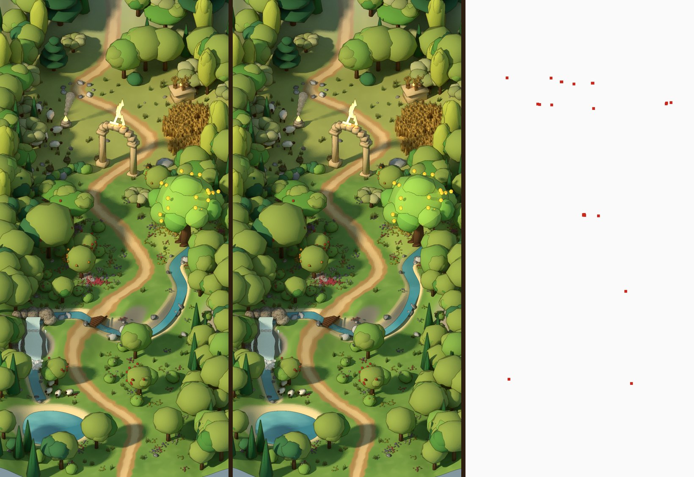
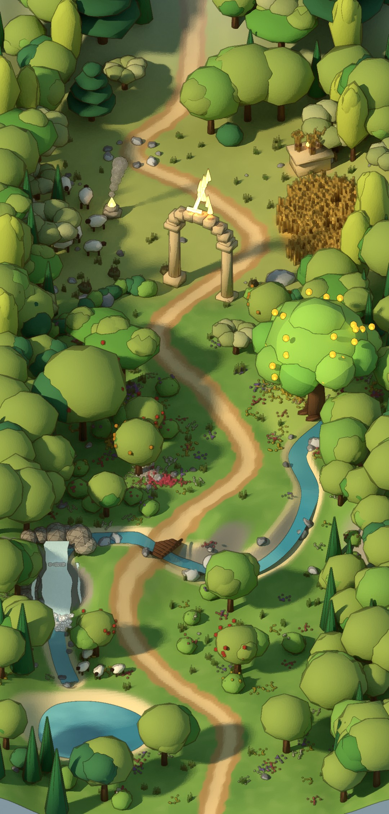

# Bible Quest — Expansão de Gênesis, etapa 1: base comum de pintura

**Relatório da etapa 1** · 27/11/2026 · branch `claude/bible-quest-android` · nenhuma mudança no jogo (`src/`, `public/`), nos testes ou na arte · nenhum merge, APK ou publicação

> **Resumo.** As funções reutilizáveis de `tools/mapa/eden.py` foram extraídas para um novo módulo, `tools/mapa/comum.py`. O `eden.py` passou a importá-lo.
>
> **O Éden gerado continua o mesmo:**
> - **cena idêntica**, conferida por uma impressão digital de tudo o que forma a imagem (1 178 objetos, 168 malhas, 43 materiais, câmera, luzes, compositor e ajustes do render);
> - **pontos e referências idênticos**, campo a campo;
> - **imagem renderizada dentro do ruído do próprio Cycles:** 23 pixels diferentes em 2,4 milhões, no máximo 3 níveis de 255. Dois renders do script **antigo, sem mudança nenhuma,** já diferem entre si em 21 a 40 pixels.
>
> A imagem usada pelo jogo **não foi trocada** e tem os mesmos hashes de antes. Typecheck e build passam, e os testes passam: 262 de 262.

## 1. Arquivos

| Arquivo | Situação | Conteúdo |
|---|---|---|
| `tools/mapa/comum.py` | **novo** (392 linhas) | Base comum de pintura |
| `tools/mapa/eden.py` | **alterado** (de 960 para 684 linhas) | Só o que é do Éden; o resto vem de `comum.py` |
| `src/`, `public/`, testes, `Trilha.tsx`, `JourneyMap.tsx`, `QuizMap.tsx` | sem mudança | — |

**Dependências:** `comum.py` usa só o que o `eden.py` já usava: Blender (`bpy`, `bmesh`, `mathutils`), NumPy e a biblioteca padrão do Python. Nada novo foi instalado no projeto. (O `pyflakes`, usado só para conferir o código, ficou fora do repositório.)

## 2. O que foi extraído e o que ficou no Éden

| Extraído para `comum.py` (sem mudar o comportamento) | Ficou em `eden.py` (é do Éden) |
|---|---|
| `argumentos()`: leitura de `-- <pasta> [largura] [amostras]` | Sementes (`random.seed(11)`, `RR = Random(2026)`) |
| `nova_cena()` | Pontos das fases, curva do caminho, rio, lago e terraço |
| `catmull()`, `dist_curva()`, `suave()`, `hexc()` | Relevo (`altura`), cores do chão e clareiras |
| `material()` | Água, cachoeira e rochedo |
| `malha_terreno()`: malha em grade com cor por vértice | Paleta de materiais (`mats`) |
| `esfera()`, `cone()`, `caixa()` | Bibliotecas do Éden (árvores, flores, pedras, trigo, espinhos) |
| `Biblioteca`: `nova`, `juntar`, `plantar`, `objeto_unico`, `arvore_copa`, `palmeira`, `ovelha` | Árvore da vida, portão e espada, sebe, altares, ponte |
| `encher()`, com a regra de espaço livre passada pela região | `livre()` do Éden e as chamadas de enchimento |
| `ceu_e_sol()`, `camera_inclinada()`, `ajustes_render()` | Quadro da câmera (y de 0 a 60) e refinamento das copas |
| `acabamento_pintado()`, `saida_png()` | Clareiras pós-vegetação e anel de flores |
| `na_imagem()`, `gravar_json()` | Lista das referências de conferência |

**Regras seguidas para a cena não mudar:**
- **Mesmo corpo.** Cada função extraída mantém exatamente o mesmo código de antes.
- **Mesmo sorteio.** O módulo comum usa o mesmo gerador aleatório global da região e não semeia nada; a semente continua no `eden.py`.
- **Mesma ordem.** Importar o módulo comum não cria nada no Blender. Cada chamada acontece no mesmo ponto em que o código estava antes. Exemplo: a coleção da biblioteca é criada antes dos materiais, como antes.
- **Nomes iguais.** O `eden.py` continua usando `juntar`, `plantar`, `arvore_copa` etc., agora como apelidos dos métodos da `Biblioteca`. O resto do arquivo não precisou mudar.

## 3. Hashes (SHA-256)

| Arquivo | Antes | Depois |
|---|---|---|
| `public/mapas/genesis/eden.webp` (alta) | `d7e569fd…5e1f20` | `d7e569fd…5e1f20` **(igual)** |
| `public/mapas/genesis/eden-leve.webp` (leve) | `e62ba9d8…cd18509` | `e62ba9d8…cd18509` **(igual)** |
| `tools/mapa/eden.py` | `842bffde…7ce8882` | `d48350c1…dec8a8` |
| `tools/mapa/comum.py` | — | `42027feb…856b5d` |
| Impressão digital da cena (sem endereços de memória) | `2fce3872…cb3b3` | `2fce3872…cb3b3` **(igual)** |

Hashes completos:
- `eden.webp`: `d7e569fd3d870cf92312a1d0fb04e80940b62020e3d91cbcecc165bbe15e1f20`
- `eden-leve.webp`: `e62ba9d848cd786112117068f510e9b74226b856403f39a5ef9425720cd18509`
- impressão digital da cena: `2fce38721851d714bf7caa710c1eab5fb676aba7947af078044ad02ef83cb3b3`

A imagem do jogo não foi substituída. Como a cena é idêntica, trocá-la só registraria o ruído do render.

## 4. Comparação da cena (prova principal)

O Cycles não gera a mesma imagem bit a bit a cada render, nem com o mesmo script. Por isso a prova principal não é a imagem, e sim **a cena que gera a imagem**.

Um script de conferência (fora do repositório) monta a cena com o `eden.py` antigo (do backup) e com o novo. Depois grava tudo o que define a imagem:
- cada objeto: nome, malha, posição, rotação, escala, materiais e coleção;
- cada malha: vértices, faces, material das faces, suavização e cores por vértice;
- cada material: todos os nós, valores, rampas de cor e ligações;
- luzes, céu, câmera (posição, rotação, escala ortográfica e corte);
- resolução, motor, amostras, saltos, exposição, transformação de cor e passes;
- todo o compositor do acabamento pintado.

| | Antigo | Novo |
|---|---|---|
| Objetos | 1 178 | 1 178 |
| Malhas | 168 | 168 |
| Materiais | 43 | 43 |
| Impressão digital | `2fce3872…` | `2fce3872…` |

**Resultado: idênticas.** Na comparação bruta, a única diferença eram endereços de memória que o próprio Blender imprime em referências internas (por exemplo, `ColorRamp at 0x7fa6…`). Eles mudam a cada execução e foram removidos antes do hash.

## 5. Comparação dos pontos

| Ponto | Original (x, y) | Novo (x, y) | |
|---|---|---|---|
| fase-1 | 0,58507 · 0,89037 | 0,58507 · 0,89037 | igual |
| fase-2 | 0,31922 · 0,73593 | 0,31922 · 0,73593 | igual |
| fase-3 | 0,63824 · 0,57197 | 0,63824 · 0,57197 | igual |
| fase-4 | 0,40429 · 0,41923 | 0,40429 · 0,41923 | igual |
| fase-5 | 0,65951 · 0,29901 | 0,65951 · 0,29901 | igual |
| baú | 0,34049 · 0,18940 | 0,34049 · 0,18940 | igual |

O `eden.json` novo é **idêntico byte a byte** ao original, incluindo o tamanho (1080 × 2257) e as referências de conferência (portão, árvore da vida e altares). `src/data/mapas/artes.ts` não precisou mudar.

## 6. Comparação pixel a pixel

Foram feitos cinco renders em 1080 px e 96 amostras:
- **A1:** a imagem aprovada, que deu origem ao `eden.webp`;
- **A2 e A3:** o script antigo, rodado de novo sem nenhuma mudança;
- **N1 e N2:** o script novo.

| Par | Pixels diferentes (de 2 437 560) | % | Diferença máx. (0–255) | Acima de 4 |
|---|---|---|---|---|
| A1 × A2 (antigo × antigo) | 21 | 0,0009% | 3 | 0 |
| A1 × A3 (antigo × antigo) | 40 | 0,0016% | 4 | 0 |
| A2 × A3 (antigo × antigo) | 27 | 0,0011% | 4 | 0 |
| **A1 × N1 (aprovado × novo)** | **23** | **0,0009%** | **3** | **0** |
| A1 × N2 (antigo × novo) | 46 | 0,0019% | 8 | 2 |
| A2 × N1 (antigo × novo) | 12 | 0,0005% | 2 | 0 |
| A2 × N2 (antigo × novo) | 29 | 0,0012% | 8 | 2 |
| A3 × N1 (antigo × novo) | 33 | 0,0014% | 4 | 0 |
| A3 × N2 (antigo × novo) | 52 | 0,0021% | 8 | 2 |
| N1 × N2 (novo × novo) | 25 | 0,0010% | 8 | 2 |

**Leitura:**
- As diferenças entre antigo e novo têm o mesmo tamanho das diferenças entre dois renders do mesmo script. É ruído de amostragem do Cycles, não mudança de cena.
- O render N1 ficou mais perto do aprovado (23 pixels) do que dois renders antigos entre si (até 40).
- Os pontos isolados com diferença 8 aparecem num render novo **contra outro render novo** (N1 × N2). Portanto, também são ruído. N2 e A3 foram renderizados ao mesmo tempo que outro processo.

Original, novo e o mapa das diferenças (cada pixel diferente foi marcado com um quadrado vermelho ampliado, para ficar visível):

O Éden gerado com a base comum, em tamanho real:

## 7. Testes e build

| Verificação | Resultado |
|---|---|
| `npm run typecheck` | passou |
| `npm test` | **24 arquivos, 262 de 262** |
| `npm run build` | passou |
| Testes de proteção (`mapa-protecao.test.tsx`) | sem nenhuma alteração |
| Verificação estática de `eden.py` e `comum.py` (pyflakes) | nenhum nome indefinido ou sem uso |
| `git diff` em `src/` e `public/` | vazio |

## 8. Diferenças e riscos

1. **Render não determinístico.** O Cycles varia algumas dezenas de pixels a cada render, mesmo sem mudança. Para as próximas regiões, a prova de "nada mudou" deve ser a impressão digital da cena, com a comparação de pixels como confirmação. Se for útil, o script de impressão digital pode virar uma ferramenta do projeto (`tools/mapa/`). **Não fiz isso sem autorização.**
2. **A imagem do jogo não foi regerada.** Regerar mudaria os bytes do WebP só por causa do ruído. Mantive o arquivo aprovado.
3. **Caminho de importação.** O `eden.py` acha o `comum.py` pela própria pasta (`__file__`). Rodar com `blender -b -P tools/mapa/eden.py -- …` de qualquer pasta funciona, como testado.
4. **Acoplamento.** O `comum.py` guarda o **visual comum** (luz, câmera, acabamento). Mudar algo nele muda todas as regiões ao mesmo tempo, inclusive o Éden. Qualquer mudança futura nesse módulo deve repetir esta conferência no Éden.
5. **Sem mudança visível.** Esta etapa não muda nada no jogo; ela só prepara a região 2.

## 9. Commits

| Commit | Conteúdo |
|---|---|
| 734cf7e | `tools/mapa/comum.py` (novo) e `tools/mapa/eden.py` usando a base comum |
| *(este relatório)* | Relatório em md e pdf, com as imagens de comparação |

A região 2 não foi iniciada. Aguardo avaliação.
