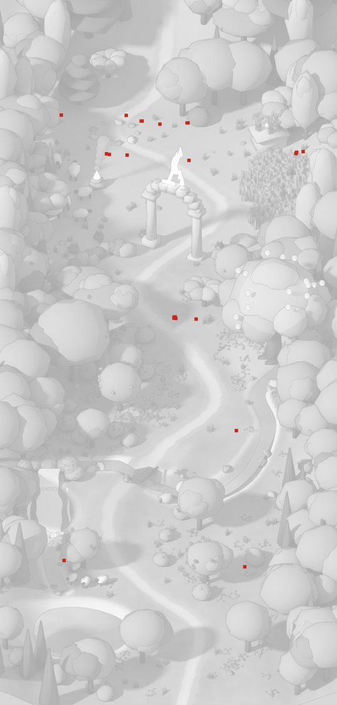
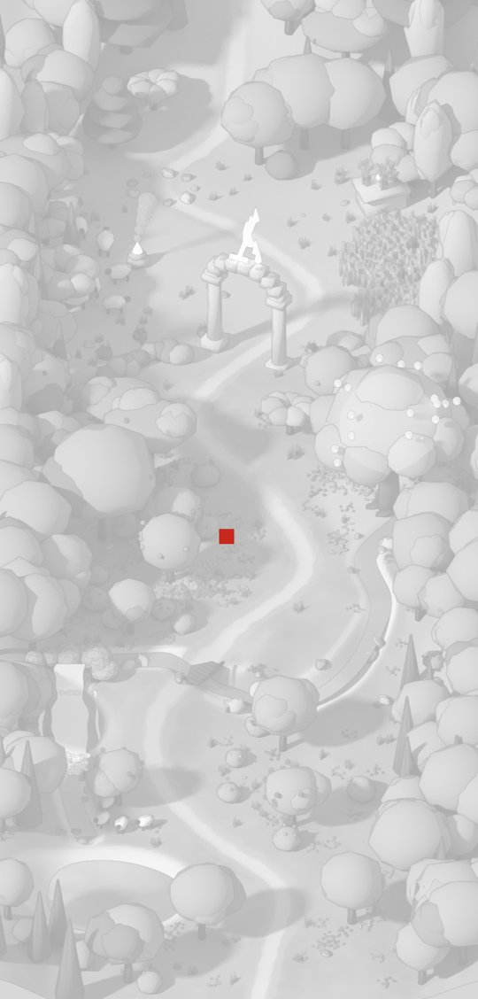

# Bible Quest — Ferramenta de conferência de cenas dos mapas

**Relatório da entrega** · 27/11/2026 · branch `claude/bible-quest-android` · nenhuma mudança em `src/`, `public/`, artes, pontos, testes ou motor · nenhum merge, APK ou publicação · Região 2 **não** iniciada

> **Resumo.** A ferramenta agora é permanente: `tools/mapa/conferir_cena.py`.
> - Ela monta a cena de uma região no Blender **sem renderizar**, em 5 segundos.
> - Grava tudo o que define a imagem: objetos, malhas, materiais, câmeras, luzes, transformações, render e compositor.
> - Compara duas cenas e separa **diferença estrutural**, **diferença de valor**, **diferença numérica relevante** e **variação numérica pequena**.
> - Compara dois renders e separa **ruído do Cycles** de **mudança real**.
>
> **Validação no Éden atual:**
> - o Éden contra ele mesmo e contra a versão anterior à base comum dá **IDÊNTICAS**;
> - uma variação de 3 milionésimos de metro dá **EQUIVALENTES**;
> - oito mudanças feitas de propósito na memória foram **todas encontradas**, cada uma na categoria e na seção certas;
> - nos renders, os 10 pares da mesma cena deram **ruído** e as 2 mudanças reais, inclusive um remendo de só 6 níveis, deram **mudança real**.
>
> Artes, pontos e código do jogo ficaram intactos, conferidos por hash. Typecheck e build passam, e os testes passam: 262 de 262.

## 1. Arquivos da entrega

| Arquivo | Situação | Para que serve |
|---|---|---|
| `tools/mapa/conferir_cena.py` | **novo** (422 linhas) | A ferramenta: modos `impressao`, `comparar` e `pixels` |
| `tools/mapa/validar_conferencia.py` | **novo** (41 linhas) | Mudanças de propósito, feitas só na memória, para provar a ferramenta |
| `tools/mapa/referencias/eden-cena.json` (780 KB) e `eden-cena.npz` (1,8 MB) | **novos** | Impressão digital de referência do Éden aprovado, para comparar as próximas mudanças sem depender do script antigo |
| `docs/relatorios/MAPA_FERRAMENTA_CONFERENCIA_CENA.md` / `.pdf` | **novos** | Este relatório |
| `docs/relatorios/evidencias/conferencia-cena/` | **novos** | Os relatórios gerados pela ferramenta e os mapas de pixels |

**Nada mais mudou:** `src/`, `public/`, `eden.webp`, `eden-leve.webp`, `eden.json`, `artes.ts`, `eden.py`, `comum.py`, testes, `Trilha.tsx`, `JourneyMap.tsx` e `QuizMap.tsx` estão intactos (seção 7).

**Sobre a referência no repositório:**
- **Por que guardar:** sem ela, conferir o Éden no futuro exigiria refazer o script antigo junto com o `comum.py` da mesma época.
- **Peso:** 2,6 MB no total.
- **Como refazer:** é gerada pelo próprio Éden em 5 segundos (seção 3), então pode ser regerada e conferida a qualquer momento.

**Dependências:** nenhuma nova. A ferramenta usa o que os mapas já usam:
- Blender e NumPy;
- Pillow, só no modo `pixels`, que já era usado para gerar o WebP dos mapas.

## 2. O que a ferramenta grava (modo `impressao`)

| Parte | O que é gravado |
|---|---|
| Objetos | tipo, dados, pai, coleções, **posição, rotação, modo de rotação, escala**, visibilidade, materiais e modificadores |
| Malhas | contagens, materiais e, no `.npz`, **cada vértice**, as faces, o material e a suavização de cada face e as **cores por vértice** |
| Materiais | todos os nós, com os valores das entradas, as propriedades, as rampas de cor e as ligações |
| Câmeras | todas as propriedades (tipo, escala ortográfica, corte, sensor…) |
| Luzes | todas as propriedades (tipo, energia, cor, ângulo, tamanho…) e os nós, se houver |
| Céu | nós e propriedades |
| Render | resolução, motor, **Cycles** (amostras, saltos, redução de ruído…), **gestão de cor** (transformação, exposição, gama), formato, passes |
| Compositor | todos os nós do acabamento pintado e as ligações |
| Coleções | visibilidade no render, quantidade de objetos e coleções filhas |

**O que fica de fora**, porque não muda a imagem:
- posição dos nós na tela do editor;
- seleção;
- identificadores internos;
- caminhos de pastas temporárias (do arquivo de saída, só o nome é gravado).

**Como evita o render:** a ferramenta troca, só durante a montagem, a operação de render por uma operação vazia. Todo o resto de `bpy.ops` funciona normalmente.

## 3. Como executar

```bash
# 1) impressão digital da cena (dentro do Blender, sem renderizar; cerca de 5 s)
blender -b -P tools/mapa/conferir_cena.py -- impressao tools/mapa/eden.py /tmp/eden-nova

# 2) comparar com a referência aprovada (relatório em Markdown; saída 0 = idêntica ou equivalente)
python3 tools/mapa/conferir_cena.py comparar tools/mapa/referencias/eden-cena.json /tmp/eden-nova.json --relatorio /tmp/conferencia.md

# 3) comparar dois renders (opcional; saída 0 = idênticas ou ruído do Cycles)
python3 tools/mapa/conferir_cena.py pixels antes.png depois.png --mapa diferencas.png
```

**Opções:**
- `impressao`:
  - `--args "<pasta> <largura> <amostras>"` são os argumentos repassados ao script da região (padrão: pasta temporária, 1080 e 96);
  - `--depois arquivo.py:função` roda uma função sobre a cena montada, para validação.
- `comparar`:
  - `--tol` é a tolerância numérica relativa (padrão `1e-5`);
  - `--limite` é quantas linhas mostrar por categoria.
- `pixels`: `--ruido-max`, `--ruido-pct`, `--bloco` e `--bloco-max` (seção 5).

**As quatro categorias:**

| Categoria | Quando | Bloqueia? |
|---|---|---|
| Diferença estrutural | algo criado ou removido: objeto, malha, material, nó, ligação, número de vértices ou faces | sim |
| Diferença de valor | mudou um valor não numérico: opção, texto, verdadeiro/falso, material de um objeto, ordem das faces | sim |
| Diferença numérica relevante | um número mudou mais que a tolerância | sim |
| Variação numérica pequena | um número mudou dentro da tolerância (arredondamento de ponto flutuante) | não |

## 4. Validação da comparação de cenas, no Éden atual

| Comparação | O que era esperado | Veredito da ferramenta | Saída |
|---|---|---|---|
| Éden × Éden (duas montagens do `eden.py` atual) | idênticas | **IDÊNTICAS** | 0 |
| Éden anterior à base comum (commit 792835f) × Éden atual | idênticas (prova da etapa 1) | **IDÊNTICAS** | 0 |
| Éden × Éden com uma árvore deslocada 3 milionésimos de metro | só variação pequena | **EQUIVALENTES** (1 variação pequena: `/objetos/veg/posicao[0]`, Δ +2,86e-06) | 0 |
| Éden × Éden com 8 mudanças de propósito | todas encontradas | **DIFERENTES**: 2 estruturais, 1 de valor, 5 numéricas | 1 |

**As 8 mudanças de propósito** (`validar_conferencia.py:mudancas`, só na memória do Blender), cada uma encontrada no lugar e na categoria certos:

| Mudança | Encontrada em | Categoria |
|---|---|---|
| Uma ovelha removida | `/objetos/ovelha`: existia → removido | estrutural |
| Ligação do compositor removida | `/compositor/nos/ligacoes`: `Mix.Image -> Hue/Saturation/Value.Image` removida | estrutural |
| Redução de ruído do Cycles ligada | `/render/cycles/use_denoising`: False → True | valor |
| Árvore da vida deslocada 0,5 m | `/objetos/arvore_vida_i/posicao[0]`: 5,9 → 6,4 | numérica |
| Câmera inclinada mais 0,5° | `/objetos/cam/rotacao[0]`: Δ +0,00873 rad | numérica |
| Cor de um material | `/materiais/Copa1/…/Base Color[0]`: Δ +0,05 | numérica |
| Energia do sol | `/luzes/sol/props/energy`: 4,2 → 4,6 | numérica |
| Um vértice do terreno subiu 5 cm | `/malhas/terreno/vertices`: 1 vértice mudou, máx. 0,05 | numérica |

**Os relatórios gerados pela ferramenta**, sem edição, estão em `docs/relatorios/evidencias/conferencia-cena/`:
- `1-eden-x-eden-mesma-versao.md`;
- `2-eden-antes-da-base-comum-x-atual.md`;
- `3-variacao-pequena.md`;
- `4-mudancas-de-proposito.md`.

O último, na íntegra:

```
Veredito: DIFERENTES
| Categoria | Quantidade |
| Diferença estrutural | 2 |
| Diferença de valor | 1 |
| Diferença numérica relevante | 5 |
| Variação numérica pequena (dentro da tolerância) | 0 |
Diferença estrutural:   /objetos/ovelha (existia → removido)
                        /compositor/nos/ligacoes (Mix.Image -> Hue/Saturation/Value.Image → removida)
Diferença de valor:     /render/cycles/use_denoising (False → True)
Numérica relevante:     /objetos/arvore_vida_i/posicao[0] 5.9000001 → 6.4000001 (+0.5)
                        /objetos/cam/rotacao[0] 0.907571197 → 0.916297853 (+0.00873)
                        /materiais/Copa1/nos/nos/Principled BSDF/entradas/0:Base Color[0] 0.0759 → 0.1259 (+0.05)
                        /luzes/sol/props/energy 4.19999981 → 4.5999999 (+0.4)
                        /malhas/terreno/vertices (1 vértice mudou, máx. 0.05)
```

**A impressão é determinística:** três montagens do Éden geraram o mesmo JSON, byte a byte (`e7bbb31c…`), e as mesmas 673 matrizes de vértices, faces e cores.

## 5. Validação da comparação de renders

Os limites foram medidos e não estimados. Na primeira versão, eu tinha posto o limite por bloco em 6, sem medir, e o pior caso de ruído real (7 pixels num bloco) foi acusado como mudança: um **falso positivo**, que corrigi.

Os limites agora vêm de 10 pares de renders da mesma cena (1080 × 2257, 96 amostras). No pior caso:
- diferença máxima 8;
- 0,0021% dos pixels;
- 7 pixels num bloco.

Os padrões dão margem de 1,5 a 3 vezes sobre isso: **12** de diferença máxima, **0,006%** dos pixels e **20** por bloco de 32 px.

| Par (mesma cena) | Pixels diferentes | % | Máx. | Pior bloco | Veredito |
|---|---|---|---|---|---|
| A1 × A2 | 21 | 0,00086% | 3 | 5 | ruído do Cycles |
| A1 × A3 | 40 | 0,00164% | 4 | 7 | ruído do Cycles |
| A1 × N1 | 23 | 0,00094% | 3 | 5 | ruído do Cycles |
| A1 × N2 | 46 | 0,00189% | 8 | 6 | ruído do Cycles |
| A2 × A3 | 27 | 0,00111% | 4 | 7 | ruído do Cycles |
| A2 × N1 | 12 | 0,00049% | 2 | 2 | ruído do Cycles |
| A2 × N2 | 29 | 0,00119% | 8 | 6 | ruído do Cycles |
| A3 × N1 | 33 | 0,00135% | 4 | 7 | ruído do Cycles |
| A3 × N2 | 52 | 0,00213% | 8 | 7 | ruído do Cycles |
| N1 × N2 | 25 | 0,00103% | 8 | 6 | ruído do Cycles |

A1 é o render aprovado, A2 e A3 vêm do script anterior à base comum, e N1 e N2 do atual.

| Mudança real | Pixels diferentes | % | Máx. | Pior bloco | Veredito |
|---|---|---|---|---|---|
| Éden antes do refinamento × aprovado | 1 610 464 | 66,07% | 223 | 1024 | **mudança real** |
| Remendo de 24 × 24 px, só +6 níveis | 576 | 0,024% | 6 | 192 | **mudança real** |

O remendo tem diferença menor que o ruído (6 contra 8). Mesmo assim foi pego, porque os pixels estão **agrupados** e são muitos. O ruído, ao contrário, aparece em pixels **espalhados**.

| Ruído (A1 × N1): pontos espalhados | Remendo sutil: um grupo |
|---|---|
|  |  |

## 6. Observação sobre a cena atual (sem mudança)

Na validação apareceu um fato do Éden aprovado, que **não foi alterado**: o render usa a transformação de cor **Standard**, não a Filmic. O `comum.py` (herdado do `eden.py`) pede Filmic só se ela estiver na lista de opções, e neste Blender sem tela a lista não traz Filmic. A pintura aprovada sempre foi feita assim, então não há nada a corrigir. O comentário do código, porém, pode enganar, e as próximas regiões vão herdar o mesmo comportamento. A ferramenta grava essa opção (`/render/cores/view_transform`), e qualquer mudança nela seria acusada como **diferença de valor**.

## 7. Preservação das artes e do código

| Arquivo protegido | SHA-256 antes | SHA-256 depois |
|---|---|---|
| `public/mapas/genesis/eden.webp` | `d7e569fd…5e1f20` | igual |
| `public/mapas/genesis/eden-leve.webp` | `e62ba9d8…cd18509` | igual |
| `src/data/mapas/artes.ts` (pontos) | `f4beedc3…ed37767` | igual |
| `tools/mapa/eden.py` | `d48350c1…dec8a8` | igual |
| `tools/mapa/comum.py` | `42027feb…856b5d` | igual |
| Árvore do git de `src/`, `public/`, `eden.py` e `comum.py` | `27006f6d…de58351` | igual |

`git status` antes do commit mostra **só arquivos novos**: os da ferramenta, a referência e a documentação. Nenhum arquivo existente foi modificado.

**Hashes dos arquivos novos:**
- `conferir_cena.py`: `b4dd7bb3…954c43`;
- `validar_conferencia.py`: `3384ee33…e93649`;
- `referencias/eden-cena.json`: `e7bbb31c…70da3be`;
- `referencias/eden-cena.npz`: `f0f46c3b…59195e`.

## 8. Testes

| Verificação | Resultado |
|---|---|
| `npm run typecheck` | passou |
| `npm test` | **24 arquivos, 262 de 262** (nenhum teste alterado) |
| `npm run build` | passou |
| Verificação estática dos quatro scripts do mapa (pyflakes) | nenhum problema |

## 9. Limites conhecidos da ferramenta

1. **Mudanças menores que o ruído:** no modo `pixels`, uma mudança de poucos pixels espalhados e de diferença baixa é indistinguível do ruído. Por isso a prova principal é a cena (`comparar`); os pixels confirmam.
2. **Limites de ruído:** foram medidos em 1080 px e 96 amostras. Em outra resolução ou com outro número de amostras, é preciso medir de novo (dois renders da mesma cena) e ajustar as opções.
3. **Objetos com o mesmo nome-base:** são comparados pelo nome que o Blender dá (`veg`, `veg.001`…). Se uma região passar a criar objetos em outra ordem, os nomes mudam e a ferramenta acusa diferenças, mesmo que a cena desenhada seja a mesma. Isso é desejável para provar identidade, mas não serve para comparar regiões diferentes.
4. **Texturas de imagem:** a ferramenta não lê o conteúdo de imagens externas. Os mapas de hoje não usam nenhuma; se passarem a usar, isso precisa ser acrescentado.

## 10. Commits

| Commit | Conteúdo |
|---|---|
| *(esta entrega)* | Ferramenta, validação, referência do Éden e relatório com as evidências |

A Região 2 (Terras do Dilúvio, fases 6 a 10) e a transição da fase 5 para a 6 **não** foram iniciadas. O carregamento sob demanda também ficou fora. Aguardo avaliação.
