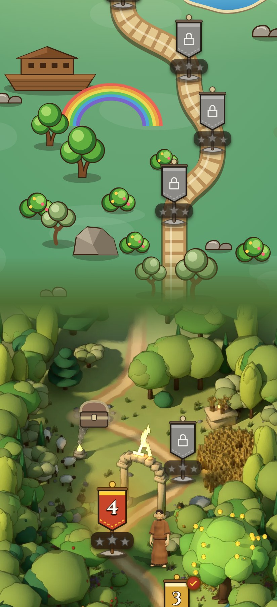
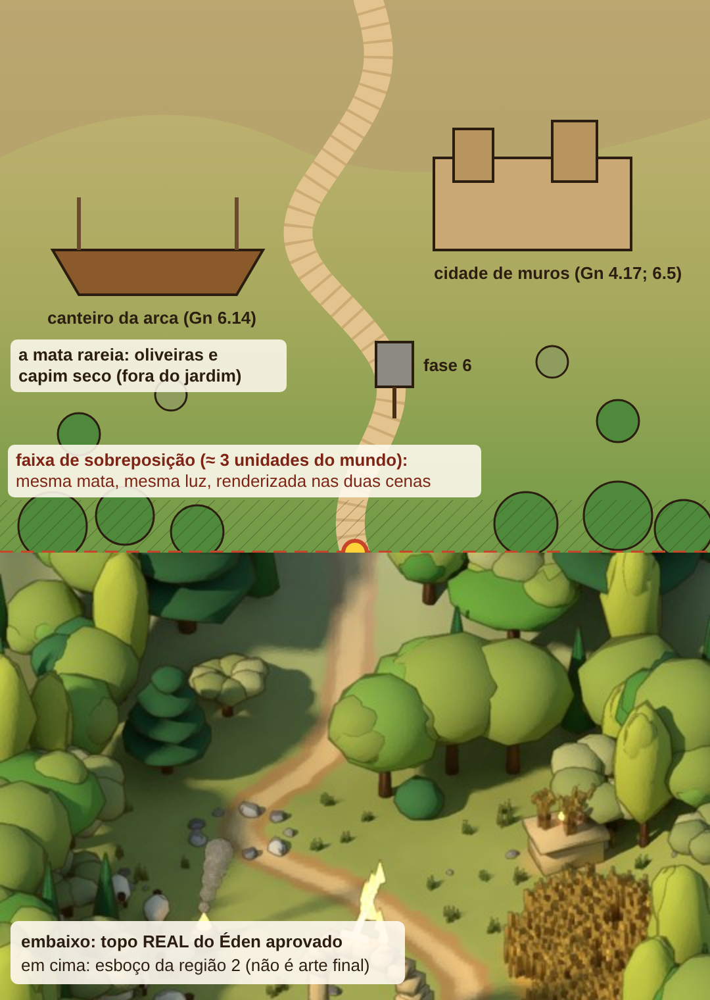

# Bible Quest — Mapa de Gênesis: auditoria e proposta da expansão

**Proposta para aprovação** · 27/11/2026 · branch `claude/bible-quest-android` · nenhuma alteração de código, arte, testes ou dados · nenhum merge, APK ou publicação

> **Resumo.** Gênesis tem 20 fases e 4 baús. O Éden aprovado cobre as fases 1 a 5 e o primeiro baú.
>
> A proposta pinta as **outras três regiões no mesmo molde**: 5 fases e 1 baú cada, uma imagem por região, pontos exportados pela cena. Cada região ganha identidade própria:
> - **Terras do Dilúvio** (fases 6 a 10);
> - **De Sinar a Canaã** (fases 11 a 15);
> - **Dos patriarcas ao Egito** (fases 16 a 20).
>
> As regiões vêm de **um só mundo contínuo**, renderizado em faixas que se sobrepõem. Assim a trilha e a mata atravessam a emenda sem corte, o que resolve a passagem brusca da fase 5 para a 6.
>
> O Quiz ganha **um mundo próprio**, o **Caminho dos Escribas**, que não reaproveita a História. Ele usa o mesmo motor, como já acontece hoje.
>
> O motor e a lógica não precisam mudar. A integração exige só dados novos e três ajustes pequenos de apresentação (seção 7), que aponto para aprovação explícita.

## 1. Diagnóstico da estrutura atual

### 1.1 Fases e baús de Gênesis (`worldSections()`, `src/services/game/journeyMap.ts`)

| Nó | Fase | Título | Região proposta |
|---|---|---|---|
| 1 | 1 | A criação do mundo | **Éden (pronto)** |
| 2 | 2 | A criação do homem e da mulher | Éden |
| 3 | 3 | O jardim do Éden | Éden |
| 4 | 4 | A queda | Éden |
| 5 | 5 | Caim e Abel | Éden |
| 6 | baú | `bau-mundo-genesis-5` (40 XP) | Éden |
| 7 | 6 | A corrupção da humanidade | **2. Terras do Dilúvio** |
| 8 | 7 | Noé, um homem justo | 2 |
| 9 | 8 | A construção da arca | 2 |
| 10 | 9 | O dilúvio | 2 |
| 11 | 10 | A aliança com Noé | 2 |
| 12 | baú | `bau-mundo-genesis-10` (40 XP) | 2 |
| 13 | 11 | A torre de Babel | **3. De Sinar a Canaã** |
| 14 | 12 | O chamado de Abraão | 3 |
| 15 | 13 | Abraão e Ló | 3 |
| 16 | 14 | A promessa de Deus | 3 |
| 17 | 15 | Isaque, o filho da promessa | 3 |
| 18 | baú | `bau-mundo-genesis-15` (40 XP) | 3 |
| 19 | 16 | Jacó e Esaú | **4. Dos patriarcas ao Egito** |
| 20 | 17 | Jacó e sua família | 4 |
| 21 | 18 | José e seus irmãos | 4 |
| 22 | 19 | José no Egito | 4 |
| 23 | 20 | José: reencontro e perdão | 4 |
| 24 | baú final | `bau-mundo-genesis-20` (100 XP) | 4 |

Os baús caem a cada 5 fases (`CHEST_EVERY = 5`). Por isso **cada região tem exatamente 6 nós**, igual ao Éden, e o mesmo formato de imagem e de pontos serve para as quatro.

### 1.2 Onde termina o Éden e começa a fase 6

- `src/data/mapas/artes.ts`: `ARTES_DO_MUNDO['mundo-genesis'] = [ARTE_EDEN]`, com 6 pontos.
- `dividirTrecho()` (`src/components/map/JourneyMap.tsx`) dá os 6 primeiros nós à região pintada. Os 18 seguintes vão para o **cenário vetorial antigo** (`CenaMapa` + `CENARIO_MUNDO`), desenhado **acima** da pintura.
- A emenda são duas máscaras de CSS (`src/styles/telas/mapa-trilha.css`):
  - a pintura some nos 7% de cima (`.tr-arte`);
  - o vetorial some nos 70 px de baixo (`.tr-emenda .av-cena`).

  Entre as duas fica uma faixa verde lisa, e o estilo troca de uma vez.

### 1.3 Arquivos responsáveis

| Papel | Arquivo |
|---|---|
| Cena pintada (gera imagem e pontos) | `tools/mapa/eden.py` (Blender, procedural) |
| Imagens | `public/mapas/genesis/eden.webp` (alta), `eden-leve.webp` (leve e 2D); licenças em `public/mapas/LICENCAS.md` |
| Dados das regiões pintadas | `src/data/mapas/artes.ts` (`ArteRegiao`: imagem, tamanho, pontos) |
| Motor compartilhado | `src/components/map/trilha/Trilha.tsx` (`RegiaoTrilha`) e `Estandarte.tsx` |
| Estados e rótulos | `src/services/game/marcos.ts` |
| Mapa da História | `src/pages/story/StoryMap.tsx` → `src/components/map/JourneyMap.tsx` |
| Mapa do Quiz | `src/pages/quiz/QuizMap.tsx` (layout próprio + `RegiaoTrilha` com fundo vetorial) |
| Fundos vetoriais antigos | `src/components/map/aventura/Cena.tsx`, `Elementos.tsx`, `src/data/mapas/cenarios.ts` (`CENARIO_MUNDO`, `CENARIO_QUIZ`) |
| Estilo | `src/styles/telas/mapa-trilha.css`; cores em `src/styles/tokens.css` (bloco "Mapa") |
| Ferramentas de conferência | `tools/mapa/relatorio.cjs` (capturas, toque, rolagem, peso), `tools/mapa/demo.html` |
| Testes | `src/test/mapa-protecao.test.tsx` (proteção), `src/test/mapa-trilha.test.tsx` (motor), `src/test/mapas.test.tsx` |

### 1.4 Como História e Quiz compartilham o motor

Os dois montam uma lista de `Marco` e entregam a `RegiaoTrilha`. Ela recebe `W`, `H`, os pontos e **ou** `arte` (imagem pintada) **ou** `fundo` (vetorial). Desenha os botões, o avatar e os estandartes.

| | História | Quiz |
|---|---|---|
| Estado das fases | `phaseState` + `estadoDoMarco` | `quizNodeState` + `estadoDoMarco` |
| Posições hoje | pontos da pintura (Éden) ou seno (`layoutSection`) | `layout()` próprio, em zigue-zague |
| Fundo hoje | pintado (Éden) + vetorial | vetorial (`CENARIO_QUIZ`) |
| Identidade | terra, estandartes de fogo e azul | pedra, estandartes azul-petróleo e verde (`.tr-quiz`) |

**Trocar o fundo do Quiz sem afetar a lógica** é só passar `arte={{ regiao: ARTE_QUIZ[regiao.id], leve }}` e os pontos da pintura no lugar de `layout()`. Ficam intactos:
- `quizNodeState`, `isQuizRegionUnlocked` e o seletor de dificuldade;
- `JanelaFaseQuiz`, os rótulos ("Disponível", "Bloqueado") e o `data-qnode`.

Cada região do Quiz também tem 6 desafios, então o mesmo formato de 6 pontos serve.

### 1.5 Resolução, carregamento, memória e desempenho no Android

| Ponto | Situação hoje (Éden) | Com as 4 regiões de Gênesis |
|---|---|---|
| Tamanho | 1080 × 2257 (alta) e 648 × 1354 (leve) | o mesmo por região; abaixo do limite de textura de 4096 px dos WebViews |
| Download | 200 KB (alta) e 74 KB (leve) | cerca de 800 KB (alta) ou 300 KB (leve) para Gênesis inteiro; no APK as imagens já vêm empacotadas |
| Memória decodificada | 9,8 MB (alta) e 3,5 MB (leve) por imagem | até **39 MB** (alta) ou **14 MB** (leve) se as quatro estiverem decodificadas ao mesmo tempo |
| Carregamento | ``, sem `loading="lazy"` | as quatro carregam ao abrir o mapa, inclusive as que estão longe da tela |
| Rolagem | 16,6 ms por quadro (navegador de teste, desenho por software) | uma imagem por região, sem 3D; tende a ficar igual |
| Qualidade | `leve` e `2d` usam a imagem leve | igual |

**Cuidados necessários:**
- `loading="lazy"` nas regiões longe do avatar;
- `content-visibility: auto` nos trechos fora da tela, para que o navegador possa liberar a memória das imagens decodificadas;
- manter a qualidade `leve` como padrão automático em aparelhos fracos (já é);
- nunca passar de 2 MB por imagem decodificada na versão leve.

## 2. Direção artística das regiões de Gênesis

**Princípios comuns:**
- **Mesmo acabamento do Éden:** procedural no Blender, Kuwahara, contorno #2B1D10 e mesma câmera inclinada de 52°.
- **Mesma luz do sol**, para que as regiões pareçam um só mundo.
- **Paleta e vegetação próprias por região**, seguindo a narrativa e a geografia.
- **Composição vertical:** a trilha sobe em S.
- **Espaço livre** em volta de cada ponto: nada alto a menos de 2 unidades, como no Éden.
- **Marcos narrativos** a 3–5 unidades das fases. Ficam visíveis, mas nunca sob o estandarte; isso é conferido na tela, como foi feito com o portão.
- **Narrativa só visual:** sem textos e sem falas.

### 2.1 Região 2 — Terras do Dilúvio (fases 6 a 10, baú 10)

| Fase | Marco na paisagem |
|---|---|
| 6. A corrupção | Ao sair da mata do Éden, a cidade de muros de barro (Gn 4.17) e terra mais seca e gasta |
| 7. Noé, um homem justo | Casa e plantação de Noé, afastadas da cidade, com oliveiras (sem figura de Noé) |
| 8. A construção da arca | Canteiro com o casco da arca em madeira (Gn 6.14), andaimes, toras e piche |
| 9. O dilúvio | A planície coberta de água: a trilha passa por uma calçada elevada de pedras, entre lagoas que refletem o céu nublado |
| 10. A aliança | Encosta das montanhas de Ararate (Gn 8.4): a arca encalhada, altar com fumaça (Gn 8.20) e **arco-íris** sobre os picos (Gn 9.13) |
| Baú 10 | Clareira de pedra no topo da encosta |

- **Paleta:** começa no verde do Éden, passa por ocre e barro seco (cidade) e termina em azul-acinzentado (água e montanha), com céu clareando no alto.
- **Atmosfera:** do fim de tarde pesado ao céu lavado depois da chuva. A luz quente volta no topo, no arco-íris.
- **Vegetação:** oliveiras, capim seco, tamargueiras perto da água e juncos nas lagoas.

### 2.2 Região 3 — De Sinar a Canaã (fases 11 a 15, baú 15)

| Fase | Marco na paisagem |
|---|---|
| 11. A torre de Babel | Planície de Sinar (Gn 11.2) com fornos de tijolo e a torre **inacabada**, em degraus, com andaimes abandonados |
| 12. O chamado de Abraão | A caravana parte: tendas, camelos e a trilha que vira estrada de caravana para o oeste (Gn 12.4–5) |
| 13. Abraão e Ló | Bifurcação: de um lado a planície verde do Jordão (Gn 13.10), do outro as colinas de Canaã; a trilha segue pelas colinas |
| 14. A promessa | Uma elevação aberta à noite, com o céu de estrelas (Gn 15.5) em degradê no alto da imagem; tenda com lamparina |
| 15. Isaque | Os carvalhos de Manre (Gn 18.1) e o poço de Berseba (Gn 21.31), com rebanhos |
| Baú 15 | Junto ao poço |

- **Paleta:** barro e tijolo dourados (Sinar), terra quente e verde-oliva (Canaã) e, no alto, o **azul profundo da noite** com estrelas: o único trecho noturno de Gênesis, de propósito.
- **Arquitetura:** tijolo cozido e betume (Gn 11.3) em Babel; tendas de pelo de cabra; altares de pedra bruta.

### 2.3 Região 4 — Dos patriarcas ao Egito (fases 16 a 20, baú final)

| Fase | Marco na paisagem |
|---|---|
| 16. Jacó e Esaú | Tendas de Isaque e um campo de caça com mata baixa (Gn 25.27); a coluna de pedra de Betel (Gn 28.18) num alto, com luz suave |
| 17. Jacó e sua família | O vau do Jaboque (Gn 32.22): rio raso com pedras, rebanhos grandes atravessando, tendas da família |
| 18. José e seus irmãos | Dotã (Gn 37.17): pastagem, a cisterna seca de pedra e uma caravana de camelos na estrada (Gn 37.25) |
| 19. José no Egito | Começo do Egito: o Nilo com papiros, palmeiras, celeiros de grãos (Gn 41.48) e construções de pedra clara |
| 20. Reencontro e perdão | Gósen (Gn 47.6): pastagens verdes junto ao rio e tendas da família ao lado das casas egípcias |
| Baú final | Diante do celeiro, maior, como já é o baú final (62 px) |

- **Paleta:** verde de pasto, depois ocre de estrada de caravana, depois o **verde-azulado do Nilo** e o **calcário claro e dourado** do Egito.
- **Vegetação:** carvalhos e terebintos, depois palmeiras, papiros e campos de trigo do Nilo.
- **Fechamento:** o alto da imagem termina em deserto claro. É a ponte natural para Êxodo, que fica para depois.

## 3. Transição da fase 5 para a 6 (e entre todas as regiões)

**Proposta:** um **mundo contínuo em faixas.** O mundo de Gênesis vira um só terreno, do Éden ao Egito, gerado por um módulo comum. Cada região é uma "janela" da mesma câmera sobre esse terreno, ao longo de y:
- Éden: y 0–60;
- Dilúvio: y 57–117;
- Sinar a Canaã: y 114–174;
- Patriarcas ao Egito: y 171–231.

Entre janelas vizinhas há **3 unidades de sobreposição** (cerca de 110 px na imagem), renderizadas nas duas cenas com a mesma mata, luz e trilha. No jogo, as faixas se encaixam com um degradê só dentro dessa sobreposição. Como os pixels dos dois lados são da mesma cena, não aparece corte nem faixa lisa.

**Contrato da emenda:**
- a trilha cruza a borda no mesmo x (hoje o Éden termina com a trilha no centro, x ≈ 0,5);
- mesma largura de trilha e mesma semente de vegetação na faixa comum;
- nenhuma fase ou baú dentro da faixa de sobreposição.

**O Éden aprovado não muda.** A faixa de cima dele é a referência: a região 2 é gerada para reproduzir essa faixa (mesma mata e mesma luz), confirmada por comparação de pixels antes da entrega.

**Narrativa da passagem:**
- saindo do Éden "para o oriente" (Gn 3.24; 4.16), a mata vai rareando;
- oliveiras soltas e capim seco tomam o lugar do jardim;
- a trilha desce suave para terras mais áridas até a cidade de muros da fase 6.

Referência visual (esboço, não é arte final): embaixo, o topo real do Éden; em cima, o esquema da região 2 e da faixa de costura.

Depois de Gênesis inteiro pintado, a única emenda com o vetorial antigo será a de **Gênesis para Êxodo**. Ela fica para a etapa de Êxodo, que não começa agora.

## 4. Proposta do Quiz: o Caminho dos Escribas

O Quiz não é uma história bíblica em ordem. É uma jornada de **aprendizado das Escrituras**. A proposta é um mundo próprio, de escolas, pergaminhos e bibliotecas antigas, que não copia nenhuma região da História. Quatro regiões, uma por dificuldade, cada uma com 6 pontos:

| Região | Identidade | Marcos (ilustrativos, sem texto) |
|---|---|---|
| Vale dos Iniciantes | Manhã clara; vale verde com riacho e oliveiras | Tenda-escola com pergaminhos abertos, poço, mesa de escriba com tinteiro, jarros de pergaminho |
| Planície do Saber | Meio-dia dourado; campos e estrada de mercadores | Pátio de estudo com colunatas baixas, ampulhetas, carroças com rolos, tabuletas de barro |
| Montanhas dos Sábios | Tarde fria; trilha em degraus na rocha, cedros | Cavernas com jarros de rolos (inspiradas nos achados do deserto da Judeia), escadarias, mirantes |
| Torre dos Especialistas | Crepúsculo e estrelas; cume rochoso | Uma **torre de vigia** de pedra com biblioteca no alto, lamparinas e o observatório do céu |

A torre de vigia não pode se parecer com a torre de Babel da História: é uma torre de vigia, estreita e redonda, nunca um zigurate.

**Unidade com a História, identidade separada:**
- mesmo acabamento de pintura e mesmo contorno;
- **caminho de pedra**, como já é hoje no Quiz;
- paleta própria: pergaminho, azul-petróleo e verde, combinando com os estandartes `.tr-quiz` que já existem;
- nenhum personagem bíblico encenado;
- o "bloqueado" de uma região continua sendo o filtro acinzentado de hoje, que precisa passar a valer também para a pintura (seção 7).

Cada região do Quiz aparece **sozinha**, pelo seletor. Por isso só uma imagem é carregada de cada vez, e o peso fica igual ao de uma região da História.

## 5. O que se mantém

- Marcadores, estados, rótulos acessíveis, `data-node` e `data-qnode`, avatar, baús, recompensas, economia, progressão e dados salvos.
- `RegiaoTrilha`, `Estandarte`, `marcos.ts`, `estadoDoMarco`, `rotuloDoEstado`.
- Os testes de proteção (`mapa-protecao.test.tsx`), sem nenhuma linha alterada.
- O Éden aprovado: mesma imagem e mesmos pontos.
- O cenário vetorial antigo (`CenaMapa`), que continua como reserva para mundos sem pintura (Êxodo).

## 6. Arquivos que precisariam ser alterados

| Arquivo | Mudança | Natureza |
|---|---|---|
| `tools/mapa/comum.py` (novo) | Terreno, água, biblioteca de formas, acabamento e exportação, extraídos de `eden.py` | ferramenta |
| `tools/mapa/genesis.py` (novo) | O mundo contínuo de Gênesis e as janelas das regiões 2, 3 e 4 | ferramenta |
| `tools/mapa/eden.py` | Nenhuma, ou só passar a importar o módulo comum **se** a imagem sair idêntica (conferido pixel a pixel); senão fica como está | ferramenta |
| `tools/mapa/quiz.py` (novo) | O mundo do Caminho dos Escribas e as 4 janelas | ferramenta |
| `public/mapas/genesis/*.webp` | 3 regiões novas, alta e leve | arte |
| `public/mapas/quiz/*.webp` | 4 regiões, alta e leve | arte |
| `public/mapas/LICENCAS.md` | Registro de cada imagem nova | documentação |
| `src/data/mapas/artes.ts` | 3 novas entradas em `ARTES_DO_MUNDO['mundo-genesis']` e `ARTES_QUIZ` | dados |
| `src/pages/quiz/QuizMap.tsx` | Usar `arte` e os pontos da pintura quando houver; o `layout()` fica como reserva | apresentação |
| `src/styles/telas/mapa-trilha.css` | Emenda entre regiões pintadas vizinhas, filtro "bloqueado" na pintura do Quiz e `content-visibility` | apresentação |
| `src/components/map/trilha/Trilha.tsx` | **Só** `loading="lazy"` na `` e, opcionalmente, reserva vetorial se a imagem falhar | apresentação (pede aprovação explícita, porque é o motor) |
| `src/test/mapa-trilha.test.tsx` | **Acrescentar** verificações das novas regiões (pontos, peso, nós) e ajustar a que hoje afirma "só Gênesis tem região pintada" quando o Quiz ganhar a dele | testes novos, sem tocar na proteção |
| `tools/mapa/relatorio.cjs` | Capturas por região e da emenda | ferramenta |

`JourneyMap.tsx` não precisa mudar: `dividirTrecho()` já distribui os nós entre várias regiões pintadas, e o trecho vetorial some sozinho quando não sobram nós.

## 7. Riscos técnicos e cuidados com o Android

| Risco | Cuidado |
|---|---|
| Memória com 4 imagens grandes decodificadas | `loading="lazy"`, `content-visibility: auto` por trecho, qualidade leve automática em aparelhos fracos e teste em aparelho real com pouca memória |
| Emenda visível entre regiões | Contrato da emenda (seção 3), comparação de pixels na faixa comum e captura da emenda em cada entrega |
| Pontos que mudam ao refazer uma região | Pontos exportados pela cena e teste que confere os nós de cada região (o mesmo que já existe para o Éden) |
| Marco narrativo escondido sob um estandarte | A mesma medição na tela feita com o portão do Éden, para cada marco |
| Variar Gênesis quebra o Éden aprovado | O Éden não é refeito; a região 2 se adapta a ele, não o contrário |
| Tempo de renderização | Cerca de 4 min por região em 1080 px; testes rápidos em 540 px |
| Peso do APK | +0,6 MB (Gênesis) e +0,8 MB (Quiz) na qualidade alta; aceitável, mas acompanhar |
| Precisão bíblica e dramatização | Só cenário (sem falas, sem texto); cada marco com referência registrada, como no Éden |
| A torre do Quiz lembrar Babel | Forma de torre de vigia, redonda e estreita, nunca em degraus |

## 8. Sequência de implementação (pequenas entregas, cada uma com avaliação)

1. **Base comum.** Extrair `comum.py` de `eden.py` e provar que o Éden sai **idêntico**. Sem mudança visível no jogo.
2. **Região 2, Terras do Dilúvio,** com a emenda do Éden. Entrega com:
   - pintura sem interface e com marcadores;
   - captura da passagem da fase 5 para a 6;
   - peso, testes e toque. **Avaliação.**
3. **Carregamento sob demanda** (`loading="lazy"`, `content-visibility`) e medição de memória no Android. **Avaliação.**
4. **Região 3, De Sinar a Canaã.** **Avaliação.**
5. **Região 4, Dos patriarcas ao Egito,** e fechamento de Gênesis sem o vetorial antigo. **Avaliação.**
6. **Quiz, primeira região** (Vale dos Iniciantes) no novo mundo, com o filtro de bloqueio na pintura. **Avaliação.**
7. **Quiz, as outras três regiões.** **Avaliação final** e relatório.

Êxodo, merge, APK e publicação ficam fora de todas essas entregas, até ordem em contrário.
