# Bible Quest — Reformulação visual, entrega 2: Mapa de Gênesis — Protótipo do Éden

**Relatório do protótipo** · 27/11/2026 · branch `claude/bible-quest-android` · nenhuma alteração na branch principal · nenhum APK gerado · nenhuma versão publicada

> **Resumo.** O começo do mapa de Gênesis virou uma **região pintada do Jardim do Éden**, vista do alto em perspectiva inclinada. Ela tem:
> - trilha de terra sinuosa;
> - rio com ponte de madeira, cachoeira e lago;
> - mata variada, árvores frutíferas e canteiros de flores;
> - marcos bíblicos no lugar certo da história: a árvore da vida, a árvore do conhecimento, o portão a leste com a espada flamejante, o trigal de Caim, o rebanho de Abel e os dois altares.
>
> As fases 1 a 5 e o primeiro baú ficam sobre ela, como **estandartes** com número e três estrelas, em **quatro estados**: concluída, atual, disponível e bloqueada.
>
> Modo História e Modo Quiz passaram a usar **o mesmo motor de trilha**. Mudam só as cores e o conteúdo.
>
> **Comportamento preservado:**
> - os 262 testes passam, inclusive os 6 de proteção escritos **antes** da mudança;
> - os rótulos acessíveis são os mesmos;
> - visitar o mapa não altera nenhum dado.
>
> **Ainda é protótipo:**
> - as fases 6 a 20 de Gênesis continuam no cenário vetorial antigo, e a passagem da pintura para ele é perceptível;
> - Êxodo não foi tocado.
>
> Peço avaliação antes da expansão.

## 1. Auditoria (antes de implementar)

| Ponto | Como era | Decisão |
|---|---|---|
| Fases e baús | `worldSections()`: numeração global, baú a cada 5 fases e no fim do mundo | **Mantido.** O mapa novo só lê esses nós, não cria nenhum |
| Estados | `phaseState` (concluída, atual, bloqueada), `chestState` (aberto, disponível, fechado), `quizNodeState` | **Mantidos.** Uma tradução única para os 4 estados visuais (`src/services/game/marcos.ts`) |
| Posições | Curva de seno calculada no código (`layoutSection`); o Quiz tinha um layout próprio, duplicado | Na região pintada, os pontos vêm **da própria cena** (exportados pelo Blender). Fora dela, o layout antigo |
| Marcadores | `Medalhao` (moeda) repetido nos dois mapas | Substituído por um único `Estandarte`, usado pelos dois. O `Medalhao` foi removido |
| Rolagem | A rolagem da própria página, com `scrollIntoView` | **Mantida** (sem rolagem customizada, que pesaria em aparelhos fracos) |
| Acessibilidade | Botões HTML com `aria-label` ("Fase atual", "Bloqueada", "Concluída, N de 3 estrelas"; no Quiz, "Disponível", "Bloqueado") | **Textos idênticos.** A arte é decorativa (`aria-hidden`, `pointer-events: none`) |

**Testes de proteção** (`src/test/mapa-protecao.test.tsx`, commit 2502361, escritos antes da mudança):
- todas as fases aparecem, com estado e estrelas reais;
- baús nos três estados;
- abrir o baú é a única ação que muda o progresso;
- fase bloqueada não começa;
- visitar o mapa não muda nada;
- todos os desafios do Quiz aparecem com o estado real.

## 2. O que foi feito

| Área | Mudança |
|---|---|
| Cena do Éden | `tools/mapa/eden.py`: cena 3D **procedural**, toda gerada por código próprio. Câmera ortográfica inclinada 52°, renderizada no Cycles. O acabamento de pintura vem do compositor: filtro Kuwahara, contornos de normal e profundidade, ajuste de cor. Exporta a imagem e os pontos das fases. |
| Imagens | `public/mapas/genesis/eden.webp` (1080 × 2257, **189 KB**) e `eden-leve.webp` (648 × 1354, **70 KB**). Licenças em `public/mapas/LICENCAS.md` |
| Motor | `src/components/map/trilha/Trilha.tsx` (`RegiaoTrilha`): uma região é a arte pintada **ou** o cenário vetorial, com os marcos HTML por cima. O mesmo componente serve à História e ao Quiz |
| Estandarte | `src/components/map/trilha/Estandarte.tsx`: pano num mastro sobre um marco de pedra, número, selo de cera (concluída), cadeado (bloqueada), ícone do modo (Quiz) e plaquinha com as 3 estrelas |
| Dados | `src/data/mapas/artes.ts`: imagem, tamanho e pontos de cada região pintada. Só Gênesis tem uma |
| Integração | `JourneyMap` divide o trecho: os 6 primeiros nós vão para a região do Éden, o resto para o cenário vetorial. `StoryMap` passa o alvo do personagem e a qualidade. `QuizMap` usa `RegiaoTrilha` |
| Estilo | `src/styles/telas/mapa-trilha.css` (cores como tokens em `tokens.css`), com alto contraste e movimento reduzido |
| Ferramentas | `tools/mapa/demo.html` (demonstração dos estados; não entra no build) e `tools/mapa/relatorio.cjs` (capturas e medições) |

## 3. O mapa em tamanho completo

### 3.1 Sem interface (a pintura sozinha, 1080 px)

A pintura precisa ser bonita sem os marcos. Do sul (embaixo) para o norte:
- **Criação:** lago, cachoeira e ovelhas no prado.
- **Jardim:** rio vindo da nascente, ponte, árvores frutíferas, canteiros e a árvore da vida, com frutos dourados e uma luz suave, a leste.
- **Saída:** o portão a leste, com a espada flamejante (Gn 3.24).
- **Fora do jardim:** o trigal de Caim, o rebanho de Abel e os dois altares (Gn 4.2–4). Só o altar de Abel tem a fumaça alta.

A narrativa é só visual, sem textos e sem falas.

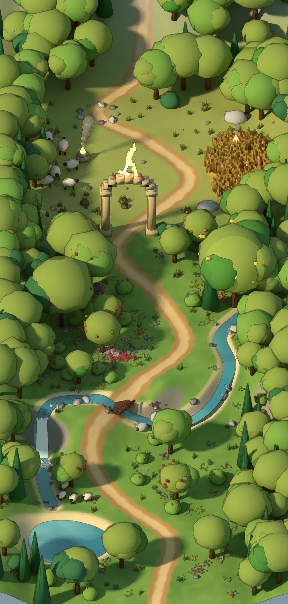

### 3.2 Com os marcos (progresso: 3 fases feitas, com 3, 2 e 1 estrelas)

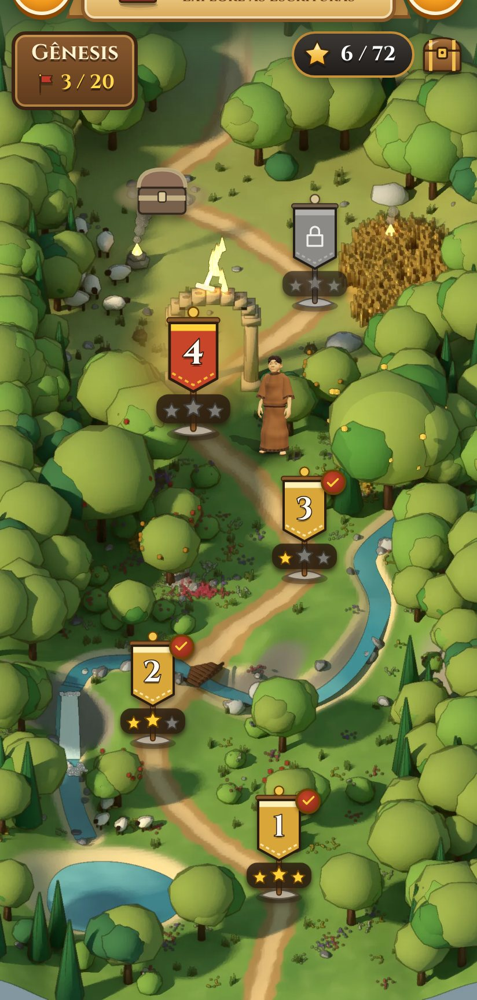

### 3.3 Trecho inteiro de Gênesis

O Éden fica embaixo, e o restante continua no cenário vetorial (seção 9).

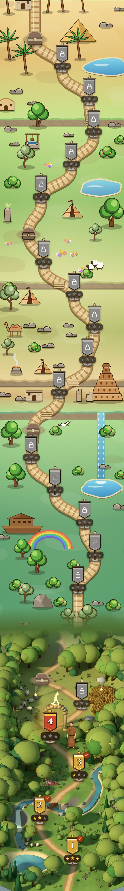

## 4. Antes e depois (celular de 412 px)

| Antes | Depois |
|---|---|
| 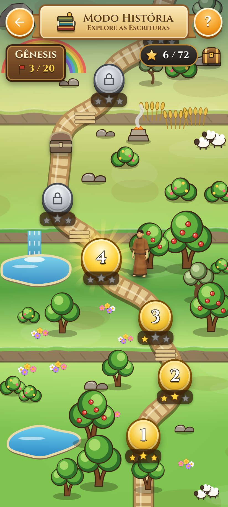 | 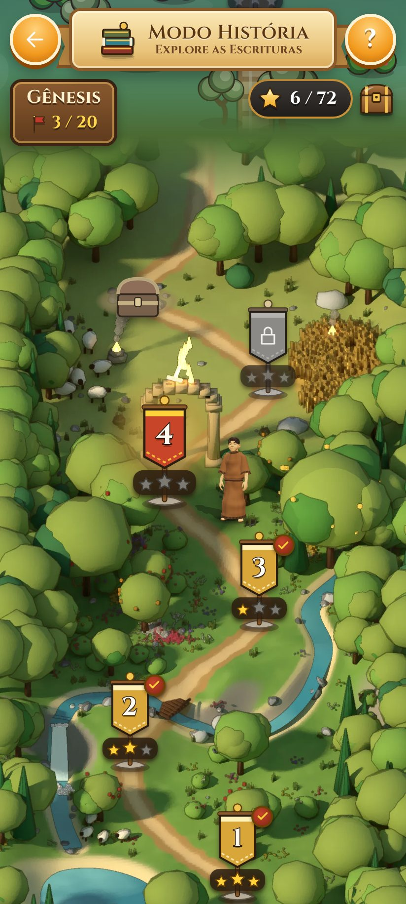 |

O cabeçalho, a placa da região, o contador de estrelas e o baú do topo não mudaram, como pedido.

## 5. História × Quiz: a mesma estrutura

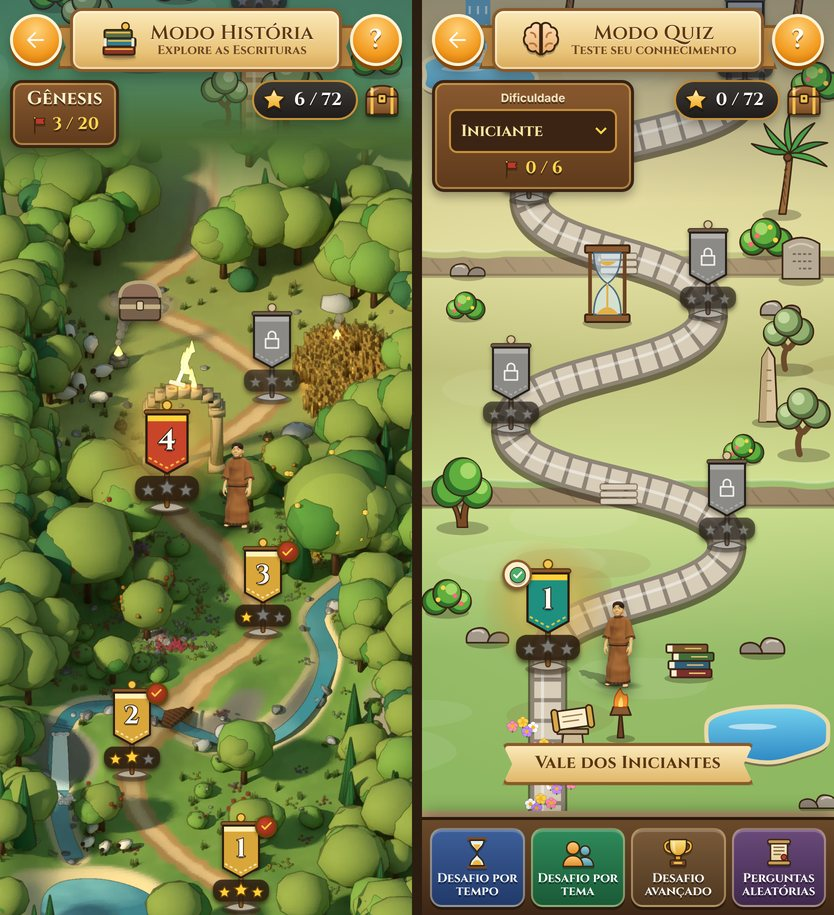

| Igual nos dois (motor) | Diferente (identidade e conteúdo) |
|---|---|
| `RegiaoTrilha`: posição dos marcos, avatar, botões, rótulos, os 4 estados, as estrelas reais, o toque e o foco | Caminho de pedra e estandartes verdes e azul-petróleo no Quiz; terra e estandartes de fogo e azul na História |
| `estadoDoMarco` e `rotuloDoEstado` (`marcos.ts`) | Ícone do modo de jogo no estandarte (Quiz) |
| Mesmo CSS (`mapa-trilha.css`) | Classe `tr-quiz` só troca as cores |

O Quiz ainda não tem região pintada própria. Ele usa o motor com o fundo vetorial dele, e o protótipo artístico desta entrega é o Éden. Antes e depois do Quiz:

| Antes | Depois |
|---|---|
| 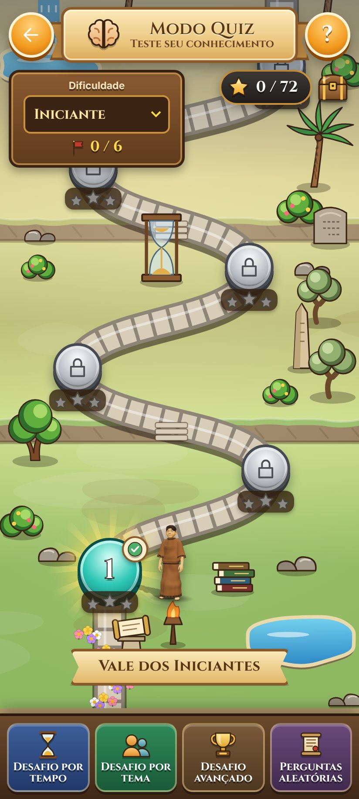 | 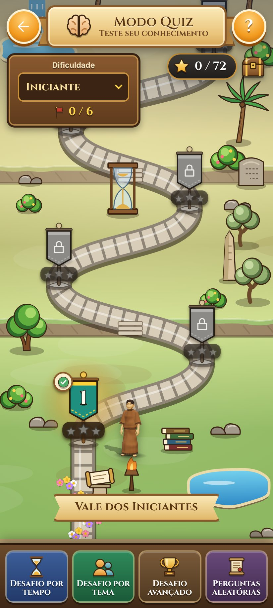 |

## 6. Os quatro estados das fases

A forma distingue cada estado, além da cor:

| Estado | Como aparece | Rótulo para leitor de tela |
|---|---|---|
| Concluída | Pano dourado, **selo de cera com ✓**, estrelas reais | "Concluída, N de 3 estrelas" |
| Atual | Pano cor de fogo, **maior**, brilho pulsante, personagem ao lado | "Fase atual" (no Quiz, "Disponível", como antes) |
| Disponível | Pano azul (verde no Quiz), número | "Disponível" |
| Bloqueada | Pano de pedra, **cadeado** no lugar do número, estrelas apagadas | "Bloqueada" / "Bloqueado" |

O estado **"disponível"** (aberta, mas não é onde o personagem está) **não acontece com as regras lineares de hoje**: só a próxima fase abre. Ele existe no motor para regras futuras e não muda progressão nenhuma. Por isso aparece aqui numa **página de demonstração**, que usa os mesmos componentes do jogo (`tools/mapa/demo.html`):

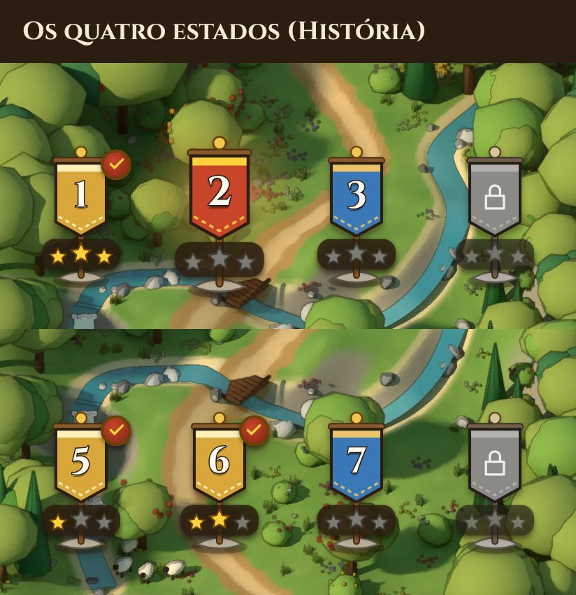

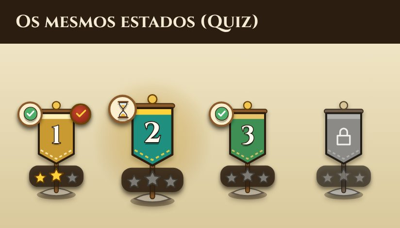

Todos os estados na região do Éden:

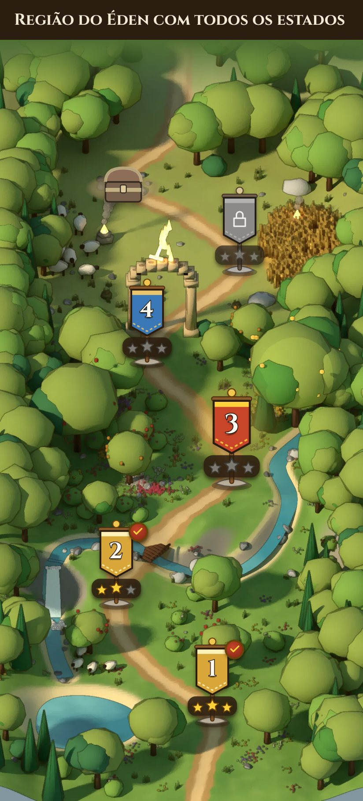

No jogo real, com o progresso vazio (fase 1 atual, todas as outras bloqueadas):

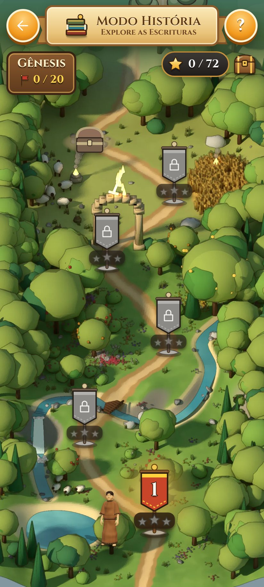

## 7. Baús

O baú fica numa clareira de pedra pintada na cena, no ponto exportado pelo Blender. Há três estados:
- **bloqueado:** acinzentado;
- **disponível:** clareira dourada e baú balançando;
- **resgatado:** tampa aberta.

Recompensas e economia não mudaram (`CHEST_XP`, `openChest`, a mesma janela de abertura).

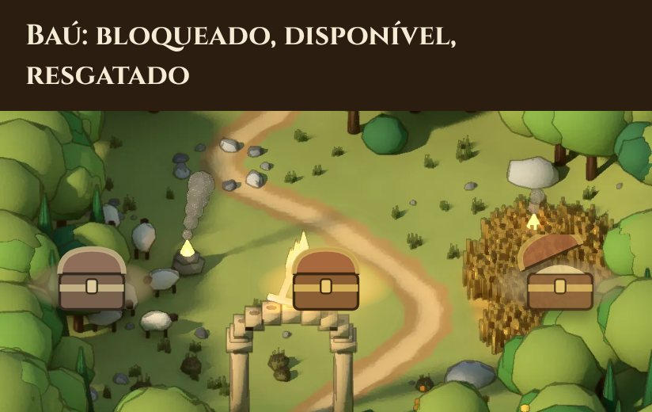

No jogo, com as 5 primeiras fases feitas, o baú está disponível. Tocar no baú do cabeçalho rola a página até ele (medido: o baú fica inteiro na tela).

| Baú disponível | Depois do toque no baú do cabeçalho |
|---|---|
| 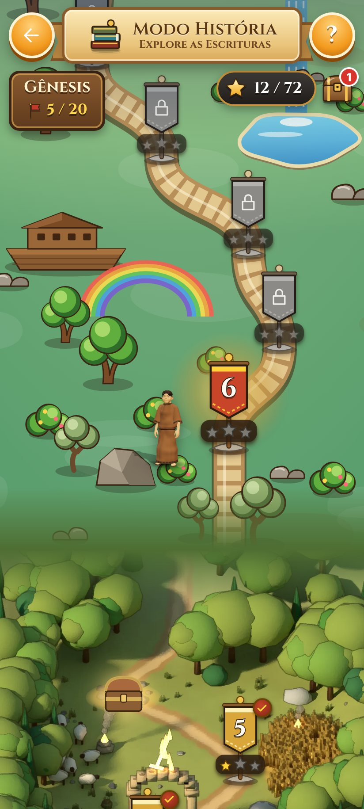 | 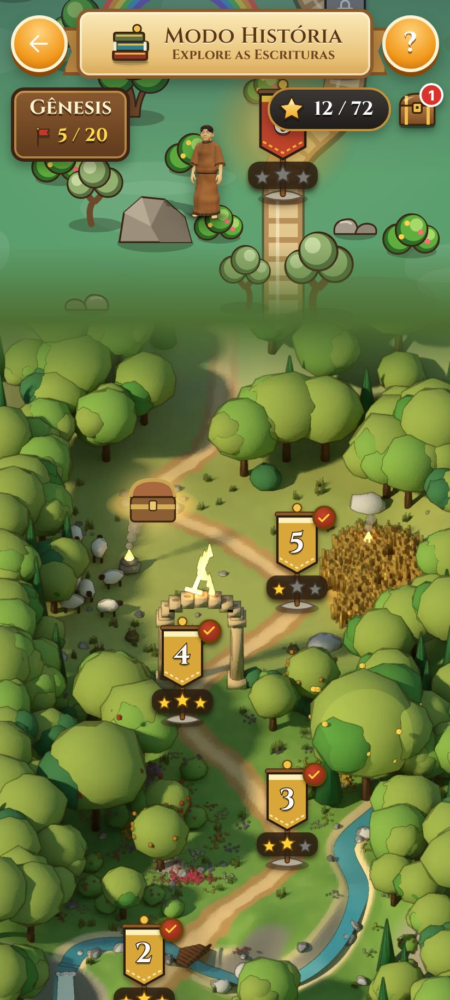 |

## 8. Rolagem, toque, desempenho e peso

Medido no Chromium de teste (Playwright), num celular de 412 × 915 px. Esse navegador desenha por software, então os números são indicativos. Os detalhes estão em `tools/mapa/relatorio.cjs`.

| Medida | Resultado |
|---|---|
| Arte cobrindo marcos | **Nenhum caso.** O toque no centro de cada marco cai no próprio botão: **29 de 29** na História e **6 de 6** no Quiz |
| Área de toque | Fases com 76 × 112 px; baús com 64 a 70 px (acima de 48 px) |
| Rolagem suave do mapa inteiro (3 s) | 182 quadros, média de **16,5 ms** por quadro e 95% dos quadros em até 16,8 ms (cerca de 60 por segundo); chegou ao fim |
| Imagem baixada (alta) | `eden.webp`: **189 KB**, uma vez, só no mapa da História |
| Imagem baixada (leve e 2D) | `eden-leve.webp`: **70 KB** |
| Código (comprimido) | JS **+1,0 KB** (441,8 para 442,8 KB); CSS **+1,4 KB** (36,2 para 37,7 KB) |
| 3D no mapa | Nenhum. A cena é pré-renderizada; no aparelho é só uma imagem |
| Memória da imagem | Alta: 1080 × 2257 ≈ 9,8 MB decodificada. Leve: 648 × 1354 ≈ 3,5 MB |

### Qualidade leve e 2D

A versão leve usa a imagem de 648 px e mantém a mesma identidade. A 2D (personagem plano) usa a mesma imagem leve.

| Leve | 2D |
|---|---|
| 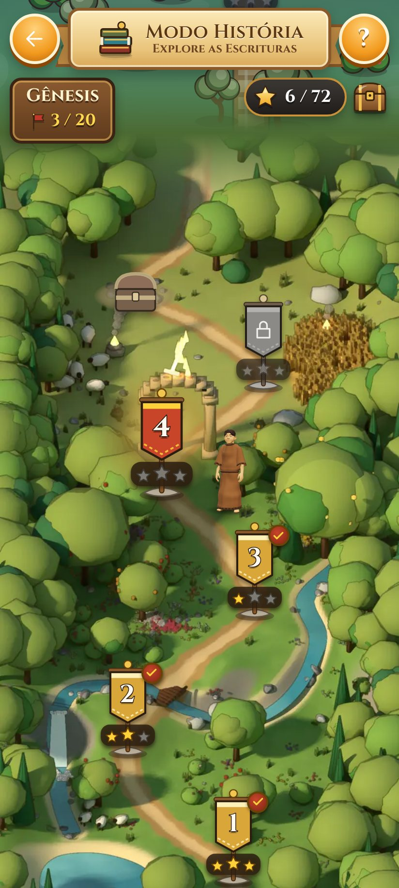 |  |

## 9. Testes

| Verificação | Resultado |
|---|---|
| `npm run typecheck` | passou |
| `npm test` | **262 de 262** (eram 253; 9 novos em `src/test/mapa-trilha.test.tsx`) |
| `npm run build` | passou (o aviso de pacote acima de 700 kB já existia) |
| Proteção (escrita antes) | 6 de 6 passando, sem mudar uma linha dos testes |
| Testes do mapa antigo (`mapas.test.tsx`) | passando, com os mesmos rótulos |

O que os testes novos verificam:
- a tradução dos 4 estados e os rótulos;
- a região do Éden recebe exatamente as fases 1 a 5 e o baú `bau-mundo-genesis-5`, sem nó perdido ou repetido;
- os pontos ficam dentro da imagem, sobem pelo mapa e têm pelo menos 90 px entre si;
- as imagens existem e respeitam o limite de peso;
- só Gênesis tem região pintada;
- a arte fica fora da acessibilidade;
- a qualidade leve usa a imagem leve;
- os três estados do baú.

## 10. Limitações conhecidas

1. **Transição para o cenário vetorial.** As fases 6 a 20 continuam no estilo antigo. A pintura se dissolve na mata, mas a troca de estilo é visível. Ela some quando as próximas regiões forem pintadas (expansão, depois da avaliação).
2. **Pontos fixos na pintura.** Se Gênesis ganhar ou perder fases antes da 6.ª, é preciso renderizar de novo (`blender -b -P tools/mapa/eden.py -- <pasta> 1080 96`, cerca de 3,5 min) e atualizar `artes.ts`. Um teste avisa se os nós não baterem.
3. **Estado "disponível"** só aparece na demonstração, porque as regras atuais são lineares (seção 6).
4. **Quiz sem pintura própria.** O Quiz já usa o motor e os estandartes, mas o fundo ainda é vetorial.
5. **Detalhes da pintura:**
   - a cachoeira é pequena e pouco animada (é imagem estática);
   - o altar de Caim é discreto ao lado do trigal;
   - o terraço do jardim aparece mais pela mudança de vegetação do que pelo relevo.
6. **Imagem estática:** a água e o fogo não se movem. Uma camada leve de animação (CSS) pode vir depois, só na qualidade alta.
7. **Medições de quadros** feitas em navegador por software, não em aparelho físico.

## 11. Commits

| Commit | Conteúdo |
|---|---|
| 2502361 | Testes de proteção do comportamento dos mapas e script de capturas |
| ad5b4fd | Cena procedural do Éden em Blender com acabamento de pintura |
| 7f44fae | Imagens do Éden em WebP (alta e leve) e registro de licenças |
| 5a73ff1 | Motor de trilha compartilhado, estandartes em 4 estados e região pintada do Éden |
| 6906a09 | Página de demonstração dos estados e script de capturas e medições |
| *(este relatório)* | Relatório em md e pdf, com imagens |

**Fora do escopo, como pedido:** a Central não foi refeita, a expansão completa de Gênesis não começou, Êxodo não foi tocado e não houve merge, APK nem publicação. README, CHANGELOG e ROADMAP não foram alterados (regra A21).
