# Bible Quest — Mapa de Gênesis: refinamento final da pintura do Éden

**Relatório do refinamento artístico** · 27/11/2026 · branch `claude/bible-quest-android` · nenhuma alteração na branch principal · nenhum APK gerado · nenhuma versão publicada

> **Resumo.** Esta rodada mexeu só na pintura (`tools/mapa/eden.py`) e nas duas imagens geradas. Os seis pedidos foram atendidos:
> - a cachoeira está mais alta e larga, com borda irregular, fios soltos e paredão de rochas;
> - a árvore da vida tem forma própria, é maior, tem frutos dourados que brilham e uma clareira com anel de flores;
> - a metade de cima ganhou outras espécies, alturas e tons;
> - o altar de Caim agora é de pedra lavrada, com feixes de trigo, ao lado do trigal;
> - o altar de Abel continua com a fumaça alta;
> - o portão foi recuado sobre a trilha, e o estandarte da fase 4 não cobre mais o arco.
>
> **Sem mudança:**
> - os pontos das fases e do baú são **idênticos** aos da versão anterior (conferido no JSON exportado);
> - os marcadores, o motor compartilhado e o progresso;
> - nenhum teste foi alterado.
>
> **Peso:** a imagem alta cresceu 10,7 KB e a leve, 4,0 KB.

## 1. Processo

| Passo | Como foi feito |
|---|---|
| Backup | A imagem anterior (`eden.webp` 189 502 B, `eden-leve.webp` 69 538 B), o PNG de origem, o JSON e o `eden.py` usados foram copiados antes da mudança. Os parâmetros anteriores estão no commit ad5b4fd, que gerou aquela pintura |
| Composição preservada | A vegetação nasce de um gerador aleatório com semente fixa. Tudo o que foi acrescentado usa **outro gerador** (`RR`). A sebe do portão usa uma cópia do gerador e devolve o original no mesmo estado. Assim, a trilha, o rio, a ponte, o lago e a mata ficaram exatamente onde estavam |
| Mudanças pós-vegetação | Clareiras (árvore da vida, portão, altar de Caim) e a troca de espécies na metade de cima são aplicadas **depois** que a vegetação está posicionada, sobre as mesmas posições |
| Pontos | `eden.json` novo = `eden.json` anterior, campo a campo. `src/data/mapas/artes.ts` não mudou |
| Renderização | Blender 4.0, Cycles, 1080 × 2257 px, 96 amostras, cerca de 3,5 min. Houve 3 versões; a final corrigiu a espada flamejante, que a limpeza em volta do portão tinha removido por engano |

## 2. A nova pintura, sem interface (tamanho real)

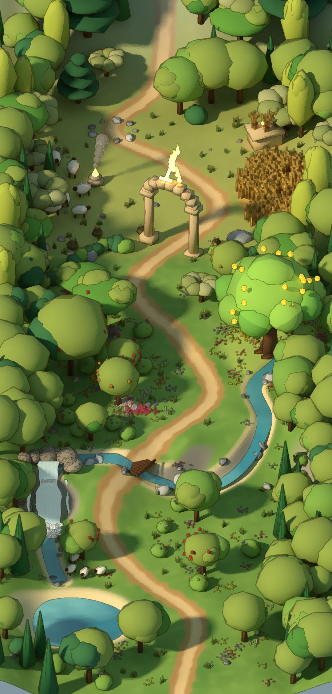

### Antes e depois, lado a lado

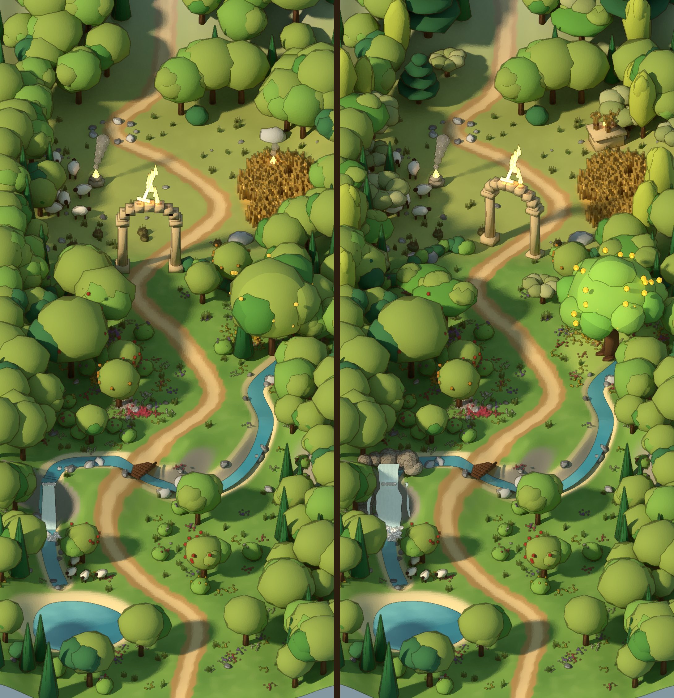

## 3. Detalhes (antes à esquerda, depois à direita, em tamanho real)

### 3.1 Cachoeira

A água agora sai de um paredão de rochas acima do terraço. A lâmina tem 18 faixas, abre ao cair e tem borda irregular. Há três fios soltos dos lados e névoa mais larga no pé.

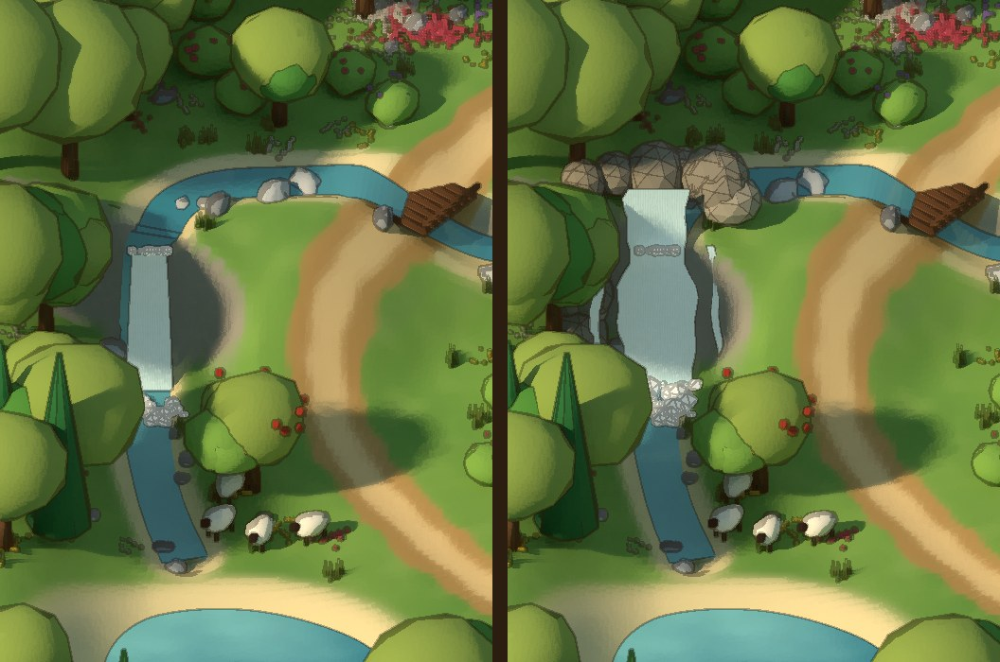

### 3.2 Árvore da vida

- **Forma própria:** cúpula larga com uma coroa de oito lóbulos e um topo; nenhuma outra árvore tem essa silhueta.
- **Tronco:** mais grosso, com raízes à mostra.
- **Frutos:** 34 frutos dourados que brilham, e uma luz quente mais forte.
- **Clareira:** grama mais clara em volta, com um anel de flores.
- A cor é um verde mais claro e quente, para se destacar sem virar neon.

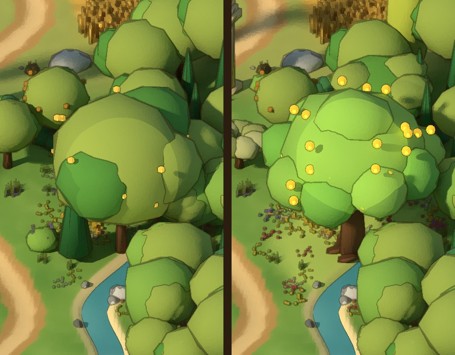

### 3.3 Portão e altares

**Portão:** recuado para o norte, sobre a própria trilha e alinhado com ela. A sebe acompanha o portão. A espada inflamada continua acima do arco (Gn 3.24).

Os dois altares agora se distinguem pela forma, pela oferta e pela fumaça:

| | Altar de Abel | Altar de Caim |
|---|---|---|
| Forma | pedras do campo, arredondadas | pedra lavrada, quadrada |
| Oferta e entorno | junto ao rebanho | três feixes de trigo amarrados em cima e outros cinco no chão |
| Fumaça | **alta** (5 baforadas) | baixa (2 baforadas) |
| Lugar | a oeste da trilha | ao norte do trigal, em chão batido |

O altar de Caim ficou cerca de 35% maior.

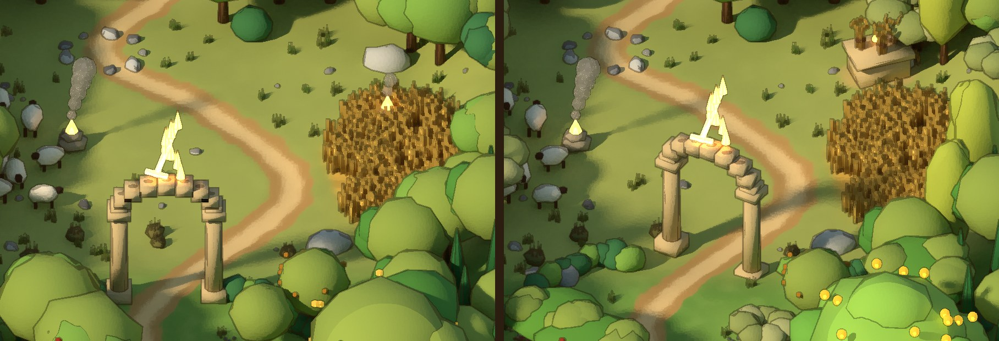

### 3.4 Metade de cima: variedade de copas

Cerca de 72% das árvores redondas da metade de cima foram trocadas por espécies diferentes:
- oliveira, baixa, larga e verde-acinzentada;
- terebinto, com copa em guarda-chuva;
- álamo, alto e estreito;
- cedro, em camadas escuras;
- amendoeira em flor;
- árvore escura comum.

Cada uma recebeu uma escala entre 0,8 e 1,3. Perto das fases, a escala fica entre 0,75 e 1,0, para não crescer sobre a trilha.

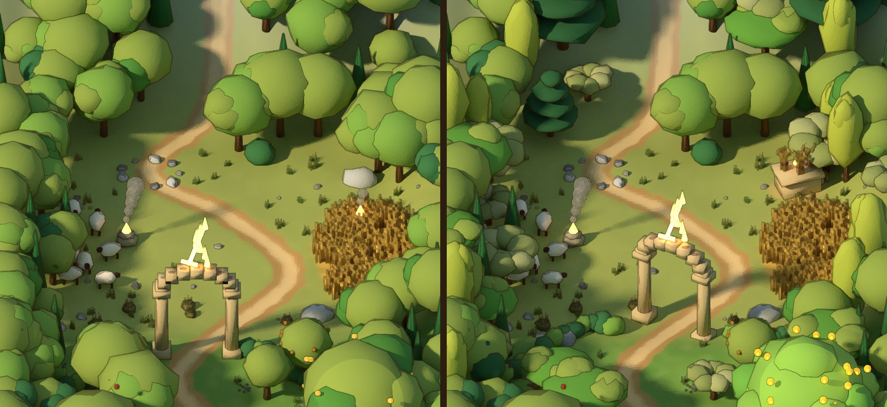

## 4. O mapa com os marcadores

### Progresso no meio (3 fases feitas, fase 4 atual)

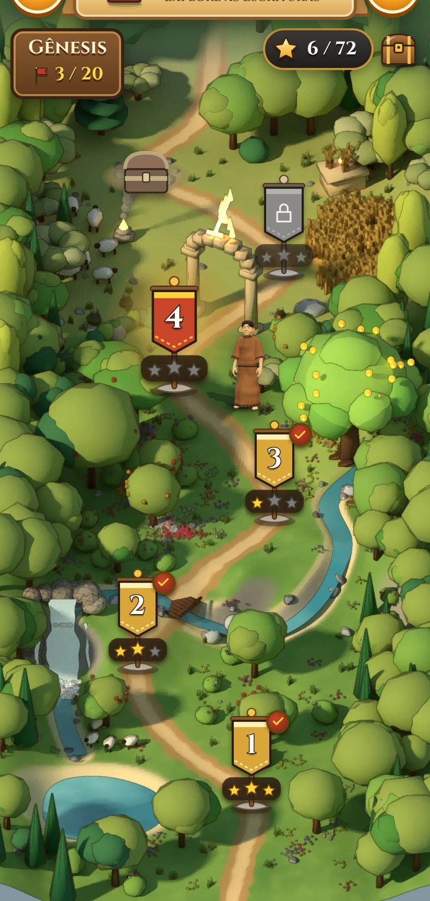

### Baú disponível (5 fases feitas)

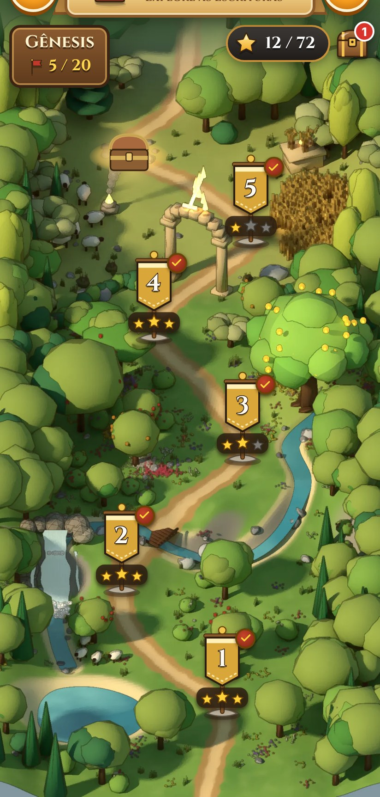

### Portão e estandarte da fase 4 (medido na tela)

| Medida (celular de 412 px) | Resultado |
|---|---|
| Topo do arco dentro do pano da fase 4? | **Não** |
| Distância horizontal do arco até o pano | 23 px |
| Base do portão | à direita do pano, fora dele |

**Observação:** a plaquinha de estrelas da **fase 5** encosta na ponta direita do arco. O arco continua legível.

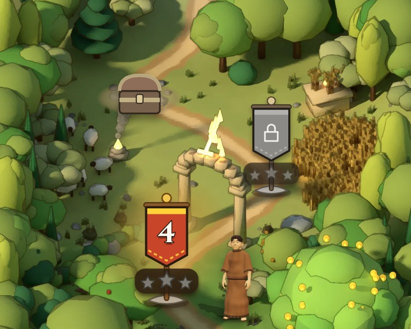

## 5. História, Quiz e a transição para a fase 6

O Quiz e a transição não fizeram parte deste escopo e continuam como no protótipo. As imagens estão aqui para você avaliar o conjunto com a pintura nova.

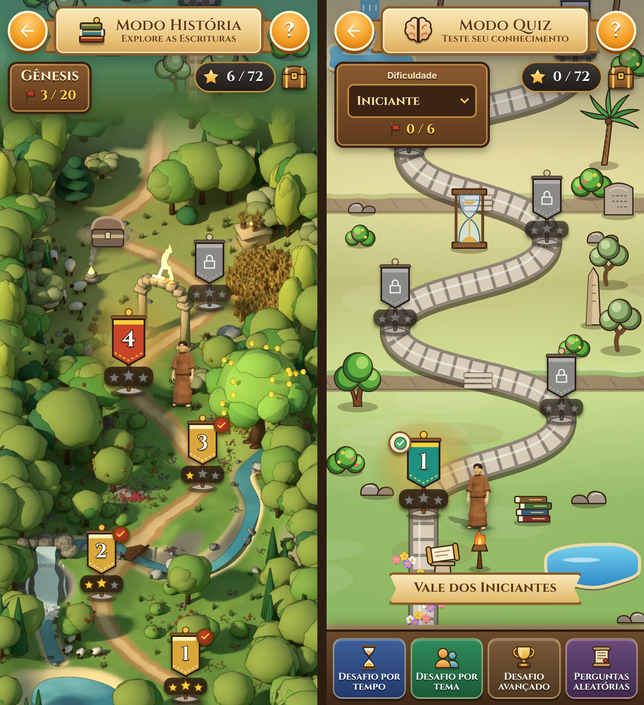

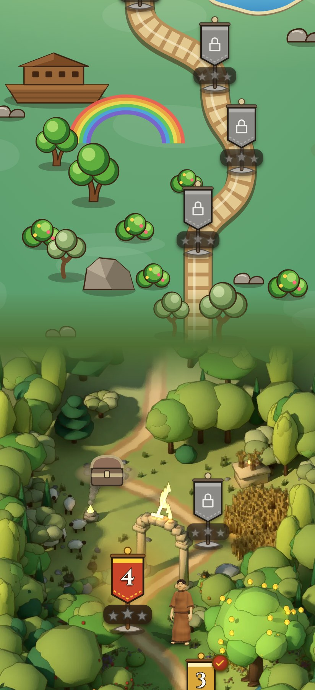

## 6. Qualidade leve e 2D

| Leve | 2D |
|---|---|
| 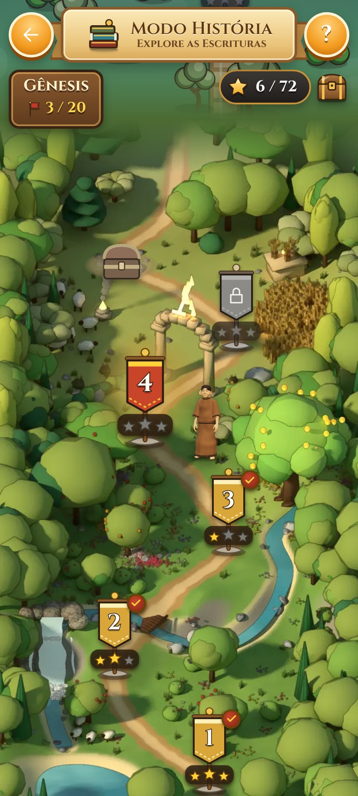 | 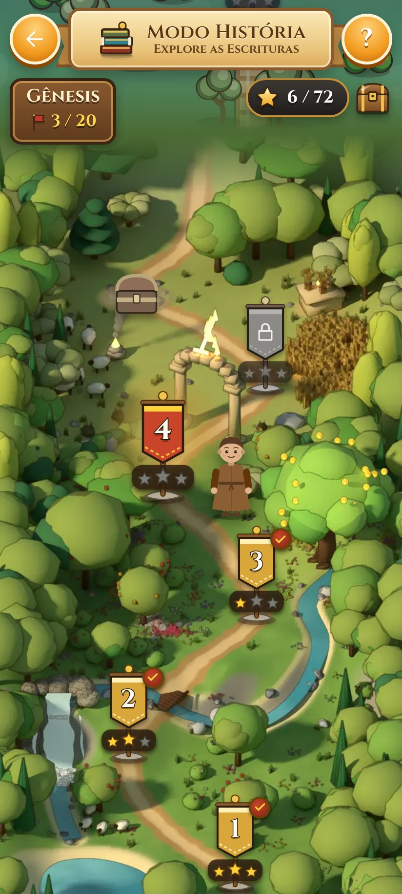 |

## 7. Tamanho dos arquivos

| Arquivo | Antes | Depois | Diferença |
|---|---|---|---|
| `eden.webp` (alta, 1080 × 2257) | 189 502 B | 200 454 B | +10 952 B (+5,8%) |
| `eden-leve.webp` (leve e 2D, 648 × 1354) | 69 538 B | 73 616 B | +4 078 B (+5,9%) |
| Código do jogo | — | — | sem mudança |

As duas imagens continuam abaixo dos limites dos testes: 450 KB para a alta e 160 KB para a leve.

## 8. Testes e verificações

| Verificação | Resultado |
|---|---|
| `npm run typecheck` | passou |
| `npm test` | **262 de 262** |
| Proteção do mapa, motor da trilha e mapas antigos (`mapa-protecao`, `mapa-trilha`, `mapas`) | 27 de 27, sem nenhuma alteração nos testes |
| `npm run build` | passou |
| Pontos das fases e do baú | idênticos aos anteriores |
| Toque no centro de cada marco | 29 de 29 (História) e 6 de 6 (Quiz) caem no próprio botão |
| Rolagem suave do mapa inteiro | média de 16,6 ms por quadro, 95% dos quadros em até 16,7 ms; chegou ao fim |
| Baú do cabeçalho leva ao baú do Éden | sim, inteiro na tela |

## 9. Limitações que continuam

1. **Clareira da árvore da vida:** vista do alto, a copa larga cobre boa parte dela. Aparece mais pelo anel de flores e pela grama clara ao sul.
2. **Rochas da cachoeira:** as dos lados ficam em parte atrás das árvores da margem; o paredão de cima é o que mais aparece.
3. **Imagem estática:** água, fogo e fumaça não se movem.
4. **Fora do escopo:** a transição da fase 5 para a 6 e o fundo do Quiz continuam como no protótipo. Ambos precisam entrar na expansão.
5. **Medições** feitas em navegador com desenho por software, não em aparelho físico.

## 10. Commits

| Commit | Conteúdo |
|---|---|
| 792835f | `tools/mapa/eden.py` refinado, `eden.webp` e `eden-leve.webp` novos e registro em `public/mapas/LICENCAS.md` |
| *(este relatório)* | Relatório em md e pdf, com as imagens |

Nada foi expandido: sem novas regiões, sem Êxodo, sem merge, APK ou publicação. README, CHANGELOG e ROADMAP não foram alterados (regra A21). Aguardo avaliação.
