# Bible Quest — Mapa de Gênesis, região 2: Terras do Dilúvio (fases 6 a 10)

**Relatório da entrega** · 27/11/2026 · branch `claude/bible-quest-android` · nenhum merge, APK ou publicação · regiões 3 e 4, Quiz, Êxodo e carregamento sob demanda **não** iniciados

> **Resumo.** A segunda região pintada de Gênesis está no jogo. Ela leva as fases 6 a 10 e o baú da fase 10, e continua o Éden como um **mundo único**.
>
> **Como a continuidade foi garantida.** A cena nova contém o Éden aprovado, montado pelo próprio `eden.py` sem nenhuma mudança, e o estende para o norte. A câmera é a do Éden, deslocada exatamente uma altura de imagem. Com isso:
> - no jogo, a pintura nova termina no mesmo pixel em que o Éden começa (folga de 0 px);
> - a imagem ficou alinhada com deslocamento zero;
> - a mudança na linha da emenda (5,1) fica dentro da variação normal entre duas linhas vizinhas da própria imagem (até 6,0).
>
> **Conferências com a ferramenta aprovada (`conferir_cena.py`):**
> - o Éden continua **idêntico** à referência;
> - a região nova tem impressão **determinística**;
> - dentro da cena nova, os 1 178 objetos, 41 materiais e 168 malhas do Éden estão **todos presentes e iguais**. As únicas exceções são a câmera, deslocada de propósito, e o terreno, que foi **estendido**; nenhum dos 60 084 vértices dele dentro do quadro do Éden mudou.
>
> **No jogo:**
> - os 29 marcos respondem no próprio botão, com os rótulos corretos;
> - a rolagem segue a 16,8 ms por quadro;
> - as imagens pesam 181 KB (alta) e 66 KB (leve), menos que o Éden.
>
> Typecheck e build passam, e os testes passam: 266 de 266. Os testes de proteção não foram alterados.

## 1. Auditoria e integração

| Ponto | Situação | O que foi feito |
|---|---|---|
| Fases | `worldSections()`: fases 6 a 10 e `bau-mundo-genesis-10` são os nós 7 a 12 de Gênesis | Nada mudou. A região 2 recebe esses 6 nós na ordem |
| Divisão do trecho | `dividirTrecho()` já distribuía os nós entre várias regiões pintadas | Nada mudou em `JourneyMap.tsx` |
| Dados | `ARTES_DO_MUNDO['mundo-genesis'] = [ARTE_EDEN]` | Passa a ser `[ARTE_EDEN, ARTE_DILUVIO]`, com pontos exportados pela cena |
| Emenda | O CSS dissolvia o topo de **toda** pintura (7%) | **Uma regra nova**: a pintura de baixo de duas regiões vizinhas não se dissolve. Só a de cima se funde com o cenário vetorial (fase 11 em diante) |
| Teste existente | `mapa-trilha.test.tsx` afirmava **uma** região pintada | Passa a esperar duas. Foram acrescentados testes da região 2 e um que trava os pontos do Éden |

**Não mudaram** (hash conferido, seção 9):
- progressão, fases, baús, XP e recompensas;
- motor História/Quiz (`Trilha.tsx`, `marcos.ts`), `JourneyMap`, `StoryMap` e `QuizMap`;
- testes de proteção;
- `eden.py`, `comum.py`, `eden.webp`, `eden-leve.webp` e os pontos do Éden.

## 2. Proposta e composição

### 2.1 As cinco cenas e os títulos reais das fases

A direção pedia a sequência cidade → canteiro → dilúvio → águas baixando → Ararate. Os **títulos reais** das fases no jogo, porém, são:
- 6: *A corrupção da humanidade*;
- 7: *Noé, um homem justo*;
- 8: *A construção da arca*;
- 9: *O dilúvio*;
- 10: *A aliança com Noé*.

Se o dilúvio ficasse no marco "A construção da arca", o mapa mostraria ao jogador uma cena diferente da fase que ele vai jogar. Por isso, **as cinco ambientações pedidas estão todas na pintura, alinhadas aos títulos:**

| Fase | Título no jogo | O que a pintura mostra ao redor do marco |
|---|---|---|
| 6 | A corrupção da humanidade | Cidade de muros de pedra com torres e casas de barro, fumaça de fogueiras, trecho de muro desmoronado, árvores secas, campos abandonados e chão gasto (Gn 6.5, 11) |
| 7 | Noé, um homem justo | A casa de Noé, **separada da cidade**, num pedaço verde com horta, oliveiras, cerca e ovelhas (Gn 6.9) |
| 8 | A construção da arca | O casco em obra: quilha, 13 cavernas, tábuas pregadas, andaimes e rampa. Em volta, pilhas de toras, dezenas de tocos de árvores cortadas e o fogo do betume (Gn 6.14-16) |
| 9 | O dilúvio | A planície alagada com a arca pronta flutuando (três andares, janela corrida, porta), copas e telhados submersos, sombra de tempestade e chuva fina. A trilha segue por uma calçada de pedras (Gn 7.17-24) |
| entre 9 e 10 | (as águas baixam) | Lama, poças, brotos novos e a **pomba com o ramo de oliveira** voando (Gn 8.3-11) |
| 10 | A aliança com Noé | O monte Ararate com dois picos nevados, o altar com a fumaça subindo reta, ovelhas e o **arco-íris** sobre os picos (Gn 8.4, 8.20, 9.13) |
| baú 10 | — | Clareira de pedras no ombro do monte |

A narrativa é só visual: sem figuras humanas, sem textos e sem falas.

### 2.2 A transição da fase 5 para a 6 (mundo contínuo)

- A cena `diluvio.py` **monta o Éden aprovado** (o próprio `eden.py`, sem render) e só depois acrescenta a região. Por isso, à volta da emenda, as árvores, as sombras, a trilha e o chão são os mesmos objetos que aparecem na imagem do Éden.
- **Câmera:** é a mesma do Éden, levantada exatamente uma altura de imagem (`ortho_scale`) na direção "para cima" da tela. A última linha da imagem nova é a continuação geométrica da primeira linha do Éden.
- **Terreno:** a malha do Éden é **estendida** para o norte, numa malha só, sem costura de normais. Ela só é remodelada e repintada **além** da borda do Éden, com uma rampa suave (de 0,5 a 3 unidades além da borda). O script mede e grava: **0 de 60 084** vértices dentro do quadro do Éden mudaram.
- **Paisagem:** a serra do Éden continua coberta pela mesma mata. A mata **rareia** em três faixas (densa, depois oliveiras e cedros soltos, depois árvores secas) e desce para a planície seca da cidade. A névoa de distância que o topo do Éden já tinha some aos poucos subindo a serra.
- **Faixa de segurança:** nada novo a menos de 2,8 unidades da borda, para nenhuma sombra ou silhueta nova cruzar a emenda.
- **Trilha:** continua a curva do Éden a partir do último ponto dele (0, 58), com a mesma pintura de terra.

## 3. A pintura

### 3.1 Sem interface (1080 × 2257, tamanho real)

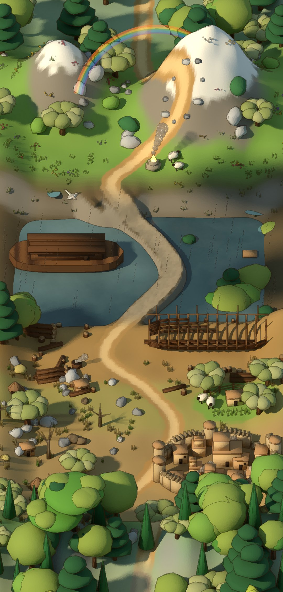

### 3.2 Éden e Terras do Dilúvio, um sobre o outro (como no jogo)

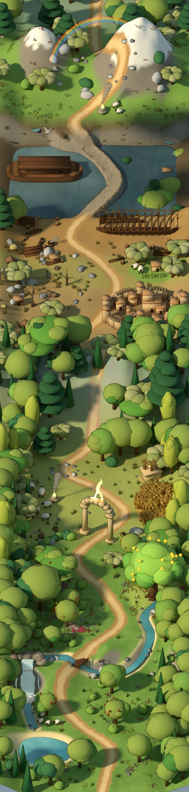

### 3.3 A emenda em tamanho real

Em cima, o Dilúvio; embaixo, o Éden aprovado. A emenda fica no meio da imagem.

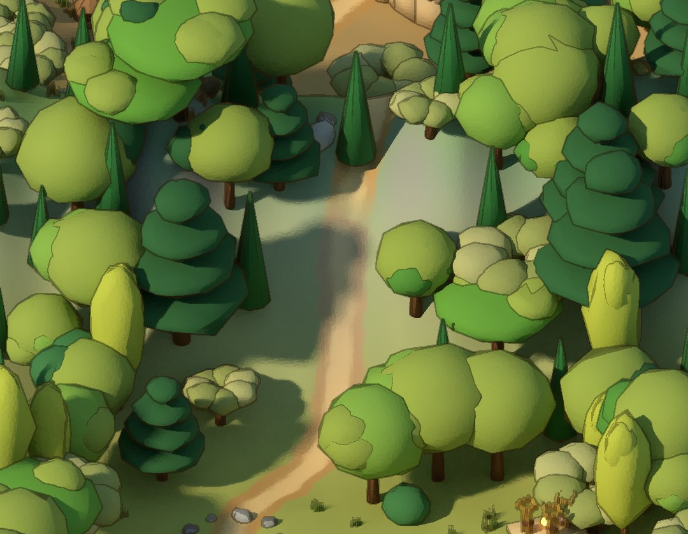

### 3.4 Detalhes por fase (tamanho real)

| Fase 6: a cidade | Fase 7: a casa de Noé |
|---|---|
| 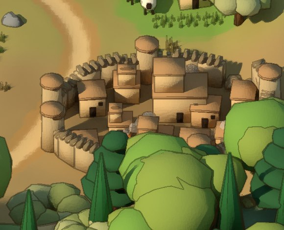 | 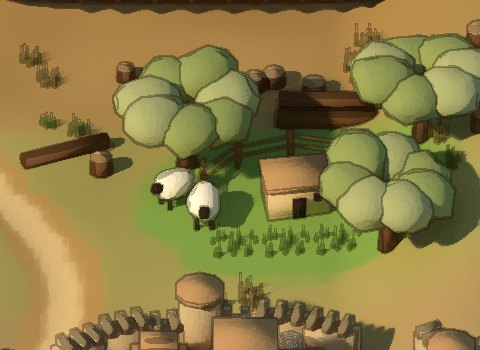 |

| Fase 8: a arca em construção | Fase 9: o dilúvio |
|---|---|
| 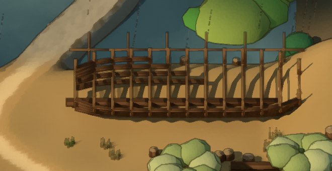 | 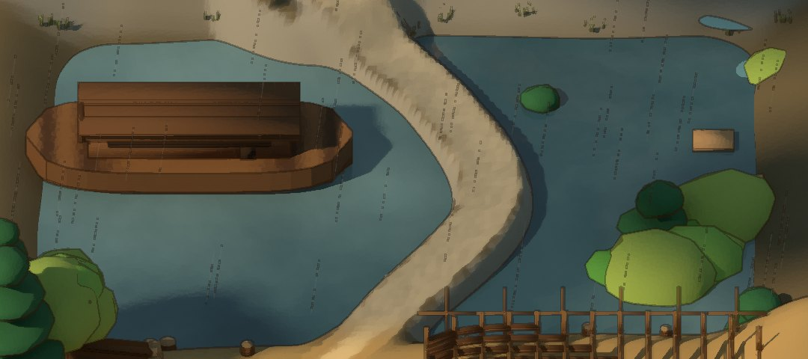 |

| As águas baixam, e a pomba | Fase 10: Ararate, altar e arco-íris |
|---|---|
| 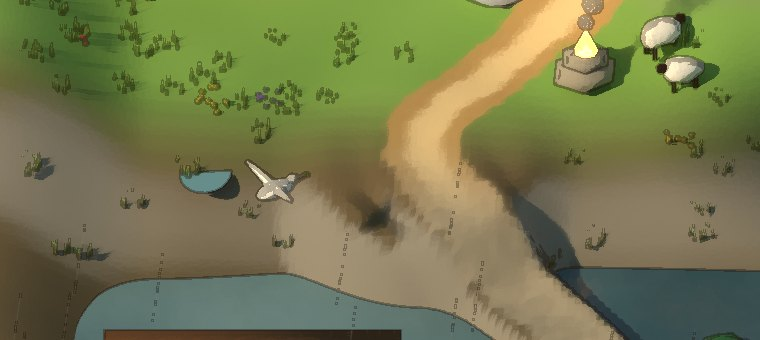 | 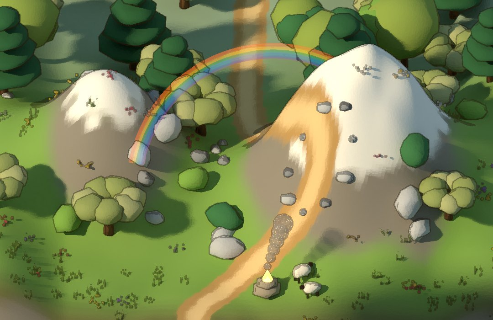 |

## 4. No jogo (celular de 412 px)

| Progresso no meio (fase 8 atual) | Fases 6 a 10 concluídas, baú 10 disponível |
|---|---|
| 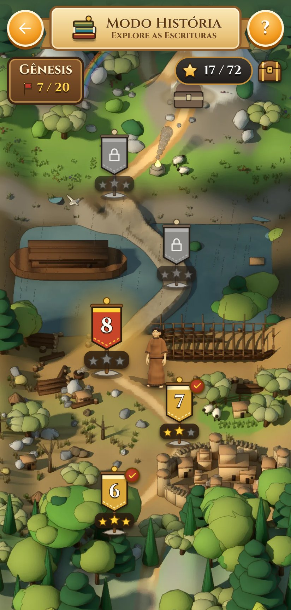 | 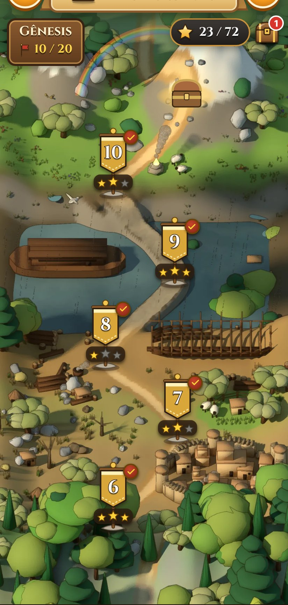 |

| A passagem do Éden (fases 3 a 5) para o Dilúvio (6 e 7) | Começo da região (fase 6 atual) |
|---|---|
| 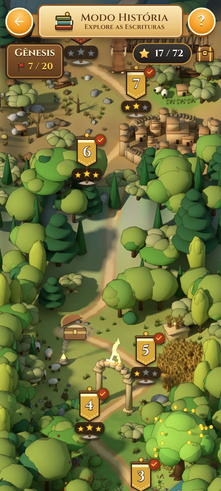 | 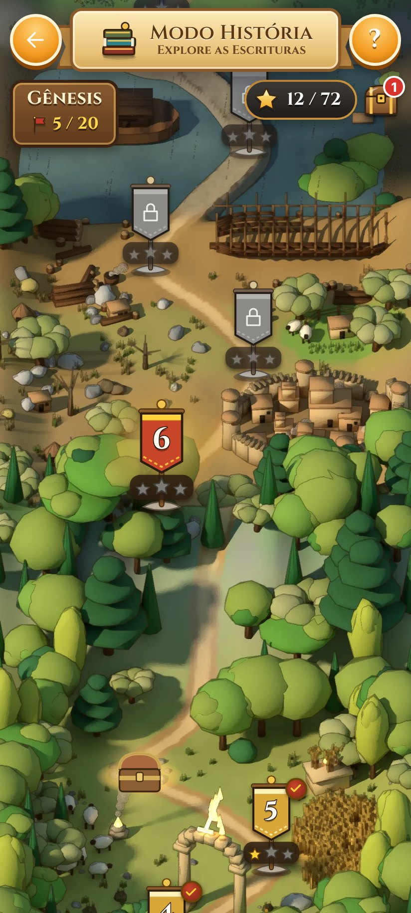 |

| Qualidade leve | 2D |
|---|---|
| 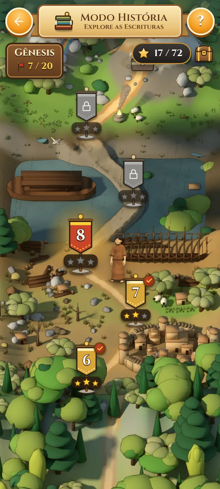 |  |

O trecho de Gênesis inteiro (Éden e Dilúvio pintados; da fase 11 em diante, o cenário vetorial):

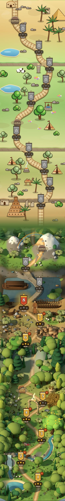

## 5. Conferências com a ferramenta aprovada

Os relatórios gerados estão em `docs/relatorios/evidencias/regiao2-diluvio/`.

| Conferência | Resultado |
|---|---|
| Éden (`eden.py`) × referência aprovada (`referencias/eden-cena.json`) | **IDÊNTICAS** (saída 0) |
| Região 2 × região 2 (duas montagens) | **IDÊNTICAS**; JSON byte a byte igual. Guardado como referência: `referencias/diluvio-cena.json` / `.npz` |
| Transição: Éden aprovado × cena da região 2 (só as partes do Éden) | Objetos do Éden: **1 178 de 1 178 presentes, 1 177 idênticos**. Só a câmera mudou, deslocada de propósito: Δy +23,94, Δz +30,64, ou seja, uma altura de imagem menos a meia faixa de conferência. Materiais do Éden: **41 de 41 idênticos**. Malhas do Éden: **168 de 168**, todas idênticas, exceto o terreno, **estendido** (de 71 680 para 146 240 vértices) |
| Terreno do Éden no quadro do Éden (medido no próprio script) | **0 de 60 084** vértices alterados. 11 182 remodelados além da borda; 74 560 novos ao norte |
| Render publicado × render da versão final do script | **Ruído do Cycles** (12 pixels, diferença máxima 1); pontos idênticos |

### 5.1 A emenda, pixel a pixel

A cena da região é renderizada com 48 px a mais embaixo. Essa faixa extra mostra a mesma área das 48 primeiras linhas do Éden aprovado e serve para medir a emenda.

| Medida | Resultado | Leitura |
|---|---|---|
| Melhor alinhamento entre a faixa extra e o topo do Éden | **dy = 0, dx = 0** (diferença média 1,29; deslocar 1 px piora para 2,4) | câmera e geometria encaixam pixel a pixel |
| Diferença média na faixa extra | 1,32 de 255 (759 de 51 840 pixels acima de 12) | veja a explicação abaixo |
| **Salto na linha da emenda** (Dilúvio × Éden) | **5,1** | dentro da variação normal entre linhas vizinhas da própria imagem: média 3,3, p95 4,6, máximo 6,0 |

**Por que a faixa não é idêntica:**
- A cena da região tem mais objetos que a do Éden, e o Cycles sorteia outra sequência de amostras. Isso dá cerca de 1 nível de diferença, espalhado.
- O acabamento normaliza a profundidade **de cada imagem** pela faixa dela, e a região tem um monte mais alto. Com isso, alguns contornos finos aparecem ou somem: são os pixels acima de 12.
- A ferramenta aponta isso como "mudança real", porque os limites dela foram medidos na **mesma** cena. Avaliei a emenda visualmente (seções 3.3 e 4) e pelo salto entre linhas: **não aparece corte**.

## 6. Testes

| Verificação | Resultado |
|---|---|
| `npm run typecheck` | passou |
| `npm test` | **24 arquivos, 266 de 266** (eram 262; 4 novos) |
| `npm run build` | passou |
| Testes de proteção (`mapa-protecao.test.tsx`) | **sem nenhuma alteração** (hash igual) e passando |
| `mapa-trilha.test.tsx` (justificado na seção 1) | `toHaveLength(1)` virou `toHaveLength(2)`; a verificação de "nenhum nó perdido" passou a somar as duas regiões. Testes novos: a região 2 recebe exatamente as fases 6 a 10 e o baú 10; o resto começa na fase 11; os pontos ficam dentro da imagem, sobem e não se sobrepõem; tamanho igual ao do Éden e peso dentro do limite; os pontos do Éden estão travados |
| No navegador: toque no centro de cada marco | **29 de 29** caem no próprio botão; rótulos corretos ("Fase 8: A construção da arca. Fase atual"…) |
| No navegador: posição das duas pinturas | Dilúvio termina em 861,27 px e Éden começa em 861,27 px: **folga 0**, larguras iguais (412 px) |
| No navegador: rolagem suave do mapa inteiro | 180 quadros, média 16,8 ms (cerca de 60 por segundo) |
| Verificação estática dos scripts do mapa (pyflakes) | nenhum problema |

## 7. Peso, formatos e Android

| Arquivo | Tamanho | Uso |
|---|---|---|
| `public/mapas/genesis/diluvio.webp` | 1080 × 2257, **180 886 B** | qualidade alta |
| `public/mapas/genesis/diluvio-leve.webp` | 648 × 1354, **66 444 B** | qualidade leve e 2D (conferido no navegador) |
| Código do jogo | sem mudança de lógica (dados e uma regra de CSS) | — |

A memória decodificada da imagem alta passa a ser de 9,8 MB por região, ou 19,5 MB com Éden e Dilúvio juntos; na leve, 7 MB juntas. O carregamento sob demanda, fora do escopo desta entrega, é o que vai segurar isso quando as regiões 3 e 4 entrarem.

## 8. Limitações conhecidas

1. **Tempestade:** com a câmera de cima, quase não há céu na imagem. A "tempestade" aparece pela sombra das nuvens sobre a água, pela água escura e pela chuva fina, mas o drama é menor do que seria num céu aberto. A chuva é discreta de propósito, para não poluir os marcadores.
2. **Emenda em números:** como explicado na seção 5.1, a faixa da emenda não é bit a bit igual (amostragem e normalização de profundidade diferentes). Visualmente, e pelo salto entre linhas, ela não aparece.
3. **Fase 10 → 11:** a região 2 termina em terras baixas ao norte do Ararate, preparadas para a região 3 continuar do mesmo jeito. Até lá, a passagem da fase 10 para a 11 continua com o degradê para o cenário vetorial, como era a da fase 5 para a 6.
4. **Imagem estática:** água, fogo, fumaça e pomba não se movem.
5. **Medições** feitas em navegador com desenho por software, não em aparelho físico.

## 9. Preservação (hashes SHA-256, commit 3963d7f × agora)

| Arquivo | Hash | Situação |
|---|---|---|
| `public/mapas/genesis/eden.webp` | `d7e569fd3d870cf9…` | igual |
| `public/mapas/genesis/eden-leve.webp` | `e62ba9d848cd7861…` | igual |
| `tools/mapa/eden.py` | `d48350c17fd88f86…` | igual |
| `tools/mapa/comum.py` | `42027feb09b1335d…` | igual |
| `tools/mapa/conferir_cena.py` | `b4dd7bb318491f49…` | igual |
| `tools/mapa/referencias/eden-cena.json` / `.npz` | `e7bbb31ca93b86e8…` / `f0f46c3b074e0d76…` | iguais |
| `src/test/mapa-protecao.test.tsx` | `06e3bbad62d76998…` | igual |
| `src/components/map/trilha/Trilha.tsx` | `551a1231ce8f7501…` | igual |
| `src/components/map/JourneyMap.tsx` | `098f75bf40a58719…` | igual |
| `src/pages/story/StoryMap.tsx` / `src/pages/quiz/QuizMap.tsx` | `428f4bd3…` / `ab8706e7…` | iguais |
| `src/services/game/journeyMap.ts` / `marcos.ts` | `86e407e2…` / `7ffc44f7…` | iguais |

**Arquivos novos ou alterados nesta entrega:**

| Arquivo | Situação |
|---|---|
| `tools/mapa/diluvio.py` | novo: a cena |
| `tools/mapa/referencias/diluvio-cena.json` / `.npz` | novos: referência da região 2 |
| `public/mapas/genesis/diluvio.webp` / `diluvio-leve.webp` | novos |
| `public/mapas/LICENCAS.md` | registro das duas imagens |
| `src/data/mapas/artes.ts` | `ARTE_DILUVIO` e a lista de Gênesis; os pontos do Éden são os mesmos |
| `src/styles/telas/mapa-trilha.css` | uma regra (emenda contínua) |
| `src/test/mapa-trilha.test.tsx` | ajuste justificado e 4 testes novos |
| `docs/relatorios/…` | este relatório, as imagens e as evidências |

## 10. Commits

| Commit | Conteúdo |
|---|---|
| b4e787b | Cena das Terras do Dilúvio (mundo contínuo com o Éden) e impressão de referência |
| 7a2081d | Imagens WebP (alta e leve) e registro de licença |
| 4f27f0e | Integração no jogo (dados, emenda no CSS, testes) |
| *(este relatório)* | Relatório em md e pdf, com imagens e evidências |

A região 3, a região 4, o Quiz e Êxodo **não** foram iniciados. Aguardo avaliação.
