# Bible Quest — Reformulação visual, entrega 1: Personagens

**Relatório da entrega** · 26/11/2026 · branch `claude/bible-quest-android` · nenhuma alteração na branch principal

> **Resumo honesto.** Os dois personagens foram reconstruídos sobre os corpos-base estilizados, com a mesma estrutura, o mesmo esqueleto e peças separadas. Cabelo, barba, rosto e expressão **mudam o modelo de verdade**, e a migração dos oito perfis antigos é segura, testada e reversível.
> - **A personagem feminina melhorou claramente**: saiu do estilo semirrealista antigo e agora tem o mesmo estilo do masculino.
> - **O masculino ganhou personalização real, mas perdeu acabamento na roupa** em relação ao modelo antigo, que era uma peça única com a roupa pintada.
>
> A entrega cumpre os requisitos de estrutura, personalização, migração e testes. **Não cumpre ainda o critério de acabamento visual em todos os pontos**: a seção 8 lista o que falta, e a seção 9 propõe como resolver. Recomendo **não aprovar como versão final** antes dessa rodada de acabamento.

## 1. O que foi alterado

| Área | Mudança |
|---|---|
| Modelos | `public/models/personagem/heroi-masculino.glb` e `heroi-feminino.glb` refeitos como **modelos modulares** (mesmo esqueleto, mesmas animações, mesmas peças). Os arquivos de pele da v0.7 (`pele-*.webp`) saíram. |
| Pipeline | Nova pasta `tools/personagem/modular/`, reprodutível por script: `pintar.py`, `refazer.py`, `pecas.py`, `previa.py`, `miniaturas.cjs` e `montar.sh`. |
| Jogo | `src/character3d/heroi.ts` (modelo modular: pele, cabelo, barba, sobrancelhas e sardas); `runtime.ts` e `stage.ts` (enquadramento medido no próprio personagem, incluindo um enquadramento só do rosto). |
| Dados | `src/data/character/bases.ts` (duas bases; as oito antigas mantidas só para conversão); `look.ts` (conversão e reversão); `src/types/index.ts` (`baseOriginal`); `repositories.ts` (conversão ao carregar e cópia de segurança). |
| Telas | Escolha com **dois personagens** (`CharacterBase.tsx`). Miniaturas de rosto, expressão e barba enquadradas no rosto (`Wardrobe.tsx`). A personalização leva **direto à Central**: a tela de chegada saiu, `/chegada` redireciona e a barra de etapas tem 4 passos (decisão V1). |
| Testes | Novo `src/test/migracao-bases.test.ts` (13 testes); `personagem`, `editor` e `flow` atualizados. |
| Licenças | `public/models/personagem/LICENCAS.md` atualizado. |

## 2. Como ficaram os personagens

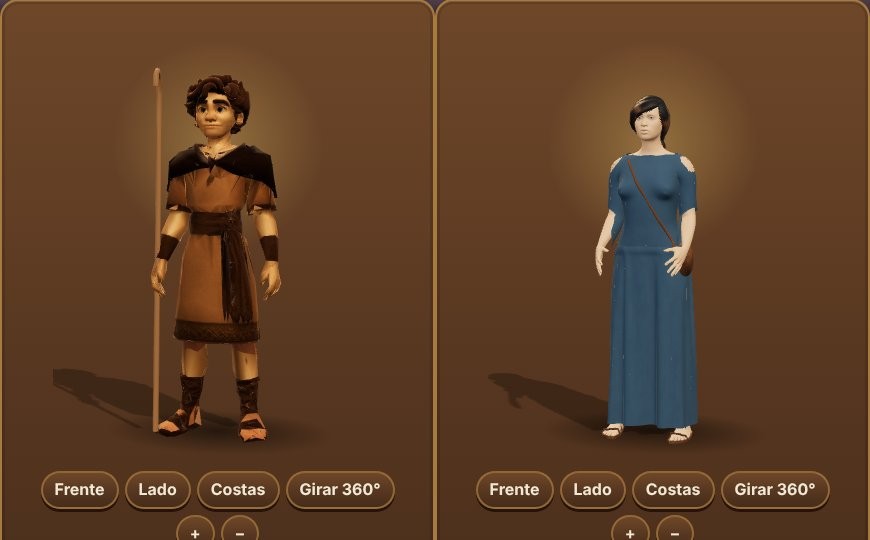

*Antes, no guarda-roupa da versão anterior do jogo: masculino estilizado de peça única e feminina semirrealista (MakeHuman), de estilos diferentes.*

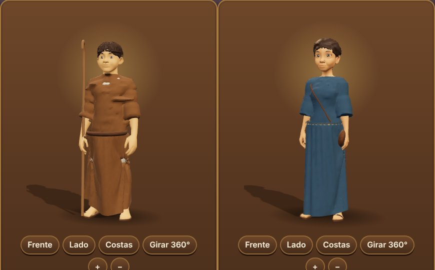

*Depois, no guarda-roupa do jogo: os dois no mesmo estilo e com a mesma estrutura.*

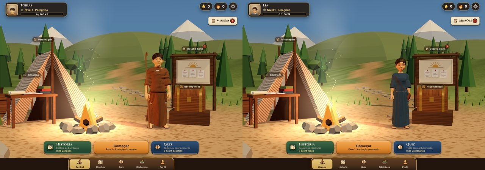

*A Central com cada personagem: só o personagem escolhido aparece.*

| Item | Masculino | Feminino |
|---|---|---|
| Corpo (triângulos visíveis) | 11,7 mil | 24,7 mil |
| Rosto | Repintado com o mesmo desenho: olhos com branco, íris, pupila, dois brilhos, linha dos cílios e pálpebras; lábios e bochechas | Igual, com três cílios no canto externo |
| Cabelos | 7 esculpidos (≈ 8 mil triângulos cada; o "bem curto", 3 mil) | 7 esculpidos |
| Barbas | Curta e cheia | — (o jogo não oferece barba no corpo feminino) |
| Rosto (peças) | Sobrancelhas normal e marcante; sardas | Igual |
| Expressões | Piscar, Sorriso, Surpresa e Alegria no corpo, nas sobrancelhas, nas sardas e na barba | Igual |
| Animações | Idle, Walk, Run, Victory, Greeting e Discovery | Igual |
| Roupas e acessórios | Túnica (nova construção), saias, mantos, xale, capuz, lenço, cintos, sandálias, botas, bolsa, odre, colar, cajado, pergaminho, lamparina, cesto e louros | Igual |
| Arquivo final (comprimido) | 2,68 MB (antes: 1,8 MB, sem personalização real) | 2,49 MB (antes: 4,8 MB) |

## 3. Cabelos, barbas, rosto e expressões

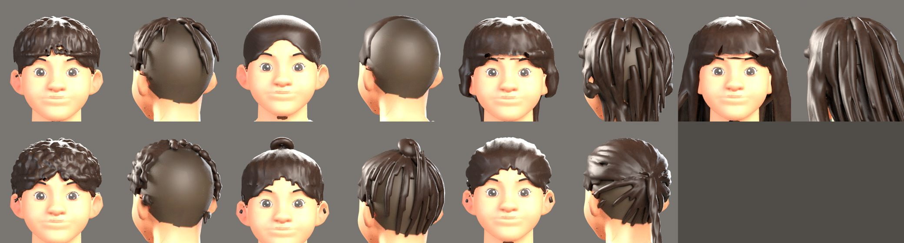

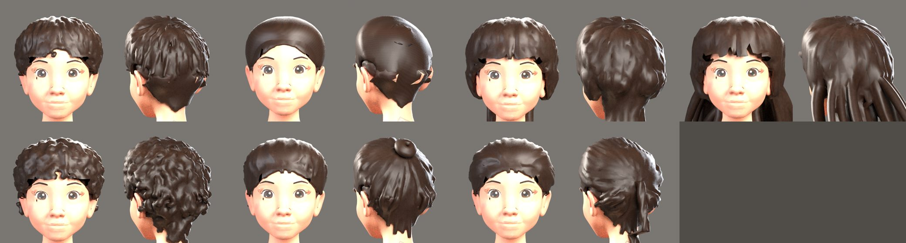

*Ordem: Curto, Bem curto, Médio, Longo / Cacheado, Preso (coque) e Trança.*

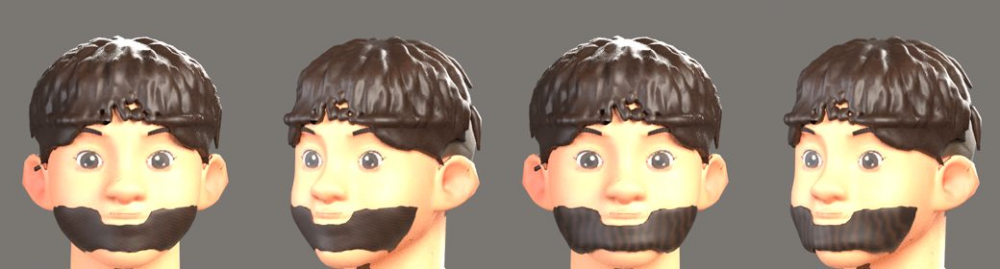

**Miniaturas geradas pelo próprio jogo** (guarda-roupa):

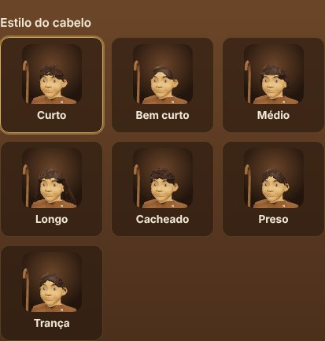 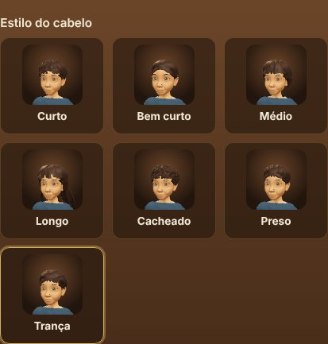

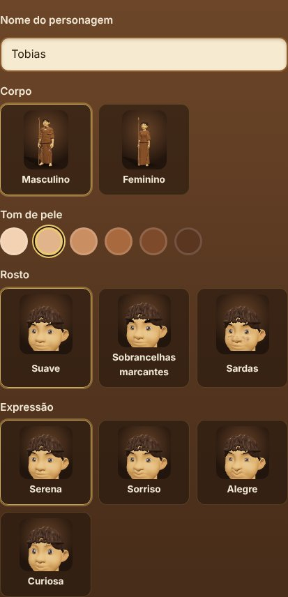 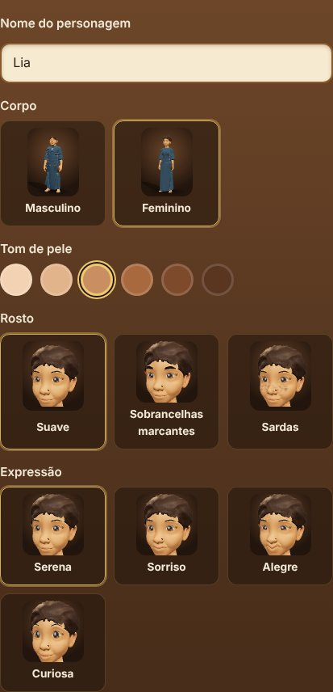

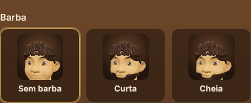

## 4. Como funciona a nova personalização

- **Cada opção é uma peça do modelo.** O jogo mostra e esconde as peças conforme a aparência: cabelo (7), barba (2), sobrancelhas normais ou marcantes, sardas, túnica, saia, manto, cinto, calçado e acessórios. As cores (pele, cabelo, túnica, manto, faixa, couro) são aplicadas ao vivo pelos tingimentos já existentes.
- **Pele:** o tom muda só nos pixels de pele. Olhos, lábios e cílios pintados continuam iguais.
- **Cabelo e barba:** a textura em tons de cinza dá os fios, e a cor vem da escolha do jogador.
- **Escolha:** só dois personagens, Masculino e Feminino. No guarda-roupa, a troca de corpo também troca a base.
- **Miniaturas:** são o mesmo modelo 3D renderizado com a opção aplicada. Rosto, expressão e barba usam um enquadramento só do rosto.
- **Enquadramento:** retrato, busto e corpo são medidos no próprio personagem (altura real e osso da cabeça), porque os dois corpos têm alturas diferentes.
- **Qualidades:** **alta** e **leve** usam o mesmo modelo (a leve sem sombras); **2D** continua com o desenho em SVG, que já tinha as opções de cabelo, barba e rosto.

## 5. Migração dos perfis

| Passo | Como funciona |
|---|---|
| Quando | Ao carregar o perfil (`migrateCharacter`), para o personagem atual e para a "aparência anterior". |
| O quê | Perfil de uma das oito bases antigas → base `masculino` ou `feminino`, pelo corpo. O corpo e a barba ficam explícitos (antes eram deduzidos da base). O rosto "barba" vira "suave", e a barba continua. O id antigo fica em `baseOriginal`. |
| O que não muda | Roupas e itens equipados, itens desbloqueados, tingimentos, cores livres, cabelo, cor do cabelo, pele, expressão, nome, id, progresso, estrelas e recompensas. |
| Recuperação | Antes da primeira conversão, o perfil original é copiado, byte a byte, para a chave `bible-quest:v1:backup-perfil-bases-antigas`, uma vez só, sem sobrescrever. `desfazerConversao()` volta à base antiga. |
| Segurança | Conversão idempotente. `baseOriginal` inválido vindo do armazenamento é descartado. |
| Testes | Um teste por base antiga (8), mais idempotência, cópia de segurança, escriba com barba, perfis novos sem cópia e valor inválido. |

## 6. Resultados dos testes

| Verificação | Resultado |
|---|---|
| `npm run typecheck` | passou |
| `npm test` | **234 de 234** testes passaram (21 arquivos; 13 novos de migração) |
| `npm run build` | passou; pacote inicial 736 kB e pacote 3D 785 kB, **sem crescimento** |
| Peças no GLB publicado (teste automático) | os dois modelos têm todas as peças, as 6 animações e as 4 expressões; a pele tem a cor de base para o tingimento |
| Jogo no navegador (guarda-roupa e Central, os dois corpos) | sem erros no console |
| **Comparação automática das miniaturas** (critério P1: diferença acima de 3 %) | **66 de 74 pares passaram.** Cabelo: de 4,4 % a 39 %. Corpo: 37 % e 53 %. Os 8 pares abaixo de 3 % estão na seção 8. Dados completos em `imagens/personagens-entrega-1/miniaturas-comparacao.json`. |

## 7. Tamanho e desempenho

| Item | Antes | Depois |
|---|---|---|
| Modelo masculino | 1,8 MB | 2,68 MB (+7 % sobre a meta de 2,5 MB; exceção: só ele tem as duas barbas) |
| Modelo feminino | 4,8 MB | 2,49 MB |
| Texturas de pele v0.7 (`pele-*.webp`) | 450 KB | removidas |
| Triângulos visíveis num personagem vestido (corpo + 1 cabelo + roupa) | masculino ≈ 40 mil (peça única) | masculino ≈ 30 mil; feminino ≈ 43 mil |
| Pacotes de código | — | sem crescimento |

- **Desempenho no Android:** não foi medido em aparelho nesta entrega (não há aparelho neste ambiente). O orçamento de triângulos e o tamanho ficaram próximos da meta, e só um cabelo aparece por vez.
- **Recomendação:** repetir o teste físico do Moto G75 e fazer um teste num aparelho de entrada antes da aprovação.

## 8. Problemas encontrados e soluções

| # | Problema | Solução |
|---|---|---|
| 1 | Os rostos gerados pela IA tinham olhos borrados, cílios soltos e blush forte | Rosto repintado por código, com o mesmo desenho nos dois |
| 2 | A textura da IA estava picotada em centenas de ilhas de UV sem margem (rachaduras escuras) | Bordas das ilhas estendidas sobre as áreas livres da textura |
| 3 | A malha da IA tinha camadas internas (a roupa e o cabelo pintados envolviam o corpo), faces com a orientação trocada (48 %) e arestas não-manifold | Remoção das faces que não enxergam o lado de fora, orientação corrigida por teste de paridade e pelo centro da cabeça |
| 4 | A redução da malha criava pontas e quebrava a textura | Limpeza antes da redução; rosto protegido; meta de triângulos realista |
| 5 | Primeiras técnicas de cabelo (volumes fundidos, fitas) pareciam capacete ou escamas | Cabelo esculpido: mechas em tubos fundidos por voxels sobre a casca do couro cabeludo, com textura de fios na direção das mechas |
| 6 | O corpo feminino tinha coque e rabo de cavalo modelados na cabeça (e a primeira correção, aplicada também ao masculino, abriu um buraco na nuca dele) | Crânio achatado e rabo removido **só no feminino**, com o buraco fechado sob a casca |
| 7 | A túnica derivada da malha do corpo tinha buracos e faces invertidas | Túnica construída por anéis e tubos em sino, fundida por voxels |
| 8 | A camiseta pintada atravessava a túnica | As faces do corpo sempre cobertas pela túnica são removidas |
| 9 | O lenço tinha 72 mil vértices | Meta de triângulos por peça de roupa |
| 10 | O exportador descartava peças com malha inconsistente (a saia curta no masculino) | Validação de todas as malhas antes da exportação, e teste automático das peças do GLB |
| 11 | Miniaturas de rosto e expressão iguais (o rosto ocupava ~20 px); sardas invisíveis (afundavam na pele e eram pequenas demais); sobrancelhas marcantes brancas (material com sufixo) | Enquadramento só do rosto; decalque afastado e sardas maiores; sufixo ignorado; expressões com intensidades distintas |

## 9. Pendências e limitações (o que falta para aprovar)

| # | Pendência | Proposta |
|---|---|---|
| P1 | **Acabamento da roupa do masculino abaixo do modelo antigo.** A túnica ficou irregular, a cor tem manchas, e aparecem pontos claros na saia (a bermuda pintada do corpo atravessando). | Estender a remoção do corpo à faixa das coxas sob a saia longa; textura de tecido pintada (dobras e barras), em vez da foto de linho; suavizar a túnica |
| P2 | **8 pares de miniaturas abaixo de 3 %**: Serena × Sorriso (0,9 % e 1,4 %), Serena × Alegre (2,9 %), Sorriso × Alegre (2,3 % e 2,6 %), barba Curta × Cheia (2,5 %) e Suave × Sobrancelhas marcantes (1,7 %). As diferenças são reais e visíveis, mas ocupam pouca área da miniatura. | Expressões mais marcadas (boca aberta no Alegre, olhos no Curiosa); barba cheia mais longa no queixo; sobrancelhas marcantes com outro formato |
| P3 | Cabelo longo e médio: atrás, as mechas ainda aparecem separadas | Mais densidade e mechas mais largas na parte de baixo |
| P4 | Pequenas marcas: no rosto feminino (ao lado do olho direito), sob o queixo do masculino e pontinhos de cabelo junto às orelhas em dois penteados | Ampliar a área apagada do rosto; limpar as sobras de cabelo perto das orelhas |
| P5 | Qualidade **leve** usa o mesmo modelo (sem versão com menos triângulos e textura menor) | Gerar uma variante leve do GLB |
| P6 | Desempenho no Android não medido em aparelho | Teste físico com o roteiro existente |
| P7 | README, CHANGELOG e ROADMAP não foram atualizados, pela regra A21 ("não atualizar documentos oficiais por enquanto") | Atualizar quando a regra for liberada |

## 10. Commits

Todos na branch `claude/bible-quest-android`, com `[skip ci]`, sem gerar APK:

`5f9c76f` pipeline · `5495786` duas bases e migração · `1908117` modelo modular no jogo · `f9526e5` crânio e arquivos mais leves · `c6a942a` roupas no orçamento · `979286c` corpo sob a túnica · `d63552b` e `8febe22` túnica nova · `35b9142` feminina publicada · `b180b59` masculino publicado e miniaturas de rosto · `2e0f654` tingimento e expressões · `d5f0c5d` modelos intermediários · commit final deste relatório (ver a mensagem da entrega).

**Branch principal:** nenhuma alteração, nenhum merge. **APK:** nenhum gerado nem publicado.
