# Bible Quest — Reformulação visual, entrega 1: Personagens — Rodada final de acabamento artístico

**Relatório da rodada final de acabamento** · 27/11/2026 · branch `claude/bible-quest-android` · nenhuma alteração na branch principal · nenhum APK gerado

> **Resumo honesto.** As roupas ganharam a riqueza que faltava, em peças próprias e sem textura pintada por cima de defeitos:
> - gola e punhos bordados, barra bordada e pespontos;
> - manto independente sobre os ombros;
> - faixa com nó e pontas, e cinto de couro com laço e fivela de bronze.
>
> O masculino e o feminino usam o mesmo molde, adaptado às proporções de cada um. Nenhuma peça atravessa o corpo ou outra peça nas vistas de frente, lado e costas. As cores continuam vindo da personalização.
>
> Das correções pedidas:
> - **resolvidas:** o furo da franja (R2), o cabelo longo, que agora cai em coluna pelas costas (R3), e o sorriso feminino sem "bico" (R4);
> - **parcial:** a marca ao lado do olho feminino (R1). Ela some com luz suave (a do jogo), mas sob luz forte e rasante ainda aparece uma covinha tênue na pele (seção 5).
>
> **Avaliação.** Em forma, limpeza e riqueza, as roupas agora ficam **no nível do modelo antigo ou acima** (seção 9). Restam três pontos visuais, listados na seção 10:
> - a covinha tênue ao lado do olho feminino;
> - as miniaturas de expressão, naturalmente sutis;
> - as mangas em sino aparecem sob a borda da capa do manto.
>
> Recomendo avaliar as imagens antes de aprovar.

## 1. O que foi feito

| Área | Mudança |
|---|---|
| Túnica | Peças costuradas sobre a própria geometria da túnica: **gola** e **punhos** bordados (`Tunica_gola`), **barra bordada** na saia longa e na curta (`Tunica_barra`, `Tunica_barra_curta`) e **pespontos** nas laterais do tronco, da saia e por fora das mangas. O linho ganhou fios irregulares, como os de um tecido fiado à mão. |
| Manto | `Manto`, `Manto_longo` e `Xale` refeitos como peças independentes (`tools/personagem/modular/manto.py`): capa sobre os ombros e painel que cai reto pelas costas, por fora da túnica e dos cintos. A lã é gerada por código. |
| Cintos | Faixa de tecido com **nó e duas pontas**; couro com **laço e tiras**; corda com **nó e borlas**. A **fivela de bronze** é uma peça própria (`Cinto_fivela`), que aparece só no cinto que tem fivela (`tools/personagem/modular/cintos.py`). |
| Materiais | Linho (túnica), lã (manto), couro e corda (cintos), faixa bordada com fio (barra), pesponto e metal (fivela). São materiais distintos, todos tingidos pela aparência (`src/character3d/heroi.ts`). |
| Rosto e cabelos | R1 a R4 (seção 5). |
| Testes | 4 testes novos em `src/test/personagens-refinamento.test.ts` (247 no total). |

## 2. Direção artística (decisões tomadas)

- **Barra bordada.** Usa a cor de barra do item quando ela existe; por exemplo, o ouro da "Túnica com barra bordada" e da "Túnica púrpura". Sem cor de barra, usa um tom profundo da própria túnica puxado para o ocre. O fio do bordado é ouro claro (`#e2bf6e`), na família `--ouro` da identidade visual. O motivo é discreto: filetes nas bordas, corrente de losangos e pontos de costura.
- **Pesponto.** Um pouco mais escuro que a túnica clara e mais claro que a túnica escura. É visível sem chamar atenção.
- **Manto.** Capa curta sobre os ombros, com a frente aberta, para deixar a túnica e a gola à vista. O painel cai nas costas até o joelho (manto) ou até o tornozelo (manto longo). O xale cobre só os ombros, com as pontas da frente sobre o peito. Os braços ficam livres; nada passa na frente deles.
- **Faixa e cinto.** Nó na frente, à esquerda do personagem. As pontas caem rentes à saia.
- **O mesmo molde nos dois corpos.** Gola mais baixa e punhos mais curtos no feminino.

### 2.1 Antes e depois (frente, lado e costas, no jogo)

As imagens foram tiradas no guarda-roupa do jogo, com a mesma câmera e o mesmo perfil. Em cima está a rodada anterior; embaixo, esta rodada.

**Masculino: túnica terra, faixa vermelha e manto azul**

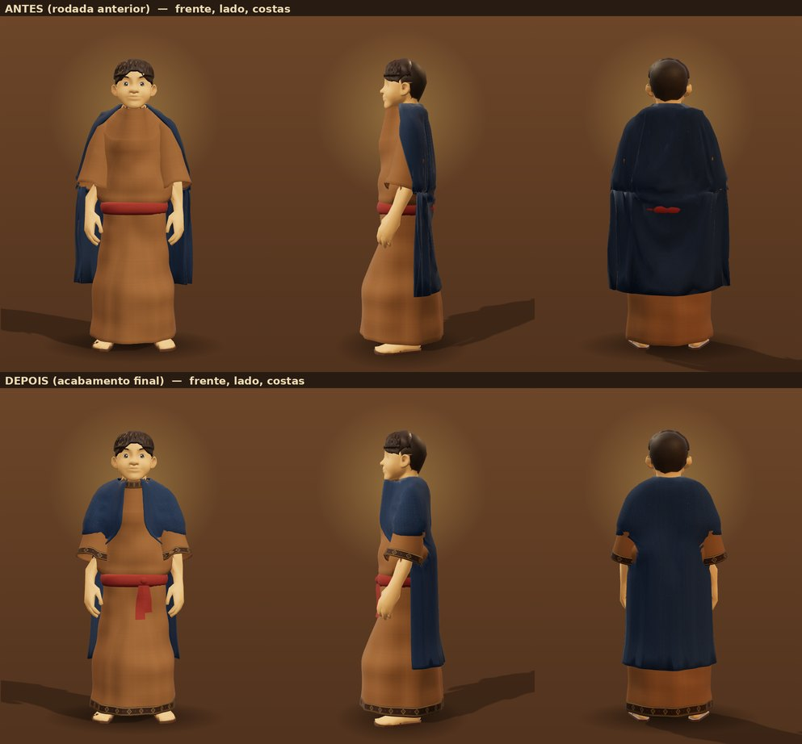

**Masculino: túnica com barra bordada, cinto com fivela de bronze e barba cheia**

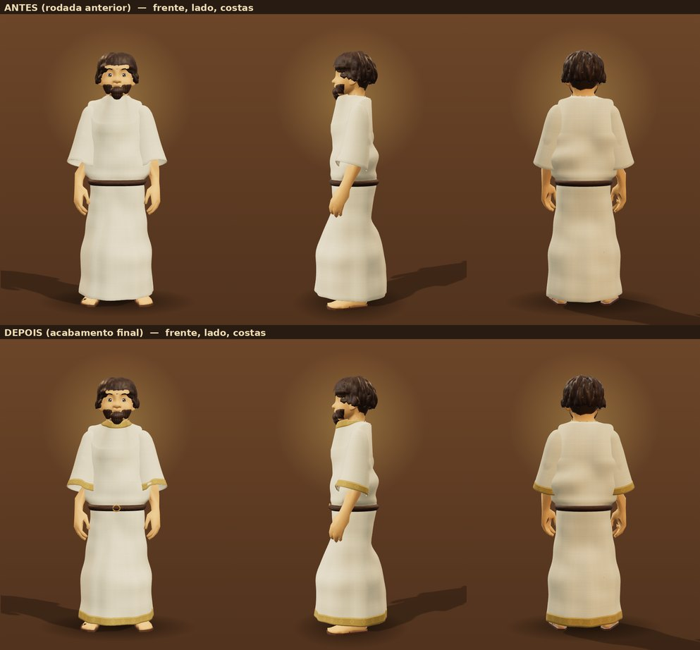

**Masculino: túnica simples com cinto de couro (sem manto)**

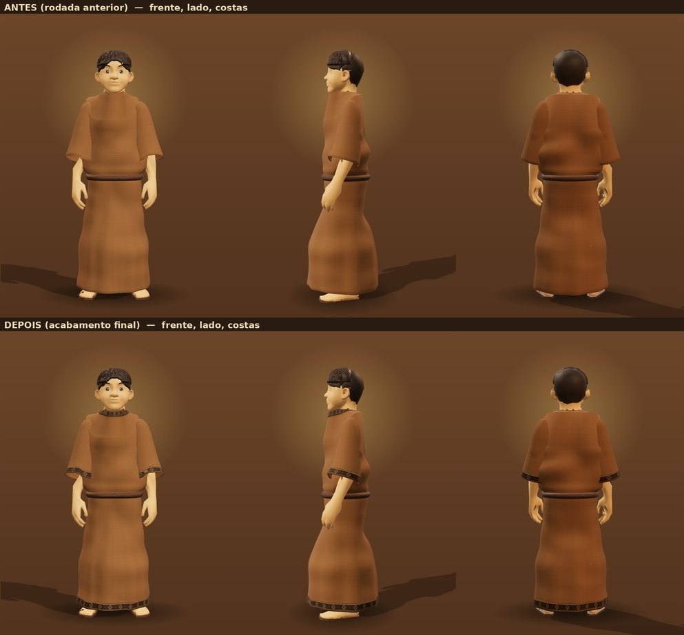

**Feminina: túnica azul, faixa dourada e manto marrom**

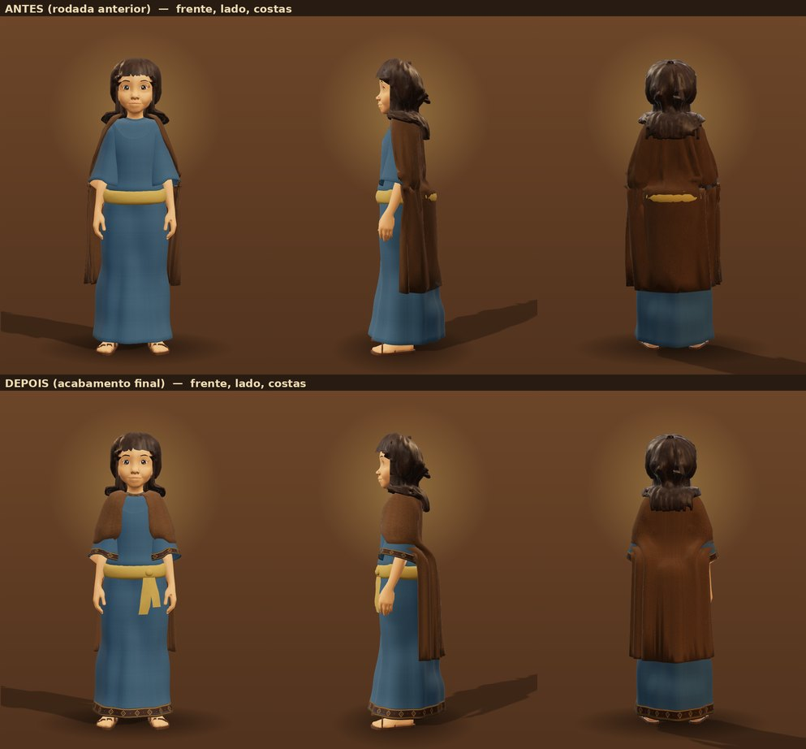

**Feminina: túnica púrpura com barra de ouro, xale listrado e cinto de corda**

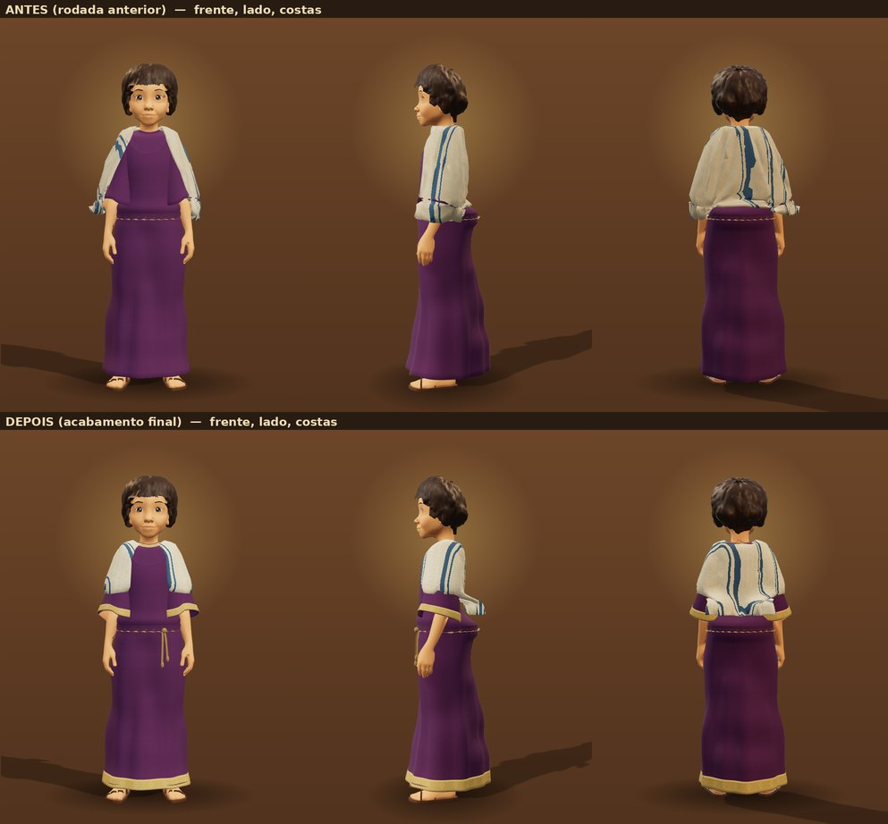

**Feminina: túnica simples com cinto de corda e cabelo longo**

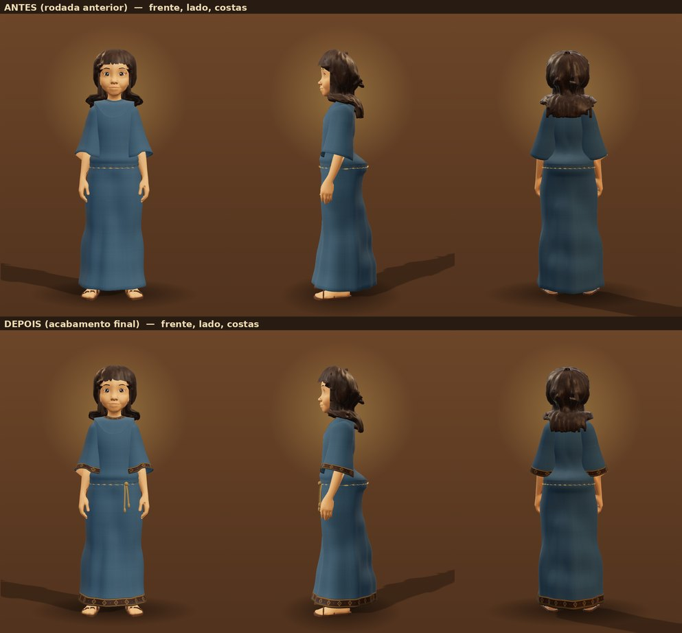

## 3. Detalhes

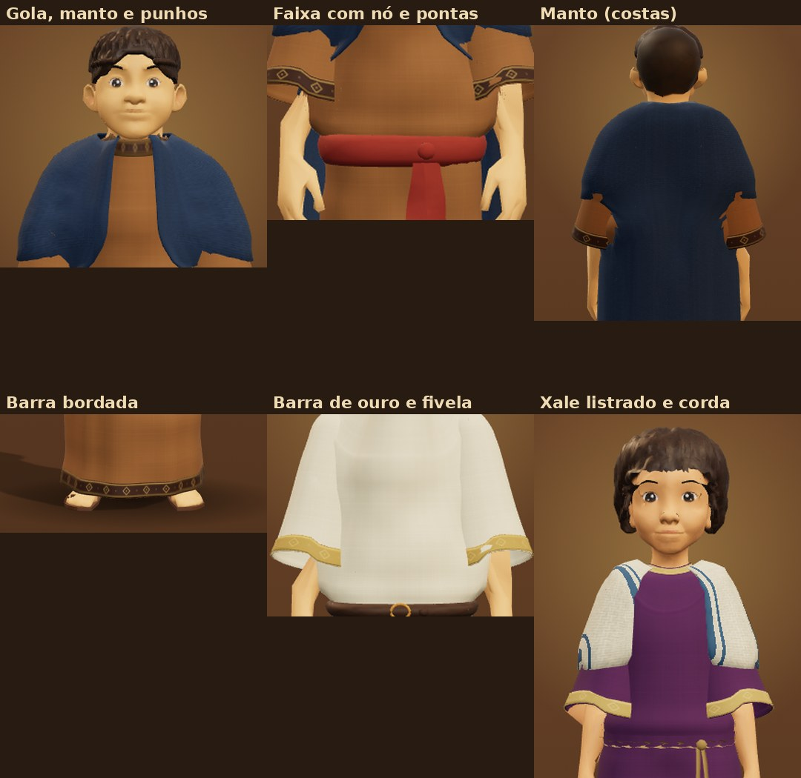

- **Gola:** faixa bordada que acompanha o decote. Tem espessura de peça costurada, 1,2 mm.
- **Punhos:** a mesma faixa na boca das mangas em sino.
- **Barra:** faixa bordada de 5 cm na saia longa e de 4 cm na curta, que acompanha as dobras da saia.
- **Pespontos:** tiras finas de costura nas laterais do tronco e da saia e por fora das mangas.
- **Manto:** capa de lã sobre os ombros, que cobre o alto das mangas, e painel que cai reto pelas costas, por fora da túnica e do cinto. Tem 4 mm de espessura. A cor e as bordas vêm do item.
- **Faixa e cintos:** a faixa de tecido tem nó e duas pontas largas; o couro tem laço e tiras curtas; a corda tem nó e borlas. A fivela de bronze só aparece no cinto que tem fivela.

## 4. Modo alto e modo leve

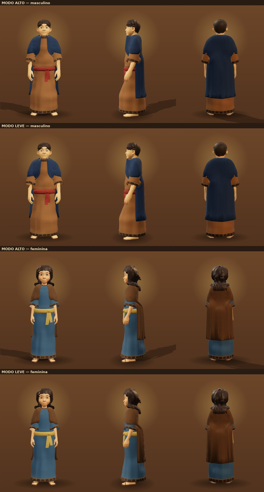

A variante leve recebe as peças novas reduzidas à metade dos triângulos, com as mesmas texturas em metade da resolução. Corpo e rosto ficam intactos, e as diferenças visuais são mínimas. A falta de sombra no chão é do próprio modo leve.

## 5. Correções visuais (R1 a R4)

| # | Problema | Causa encontrada | Correção | Situação |
|---|---|---|---|---|
| R1 | Marca ao lado do olho esquerdo da personagem feminina | Não era tinta: era uma **dobra da malha da IA** (pálpebra do olho antigo, bem maior que o olho pintado), com faces viradas para trás | Faces da dobra recortadas e superfície fechada com a pele da borda; anel em volta do olho alisado; nenhuma face da região aponta para trás; covas niveladas | **Parcial.** Com a luz do jogo (suave), a marca não aparece. Sob luz forte e rasante, no Blender, ainda se vê uma covinha tênue. |
| R2 | Furo na franja do cabelo curto masculino | Os cortes da franja e da orelha deixavam furinhos na malha do cabelo | Furinhos de até 12 arestas fechados e normais reorientadas para fora | **Resolvido** (frente e lado) |
| R3 | Cabelo longo feminino com volume aberto sobre os ombros | As mechas laterais escorregavam pelos ombros, e a manta se abria até eles | Abaixo do pescoço o cabelo cai em coluna pelas costas, com no máximo 10 cm para cada lado; a manta se estreita; a transição no pescoço ficou suave | **Resolvido** |
| R4 | Sorriso feminino "em bico" | Os cantos da boca recuavam e as bochechas avançavam demais na boca pequena do rosto feminino | No feminino, os cantos quase não recuam, abrem mais para os lados e as bochechas avançam menos | **Resolvido** em luz suave; em luz forte ainda se nota uma leve dobra na bochecha |

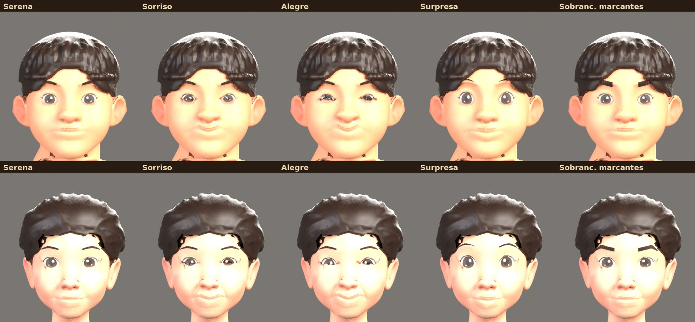

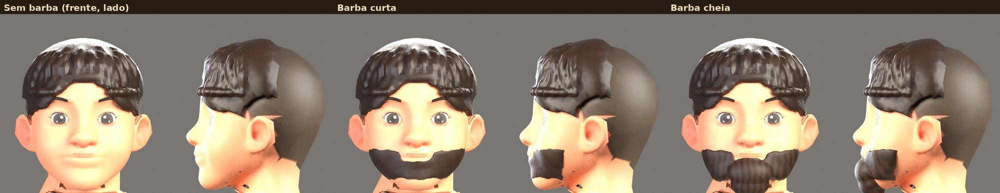

## 6. Os sete penteados

Cada folha mostra os sete penteados de frente e de costas: curto, raspado, ondulado (médio), longo / cacheado, coque e trança.

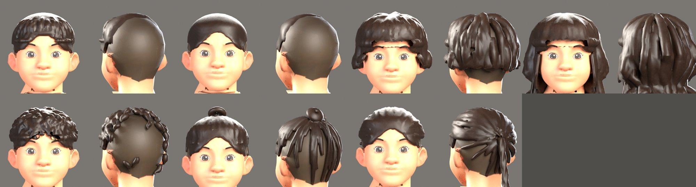

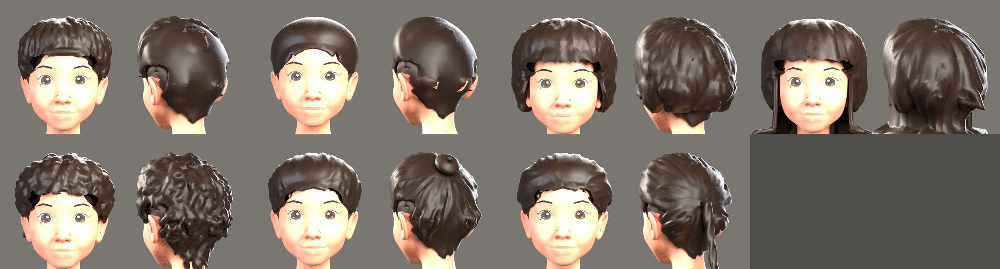

## 7. Expressões e miniaturas

Resultado da comparação automática no guarda-roupa do jogo: **60 de 65 pares acima de 3%**.

| Corpo | Par | Diferença | Revisão visual (o jogador percebe?) |
|---|---|---|---|
| Masculino | Suave × Sobrancelhas marcantes | 1,1% | Sim, quando a testa aparece. No cabelo curto, a franja cobre parte das sobrancelhas; nos outros penteados a diferença é clara. |
| Masculino | Serena × Sorriso | 2,5% | Sim, mas de forma sutil: o sorriso é de boca fechada, com os cantos curvados e os olhos apertando de leve. |
| Masculino | Sorriso × Alegre | 1,4% | Sim: na alegria os olhos se fecham em sorriso. |
| Feminino | Suave × Sobrancelhas marcantes | 1,6% | Sim: sobrancelhas retas, grossas e escuras. |
| Feminino | Sorriso × Alegre | 2,4% | Sim, pelos olhos. |

**Por que não forcei:** as diferenças entre sorriso e alegria são naturalmente sutis num rosto de 75 pixels. Nas rodadas anteriores, aumentar a deformação deixou a boca "em bico" (justamente o R4). Preferi a naturalidade, como pedido: a diferença se vê, mas pouco muda em pixels.

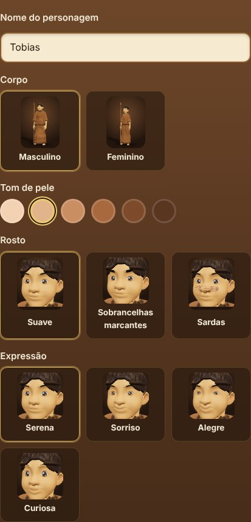

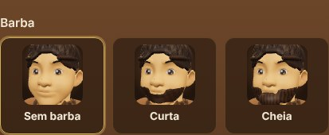

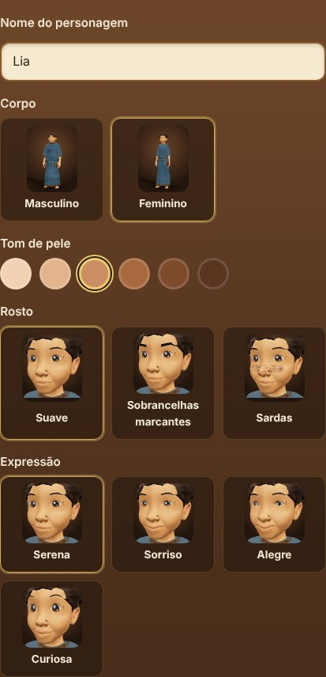

## 8. Tamanho, triângulos e desempenho

> **Não houve teste em aparelho real.** As medições são de um Chromium **sem GPU** (SwiftShader), com tela de celular (412×915), e não aprovam o desempenho no Moto G75. Dados em `imagens/personagens-entrega-1-acabamento/desempenho.json`.

| Arquivo | Tamanho | Triângulos (todas as peças) | Personagem simples* | Personagem completo** |
|---|---|---|---|---|
| `heroi-masculino.glb` (rodada anterior) | 2,80 MB | 118.579 | 36.759 | — |
| `heroi-masculino.glb` | 2,69 MB | 131.274 | 42.128 | 46.328 |
| `heroi-masculino-leve.glb` | **1,93 MB** | 79.405 | **27.878** | **29.978** |
| `heroi-feminino.glb` (rodada anterior) | 2,55 MB | 125.228 | 47.755 | — |
| `heroi-feminino.glb` | 2,46 MB | 137.816 | 53.026 | 57.226 |
| `heroi-feminino-leve.glb` | **1,69 MB** | 84.432 | **38.245** | **40.345** |

\* Corpo + cabelo curto + túnica com gola + saia longa com barra + cinto de couro + sandália + sobrancelhas.
\*\* O mesmo, com manto e faixa no lugar do cinto de couro.

| Peça nova | Triângulos (alto / leve) |
|---|---|
| Gola, punhos e pespontos do tronco (`Tunica_gola`) | 3,2 mil / 1,6 mil |
| Barra da saia longa (`Tunica_barra`) | 2,1 mil / 1,1 mil |
| Manto / manto longo / xale | 4,2 / 4,8 / 3,2 mil (metade no leve) |
| Faixa, couro, corda (com nó e pontas) | 0,8 / 0,8 / 1,4 mil |
| Fivela | 320 |

**Materiais.** São 6 tipos novos: barra, pesponto, metal, lã, além de couro e corda, que já existiam. Cada peça tem o próprio material, para o jogo tingir a peça certa, mas as **texturas são compartilhadas**: uma de bordado, uma de pesponto e uma de lã. Os arquivos ficaram **menores** que os da rodada anterior, porque a lã e o linho novos comprimem melhor.

| Corpo | Qualidade | Tela | Pronto em | Memória JS | Quadros/s* | Erros | Contexto perdido |
|---|---|---|---|---|---|---|---|
| Masculino | alta | Central | 9,6 s | 50 MB | 6,2 | 0 | não |
| Masculino | alta | Guarda-roupa | 3,9 s | 64 MB | 8,6 | 0 | não |
| Masculino | leve | Central | 7,1 s | 47 MB | 8,9 | 0 | não |
| Masculino | leve | Guarda-roupa | 3,6 s | 55 MB | 18,5 | 0 | não |
| Feminino | alta | Central | 9,0 s | 50 MB | 5,9 | 0 | não |
| Feminino | alta | Guarda-roupa | 3,8 s | 62 MB | 7,8 | 0 | não |
| Feminino | leve | Central | 6,9 s | 48 MB | 8,6 | 0 | não |
| Feminino | leve | Guarda-roupa | 3,6 s | 61 MB | 16,0 | 0 | não |

\* Sem GPU, os números não representam o celular; servem só para comparar.

**Estabilidade:** nenhum erro e nenhuma perda de contexto WebGL. **A verificar no Moto G75:** quadros por segundo, memória de vídeo (pele de 2048²) e aquecimento.

## 9. Critérios de aprovação

| # | Critério | Situação |
|---|---|---|
| 1 | Roupa masculina e feminina com acabamento rico | **Cumprido.** Gola, punhos e barra bordados, pespontos, manto, faixa ou cinto, com materiais distintos e o mesmo nível nos dois corpos. |
| 2 | Manto, faixa, gola e barra bem construídos | **Cumprido.** Peças próprias, que acompanham a geometria. A borda da capa do manto termina sobre as mangas em sino, que aparecem logo abaixo dela. |
| 3 | Sem atravessamentos nem defeitos geométricos | **Cumprido nas vistas** (frente, lado e costas, com e sem manto). O manto passa por fora do cinto, e o cabelo longo por fora do manto. |
| 4 | Rosto feminino sem a marca | **Parcial** (R1): some na luz do jogo; sob luz forte, ainda há uma covinha tênue. |
| 5 | Franja masculina sem furos | **Cumprido.** |
| 6 | Cabelo longo feminino com caimento natural | **Cumprido.** Cai em coluna pelas costas. |
| 7 | Sorriso feminino natural sob diferentes iluminações | **Quase.** Natural na luz do jogo; sob luz forte, uma dobra leve na bochecha. |
| 8 | Expressões e opções compreensíveis | **Cumprido com ressalva.** Visualmente distinguíveis; 5 pares abaixo de 3% por serem naturalmente sutis (seção 7). |
| 9 | Modo leve atualizado e validado | **Cumprido** (testes, vistas e medições). O aparelho real fica pendente. |
| 10 | Testes existentes passando | **Cumprido.** 247 de 247. |

## 10. Limitações e pendências

| # | Pendência | Proposta |
|---|---|---|
| L1 | Covinha tênue ao lado do olho feminino, sob luz forte | Refazer a topologia local da pálpebra (remalhar só essa área) ou repintar a sombra na textura |
| L2 | Leve dobra na bochecha do sorriso feminino sob luz forte | Forma da boca feminina dedicada (curva menor, bochecha mais lisa) |
| L3 | As mangas em sino aparecem sob a borda da capa do manto | Opcional: capa um pouco mais longa nos ombros ou mangas mais justas quando há manto |
| L4 | O capuz (`Capuz`) continua sendo a peça simulada antiga; não foi refeito nesta rodada | Construir o capuz sobre a capa nova, com o mesmo método |
| L5 | Desempenho físico não verificado | Teste no Moto G75: Central e guarda-roupa, nos modos alto e leve |
| L6 | README, CHANGELOG e ROADMAP não atualizados (regra A21) | Atualizar quando a regra A21 for liberada |

## 11. Testes

| Verificação | Resultado |
|---|---|
| `npm run typecheck` | passou |
| `npm test` | **247 de 247** (22 arquivos; 4 testes novos) |
| `npm run build` | passou |

Testes novos:
- a túnica sempre mostra a gola e a barra da saia em uso; a fivela só aparece no cinto que tem fivela;
- as cores da barra vêm do item ou de um tom da túnica, e o pesponto fica visível sobre túnicas claras e escuras;
- nos dois corpos, gola, barras, fivela e mantos existem com materiais próprios, dentro do orçamento de triângulos e na altura certa.

Continuam preservados e testados:
- a migração dos oito perfis, a cópia de segurança e a reversão;
- a personalização, o progresso, as fases, as estrelas e as recompensas.

## 12. Commits

Todos na branch `claude/bible-quest-android`, com `[skip ci]` (sem APK):

| Commit | Conteúdo |
|---|---|
| `b77f651` | Gola, punhos e barra bordados, pespontos, mantos paramétricos, cintos com nó e fivela; correções do rosto e dos cabelos; materiais no jogo; testes novos |
| `7d1f9c8` | Modelos finais (alto e leve) com as roupas detalhadas, o olho feminino e a franja corrigidos; licenças |
| (este relatório) | Relatório em md e pdf, com imagens e medições |

**Branch principal:** nenhuma alteração e nenhum merge. **APK e publicação:** nenhum. **Mapa de Gênesis e Central:** não foram tocados. **Conteúdo bíblico, perguntas e recompensas:** sem mudança. Os modelos da rodada anterior continuam recuperáveis pelo commit `0b537e4`.

