# Bible Quest — Reformulação visual, entrega 1: Personagens — Rodada de refinamento

**Relatório da rodada de refinamento** · 26/11/2026 · branch `claude/bible-quest-android` · nenhuma alteração na branch principal · nenhum APK gerado

> **Resumo honesto.** A roupa masculina foi refeita do zero com uma construção nova (molde de costura em malha regular). A causa dos defeitos foi encontrada e corrigida. Os dois personagens agora têm o mesmo acabamento na roupa.
> - Cabelos médio e longo, barba cheia, sobrancelhas marcantes e expressões foram refeitos.
> - Furos e covas da malha, manchas da pele e resíduos foram limpos.
> - O modo leve ganhou uma variante própria dos modelos.
>
> **Avaliação.** A roupa masculina passou do pior ponto da entrega 1 para um acabamento limpo, uniforme e coerente de frente, de lado e de costas. Ainda assim, ela **não iguala o detalhe da roupa pintada do modelo antigo** (manto escuro, faixa e barra bordada), porque a túnica nova é uma peça lisa, tingida pela cor escolhida.

Restam pontos menores, listados na seção 9:
- 5 de 65 pares de miniaturas abaixo de 3% (sobrancelhas e expressões);
- uma marca pequena ao lado do olho da personagem feminina;
- um furo pequeno na franja do cabelo curto masculino;
- um sorriso feminino um pouco "em bico" em luz forte.

**Recomendo avaliar as imagens desta rodada antes de aprovar.** Não considero a entrega pronta só por passar nos testes.

## 1. O que foi feito nesta rodada

| Área | Mudança |
|---|---|
| Roupa (prioridade máxima) | Túnica nova (`tools/personagem/modular/tunica.py`): parte de cima com mangas, saia longa e saia curta, construídas como molde em malha regular, com caimento, ombros arredondados, bainhas dobradas, dobras suaves e UV em escala constante. A textura de linho é uniforme e gerada por código. O corpo não atravessa mais o tecido. Vale para os dois corpos. |
| Miniaturas e personalização | Sorriso e alegria redesenhados (linha da boca curvada e olhos que sorriem); barba cheia com volume e comprimento abaixo do queixo; sobrancelhas marcantes com formato próprio (retas e angulosas); franja acima das sobrancelhas; sardas mais visíveis. |
| Cabelos | Médio e longo: massa contínua atrás (manta), mechas mais cheias que terminam dentro dela (sem pingos) e caem rentes às costas, por fora da túnica. Curto: franja contínua, sem a crista espetada atrás e sem pontas soltas perto da orelha. |
| Limpeza | Furos da malha da IA fechados; covas fundas alisadas (canto do olho, sob o queixo); manchas escuras da textura limpas (pescoço, orelhas, em volta dos olhos); normais invertidas corrigidas (furo na franja); emenda da orelha preservada. |
| Modo leve | Variantes `heroi-masculino-leve.glb` e `heroi-feminino-leve.glb`, carregadas quando a qualidade gráfica é "leve" (`runtime.ts`, `heroi.ts`). |
| Desempenho | Script de validação técnica `tools/personagem/modular/medir-desempenho.cjs` e vistas no jogo `vistas.cjs`. |
| Testes | Novo `src/test/personagens-refinamento.test.ts` (9 testes). |
| Licenças | `public/models/personagem/LICENCAS.md` atualizado. |

## 2. Roupa masculina: causa dos defeitos e correção

### 2.1 O que causava os defeitos (investigação)

| Sintoma | Causa encontrada |
|---|---|
| Superfície irregular, sulcos horizontais | A parte de cima era montada por anéis com o raio **máximo** do corpo em cada fatia, depois fundida por voxels, alisada e reduzida a 4,2 mil triângulos. O raio máximo copia cada calombo do corpo da IA, e a redução da malha deformava o resultado. |
| Ombros quadrados ("ombreiras") | O próprio corpo-base masculino veste uma **camiseta modelada em forma de caixa**, com mangas largas e quinas nos ombros. A túnica copiava essa caixa. |
| Buracos nas costas e nas mangas | A fusão por voxels das mangas com o tronco abria furos onde as peças se cruzavam. |
| Manchas e variação de cor | A textura usava projeção plana de UV, que estica o tecido nos lados, e a malha tinha normais irregulares depois da fusão e da redução. |
| Saia com a borda de cima larga | A saia vinha de uma simulação de tecido com a borda presa numa elipse maior que a cintura. |
| Bermuda e corpo aparecendo | Pontos do corpo (camiseta e bermuda pintadas da IA) ficavam fora do tecido, nos ombros, nas costas e no quadril. |

### 2.2 Como a roupa é feita agora (`tunica.py`)

- **Molde em malha regular.** São anéis e setores em quadriláteros: 64 direções, sem fusão por voxels e sem redução.
- **Envoltória do corpo.** É fechada (máximo em janela) e suavizada. O tecido **cai**: ao descer, não entra mais depressa que um limite. Assim o pano passa reto sob o peito, a barriga e as costas.
- **Ombros.** Antes de medir, a camiseta em caixa do corpo-base é **alisada**. Essa região fica sempre sob a túnica. Os ombros saem de um campo de alturas medido por raios de cima para baixo, até uma gola redonda que assenta no pescoço.
- **Mangas em sino.** Começam com uma cúpula sobre o ombro (corte raglan) e alargam até abaixo do cotovelo.
- **Saia em sino.** Tem franzido fino logo abaixo do cinto e dobras largas e suaves que crescem para a barra. Atrás, a barra cai um pouco mais.
- **Bainhas dobradas para dentro** na barra, nas mangas e na gola: a borda tem espessura visível.
- **Cintura.** A túnica e a saia viram um anel que segue o corpo, e o cinto (couro, corda ou faixa) é ajustado ao mesmo anel. Ele cobre a emenda sem atravessar.
- **UV cilíndrico em escala constante** (1 unidade = 12 cm de tecido). O linho é **gerado por código**: trama fina de baixo contraste, sem manchas. A cor vem só da escolha do jogador.
- **Nenhum ponto do corpo atravessa o tecido.** Na região coberta, todo vértice do corpo que fica fora do tecido, ou a menos de 9 mm dele, volta para dentro. Também são removidas as faces do corpo sempre cobertas (camiseta e bermuda pintadas).
- **O mesmo molde vale para os dois corpos.** Masculino e feminino têm agora o mesmo acabamento.

### 2.3 Comparação no jogo (frente, lado e costas)

As imagens foram tiradas no guarda-roupa do jogo, com a mesma câmera e o mesmo perfil de teste. Em cima está a entrega 1; embaixo, esta rodada.

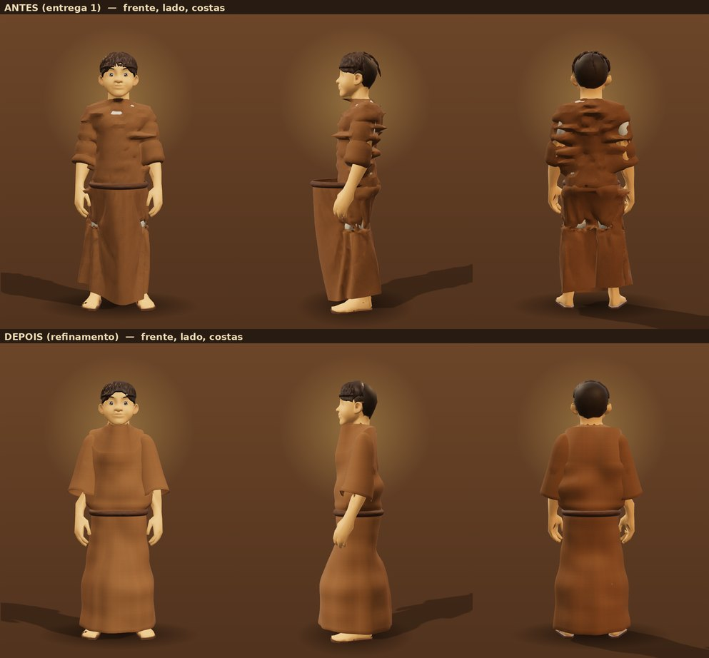

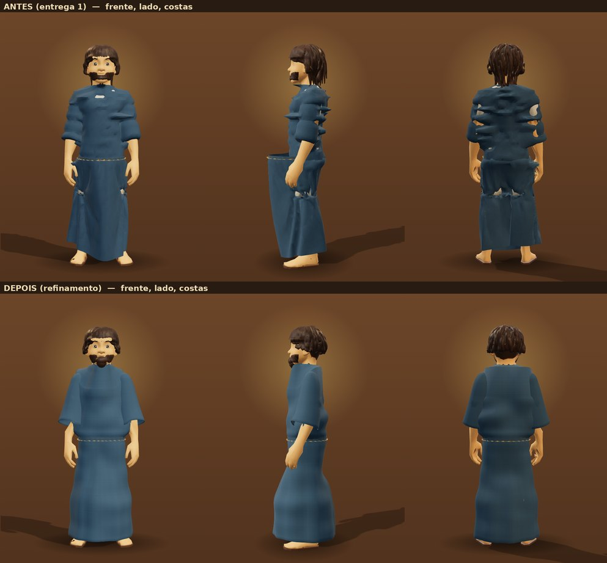

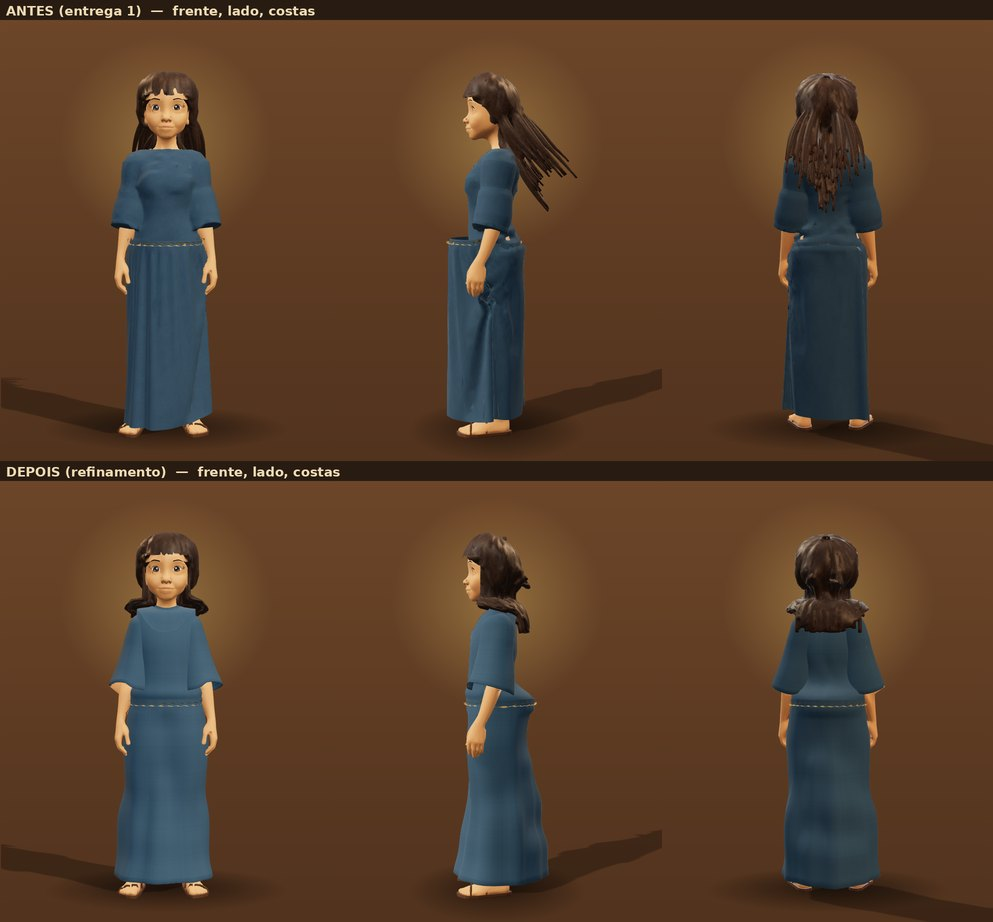

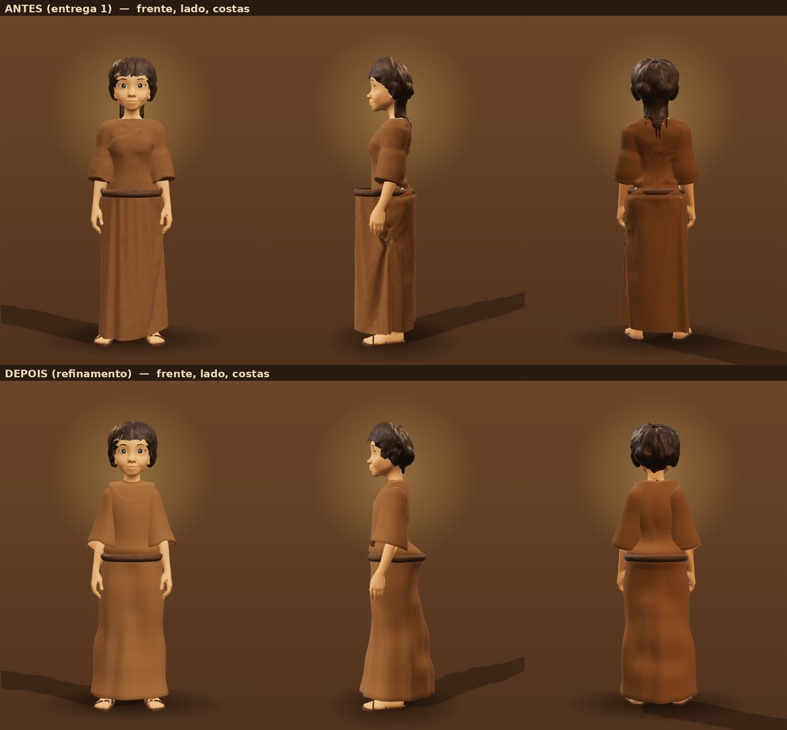

Para referência, o **modelo antigo** (peça única, antes da entrega 1) está na imagem `imagens/personagens-entrega-1/antes.jpg` do relatório anterior. A roupa dele tinha manto, faixa e barra pintados na textura.

## 3. Expressões, barbas e sobrancelhas

- **Sorriso.** A linha da boca (os lábios pintados) se curva: os cantos sobem e abrem, o centro quase não se move. As maçãs do rosto sobem, e a pálpebra de baixo sobe um pouco, como num sorriso natural.
- **Alegre.** Sorriso mais largo e "olhos que sorriem": a pálpebra de baixo sobe bem e a de cima desce um pouco. Não há boca aberta nem deformação exagerada.
- **Intensidades no jogo** (`EXPRESSAO_BASE`): todas em 1, a surpresa em 1,3. Antes, a alegria ia a 1,9 para compensar formas fracas.
- **Barba cheia.** Tem volume claro nas faces (até 2,3 cm de espessura no queixo, contra 3 mm da curta) e desce abaixo do queixo com ponta arredondada. Era isso que a deixava quase igual à curta: o volume do queixo era feito com *metaballs*, que saíam vazios na conversão em segundo plano. Agora são elipsoides fundidos.
- **Sobrancelhas marcantes.** Têm formato próprio: cabeça reta e grossa junto do nariz, subida em linha até um pico anguloso a 70 % e cauda fina e mais longa. Ficam mais baixas (olhar mais intenso) e mais escuras no jogo. As suaves continuam em arco redondo.
- **Franja.** Fica acima das sobrancelhas, para que elas apareçam também nas miniaturas.

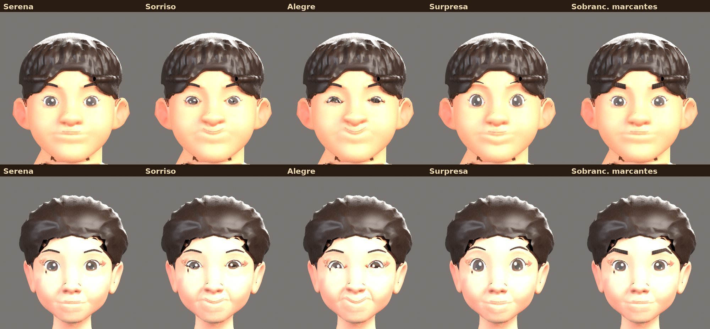

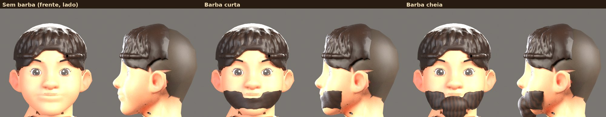

## 4. Cabelos

| Cabelo | Problema | Correção |
|---|---|---|
| Médio (ondulado) e longo | Mechas separadas atrás, vãos, pontas pingando, mechas espetadas para trás (o "fluxo" empurrava as pontas para trás) | **Manta contínua** atrás e dos lados, da altura das orelhas até o comprimento do penteado, que se estreita abaixo do pescoço. Mechas mais grossas e juntas, caindo rentes às costas e por fora da túnica. As pontas terminam dentro da manta (sem pingos). Fundo entre as mechas mais escuro (lê como volume, não como falha). |
| Curto | Falha no meio da franja; crista de mechas espetadas na coroa; tocos soltos perto da orelha | Volume raso preenchendo a franja. Da coroa para trás só a textura de fios. Mechas que ficavam curtas demais depois do corte são descartadas (antes viravam tocos pendurados). |
| Todos | Casca do couro cabeludo entrando na cabeça onde a malha da IA tinha normais invertidas | Normais orientadas para fora antes de afastar a casca e de afundar o couro cabeludo do corpo. |

As sete opções continuam: curto, raspado, ondulado (médio), longo, cacheado, coque e trança.

Comparação dos sete cabelos. Em cada folha, cada penteado aparece de frente e de costas, na ordem: curto, raspado, ondulado (médio), longo / cacheado, coque e trança. As folhas da entrega 1 estão em `imagens/personagens-entrega-1/cabelos-*.jpg`.

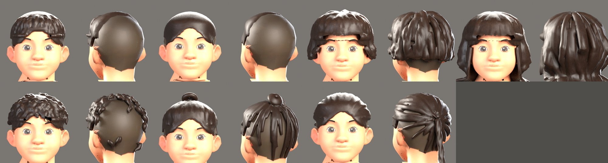

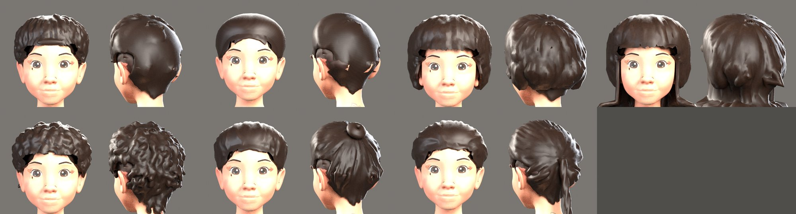

## 5. Limpeza dos modelos (inspeção em 360°)

| Defeito | Causa | Correção |
|---|---|---|
| Marcas escuras sob o queixo (masculino) | Covas fundas na malha da IA (não eram tinta) | Vértices muito abaixo da média dos vizinhos são nivelados (`alisar_covas`), exceto boca, narinas, olhos e orelhas |
| Marca ao lado do olho (feminino) | Restos do olho antigo da IA (cova e cílios modelados) | Covas e pontas em volta do olho nivelados; manchas escuras da textura limpas abaixo do olho |
| Resíduos junto das orelhas | (1) tocos de mechas cortadas cedo demais; (2) a emenda da orelha abria quando o couro cabeludo era afundado | (1) mechas curtas descartadas e cabelo encostado na orelha removido; (2) afundamento desligado aos poucos perto da orelha |
| Furos (narinas, orelhas, pescoço) | Furos pequenos da malha da IA mostravam o interior escuro | Fechados, com a textura da borda |
| Manchas escuras pintadas na pele | Pintura da IA (pescoço, orelhas) | Texels muito mais escuros que a pele em volta voltam ao tom da pele, só nessas regiões |

## 6. Miniaturas (revisão visual e comparação automática)

O script `tools/personagem/modular/miniaturas.cjs` abre o guarda-roupa do jogo e compara as miniaturas da mesma categoria, duas a duas. Critério: mais de 3% dos pixels diferentes. Na revisão visual, as miniaturas de rosto, de expressão e de barba ganharam um enquadramento mais fechado, do queixo à testa (`stage.ts`), para que os traços apareçam no tamanho pequeno do cartão.

| | Entrega 1 | Refinamento |
|---|---|---|
| Pares comparados | 74 | 65 (as opções de rosto agora são Suave, Sobrancelhas marcantes e Sardas) |
| Pares acima de 3% | 66 | **60** |
| Pares abaixo de 3% | 8 | **5** |
| Barba curta × cheia | 2,5% (falhou) | **passou** |
| Suave × Sardas | — | **passou** |

Os 5 pares que continuam abaixo de 3%:

| Corpo | Par | Diferença | Revisão visual |
|---|---|---|---|
| Masculino | Suave × Sobrancelhas marcantes | 1,1% | Diferença visível, mas a franja do cabelo curto cobre parte das sobrancelhas na miniatura |
| Masculino | Serena × Sorriso | 2,5% | A boca curvada se vê, mas é sutil no tamanho da miniatura |
| Masculino | Sorriso × Alegre | 1,4% | Distinguível: na alegria os olhos se fecham em sorriso |
| Feminino | Suave × Sobrancelhas marcantes | 1,7% | Bem visível (sobrancelhas retas, escuras e grossas) |
| Feminino | Sorriso × Alegre | 2,8% | Distinguível pelos olhos |

Não forcei as formas só para passar no número. Aumentar ainda mais o sorriso deixava a boca "em bico", e esse exagero foi desfeito.

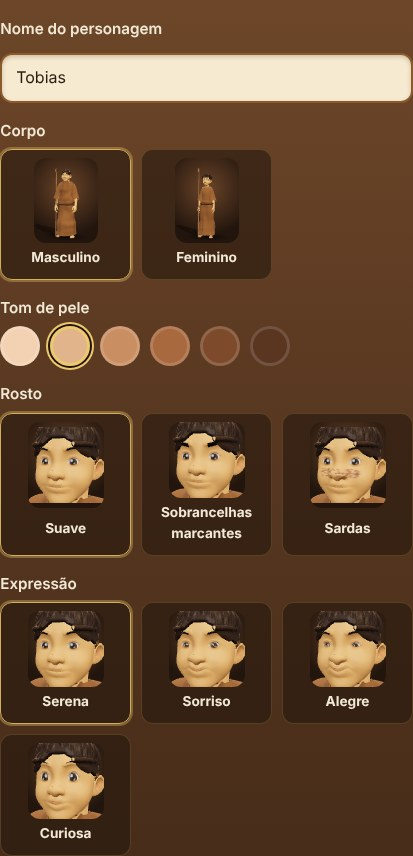

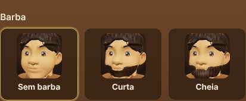

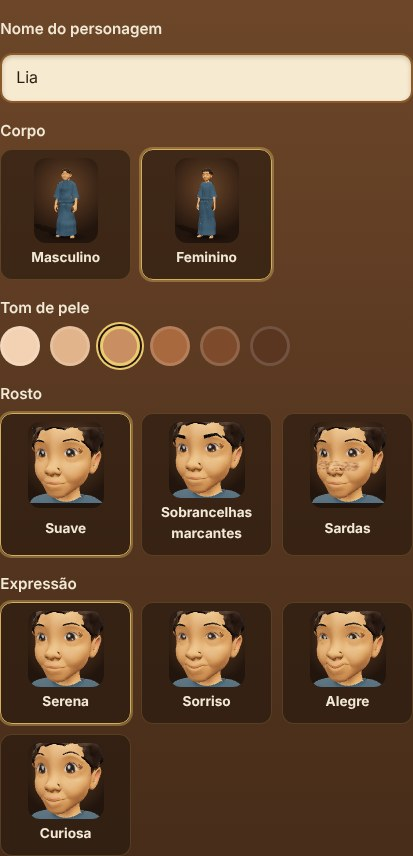

Os resultados de cada par estão em `imagens/personagens-entrega-1-refinamento/miniaturas-comparacao.json`.

## 7. Modo leve

- **Como funciona.** Na qualidade gráfica "leve", o jogo carrega `heroi-<corpo>-leve.glb`. Se o arquivo faltar, usa o modelo completo. O modo 2D continua igual.
- **O que muda na variante.** Ela tem as mesmas peças, esqueleto, animações, nomes e expressões. Cabelos, roupas e acessórios têm metade dos triângulos, e as texturas têm metade da resolução. **Corpo e rosto ficam intactos**: a pele mantém 2048 px e a malha do corpo é a mesma.
- **Validação.** Um teste garante a mesma lista de peças, as mesmas animações, o mesmo número de ossos, as mesmas expressões, o mesmo corpo e menos triângulos. Nas vistas do jogo, a diferença visual é mínima; a falta de sombra no chão é do próprio modo leve.

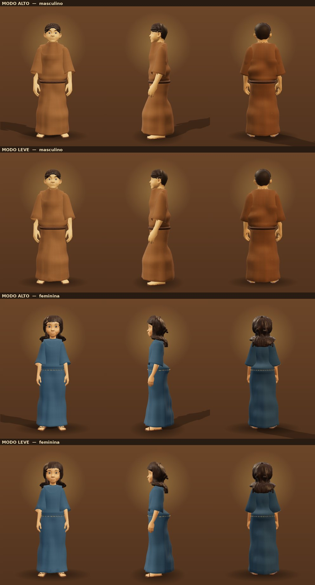

## 8. Tamanho, triângulos e desempenho (validação técnica)

> **Não houve teste em aparelho real.** Os números abaixo são de um Chromium **sem GPU** (renderização por software, SwiftShader), com tela de celular (412×915). Servem para comparar versões e detectar erros, **não** para aprovar o desempenho no Moto G75, que deve ser testado quando estiver disponível. Script: `tools/personagem/modular/medir-desempenho.cjs`; dados em `imagens/personagens-entrega-1-refinamento/desempenho.json`.

### 8.1 Arquivos

| Arquivo | Tamanho | Triângulos (todas as peças) | Triângulos visíveis* | Texturas | Memória de textura estimada** |
|---|---|---|---|---|---|
| `heroi-masculino.glb` (entrega 1) | 2,68 MB | 101.850 | 27.794 | — | — |
| `heroi-masculino.glb` (refinamento) | 2,80 MB | 118.579 | 36.759 | 19 (maior 2048²) | 46 MB |
| `heroi-masculino-leve.glb` | **1,99 MB** | 72.880 | **25.179** | 19 | **29 MB** |
| `heroi-feminino.glb` (entrega 1) | 2,49 MB | 111.351 | 40.416 | — | — |
| `heroi-feminino.glb` (refinamento) | 2,55 MB | 125.228 | 47.755 | 17 (maior 2048²) | 45 MB |
| `heroi-feminino-leve.glb` | **1,73 MB** | 77.990 | **35.621** | 17 | **28 MB** |

\* Corpo + cabelo curto + túnica + saia longa + cinto + sandália + sobrancelhas (o que o jogo desenha).
\*\* RGBA com mipmaps, de todas as texturas do arquivo. A pele (2048²) responde por cerca de 21 MB.

A túnica nova tem mais triângulos que a antiga: 8,8 mil em cima e 6 mil na saia, contra 4,2 mil e 2,6 mil. A malha regular é o que dá o acabamento, por isso não foi reduzida no modo alto. No modo leve, o personagem visível fica **abaixo** da entrega 1 no masculino e na feminina.

### 8.2 No jogo (Chromium sem GPU)

| Corpo | Qualidade | Tela | Pronto em | GLB baixado em | Memória JS | Quadros/s* | Erros | Contexto perdido |
|---|---|---|---|---|---|---|---|---|
| Masculino | alta | Central | 9,2 s | 1,5 s | 49 MB | 6,1 | 0 | não |
| Masculino | alta | Guarda-roupa | 4,0 s | 1,6 s | 62 MB | 10 | 0 | não |
| Masculino | leve | Central | 7,2 s | <0,1 s | 47 MB | 8,8 | 0 | não |
| Masculino | leve | Guarda-roupa | 3,7 s | <0,1 s | 62 MB | 19,3 | 0 | não |
| Feminino | alta | Central | 9,0 s | 3,1 s | 50 MB | 5,9 | 0 | não |
| Feminino | alta | Guarda-roupa | 3,8 s | 1,6 s | 58 MB | 8,6 | 0 | não |
| Feminino | leve | Central | 6,8 s | <0,1 s | 47 MB | 8,6 | 0 | não |
| Feminino | leve | Guarda-roupa | 3,8 s | <0,1 s | 57 MB | 16,9 | 0 | não |

\* Sem GPU, os quadros por segundo não representam o celular. Valem como comparação: o modo leve rendeu de 1,4 a 2 vezes mais quadros que o alto.

**Estabilidade:** nas 8 medições não houve erro no console nem perda de contexto WebGL.

**A verificar no Moto G75:** tempo de carga real, quadros por segundo na Central e no guarda-roupa (alta e leve), memória de vídeo e aquecimento. A **memória de textura** é o ponto de atenção, porque a pele de 2048² vale cerca de 21 MB.

## 9. Testes

| Verificação | Resultado |
|---|---|
| `npm run typecheck` | passou |
| `npm test` | **243 de 243** testes, 22 arquivos (eram 234; 9 novos) |
| `npm run build` | passou |
| Miniaturas no jogo | 60 de 65 pares acima de 3% (seção 6) |
| Vistas no jogo (frente, lado e costas, alta e leve) | sem erros |
| Desempenho e estabilidade (seção 8) | sem erros e sem perda de contexto |

Testes novos (`src/test/personagens-refinamento.test.ts`):
- a variante leve tem as mesmas peças, animações, ossos e expressões, o corpo intacto e menos triângulos;
- a túnica usa a mesma textura de linho em cima e nas saias, e a malha regular fica dentro do orçamento;
- a saia longa desce mais que a curta, e as duas começam na cintura;
- as sobrancelhas marcantes são mais longas e mais altas que as suaves;
- a barba cheia tem mais comprimento, mais volume e desce abaixo da curta;
- as intensidades das expressões ficam sem exagero (no máximo 1,3).

Os testes existentes continuam passando, inclusive:
- a migração dos oito perfis, com cópia de segurança e reversão;
- a personalização (itens, cores, cabelos, barbas, expressões).

O progresso, as fases, as estrelas e as recompensas não foram tocados.

## 10. Critérios de aprovação: situação

| Critério | Situação |
|---|---|
| 1. Roupa masculina igual ou superior ao modelo antigo | **Parcial.** É superior em forma e limpeza, sem manchas, furos ou atravessamentos. Não tem os detalhes pintados do modelo antigo (manto escuro, faixa e barra bordada). Com manto e cinto de faixa do guarda-roupa, o visual se aproxima. |
| 2. Sem manchas, atravessamentos ou corpo aparecendo | **Cumprido na roupa.** A gola alta não mostra a camiseta pintada; o quadril não mostra a bermuda. |
| 3. Acabamento equivalente nos dois personagens | **Cumprido.** O mesmo molde vale para os dois. |
| 4. Sete cabelos bem resolvidos | **Quase.** Médio e longo agora contínuos. Restam: furo pequeno na franja do curto masculino; o longo feminino termina com volume aberto sobre os ombros. |
| 5. Expressões e barbas claramente distinguíveis | **Barbas: cumprido. Expressões: parcial** (seção 6). |
| 6. Marcas e resíduos removidos | **Quase.** Queixo, orelhas e furos foram resolvidos. Resta uma marca pequena ao lado do olho feminino, que não é tinta nem cova comum. |
| 7. Miniaturas revisadas (visual e automático) | **Feito**, com 5 pares abaixo do limite (seção 6). |
| 8. Modo leve validado tecnicamente | **Cumprido** (variante, testes e medições). Falta o aparelho real. |
| 9. Testes existentes passando | **Cumprido.** |
| 10. Testes novos | **Cumprido** (9). |

## 11. Limitações e pendências

| # | Pendência | Proposta |
|---|---|---|
| R1 | A túnica é lisa: não tem os detalhes pintados do modelo antigo | Pequenos detalhes de roupa: barra e gola com faixa de cor (o shader do jogo já aceita barra e listras), costura e um segundo tecido opcional |
| R2 | 5 pares de miniaturas abaixo de 3% (sobrancelhas no cabelo curto; sorriso × serena × alegre) | Destacar a boca do sorriso na textura (linha mais escura nos cantos) e encurtar mais a franja do curto |
| R3 | Marca pequena ao lado do olho esquerdo da personagem feminina | Repintar essa região do rosto no `pintar.py` (não é cova nem mancha comum da textura) |
| R4 | Furo pequeno na franja do cabelo curto masculino | Revisar a fusão da franja com a casca |
| R5 | Cabelo longo feminino com volume aberto sobre os ombros; termina na altura das costas, e não mais abaixo | Estreitar mais a manta nos ombros e alongar |
| R6 | Sorriso feminino um pouco "em bico" em luz forte | Ajustar a forma da boca só no corpo feminino |
| R7 | Desempenho físico não verificado (sem aparelho) | Teste no Moto G75: Central e guarda-roupa, alto e leve |
| R8 | Pele em 2048² (cerca de 21 MB de memória de vídeo) | Se o Moto G75 mostrar pressão de memória, usar pele em 1024² também no modo leve |
| R9 | README, CHANGELOG e ROADMAP não atualizados (regra A21) | Atualizar quando a regra A21 for liberada |

## 12. Commits

Todos na branch `claude/bible-quest-android`, com `[skip ci]` (sem APK):

| Commit | Conteúdo |
|---|---|
| `2c76613` | Túnica paramétrica, limpeza da malha, expressões, barba, cabelos e variante leve no pipeline |
| `4d4c8e8` | Covas alisadas, franja contínua, cabelo curto sem crista, médio e longo encerrados na manta; licenças |
| `2f9d7d5` | Modelos novos, variante leve no jogo, expressões, enquadramento do rosto e testes novos |
| `0b537e4` | Modelos finais (sorriso e alegria naturais, franja acima das sobrancelhas, sem resíduos nas orelhas) |
| (este relatório) | Relatório em md e pdf, com imagens |

**Branch principal:** nenhuma alteração e nenhum merge. **APK:** nenhum gerado. **Versão publicada:** nenhuma. **Mapa de Gênesis e Central:** não foram reconstruídos (a Central só mostra o personagem novo). **Conteúdo bíblico, perguntas e recompensas:** sem mudança. Os modelos anteriores continuam recuperáveis pelo commit `746f2a6`.

