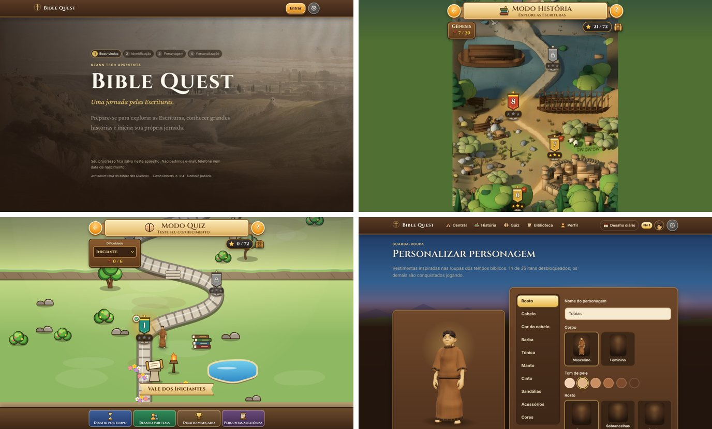

# Bible Quest — Site de prévia de desenvolvimento

**Etapa de infraestrutura, sem mudança visível no jogo** · branch `claude/bible-quest-android` · commit `4a80772` · 27/11/2026

> **Situação.** A prévia está **implementada e testada, mas ainda não publicada**. Para publicar, falta uma configuração que só o dono da conta do GitHub pode fazer:
> - criar um repositório para a prévia;
> - criar uma chave de acesso e cadastrá-la nos dois repositórios.
>
> Esta sessão não pode criar repositórios nem guardar segredos (§ 7). Por isso, **não há endereço publicado ainda** e nenhum endereço foi inventado. O site oficial não foi tocado.

## 1. Auditoria

| Item | O que encontrei |
|---|---|
| Site oficial | `https://theuzxl13-oss.github.io/Bible-Quest/`, publicado pelo `deploy.yml` com GitHub Pages via Actions. **Só o `main` publica.** As branches `claude/**` só verificam tipos, testes e build. |
| GitHub Pages | **Um único site por repositório.** Qualquer publicação no Pages deste repositório substituiria o site oficial. |
| Outros fluxos | `android.yml` (APK de depuração), `android-verificacoes.yml` e `android-diagnostico.yml`. Nenhum publica site. |
| Build web | `npm run build` (Vite 8). Gera `dist/`, com 17 MB e 109 arquivos: imagens, modelos `.glb`, pinturas `.webp` e fontes embutidas pelo `@fontsource`. Não há áudio. |
| Caminhos | `base: './'`: todos os recursos são relativos, e o mesmo pacote funciona em qualquer subdiretório. |
| Rotas | `HashRouter` (`#/historia`, `#/quiz`…). Abrir uma página direto e atualizar o navegador não geram erro 404, mesmo em hospedagem estática. |
| **Risco encontrado: dados salvos** | Todo site em `theuzxl13-oss.github.io` tem a **mesma origem** do site oficial e, portanto, o **mesmo armazenamento do navegador** (`localStorage`). Uma prévia mais nova usando as mesmas chaves (`bible-quest:v1:*`) poderia ler e regravar o progresso de quem joga no site oficial no mesmo navegador. |

## 2. Arquitetura escolhida

**Repositório separado só para a prévia (`theuzxl13-oss/bible-quest-previa`), com o próprio GitHub Pages, atualizado por um fluxo deste repositório a cada push na branch de desenvolvimento.**

- **Endereço próprio e estável:** `https://theuzxl13-oss.github.io/bible-quest-previa/`, assim que for ativado.
- **Custo zero:** GitHub Pages e Actions gratuitos, sem conta nova.
- **Independente do site oficial:**
  - o Pages deste repositório continua sendo publicado só pelo `deploy.yml`, a partir do `main`;
  - o fluxo da prévia nem pede a permissão `pages`;
  - o fluxo se recusa a publicar se o destino for este mesmo repositório.
- **Dados separados.** A versão de prévia grava em `bible-quest-previa:v1:*`. No site oficial e no aplicativo, o prefixo continua `bible-quest:v1:*`. Testado: com os dados do site oficial presentes no navegador, a prévia não os leu nem os alterou.
- **Sem merge no `main`.** Fluxos acionados por push rodam a partir da própria branch.

**Alternativas descartadas:**

| Alternativa | Por que não |
|---|---|
| Pages deste repositório | Substitui o site oficial. |
| Subpasta `/previa/` no site oficial | Exige mudar a publicação oficial e passar pelo `main`. |
| Netlify, Cloudflare Pages ou Vercel | Também gratuitas e com domínio próprio, o que separaria os dados naturalmente. Exigem conta e chave nesses serviços. O fluxo pode ser adaptado se você preferir. |
| `raw.githack` ou jsDelivr | Serviços de terceiros: não servem HTML como página (jsDelivr) ou não aceitam branch com `/` no endereço. |
| Só o artefato do Actions | Funciona agora, mas é um `.zip` para baixar, não um endereço. Fica como reserva (§ 5). |

## 3. Arquivos criados ou alterados

| Arquivo | Mudança |
|---|---|
| `.github/workflows/previa.yml` | **novo**: verifica, gera e publica a prévia |
| `vite.config.ts` | modo `previa`: título da aba, `noindex`, commit em `<meta name="bq-previa">` e `previa.json`; constante `__PREVIA__` |
| `package.json` | script `build:previa` |
| `src/services/storage/repositories.ts` | `STORAGE_PREFIX` usa `bible-quest-previa:v1:` só na prévia |
| `src/admin/AdminApp.tsx` | a chave de confirmação do painel também fica separada na prévia |
| `src/globais.d.ts` | declara `__PREVIA__` |
| `src/test/previa.test.ts` | **novo**, 4 testes (abaixo) |

O que os 4 testes protegem:
- o site e o aplicativo continuam com o prefixo de sempre;
- a prévia muda só título, indexação e prefixo;
- o fluxo da prévia não usa o Pages deste repositório nem o publica aqui;
- o `deploy.yml` continua publicando só a partir do `main`.

**Não mudaram:** `deploy.yml`, os fluxos Android, a interface do jogo, os personagens, a progressão e os mapas. **A compilação do site oficial ficou idêntica byte a byte:** os 109 arquivos têm o mesmo SHA-256 antes e depois.

**Identificação visual.** O título da aba é **"Bible Quest — Prévia de desenvolvimento"**, fora da área do jogo. Não há faixa, botão nem menu dentro do jogo. O arquivo `previa.json`, aberto no endereço da prévia, diz qual commit está publicado.

## 4. Fluxo de publicação (`previa.yml`)

1. **Quando roda:**
   - a cada push na branch `claude/bible-quest-android`, exceto commits só de documentação (`docs/**`, `*.md`);
   - à mão, pelo botão "Re-run" de uma execução anterior.
2. **Dependências e verificação:** `npm ci`, `typecheck` e testes.
3. **Compilação:** `npm run build:previa`.
4. **Conferências do pacote:**
   - título, `noindex` e o commit certo no HTML;
   - recursos relativos;
   - modelos 3D e pinturas presentes;
   - prefixo próprio dos dados, e **nenhuma** chave do site oficial;
   - `.nojekyll`.
5. **Artefato:** o pacote é guardado como artefato `bible-quest-previa`, por 7 dias.
6. **Publicação:**
   - Sem o segredo `PREVIA_DEPLOY_KEY`, o fluxo termina com o aviso *"Prévia gerada, mas não publicada"*, sem erro.
   - Com o segredo, envia o pacote ao repositório da prévia como **um único commit**, substituindo o anterior para o repositório não crescer. O GitHub Pages de lá atualiza em cerca de 1 minuto.
7. **Segurança:**
   - a chave só dá escrita no repositório da prévia;
   - ela não aparece nos registros;
   - segredos não chegam a execuções de forks;
   - o fluxo só tem permissão de leitura neste repositório.

## 5. Como a prévia é atualizada

**Automaticamente.** Cada commit de código enviado à branch `claude/bible-quest-android` gera e publica a prévia em poucos minutos. O `previa.json` e o `<meta name="bq-previa">` mostram o commit em uso.

Enquanto a publicação não estiver ativa, cada execução deixa o pacote como artefato `bible-quest-previa` em **Actions**. Baixe o `.zip` e sirva a pasta em qualquer servidor estático. Abrir `index.html` direto do disco não funciona, porque os navegadores bloqueiam módulos JavaScript em `file://`.

## 6. Testes

| Teste | Resultado |
|---|---|
| `npm run typecheck` | ✔ |
| `npm test` | ✔ **288/288**, 26 arquivos (4 novos) |
| `npm run build` (site oficial) | ✔, **idêntico byte a byte** ao anterior (109 arquivos) |
| `npm run build:android` / `npm run build:previa` | ✔ / ✔ |
| Fluxo `previa.yml` no GitHub Actions | primeira execução: ver § 8 |

**Prévia servida num subdiretório (`/bible-quest-previa/`, como no GitHub Pages), no Chromium, em celular (412 × 915, toque) e computador (1366 × 820):**

| Verificação | Celular | Computador |
|---|---|---|
| Primeira visita (sem dados): boas-vindas | ✔ 0,3 s | ✔ 0,2 s |
| Navegação pelo jogo: Central, História, Quiz, Guarda-roupa, Biblioteca, Linha do tempo, Treino, Configurações | 8/8 ✔ | 8/8 ✔ |
| Atualizar o navegador em cada uma das 8 rotas | 8/8 ✔ | 8/8 ✔ |
| Pinturas do mapa (Éden e Dilúvio), miniaturas, emenda de 0 px, 29 marcos | ✔ | ✔ |
| Mapa do Quiz | ✔ | ✔ |
| Personagens 3D (`.glb`) | ✔ masculino e feminino | ✔ |
| Fontes (Cinzel, Inter) e 13 imagens WebP | ✔ | ✔ |
| Recursos com erro (HTTP ≥ 400 ou falha) e erros de JavaScript | **0** | **0** |
| Título da aba, `noindex` e commit | ✔ | ✔ |
| Dados do site oficial presentes no navegador | **intactos**; a prévia gravou só em `bible-quest-previa:v1:*` | **intactos** |

Capturas: `imagens/previa-desenvolvimento/`.




## 7. O que falta para ativar (configuração externa, feita pelo dono da conta)

Não consigo fazer estes passos daqui: esta sessão não pode criar repositórios, gravar segredos nem mudar configurações da conta.

1. **Criar o repositório da prévia.**
   - Endereço para criar: `https://github.com/new`
   - Nome: `bible-quest-previa`
   - Visibilidade: **público**, porque o GitHub Pages gratuito exige.
   - Deixe-o vazio, sem README.
2. **Gerar uma chave só para a prévia**, no seu computador (Windows: PowerShell ou Prompt de Comando):

   ```bash
   ssh-keygen -t ed25519 -C "previa-bible-quest" -f previa-bible-quest -N ""
   ```

   Isso cria dois arquivos: `previa-bible-quest` (privado) e `previa-bible-quest.pub` (público).
3. **No repositório da prévia:**
   - **Settings → Deploy keys → Add deploy key**;
   - título "Fluxo da prévia";
   - cole o conteúdo de `previa-bible-quest.pub`;
   - marque **Allow write access**.
4. **No repositório `Bible-Quest`:**
   - **Settings → Secrets and variables → Actions → New repository secret**;
   - nome **`PREVIA_DEPLOY_KEY`**;
   - valor: o conteúdo inteiro de `previa-bible-quest` (o arquivo privado, incluindo as linhas `-----BEGIN…` e `-----END…`);
   - depois, apague os dois arquivos do computador.
5. **Rodar o fluxo uma vez:**
   - em **Actions → "Prévia de desenvolvimento" → última execução → Re-run all jobs**;
   - ou avise-me e eu reexecuto ou envio o próximo commit.
6. **No repositório da prévia:**
   - **Settings → Pages → Build and deployment → Source: Deploy from a branch → `main` / `(root)` → Save**;
   - o branch `main` existe a partir do passo 5.
7. **Abrir `https://theuzxl13-oss.github.io/bible-quest-previa/`** depois de cerca de 1 minuto. Eu testo o endereço publicado assim que estiver no ar.

**Se preferir outro nome de repositório**, crie em **Settings → Secrets and variables → Actions → Variables** a variável `PREVIA_REPOSITORIO`, com o valor `dono/nome`.

## 8. Primeira execução do fluxo no GitHub

O push do commit `4a80772` disparou o fluxo pela primeira vez: execução [46048128859](https://github.com/theuzxl13-oss/Bible-Quest/actions/runs/46048128859), **concluída com sucesso** em 51 s.

| Passo | Resultado |
|---|---|
| `npm ci`, `typecheck`, testes | ✔ |
| Gerar a prévia | ✔ |
| Conferir o pacote: título, `noindex`, commit, prefixo dos dados, recursos | ✔ |
| Artefato `bible-quest-previa` | ✔ 15,3 MB, até 04/12/2026 |
| Publicar no repositório da prévia | aviso *"falta o segredo PREVIA_DEPLOY_KEY"*; **nada publicado**, como esperado |

No mesmo push, a verificação oficial (`deploy.yml`, execução [46048128711](https://github.com/theuzxl13-oss/Bible-Quest/actions/runs/46048128711)) passou nos tipos, nos testes e no build. As etapas **"Preparar o pacote do Pages"** e **"Publicar no GitHub Pages"** ficaram **puladas**, como sempre fora do `main`: **o site oficial não foi tocado**.

## 9. Limitações

- **Sem endereço publicado até a § 7 ser feita.** Nenhuma URL foi testada na internet. Os testes acima são locais, com a mesma estrutura de subdiretório do Pages.
- **Mesmo domínio do site oficial.** A separação dos dados vem do prefixo. A cota de armazenamento do navegador (~5 MB) é compartilhada entre os dois, o que é irrelevante para o tamanho atual dos dados.
- **A prévia é pública** para quem tiver o endereço, como o próprio repositório. O `noindex` evita que apareça em buscadores, mas não é senha.
- **O commit desta etapa foi enviado sem `[skip ci]`**, para o fluxo da prévia rodar de verdade no GitHub. Por isso, o fluxo `android.yml` também rodou e gera o APK de depuração como artefato (30 dias). Não tive permissão para cancelar essa execução. Se não quiser o artefato, ele pode ser apagado em **Actions → "Aplicativo Android (APK de depuração)" → execução de 27/11 → Artifacts**.
