# Bible Quest — Central do Jogador 0.17.3: galeria de evidências

Capturas de tela reais usadas no relatório [`ETAPA_2_CENTRAL_AJUSTES_FINAIS.pdf`](../../ETAPA_2_CENTRAL_AJUSTES_FINAIS.pdf) (versão em texto: [`ETAPA_2_CENTRAL_AJUSTES_FINAIS.md`](../../ETAPA_2_CENTRAL_AJUSTES_FINAIS.md)).

## Como as capturas foram feitas

- **Versão:** 0.17.3, commit `7b20464` na branch `claude/loving-carson-8mrbjo`. Não foi publicada no `main` nem no GitHub Pages.
- **Origem:** são os arquivos originais das capturas do relatório, copiados sem edição. Todos foram gerados em 16/11/2026, depois da última mudança de código da 0.17.3 e antes do commit.
- **Ferramenta:** Chromium (Playwright) com vídeo por software, servidor local de desenvolvimento, escala de pixel 1,5 (por isso as imagens têm 1,5 vez o tamanho da tela).
- **Perfil "13 elementos":** perfil de teste com XP, fases, conquistas e baú suficientes para liberar os 13 elementos do acampamento.
- **Perfil "jogador novo":** só os 5 elementos iniciais (tenda, fogueira, mesa, quadro e baú).
- **Exceção:** o item 11 e o seu equivalente em "antes" são recortes das capturas do computador (itens 3 e 13), para mostrar o quadro de perto.

| # | Dispositivo | Tela | Situação | Arquivo |
| --- | --- | --- | --- | --- |
| 1 | Celular | 390 × 844 | 13 elementos, cena 3D | `01-celular-13-elementos.jpg` |
| 2 | Tablet | 768 × 1024 | 13 elementos, cena 3D | `02-tablet-13-elementos.jpg` |
| 3 | Computador | 1280 × 800 | 13 elementos, cena 3D | `03-computador-13-elementos.jpg` |
| 4 | Notebook | 1440 × 900 | 13 elementos, cena 3D | `04-notebook-13-elementos.jpg` |
| 5 | Celular | 390 × 844 | Jogador novo, cena 3D | `05-celular-jogador-novo.jpg` |
| 6 | Computador | 1280 × 800 | Jogador novo, cena 3D | `06-computador-jogador-novo.jpg` |
| 7 | Celular | 390 × 844 | Painel de missões aberto, 13 elementos | `07-celular-painel-missoes-aberto.jpg` |
| 8 | Computador | 1280 × 800 | Painel de missões aberto, 13 elementos | `08-computador-painel-missoes-aberto.jpg` |
| 9 | Celular | 390 × 844 | Cena 2D (alternativa sem 3D), 13 elementos | `09-celular-2d.jpg` |
| 10 | Computador | 1280 × 800 | Cena 2D (alternativa sem 3D), 13 elementos | `10-computador-2d.jpg` |
| 11 | Computador | recorte | Detalhe do quadro (sol e bilhetes, sem texto) | `11-detalhe-quadro-0.17.3.jpg` |

As capturas com o painel de missões fechado são as dos itens 1 a 6.

## 1. Celular — 13 elementos

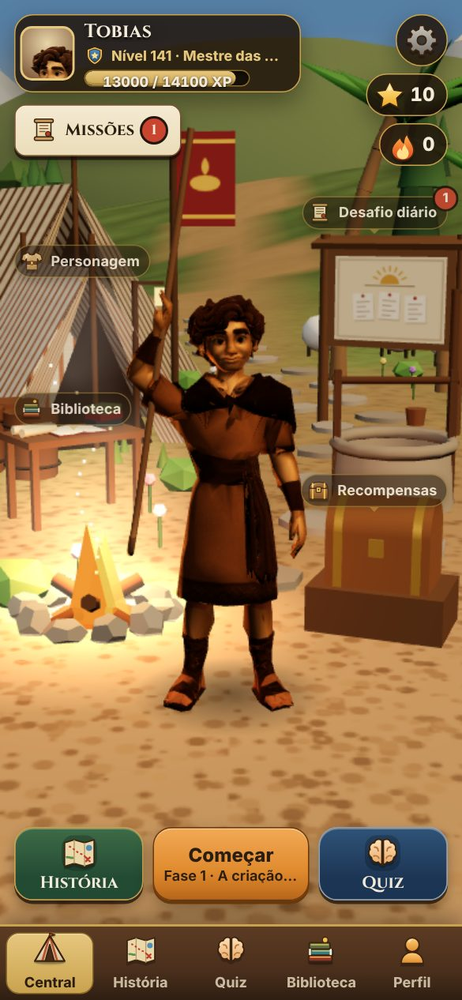

## 2. Tablet — 13 elementos

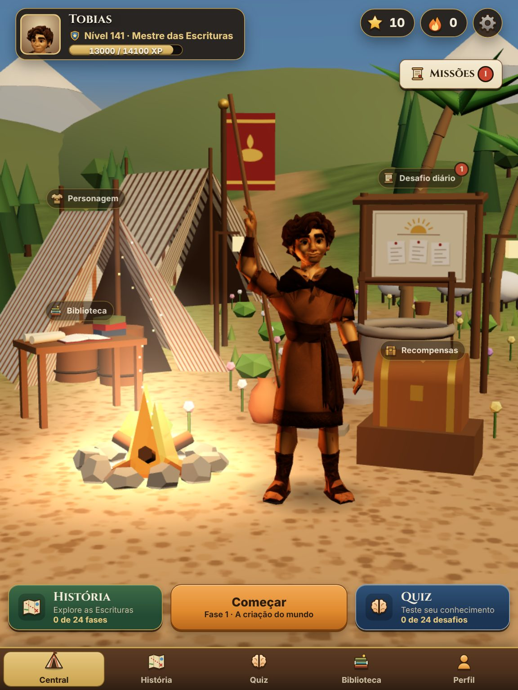

## 3. Computador — 13 elementos

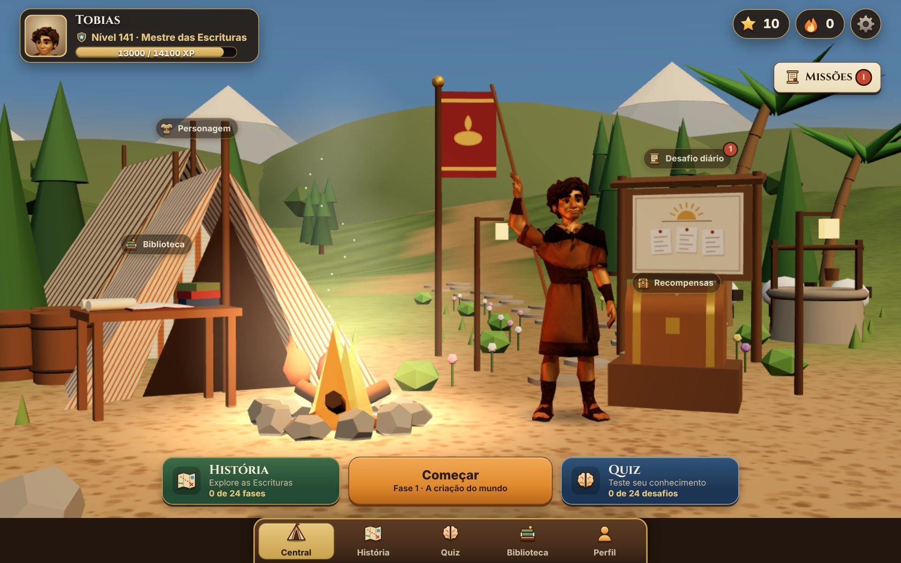

## 4. Notebook — 13 elementos

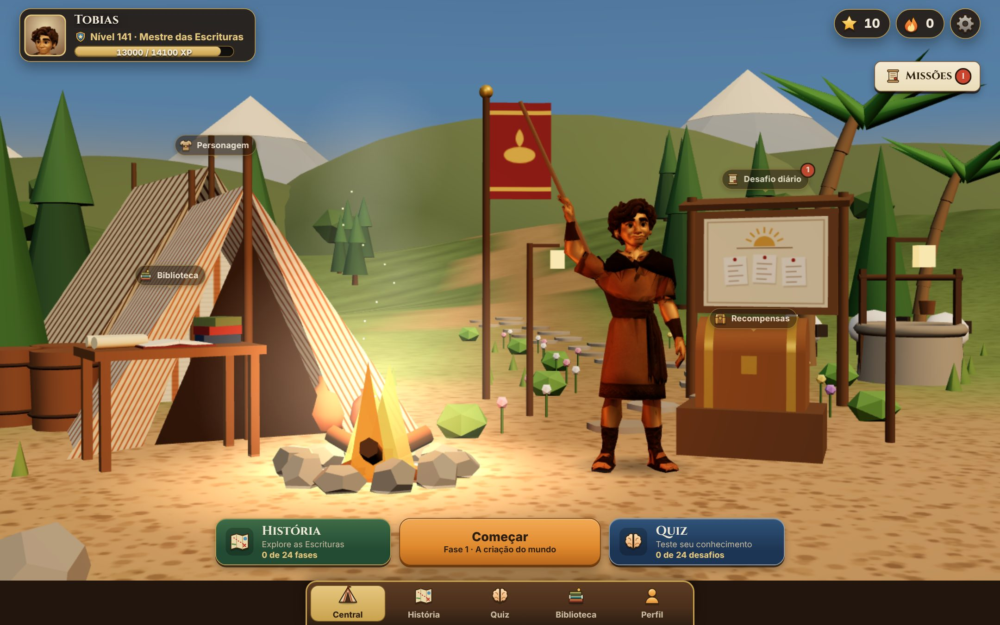

## 5. Celular — jogador novo

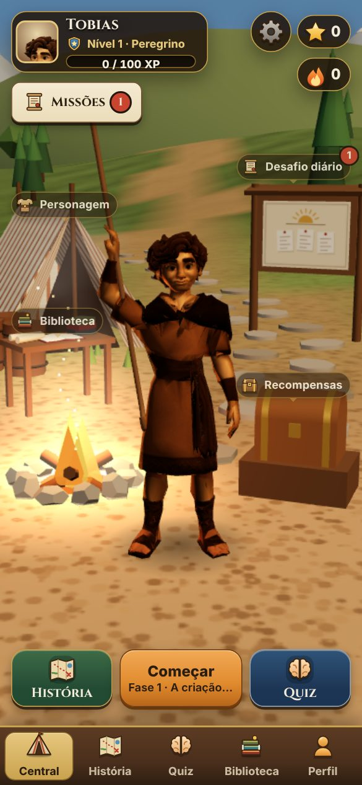

## 6. Computador — jogador novo

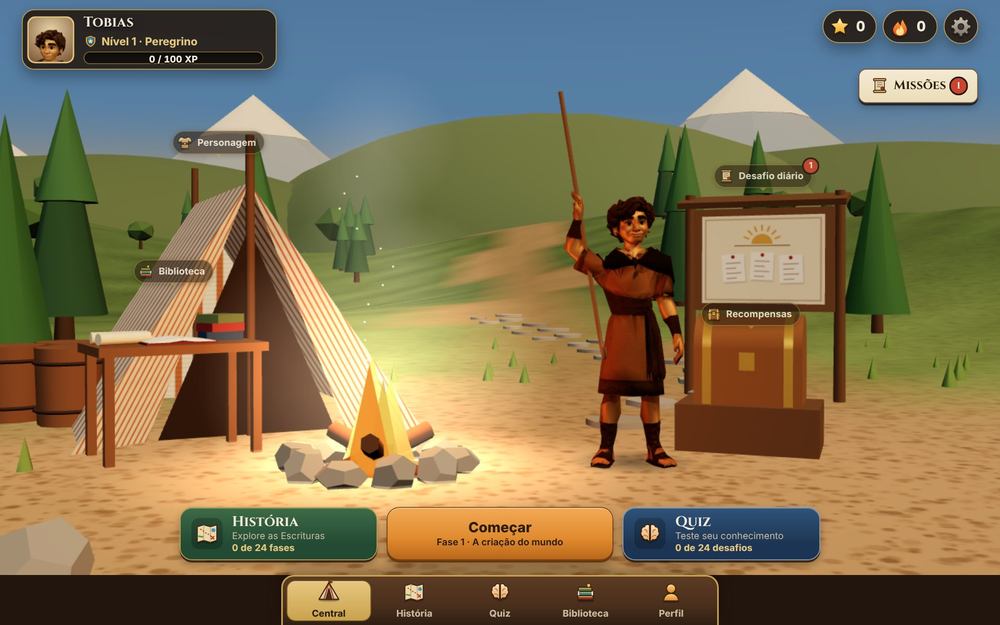

## 7. Celular — painel de missões aberto

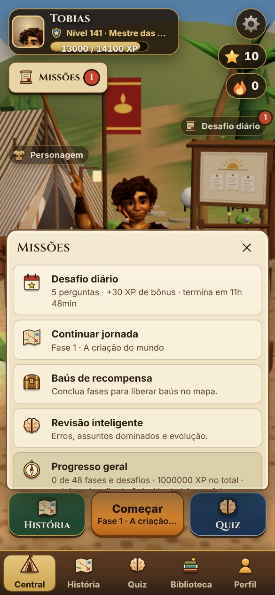

## 8. Computador — painel de missões aberto

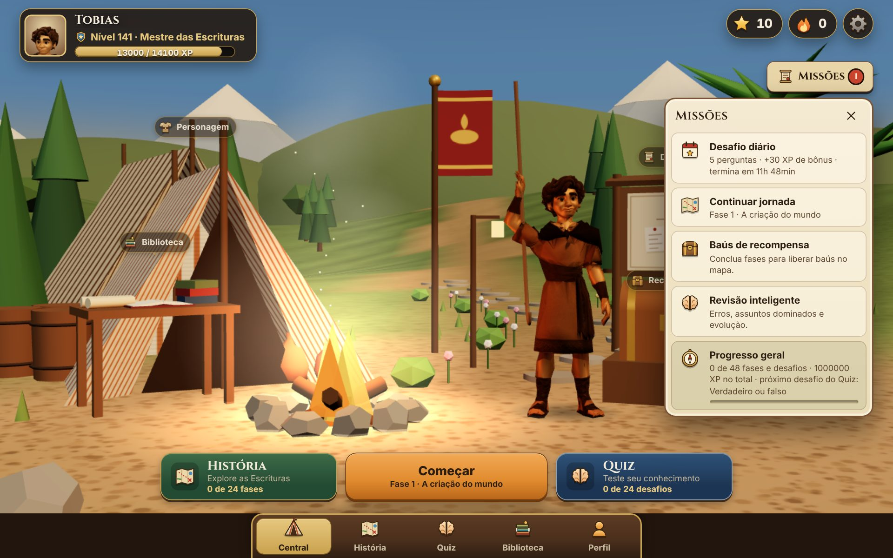

## 9. Celular — cena 2D

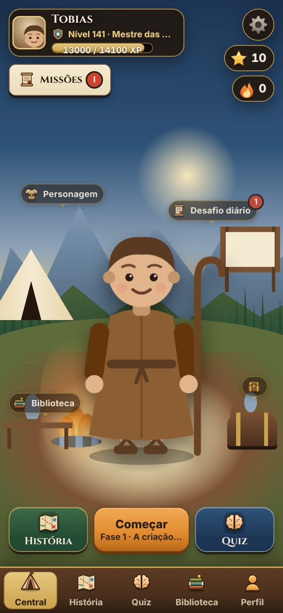

## 10. Computador — cena 2D

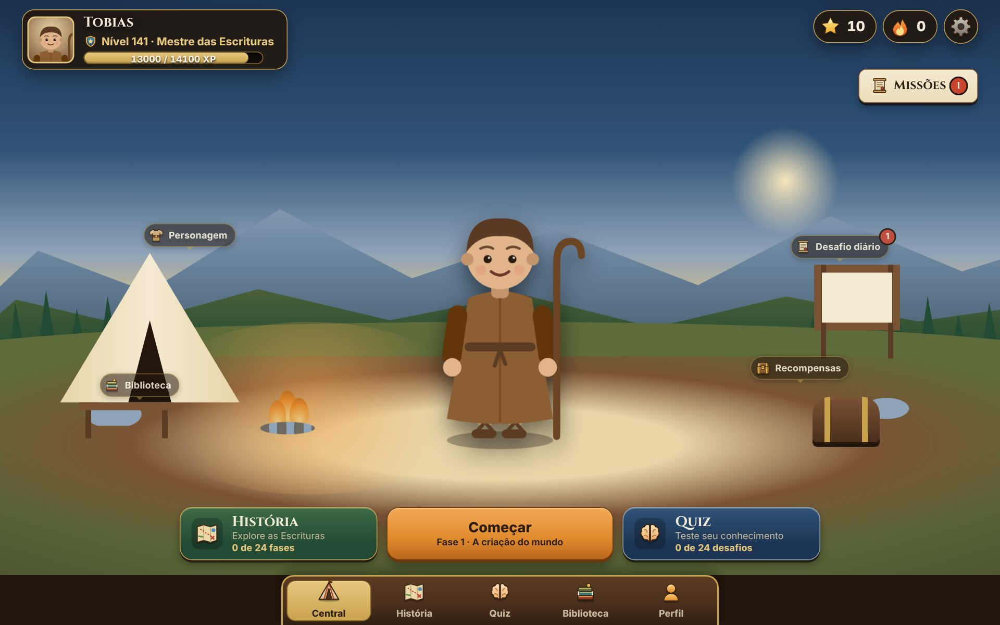

## 11. Detalhe do quadro

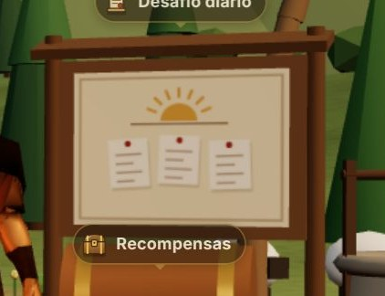

## Antes (0.17.2), para comparação

Capturas da versão 0.17.2, feitas no mesmo ambiente e com o mesmo perfil de 13 elementos. São as imagens "antes" do relatório 0.17.3.

| Dispositivo | Situação | Arquivo |
| --- | --- | --- |
| Celular | 13 elementos, 3D | `antes-0.17.2/celular-13-elementos.jpg` |
| Tablet | 13 elementos, 3D | `antes-0.17.2/tablet-13-elementos.jpg` |
| Computador | 13 elementos, 3D | `antes-0.17.2/computador-13-elementos.jpg` |
| Celular | 13 elementos, 2D | `antes-0.17.2/celular-2d.jpg` |
| Computador | Detalhe do quadro (com a palavra "Missões" e a lanterna na frente) | `antes-0.17.2/detalhe-quadro.jpg` |

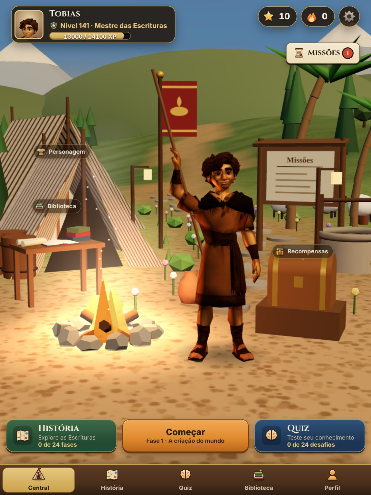

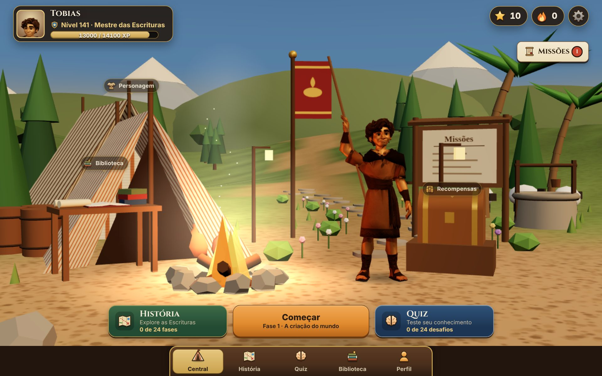

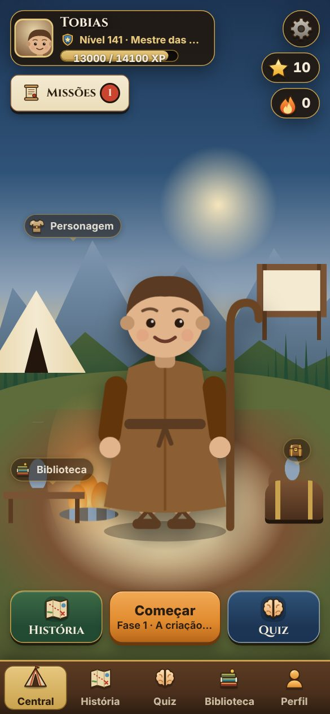

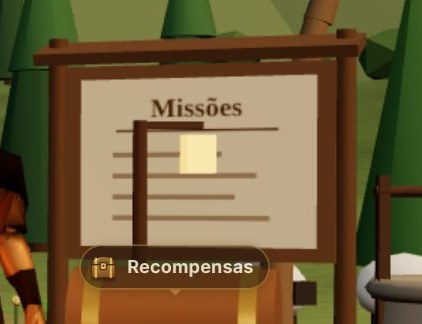
