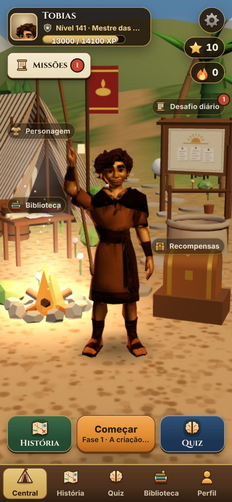
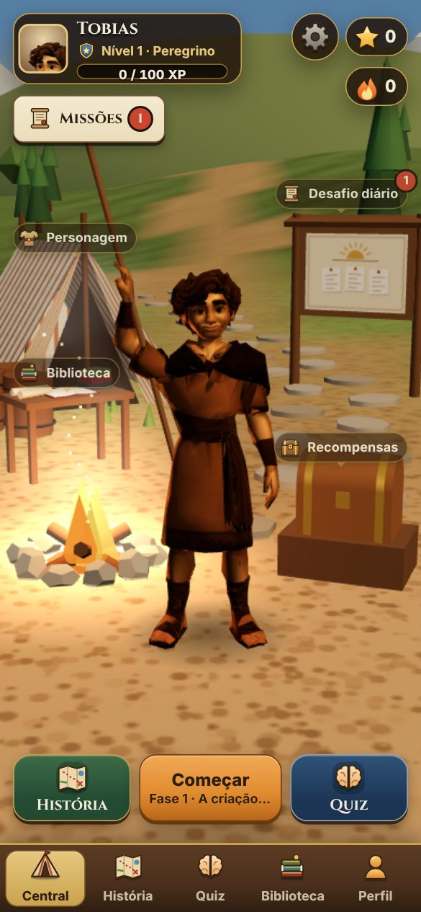
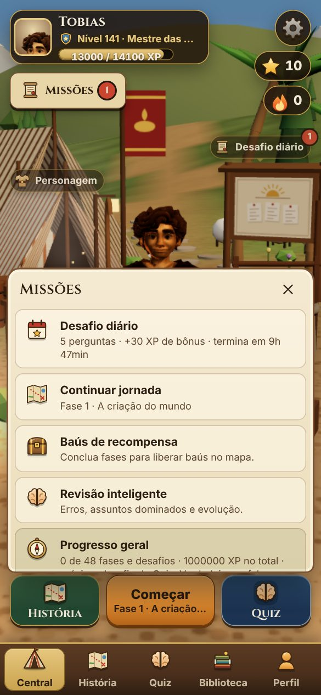
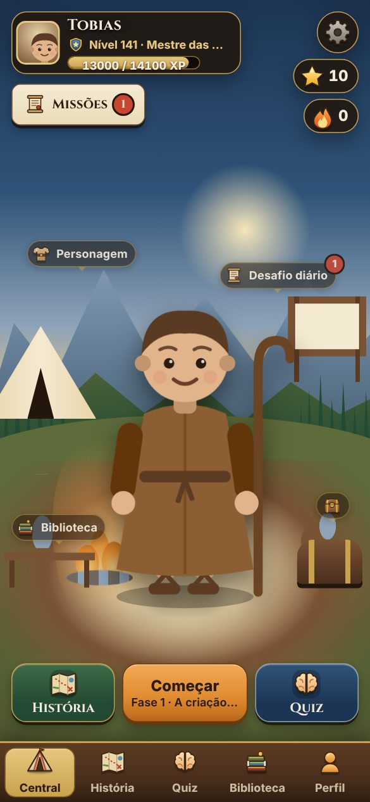
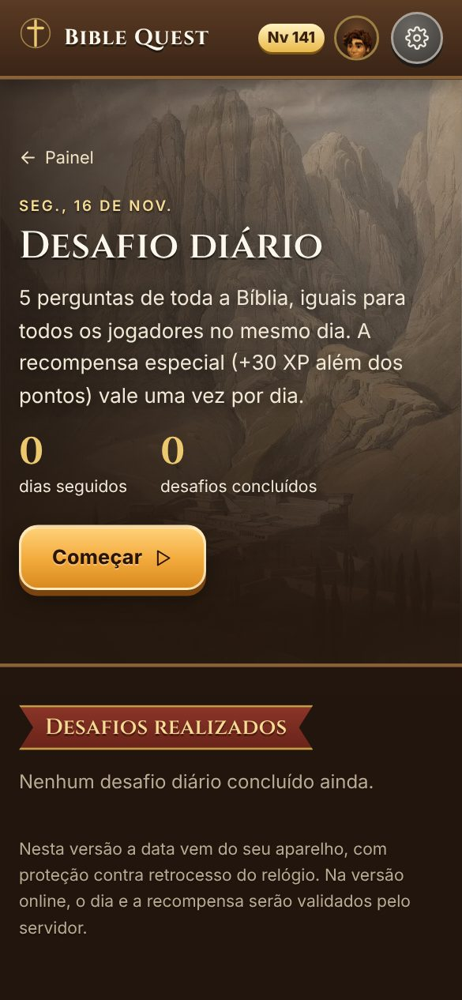
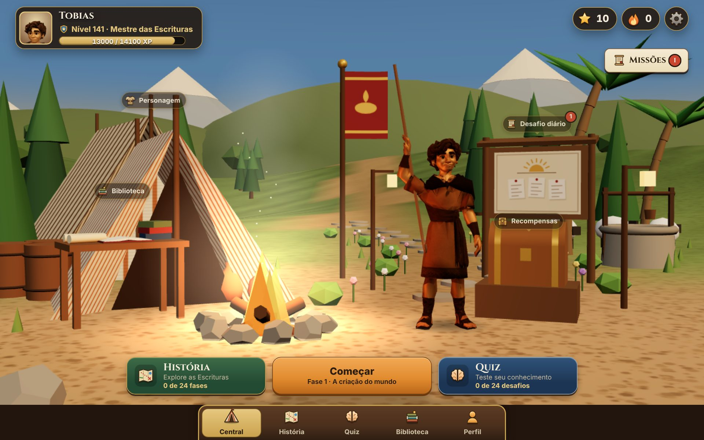
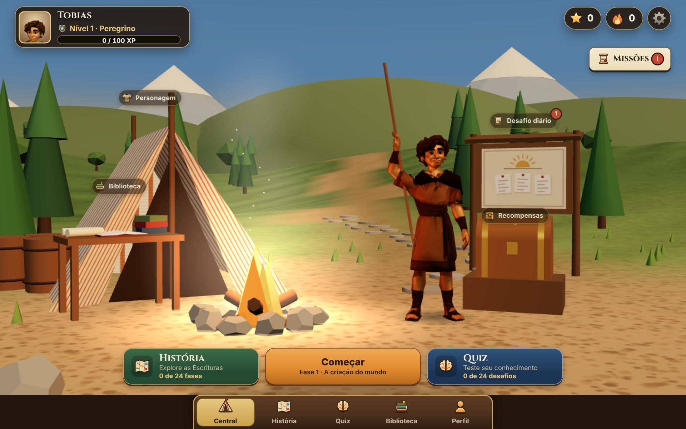
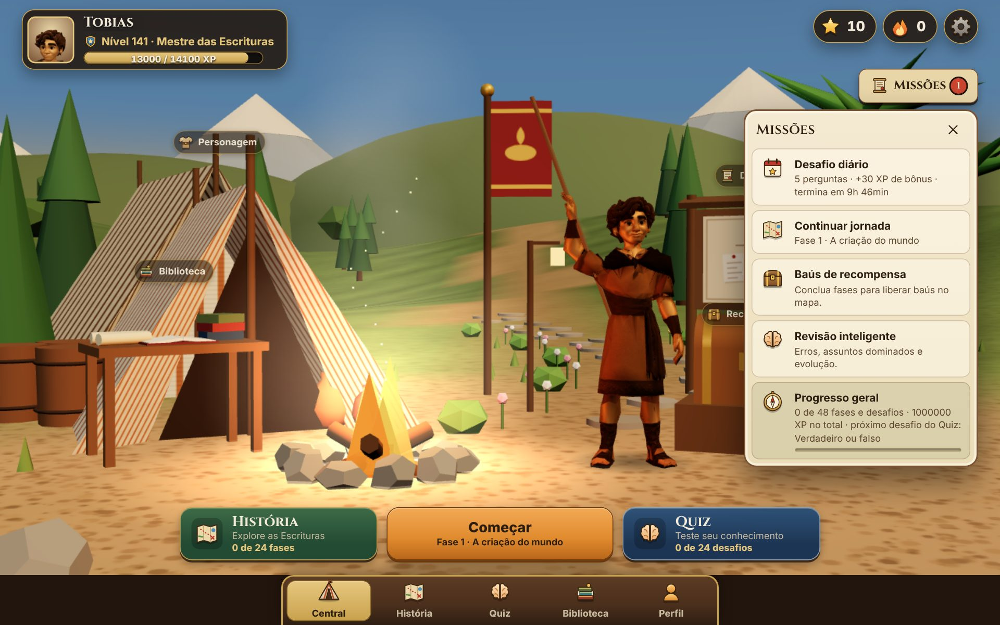
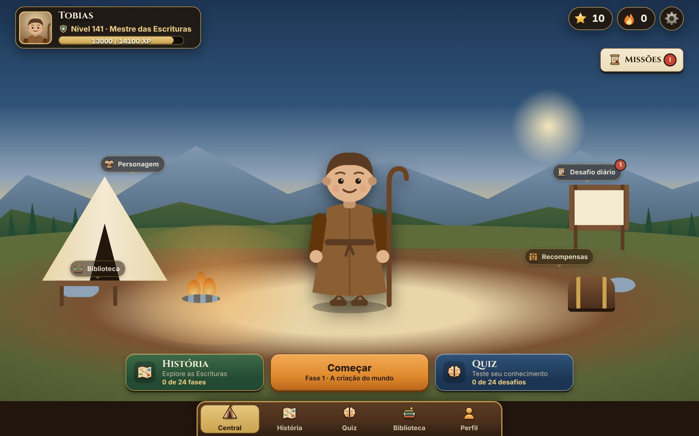

# Bible Quest — publicação oficial da Central 0.17.3

Registro da integração da versão 0.17.3 ao `main` e da verificação do site publicado, em 16/11/2026.

## Integração

- **Branch de origem:** `claude/loving-carson-8mrbjo`. **Destino:** `main`.
- **Forma:** avanço direto (fast-forward) de `3a87c93` para `a983e98`. Não houve commit de merge nem conflito, e o histórico foi preservado. O `main` não tinha nenhum commit que faltasse na branch de desenvolvimento.
- **Commits integrados:**

  | Commit | Descrição |
  | --- | --- |
  | `f8b833f` | Revisão visual da Central (0.17.1) |
  | `fb83f72` | Refinamento final da Central (0.17.2) |
  | `7b20464` | Ajustes finais da Central (0.17.3) |
  | `a983e98` | Evidências visuais da Central 0.17.3 (só documentação) |

- **Conferência antes de integrar:**
  - Todos os arquivos alterados são da Central ou da documentação da Etapa 2.
  - Não mudaram `package.json`, `package-lock.json`, o fluxo de publicação (`.github/`), os dados (`src/data/`) nem os serviços de jogo (`src/services/`).
- **Versão oficial:** 0.17.3. Não foi criada uma 0.17.4. Depois da publicação, o número do pacote (`package.json`) passou de 0.17.0 para 0.17.3, para acompanhar a versão oficial; isso não muda o jogo.

## Verificações

| Verificação | Resultado |
| --- | --- |
| `npm ci` + `npm run typecheck` | Sem erros |
| `npm test` | 151 de 151 testes passando, em 12 arquivos |
| `npm run build` | Concluído; pacote principal `assets/index-B16ZFxcQ.js` |
| CI da branch (runs 65 a 68) | Sucesso nos 4 commits |
| Publicação no `main` (run 69) | Sucesso: tipos, testes, build e publicação no GitHub Pages |
| Site publicado | Serve `assets/index-B16ZFxcQ.js`, o mesmo arquivo do build local da 0.17.3 |

## Verificação no site publicado

Site: <https://theuzxl13-oss.github.io/Bible-Quest/>

A verificação foi automática, no Chromium com vídeo por software, no celular (390 × 844) e no computador (1280 × 800). Foram usados três perfis: 13 elementos, jogador novo e alternativa 2D.

| Item | Celular | Computador |
| --- | --- | --- |
| Central em 3D | Sim | Sim |
| 13 elementos (perfil completo; sem "Próximo no acampamento" no painel) | Sim | Sim |
| Jogador novo (5 elementos iniciais; painel mostra "Próximo no acampamento: Jarros de barro") | Sim | Sim |
| Painel de missões abre, com Desafio diário, Continuar jornada, Baús, Revisão e Progresso geral | Sim | Sim |
| Desafio diário pelo rótulo da cena abre `#/diario` | Sim | Sim |
| Desafio diário pelo painel de missões abre `#/diario` | Sim | Sim |
| Navegação inferior: Central, História, Quiz, Biblioteca e Perfil | Sim | Sim |
| Alternativa 2D, com os 4 rótulos | Sim | Sim |
| Erros no console, erros de página ou respostas HTTP 400+ | Nenhum | Nenhum |
| Rolagem horizontal | Nenhuma | Nenhuma |

As 6 combinações de tela e perfil foram verificadas, e os itens passaram em todas.

Sobre a contagem dos elementos: a cena registra 13 objetos posicionados no perfil completo, que são 12 elementos mais os barris (decoração fixa). O 13º elemento, o jardim, são as flores ao longo do caminho, que não têm posição própria. No jogador novo, são 6 objetos: os 5 iniciais e os barris.

## Capturas do site publicado

| Arquivo | Dispositivo | Situação |
| --- | --- | --- |
| `publicacao/cel-13.jpg` | Celular | 13 elementos, 3D |
| `publicacao/cel-novo.jpg` | Celular | Jogador novo, 3D |
| `publicacao/cel-13-missoes.jpg` | Celular | Painel de missões aberto |
| `publicacao/cel-2d.jpg` | Celular | Alternativa 2D |
| `publicacao/cel-diario.jpg` | Celular | Página do Desafio diário, aberta pelo rótulo da cena |
| `publicacao/pc-13.jpg` | Computador | 13 elementos, 3D |
| `publicacao/pc-novo.jpg` | Computador | Jogador novo, 3D |
| `publicacao/pc-13-missoes.jpg` | Computador | Painel de missões aberto |
| `publicacao/pc-2d.jpg` | Computador | Alternativa 2D |

## Limites

- A verificação foi no Chromium, com vídeo por software.
- Não houve teste em celular ou tablet reais nem no Safari.
- O tablet e o notebook não foram verificados de novo no site publicado. Como o pacote publicado é idêntico ao das capturas da galeria, eles valem pelos itens 2 e 4 da [galeria](GALERIA_EVIDENCIAS.md).
