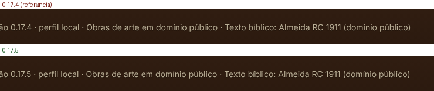
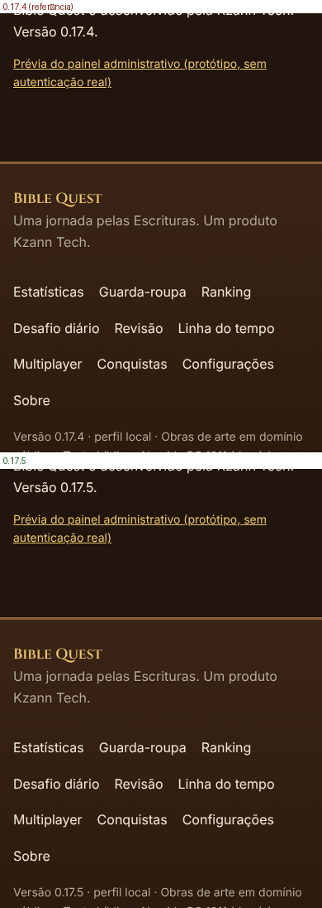

# Bible Quest 0.17.5 — comparação visual dos passos 1.1 a 1.3 da Fase 1

Objetivo: confirmar que os tokens novos, a ponte de compatibilidade e os componentes base **não mudam nada na tela**.

## Como foi feito

- **Telas:** 44 telas e estados, no celular (390 × 844) e no computador (1280 × 800). São 88 capturas de página inteira, superconjunto das 84 do diagnóstico (as 4 a mais são a introdução do mundo, o mapa já aberto, a janela da fase e o resultado sem a janela de item).
- **Condições iguais em todas as rodadas:** data e hora fixas (16/11/2026 12:00), números aleatórios com semente fixa, animações reduzidas e o mesmo perfil de teste.
- **Rodadas:**
  - **A** — referência, antes das mudanças (0.17.4);
  - **B** — referência repetida, para medir a variação natural;
  - **C** — com as mudanças e a versão ainda 0.17.4 (só o código novo);
  - **E** — final, com a versão 0.17.5.
- **Comparação:** pixel a pixel, com `PIL.ImageChops`. Qualquer pixel diferente conta.

## Resultado

| Resultado (A × E) | Capturas |
| --- | --- |
| Idênticas | 43 |
| Só a linha da versão no rodapé (0.17.4 → 0.17.5), uma faixa de 16 px | 38 |
| Página Sobre: a versão no rodapé e no texto "Versão 0.17.5." | 2 |
| Variação natural (também aparece entre duas referências A × B, ou some ao repetir) | 5 |
| **Mudança inesperada** | **0** |

Com o código novo e a versão ainda 0.17.4 (A × C), 84 capturas saíram idênticas. As 4 restantes eram variações naturais:

- **Mapa (celular):** o personagem andando no mapa, que já variava entre A e B.
- **Carregamento da Central (celular e computador):** depende do momento exato da captura.
- **Desafio diário (celular):** o retrato da barra ainda estava carregando; repetindo a captura 3 vezes, saiu idêntica nas 3.

## Central

Comparada com a referência da 0.17.3 (capturas com animações reduzidas): **idêntica pixel a pixel** em 3D e 2D, no celular e no computador, tanto com o código novo quanto na versão final. Capturas: `central-*-0.17.5.jpg`.

## Variáveis antigas

No navegador, as 39 variáveis antigas de `global.css` têm exatamente os valores de antes:

- **Modo normal:** todos os valores iguais.
- **Alto contraste:** as 10 trocas antigas continuam valendo.
- **Animação reduzida:** `--speed` continua 0ms.

## Erros

Nas rodadas C e E: 0 erros de JavaScript, 0 falhas de carregamento e 0 casos de rolagem horizontal.

## Tabela completa (A = 0.17.4, B = A repetida, C = código novo com versão 0.17.4, E = 0.17.5)

| Captura | A × B | A × C | A × E |
| --- | --- | --- | --- |
| `cel-00-boas-vindas` | idêntica | idêntica | idêntica |
| `cel-01-entrar` | idêntica | idêntica | idêntica |
| `cel-02-personagem-base` | idêntica | idêntica | idêntica |
| `cel-03-guarda-roupa` | idêntica | idêntica | só a linha da versão (0.17.4 → 0.17.5) |
| `cel-04-chegada` | idêntica | idêntica | idêntica |
| `cel-09-historia-introducao-mundo` | idêntica | idêntica | idêntica |
| `cel-10-historia-mapa` | varia | variação natural | variação natural: personagem andando no mapa (varia entre rodadas) |
| `cel-10b-historia-mapa-aberto` | idêntica | idêntica | idêntica |
| `cel-11-historia-janela-fase` | idêntica | idêntica | idêntica |
| `cel-11b-historia-janela-fase` | idêntica | idêntica | idêntica |
| `cel-12-historia-livros` | idêntica | idêntica | só a linha da versão (0.17.4 → 0.17.5) |
| `cel-13-historia-livro` | idêntica | idêntica | só a linha da versão (0.17.4 → 0.17.5) |
| `cel-14-historia-livro-exodo` | idêntica | idêntica | só a linha da versão (0.17.4 → 0.17.5) |
| `cel-15-fase-apresentacao` | idêntica | idêntica | só a linha da versão (0.17.4 → 0.17.5) |
| `cel-16-fase-cena` | idêntica | idêntica | idêntica |
| `cel-17-fase-cena-meio` | idêntica | idêntica | idêntica |
| `cel-18-desafio-pergunta` | idêntica | idêntica | idêntica |
| `cel-19-desafio-feedback-acerto` | idêntica | idêntica | idêntica |
| `cel-20-desafio-feedback-erro` | idêntica | idêntica | idêntica |
| `cel-21-resultado` | idêntica | idêntica | idêntica |
| `cel-22-resultado-sem-janela` | idêntica | idêntica | idêntica |
| `cel-30-quiz-mapa` | idêntica | idêntica | idêntica |
| `cel-31-quiz-janela-desafio` | idêntica | idêntica | idêntica |
| `cel-32-quiz-desafio-inicio` | idêntica | idêntica | idêntica |
| `cel-33-quiz-treino` | idêntica | idêntica | só a linha da versão (0.17.4 → 0.17.5) |
| `cel-34-quiz-treino-modalidade` | idêntica | idêntica | variação natural: retrato da barra ainda carregando (tempo) |
| `cel-35-quiz-treino-pergunta` | idêntica | idêntica | idêntica |
| `cel-36-quiz-pergunta-relacione-ou-ordem` | idêntica | idêntica | idêntica |
| `cel-37-quiz-multiplayer` | idêntica | idêntica | só a linha da versão (0.17.4 → 0.17.5) |
| `cel-38-desafio-diario` | idêntica | variação natural | variação natural: retrato da barra ainda carregando (tempo) |
| `cel-39-revisao` | idêntica | idêntica | só a linha da versão (0.17.4 → 0.17.5) |
| `cel-40-biblioteca` | idêntica | idêntica | só a linha da versão (0.17.4 → 0.17.5) |
| `cel-41-biblioteca-personagem` | idêntica | idêntica | só a linha da versão (0.17.4 → 0.17.5) |
| `cel-42-biblioteca-livro` | idêntica | idêntica | só a linha da versão (0.17.4 → 0.17.5) |
| `cel-43-biblioteca-lugar` | idêntica | idêntica | só a linha da versão (0.17.4 → 0.17.5) |
| `cel-44-linha-do-tempo` | idêntica | idêntica | só a linha da versão (0.17.4 → 0.17.5) |
| `cel-50-perfil` | idêntica | idêntica | só a linha da versão (0.17.4 → 0.17.5) |
| `cel-51-estatisticas` | idêntica | idêntica | só a linha da versão (0.17.4 → 0.17.5) |
| `cel-52-configuracoes` | idêntica | idêntica | só a linha da versão (0.17.4 → 0.17.5) |
| `cel-53-ranking` | idêntica | idêntica | só a linha da versão (0.17.4 → 0.17.5) |
| `cel-60-conquistas` | idêntica | idêntica | só a linha da versão (0.17.4 → 0.17.5) |
| `cel-70-sobre` | idêntica | idêntica | só a versão no rodapé e no texto do Sobre |
| `cel-71-nao-encontrada` | idêntica | idêntica | só a linha da versão (0.17.4 → 0.17.5) |
| `cel-72-carregamento-central` | varia | variação natural | variação natural: tela de carregamento (momento da captura) |
| `pc-00-boas-vindas` | idêntica | idêntica | idêntica |
| `pc-01-entrar` | idêntica | idêntica | idêntica |
| `pc-02-personagem-base` | idêntica | idêntica | idêntica |
| `pc-03-guarda-roupa` | idêntica | idêntica | só a linha da versão (0.17.4 → 0.17.5) |
| `pc-04-chegada` | idêntica | idêntica | idêntica |
| `pc-09-historia-introducao-mundo` | idêntica | idêntica | idêntica |
| `pc-10-historia-mapa` | idêntica | idêntica | idêntica |
| `pc-10b-historia-mapa-aberto` | idêntica | idêntica | idêntica |
| `pc-11-historia-janela-fase` | idêntica | idêntica | idêntica |
| `pc-11b-historia-janela-fase` | idêntica | idêntica | idêntica |
| `pc-12-historia-livros` | idêntica | idêntica | só a linha da versão (0.17.4 → 0.17.5) |
| `pc-13-historia-livro` | idêntica | idêntica | só a linha da versão (0.17.4 → 0.17.5) |
| `pc-14-historia-livro-exodo` | idêntica | idêntica | só a linha da versão (0.17.4 → 0.17.5) |
| `pc-15-fase-apresentacao` | idêntica | idêntica | só a linha da versão (0.17.4 → 0.17.5) |
| `pc-16-fase-cena` | idêntica | idêntica | idêntica |
| `pc-17-fase-cena-meio` | idêntica | idêntica | idêntica |
| `pc-18-desafio-pergunta` | idêntica | idêntica | idêntica |
| `pc-19-desafio-feedback-acerto` | idêntica | idêntica | idêntica |
| `pc-20-desafio-feedback-erro` | idêntica | idêntica | idêntica |
| `pc-21-resultado` | idêntica | idêntica | idêntica |
| `pc-22-resultado-sem-janela` | idêntica | idêntica | idêntica |
| `pc-30-quiz-mapa` | idêntica | idêntica | idêntica |
| `pc-31-quiz-janela-desafio` | idêntica | idêntica | idêntica |
| `pc-32-quiz-desafio-inicio` | idêntica | idêntica | idêntica |
| `pc-33-quiz-treino` | idêntica | idêntica | só a linha da versão (0.17.4 → 0.17.5) |
| `pc-34-quiz-treino-modalidade` | idêntica | idêntica | idêntica |
| `pc-35-quiz-treino-pergunta` | idêntica | idêntica | idêntica |
| `pc-36-quiz-pergunta-relacione-ou-ordem` | idêntica | idêntica | idêntica |
| `pc-37-quiz-multiplayer` | idêntica | idêntica | só a linha da versão (0.17.4 → 0.17.5) |
| `pc-38-desafio-diario` | idêntica | idêntica | idêntica |
| `pc-39-revisao` | idêntica | idêntica | só a linha da versão (0.17.4 → 0.17.5) |
| `pc-40-biblioteca` | idêntica | idêntica | só a linha da versão (0.17.4 → 0.17.5) |
| `pc-41-biblioteca-personagem` | idêntica | idêntica | só a linha da versão (0.17.4 → 0.17.5) |
| `pc-42-biblioteca-livro` | idêntica | idêntica | só a linha da versão (0.17.4 → 0.17.5) |
| `pc-43-biblioteca-lugar` | idêntica | idêntica | só a linha da versão (0.17.4 → 0.17.5) |
| `pc-44-linha-do-tempo` | idêntica | idêntica | só a linha da versão (0.17.4 → 0.17.5) |
| `pc-50-perfil` | idêntica | idêntica | só a linha da versão (0.17.4 → 0.17.5) |
| `pc-51-estatisticas` | idêntica | idêntica | só a linha da versão (0.17.4 → 0.17.5) |
| `pc-52-configuracoes` | idêntica | idêntica | só a linha da versão (0.17.4 → 0.17.5) |
| `pc-53-ranking` | idêntica | idêntica | só a linha da versão (0.17.4 → 0.17.5) |
| `pc-60-conquistas` | idêntica | idêntica | só a linha da versão (0.17.4 → 0.17.5) |
| `pc-70-sobre` | idêntica | idêntica | só a versão no rodapé e no texto do Sobre |
| `pc-71-nao-encontrada` | idêntica | idêntica | só a linha da versão (0.17.4 → 0.17.5) |
| `pc-72-carregamento-central` | varia | variação natural | variação natural: tela de carregamento (momento da captura) |