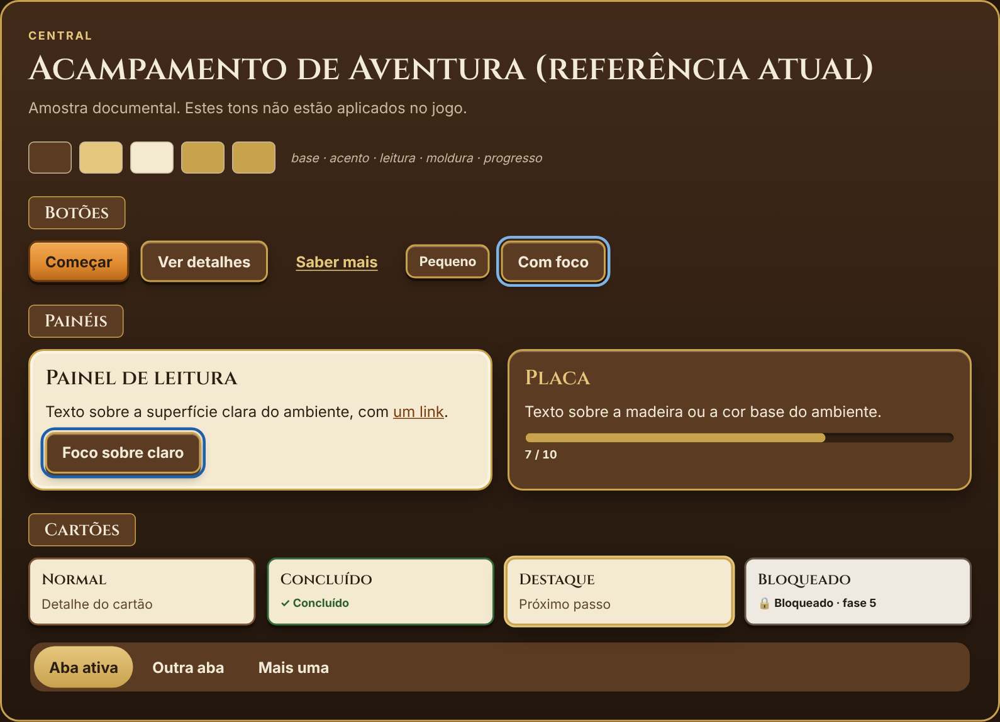
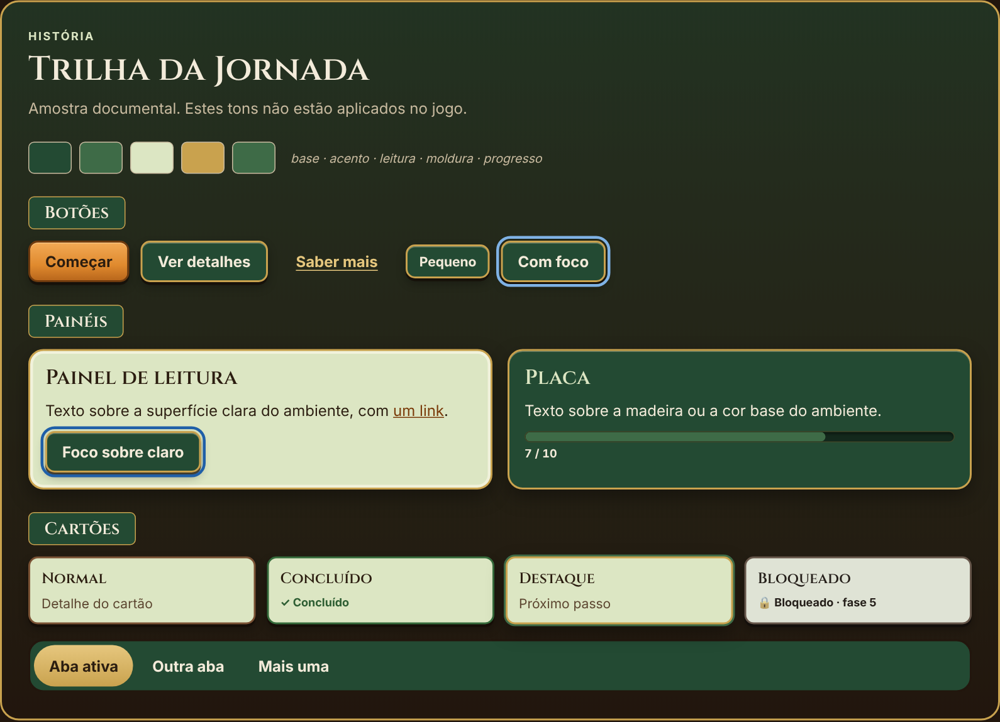
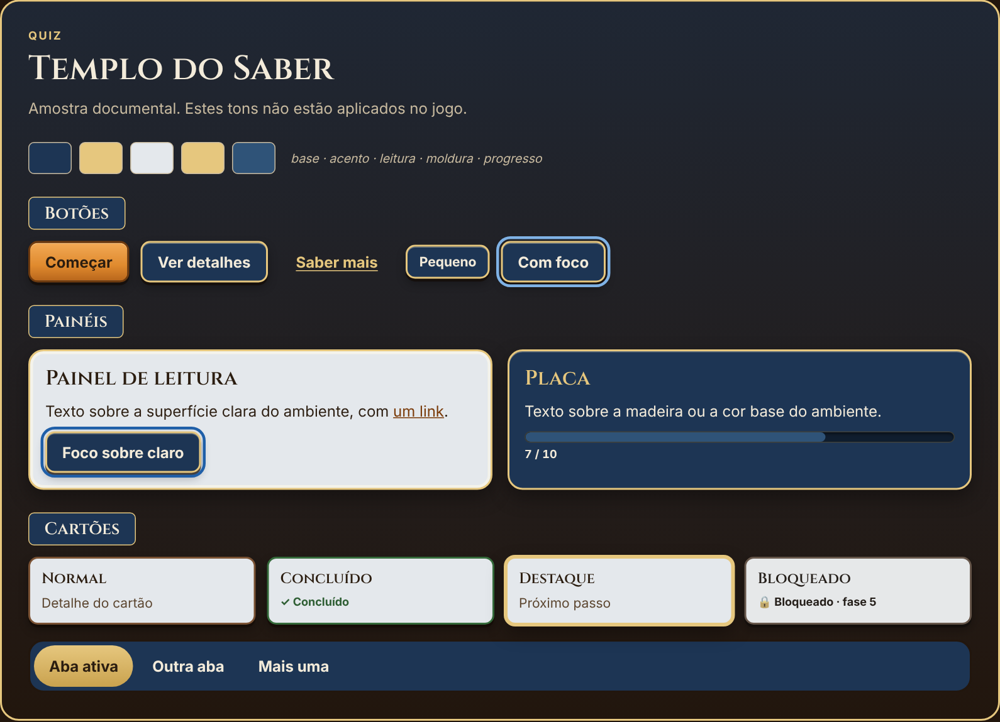
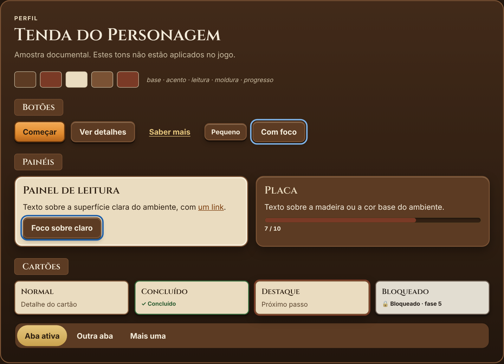
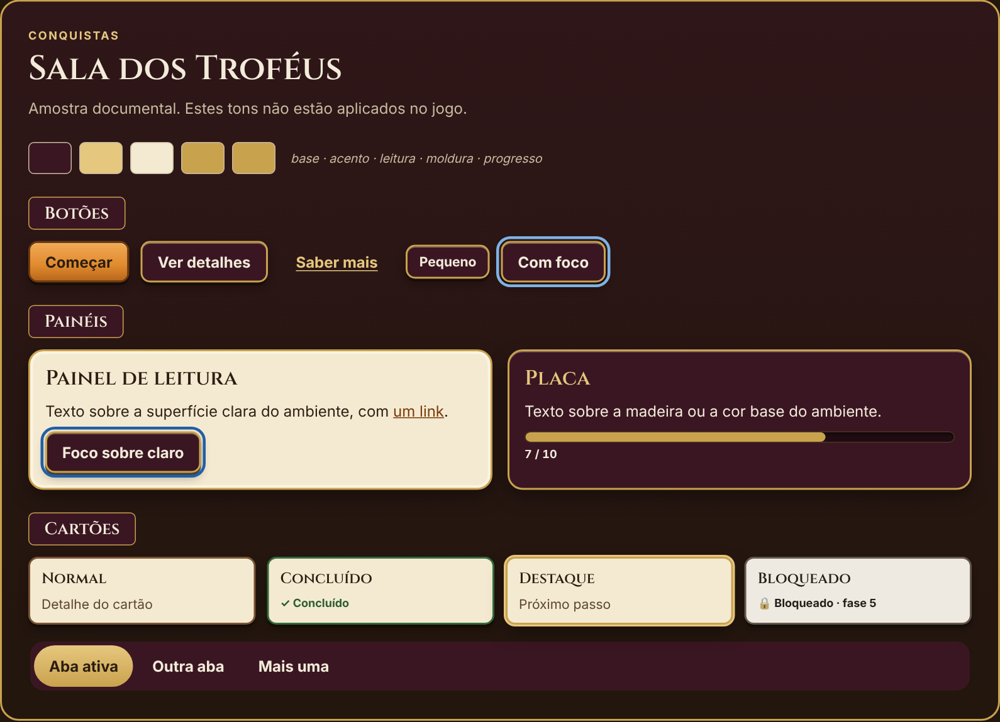

# Bible Quest — folha de amostras dos ambientes (documental)

**Só documentação.** Estes tons **não estão aplicados no jogo**. São a proposta para aprovação, conforme a decisão oficial: os novos tons dos ambientes dependem desta folha e da sua aprovação.

As amostras usam os componentes base reais da 0.17.5 (`styles/componentes/base-*.css`) e os tokens de ambiente (`[data-ambiente]` em `tokens.css`). A página que gera as imagens é `folha.html`; para abrir localmente, ela usa os estilos de `src/styles/`.

## Ambientes

| Ambiente | Ideia | Base | Acento (texto) | Leitura | Moldura |
| --- | --- | --- | --- | --- | --- |
| Central (atual) | Acampamento de Aventura | terra-600 `#5C3B23` | ouro-300 `#E6C77E` | pergaminho `#F4EAD2` | ouro-500 `#C9A24E` |
| História | Trilha da Jornada | floresta-700 `#234A33` | campo-200 `#DCE6C3` | campo-200 `#DCE6C3` | ouro-500 |
| Quiz | Templo do Saber | azul-700 `#1D3554` | ouro-300 | pedra-100 `#E4E8EC` | ouro-300 |
| Biblioteca | Sala de Estudos | couro-700 `#4B2A22` | lamparina-300 `#F0C76E` | papel `#F7F0DE` | terra-500 `#7A5234` |
| Perfil | Tenda do Personagem | terra-600 | lona `#EADCC0` (acento visual: tecido-600 `#7A3A26`) | lona `#EADCC0` | terra-500 |
| Conquistas | Sala dos Troféus | veludo-800 `#3A1622` | ouro-300 | pergaminho | ouro-500 (medalhas: bronze `#C08A5B`, prata `#C9CED4`) |

## Contraste medido nas amostras

Medido no navegador, entre a cor de cada texto e o fundo onde ele está (valores em `contraste.json`). Mínimo: 4,5:1 para texto e 3:1 para foco.

| Ambiente | Botão secundário | Placa | Título da placa | Painel de leitura | Link na leitura | Cartão | Aba | Sobretítulo | Foco sobre claro |
| --- | --- | --- | --- | --- | --- | --- | --- | --- | --- |
| Central | 8,41 | 8,41 | 6,10 | 13,64 | 7,14 | 13,64 | 8,41 | 10,80 | 5,38 |
| História | 8,44 | 8,44 | 7,69 | 12,56 | 6,57 | 12,56 | 8,44 | 13,59 | 4,95 |
| Quiz | 10,48 | 10,48 | 7,60 | 13,26 | 6,94 | 13,26 | 10,48 | 10,80 | 5,23 |
| Biblioteca | 10,71 | 10,71 | 7,92 | 14,37 | 7,52 | 14,37 | 10,71 | 11,02 | 5,67 |
| Perfil | 8,41 | 8,41 | 7,36 | 12,05 | 6,31 | 12,05 | 8,41 | 13,04 | 4,75 |
| Conquistas | 13,44 | 13,44 | 9,74 | 13,64 | 7,14 | 13,64 | 13,44 | 10,80 | 5,38 |

A aba ativa (tinta sobre o gradiente de ouro) fica com 6,8:1 a 10,0:1 em todos os ambientes.

## O que a folha revelou

- **Acento usado como texto:** na primeira versão, o título da placa e o sobretítulo usavam a cor de acento do ambiente. Em História (verde sobre verde) e no Perfil (vermelho sobre escuro), o texto ficava ilegível.
- **Correção:** foi criado o token `--amb-acento-texto`, com uma cor legível por ambiente (campo-200 na História, lona no Perfil, ouro e âmbar nos demais). A cor de acento continua para elementos visuais, como bordas e destaques.
- **Resultado:** depois da correção, todos os pares atendem os mínimos. Como nenhuma tela usa os ambientes ainda, o jogo não foi afetado.

## Para decidir

1. Aprovar, ajustar ou recusar os tons de cada ambiente.
2. Só depois da aprovação, a marcação `data-ambiente` entra nas telas (passo 1.5) e os tons passam a valer, ambiente por ambiente, com capturas antes e depois.
